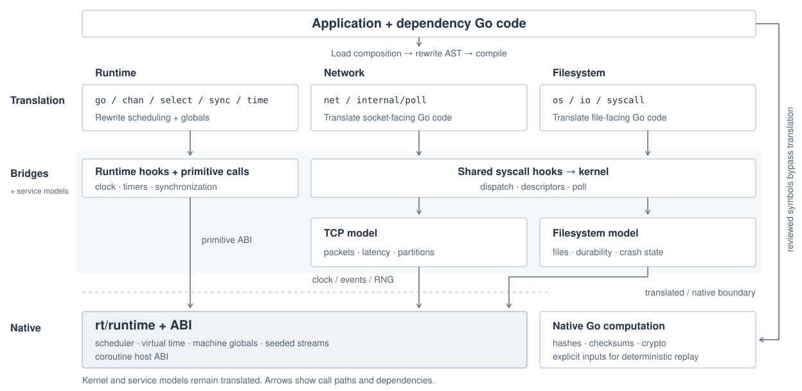

# Gosim: simulation testing for Go

Gosim is a simulation testing framework that aims to make it easier to write reliable distributed systems code in go. Gosim takes standard go programs and tests and runs them with a simulated network, filesystem, multiple machines, and more.

In Gosim's simulated environment you can run an entire distributed system in a single go process, without having to set up any real servers. The simulation can also introduce all kinds of problems, such as flaky networks, restarting machines, or lost writes on a filesystem, to test that the program survive those problems before they happen in real life.

Features are fixed for the whole test binary before application initialization. Importing a control package does not enable its feature. Attempting a disabled operation aborts the simulation with a feature, operation, machine/epoch and caller diagnostic, even if application code ignores errors or recovers panics. There is no host filesystem or network fallback.





See [Features](docs/features.md) for supported, partially supported, and unsupported capabilities. PRs welcome.

## Go versions and configuration

Gosim supports stable **Go 1.25.* and Go 1.26.*** releases on Linux AMD64,
Linux ARM64 and Darwin ARM64. The caller uses ordinary Go tooling: `go.mod`,
`go.work`, and `GOTOOLCHAIN` determine the compiler. Application code does not
select a Go version, and a new patch within a supported family needs no Gosim
allowlist entry. Gosim checks the private runtime contracts it uses against the
selected compiler; an incompatible contract produces an actionable error.

Add Gosim to your module, then build the launcher in that module's context:

```sh
go get github.com/neria-cloud/gosim
go build -ldflags=-checklinkname=0 -tags=linkname -o .gosim/gosimtool github.com/neria-cloud/gosim/cmd/gosim
```

In this repository, `make build` builds `.gosim/gosimtool`, `.gosim/gosim-worker`,
and `.gosim/gosim-gen`. It uses Go's normal compiler selection; an optional
`GOSIM_TOOLCHAIN` override selects an exact compiler for the build. The launcher
selects the caller's Gosim dependency, including workspace and local
replacements, and automatically builds/caches a worker with the compiler Go
selected. Switching supported Go patches does not require rebuilding the
launcher. Help and version commands work without worker bootstrap.

Use `-C directory` before the command to select another working directory,
including its module, Go toolchain, and configuration. Relative package and
configuration paths are resolved there; your shell stays in its current directory:

```sh
./.gosim/gosimtool -C examples/network/nats test -features rt,fs,net -v .
```

An optional `gosim.json` selects features, without a compiler pin:

```json
{"schema":2,"features":["rt"],"simulation_os":"linux"}
```

Without a config file, all three features are enabled and simulation uses the
Linux source ABI. `-config PATH` or `GOSIM_CONFIG` selects another file;
`-features` replaces the feature list. `-go` is an optional explicit compiler
override. Legacy schema-1 files remain explicit overrides with a migration
warning; remove their `toolchain` field and set `schema` to `2` for automatic
selection. Unknown fields, unsupported families/platforms and `fs`/`net`
without `rt` are errors. Prerelease and development compilers are unsupported.

Certification is an optional manual operation. It is neither a CI step nor a
requirement for normal commands or library use. Missing or stale certification
never blocks a compatible build. Exact compiler/source identities still isolate
artifacts and deterministic replay; a family policy does not promise replay
across different patches.

## A deterministic test

```go
package demo_test

import (
    "math/rand"
    "testing"
    "time"

    "github.com/neria-cloud/gosim"
)

func TestClock(t *testing.T) {
    if !gosim.IsSim() {
        t.Skip("run with gosim test")
    }
    start := time.Now()
    time.Sleep(time.Second)
    t.Log(time.Since(start), rand.Int())
}
```

Run it with:

```sh
./.gosim/gosimtool test -features rt -v -seeds 1-3 -run TestClock .
```

Repeating a seed with the same complete build identity and replay revision reproduces the execution. Toolchain, architecture, source, feature, race or approved build-policy changes define another identity. Run IDs protect handles from stale runs and are excluded from deterministic seed/trace derivation. Scheduler, application, filesystem and network randomness use separate owned streams.

## Machines and optional controls

`NewMachine` returns an **unstarted** machine. Configure its optional services, then call `Start`. Returning from its main function gracefully stops that epoch and its other goroutines.

```go
package demo_test

import (
    "fmt"
    "net/netip"
    "testing"

    "github.com/neria-cloud/gosim"
    simfs "github.com/neria-cloud/gosim/fs"
    simnet "github.com/neria-cloud/gosim/net"
)

func TestMachine(t *testing.T) {
    m, err := gosim.NewMachine(gosim.MachineConfig{
        Label: "node-a",
        Main: func() { fmt.Println("node-a started") },
    })
    if err != nil { t.Fatal(err) }
    if err := simfs.ConfigureMachine(m, simfs.DefaultConfig()); err != nil { t.Fatal(err) }
    if err := simnet.ConfigureMachine(m, simnet.MachineConfig{
        Addr: netip.MustParseAddr("10.0.0.1"),
    }); err != nil { t.Fatal(err) }
    if err := m.Start(); err != nil { t.Fatal(err) }
    exit, err := m.Wait()
    if err != nil { t.Fatal(err) }
    if exit.Kind != gosim.Graceful { t.Fatalf("unexpected exit: %+v", exit) }
    if err := m.Destroy(); err != nil { t.Fatal(err) }
}
```

Run this example with `-features rt,fs,net`. `Stop` is graceful; `Crash` retains the provider's crash outcome. `Restart` accepts a previously started, stopped/crashed machine and initializes fresh globals. `SetMain` changes its next boot program. `Wait` observes the epoch active when called, even if the machine restarts later. Destroy invalidates the handle. Machine termination cancels its goroutines without running their pending defers. The controller/test root cannot be explicitly stopped or destroyed.

Returning self-targeted `Stop`, `Crash` and `Wait` calls report `ErrSelfTransition`; `gosim.ExitSelf()` and `gosim.CrashSelf()` are the non-returning alternatives. Native error-returning controls return `gosim.ErrNotSim`; native `IsSim`, `CurrentMachine` and `rt.Info` return false/zero values. Pure defaults and handle ID accessors remain usable.

## Filesystem recovery

The filesystem starts at `/app`. Configure it before startup with `fs.ConfigureMachine`. `fs.SetCrashMode` selects `DurableOnly` or `SamplePending`; `fs.SetSyncFault` configures bounded sync-failure probabilities.

After a crash, `fs.CrashStates(machine, fs.EnumerateOptions{MaxStates: n})` owns a synchronous iterator over immutable crash outcomes. A positive budget is required. `Next` returns a snapshot and availability flag; exceeding the budget while more outcomes exist returns `fs.ErrEnumerationLimit`. Close the iterator when finished, and close each returned snapshot separately. Closing the iterator does not invalidate snapshots already returned. `fs.Restore` accepts a retained snapshot from the same simulation for an unstarted or stopped/crashed target; configure its next main function and start/restart it explicitly. Destroying a machine does not invalidate separately owned snapshots.

Graceful stop flushes modeled writes. Crash behavior preserves the existing persistence model, including uncertainty in non-fsynced operations; it does not add missing POSIX locking or permission semantics.

## Network policy

Use `net.DefaultConfig` and `net.Configure` for global latency/loss defaults. `net.ConfigureMachine` assigns an IPv4 address before the first start; a zero address requests deterministic allocation. `net.Address` returns `ErrNotStarted` before allocation, and restart retains the assigned address.

`net.Config.ConnectionTimeout` sets the connection-opening timeout for new
attempts. It defaults to one second; zero also selects that default, and negative
values are invalid. Reconfiguration leaves pending attempts and established
connections unchanged. A shorter `net.DialTimeout` or dialer context deadline
still takes precedence. For high-latency links, configure a timeout longer than
the expected handshake round trip:

```go
config := simnet.DefaultConfig()
config.ConnectionTimeout = 10 * time.Second
if err := simnet.Configure(config); err != nil {
    t.Fatal(err)
}
```

A `net.Link` selects `From`, `To`, and `Forward` or `Both` directions. `SetLinkPolicy` copies each non-nil latency/loss group; nil leaves that override unchanged. `ResetLinkPolicy` restores global defaults. For fixed latency, set `LatencyConfig{Min: delay, Max: delay, Lambda: 1}`. Values are validated atomically; lambda must be positive and probabilities must lie in `[0,1]`.

`Partition`/`Repair` control explicit connectivity separately from sampled loss state. Fault transitions are traffic-driven; packets retain deterministic delivery order, destination epochs and connection generations. Old packets cannot reach a restarted endpoint or a reused connection. Graceful close may deliver a final immutable packet to a still-live peer; crash does not send a close notification.

## CLI, metatesting and diagnostics

All build commands share configuration and identity validation:

```sh
./.gosim/gosimtool translate -features rt ./package
./.gosim/gosimtool build-tests -features rt ./package
./.gosim/gosimtool test -features rt -race -seeds 1-20 ./package
./.gosim/gosimtool debug -features rt -package ./package -test TestName -seed 1 -step 11
```

Debug requires Delve and supports `-headless`. Logging includes machine, goroutine and step information. `rt.SetTimeout` sets the simulation timeout; `rt.Info` reports the actual build identity. Its deprecated `Certified` field is false; manual reports remain separate. `-simtrace syscall` enables syscall tracing.

[Metatesting](metatesting/) runs prebuilt simulation workers from native Go tests. Prepare application workers with `build-tests` using the matching patch, features and race mode. `prepare-selftest` additionally prepares this repository’s own native test infrastructure and is run from the Gosim checkout. The runner checks the manifest, contents and versioned handshake before executing. A mismatch reports a rebuild command; it cannot reuse another feature set or stale source inputs. Native metatests automatically select a matching CLI worker from the Go test process’s compiler. An explicit `GOSIMTOOL` override requires that worker’s matching manifest; unset stale overrides to restore automatic selection.

Artifacts are stored per identity **and package content** at `.gosim/v2/<identity>/packages/<package-digest>/`. Manifests hash the binary and generated files. The separate CLI worker cache uses `workers/v1/<key>/` under the selected cache root, keyed by exact compiler, Gosim source and worker dependency content. The SQLite translation cache uses the v2 namespace and treats corrupt entries as observable misses; old cache formats are not decoded.

## Current scope

| Area | Current boundary |
| --- | --- |
| Files and persistence | Existing file/directory, sync and crash semantics; limits remain in mappings and syscall options |
| Locks and permissions | `flock`/record-lock stubs do not establish ownership or contention; chmod/permission completeness is not claimed |
| Networking | Simulated IPv4/TCP; UDP, IPv6 and hostname resolution are outside the supported model |
| HTTP/gRPC/TLS | HTTP dependencies can be translated; full HTTP support is not established. gRPC remains rejected, and optional TLS/certificate operations abort. The [NATS example](examples/network/nats/) exercises plain TCP only. |
| Linux process services | Deterministic getrandom, historical fixed PID and limited uname; full signals/procfs/process behavior is absent |
| Runtime modes | One active run per process; no native-scheduler virtual-I/O mode, mutable feature sets or runtime provider loading |
| Additional platforms | Go families other than 1.25/1.26, Darwin AMD64, Windows and non-Linux simulated ABIs are unsupported |

The reviewed [go125](internal/compat/go125/profile/capabilities.json) and [go126](internal/compat/go126/profile/capabilities.json) capability records distinguish implemented, limited, stub and rejected behavior. The historical [syscall audit](docs/reports/syscall-support-for-gquorum.md) records remaining application requirements; modularization does not claim to implement them.

## Development and test reports

Run `make test` for ordinary local native and simulation checks. Go selects the
compiler normally; `GOSIM_TOOLCHAIN` is an optional explicit override. The runner
creates an isolated source snapshot and starts no Docker, Colima, VMs or
cross-architecture jobs. Package and test concurrency default to 2 and 4:

```sh
make test
make test UNIT_PACKAGES=2 UNIT_PARALLEL=4
make test GOSIM_TOOLCHAIN=go1.26.9
```

Run `make test-race` and `make test-large` only when explicitly instructed to run
and check those suites. They are separate opt-in commands. `make test-large`
runs the candidate feature cases, selected-compiler translation checks and CLI
script fixtures; it does not repeat other toolchains or silently enable race
instrumentation. `make test-report-tools` checks reporting/orchestration without
running the library suites.

| Command | Latest report directory |
| --- | --- |
| `make test` | `test-reports/unit/latest/` |
| `make test-race` | `test-reports/unit-race/latest/` |
| `make test-large` | `test-reports/large/latest/` |

Each run is retained under `test-reports/<suite>/<run>/`. Read `report.md` for
pass/fail/error/skip totals, `timeline.md` or `timeline.json` for duration and
parallel execution, and per-package `.log` files for failure details. Reports
also retain raw events, JSON, JUnit XML and command logs. `TEST_REPORTS_DIR`
changes the report root. Skips are reported separately from passes.

Results describe the startup source snapshot. Working-checkout edits during a
reported run are recorded without invalidating that snapshot; mutations inside
the tested copy fail verification. Snapshot details live under
`.gosim/verification/<patch>/gate-*/verification.json`. The standalone
`./.ci/verify-step.sh --ordinary` also rejects checkout changes. `./test.sh`
defaults to ordinary verification; `./test.sh --race` explicitly selects race.
Neither path invokes certification or rewrites profile evidence.

CI runs ordinary native tests and reporting checks on ARM64 Linux/Darwin with
Go family selectors, and uploads `test-reports`. It has no certification step.

## Generation and manual certification

Generation baselines are reproducible provenance, not caller compiler pins.
`cmd/gosim-gen` uses explicit toolchain/profile/architecture flags; `-check`
reproduces the recorded baseline without modifying files. An intentional
`-refresh-origin` validates contracts before recording a different baseline.
`task go-generate` generates adapters and filesystem-model stringer output.

Manual certification is independent of tests and CI. Its matrix defaults to
Go 1.25.14 and Go 1.26.9 on Linux/Darwin ARM64, with four feature sets and no race
instrumentation (16 tuples). `--toolchains` can select other stable supported
patches; these defaults are not an admission list. AMD64 and race certification
remain disabled at scheduler, worker and command boundaries.

An explicitly requested manual run uses `run-matrix.sh --native --platform
OS/arm64`, or `--context colima --platform linux/arm64` from Darwin ARM64. It
requires complete selected-tuple large coverage and records exact source,
compiler, observed architecture, image metadata and logs. Such a report never
changes library usability or promotes a pending tuple. No normal command
invokes this matrix.

See [the architecture](docs/design.md), [examples](examples/), and [nemesis](nemesis/) for implementation details and supported scenarios.

## License

[MIT](LICENSE). neria-cloud/gosim is a fork of [jellevandenhooff/gosim](https://github.com/jellevandenhooff/gosim).
