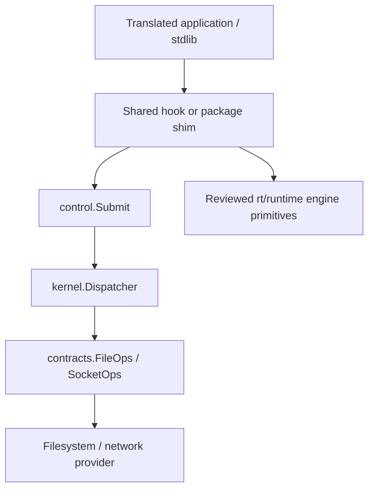

# Maintainer guide

This guide covers Go compatibility, stdlib interception, simulation features, and
manual certification. Run commands from the repository root. Read
[AGENTS.md](../AGENTS.md) for test restrictions and [design.md](design.md) for the
package boundaries.

## Where changes belong

| Location | Maintainer responsibility |
| --- | --- |
| `internal/compat/profiles/go125.json` | Baseline declarations, policies, capabilities, layouts, and constants |
| `internal/compat/profiles/go126.json` and later definitions | Changes relative to the immediately preceding minor family |
| `internal/compat/profiles/goNNN.origin.json` | Independently generated upstream provenance for that family |
| `internal/compat/hooks/{rt,kernel,fs,net}` | Shared replacements for stdlib/private runtime functions |
| `internal/compat/shims` | Shared replacement packages and types |
| `internal/compat/host`, `internal/hostabi` | Native compiler/runtime ABI adaptation and facade |
| `internal/compat/spec`, `profiles`, `selected` | Metadata validation, generation, and compile-time family selection |
| `internal/routegen` | Authored route schema, adapter generation, and dispatch generation |
| `rt/runtime`, `rt/runtime/abi` | Deterministic engine and primitive memory boundary |
| `internal/contracts`, `internal/control`, `internal/kernel` | Service interfaces, transport, lifecycle, dispatch, descriptors, and polling |
| `internal/fs`, `internal/net` | Filesystem and network providers |
| `fs`, `net`, `rt` | Public simulation controls |

Support is declared for **`1.X.*`**, using a definition family such as `"1.26"`.
An exact compiler such as `go1.26.9` identifies generation inputs, build artifacts,
and certification evidence. It is not a separate support declaration.

Inheritance is cumulative:

```text
Go 1.25: baseline
Go 1.26: baseline + 1.26 delta
Go 1.27: baseline + 1.26 delta + 1.27 delta
```

Metadata inheritance and executable source selection are separate mechanisms.
JSON deltas compose metadata; ordinary Go build constraints select shared source
variants. Retain ancestors even if their `supported` flag becomes false.

## 1. Add support for a new Go version

### Inspect before declaring support

The example below uses **hypothetical Go 1.27**. Replace the candidate compiler
with the actual stable release being reviewed. This example does not claim that
1.27 is currently supported. Read the parent's exact baseline from its
`.origin.json`; for the existing 1.26 parent it is `go1.26.9`.

```sh
NEW_GO=go1.27.0
mkdir -p .gosim/onboarding
AUDIT_DIR=$(mktemp -d "$PWD/.gosim/onboarding/go127.XXXXXX")

GOTOOLCHAIN=go1.26.9 go run -ldflags=-checklinkname=0 -tags=linkname ./cmd/gosim-gen observe \
  -profile=go126 -arches=amd64,arm64 -output="$AUDIT_DIR/parent.json"

GOTOOLCHAIN="$NEW_GO" go run -ldflags=-checklinkname=0 -tags=linkname ./cmd/gosim-gen compare \
  -parent=go126 -arches=amd64,arm64 \
  -parent-observation="$AUDIT_DIR/parent.json" -output="$AUDIT_DIR/comparison"
```

The metadata-only inspection command can run under an unregistered stable
compiler. It checks the immediate next minor; it cannot skip intermediate
families. Use the same host and architecture arguments for both commands.
Each process uses its selected compiler; compare never runs a parent compiler
for you. Source inspection of another architecture or race context does not
execute cross-architecture or race tests.

Review these outputs:

- `report.md`: grouped contract, API, package, and source findings.
- `report.json`: completeness, compiler/parent identities, contexts, and findings.
- `delta.draft.json`: proposed operations and unresolved review items. It is not
  a loadable family definition and cannot be installed automatically.

A complete comparison exits **0 even when it finds incompatibilities**. Exit 1
means an incomplete/failed operation; exit 2 means invalid CLI arguments. Require
`complete=true` before using the report as a complete inspection. With a parent
snapshot, `api_diff=inspected` covers the reviewed API inventory. Without a
snapshot, `api_diff=skipped-no-parent`: declared contracts and source checks still
run, but API differences and newly added packages cannot be established.
Behavioral source changes require manual review even when signatures match.

Output destinations must be new; their filesystem must support hard links.
Snapshots bind inspector code, module inputs, parent metadata/provenance, and
compiler/context identities. Recapture a stale snapshot instead of editing its
recorded hashes. Keep audit outputs under ignored `.gosim/`, outside committed
support metadata.

### Author the definition and any actual implementation changes

Create `internal/compat/profiles/go127.json`. For a reviewed family with no
metadata changes, the complete definition is:

```json
{
  "schema": 1,
  "family": "1.27",
  "parent": "1.26",
  "supported": true,
  "delta": {}
}
```

Use `add`, `replace`, and `remove` only for changes from the effective parent.
Implement changed behavior using the shared source rules in section 2. An empty
delta does not prove behavioral compatibility: review upstream changes and run
the checks below before merging the support declaration.

Do not copy `hooks`, `shims`, or `host` into a new family directory. Do not copy the
parent's origin file or edit historical `profiles/evidence.json` to manufacture
provenance or approval.

### Bootstrap support metadata, then generate provenance and adapters

Run metadata write mode first, using an already supported compiler. It reads
checkout definitions even when the compiled registry does not yet know the new
family, and can bootstrap before the new origin exists:

```sh
GOTOOLCHAIN=go1.26.9 go run -ldflags=-checklinkname=0 -tags=linkname ./cmd/gosim-gen profiles -root=.

GOTOOLCHAIN="$NEW_GO" go run -ldflags=-checklinkname=0 -tags=linkname ./cmd/gosim-gen \
  -toolchain="$NEW_GO" -profile=go127 -arches=amd64,arm64 -output=. -refresh-origin

GOTOOLCHAIN="$NEW_GO" go run -ldflags=-checklinkname=0 -tags=linkname ./cmd/gosim-gen profiles -root=.
GOTOOLCHAIN="$NEW_GO" go run -ldflags=-checklinkname=0 -tags=linkname ./cmd/gosim-gen profiles -root=. -check
GOTOOLCHAIN="$NEW_GO" go run -ldflags=-checklinkname=0 -tags=linkname ./cmd/gosim-gen \
  -toolchain="$NEW_GO" -profile=go127 -arches=amd64,arm64 -output=. -check
```

`-refresh-origin` validates declared contracts before publishing provenance. Fix
incorrect declarations or implementations when validation fails; refreshing an
origin is not a way to approve ABI drift. Metadata `-check` requires an origin for
each supported family, so run it after first-origin generation. `-check` and
`-refresh-origin` are separate operations.

`profiles` maintains `families_gen.go`, selectors, support guards, and adapter
revisions. Do not edit those generated files by hand. Regenerate revisions after
compatibility implementation or definition changes; generate them again after
adapter generation if generated implementation changed.

### Validate all affected families and update scheduled coverage

1. Inspect the generated diff. Unchanged implementations should remain shared;
   new support normally adds its definition, independent origin, and generated
   support metadata.
2. Run focused metadata, hook/shim, and generator tests under the new compiler
   and existing supported compilers. Preserve host flags:

   ```sh
   GOTOOLCHAIN="$NEW_GO" go test -ldflags=-checklinkname=0 -tags=linkname \
     ./internal/compat/spec ./internal/compat/profiles ./internal/routegen
   ```

3. Independently run generation `-check` for **every supported family**, using
   each family's recorded exact baseline. The same shared generated files must
   pass all applicable checks; checking only the last writer is insufficient.
4. Run ordinary tests with separate report roots, including the new compiler:

   ```sh
   GOSIM_TOOLCHAIN="$NEW_GO" TEST_REPORTS_DIR="$PWD/.gosim/validation/go127" make test
   ```

   Read reports and skips. Use the launcher/prepared verification path, rather
   than bare `go test ./...` against potentially stale simulation workers.
5. Extend the family matrix in [the CI workflow](../.github/workflows/main.yml)
   and the explicit generation/check entries in [Makefile](../Makefile). CI stays
   ordinary-test-only. Update manual matrix defaults in Makefile and
   [matrix.py](../.ci/crossarch-tests/matrix.py) if the new baseline should be
   included by default, or select it explicitly with `--toolchains`.
6. Update support documentation and run separately authorized large tests and
   manual certification as described in section 4. Race requires its own
   explicit instruction and is not part of the certification matrix.

The same compiler/source/feature identities must be used from build through
execution. A passed old-family test, a compile-only check, or an empty delta does
not certify the new family.

## 2. Add functions or packages introduced in a particular Go version

### Choose the earliest family to receive the change

Put an API introduced in Go 1.26 in `go126.json`, so later families inherit it and
1.25 does not. Put a simulation improvement that applies to every supported
family in the baseline metadata, if metadata needs to change. Check descendant
deltas: an inherited key may already be replaced or removed there.

The actual [1.26 delta](../internal/compat/profiles/go126.json) is a useful example:
`reflect` iterator methods and `testing.ArtifactDir` are additions;
`sync.runtime_StoreReluintptr` replaces an inherited signature.

### Write only the version-specific source

Use a build constraint at the top of a new implementation **and its tests**:

```go
//go:build go1.26
```

This includes later releases. A `_go126.go` filename alone does not select a Go
version. When an existing implementation changes, bound the previous variant:

```go
// old variant
//go:build go1.25 && !go1.26

// replacement variant, in a different file
//go:build go1.26
```

These are separate file-header examples, not two constraints in one file.
Preserve any required OS, architecture, `linkname`, or instrumentation constraints.
Shared code that has not changed stays in its existing file. Generated support
guards reject unsupported families; common implementation files do not need a
new upper bound for every release. Do not dispatch on `runtime.Version()`.

Concrete references:

- [store_go125.go](../internal/compat/hooks/rt/store_go125.go) and
  [store_go126.go](../internal/compat/hooks/rt/store_go126.go): a changed return type.
- [reflect/iterators.go](../internal/compat/shims/reflect/iterators.go): newly added methods.
- [testing/version_go126.go](../internal/compat/shims/testing/version_go126.go):
  `ArtifactDir`, including its `TB` interface extension.
- [clearenv_go126.go](../internal/compat/hooks/kernel/clearenv_go126.go): a new
  stdlib callback operating on translated machine state.

### Describe the upstream contract

Add the upstream package/symbol/signature and the actual implementation target
under `delta.declarations.add`. For example, this is the existing 1.26
`ArtifactDir` declaration, shown as a record inside that array:

```json
{
  "hook": {
    "package": "testing",
    "symbol": "*common.ArtifactDir",
    "signature": "func() string",
    "target": "github.com/neria-cloud/gosim/internal/compat/shims/testing.*common.ArtifactDir",
    "owner": "rt"
  }
}
```

The declaration describes the real upstream receiver, including unexported
receivers where applicable. The shim must also implement the public surface and
embedded interfaces expected by applications. Check bindings through the
ordinary translated path, not just a native shim unit test.

Delta operations use natural keys:

| Record | Key used by `remove` |
| --- | --- |
| Declaration | `[context, package, symbol, architecture-scope]` |
| Package policy / runtime package / module | `[path]` |
| Bridge | `[package]` |
| Capability | `[package, symbol]` |
| Layout within one architecture | `[package, type]` |
| Constant within one architecture | `[package, symbol]` |

For ordinary translated declarations, `context` is `""`; native contracts use
`"host"` or `"host-race"`. Architecture scope is `"*"` for both architectures, or
`"amd64"`/`"arm64"` for a scoped declaration. For example:

```json
{
  "remove": [["", "sync", "runtime_StoreReluintptr", "*"]]
}
```

That fragment shows removal syntax; a signature change with the same key should
use `replace` with the **complete new record**. `add` must introduce a new key;
`replace` and `remove` require an inherited key. Records are not recursively
merged. To split an all-architecture declaration, remove its `"*"` key and add
the distinct architecture-specific records. Keep layouts/constants under
`delta.architectures.amd64` and `.arm64` when applicable.

### Review a new package's execution policy

Unknown standard-library packages require review. Add the narrowest appropriate
entry to `delta.packages`; do not use a broad native allowlist to bypass an error.

| Mode | Intended use |
| --- | --- |
| `translate` | Go code whose dependencies and effects work through the simulator |
| `bridge` | A reviewed package replacement or explicitly permitted native symbols |
| `native-pure` | Reviewed computation that is safe outside translated state |
| `reject` | Behavior the simulator does not support |

For a replacement package, add its `bridges` record and implement the package
under shared `shims`. Preserve the translated type universe and check type
aliases, method sets, and interfaces. For native symbol bridges, enumerate exact
symbols and review their state/effects. Native-import permissions are separate
explicit edges, not permission to import arbitrary native code.

Update `runtime_packages` when the selected composition needs to include a new
compatibility package. Update `capabilities` with the actual implemented,
limited, stub, or rejected behavior and `probes` for relevant init/first-use
behavior. A capability description does not supply an implementation. Keep
host-sensitive declarations and architecture layouts in their proper contexts.

After source/metadata changes, regenerate profiles, regenerate/check affected
adapters, refresh origin only when intentionally changing provenance, and run
both the introducing-family tests and older-family exclusion checks. Use a test
that calls the new public stdlib API inside a simulation.

## 3. Add simulation features that intercept stdlib calls

### Trace the real call and choose its owner

Find the upstream entry points for both supported source families and simulation
architectures. A public stdlib method may reach a private helper, poll operation,
or syscall wrapper; intercept the reviewed boundary it actually uses.



Use `hooks/rt` with `rt/runtime` for scheduler/time/synchronization primitives.
Use kernel routes and provider contracts for filesystem, network, descriptor,
polling, or lifecycle effects. Keep stdlib signatures and private layout handling
in compatibility adapters; expose simulation-owned types across service contracts.

Current immutable feature sets are `rt`, `rt,fs`, `rt,net`, and `rt,fs,net`.
Adding a capability within these domains is the usual path. Adding a new
independently selectable domain requires a separate coordinated change to build
identity/config validation, composition, contracts, lifecycle, applicability and
certification enumeration; it is not accomplished by adding a hook file.

### Implement the simulation operation

1. Add the state/behavior to the owning engine or provider. Use the existing
   clock, event, trace, and domain-random ports instead of host time, I/O, or
   process-global randomness.
2. For a provider service, update the appropriate interface in
   [contracts](../internal/contracts/), its implementation, and test fakes.
   Kernel/contracts/public controls cannot import concrete providers; providers
   cannot import one another. Composition owns provider construction.
3. For a transported operation, add a unique, ordered route ID and typed payload
   to [routes.json](../internal/routegen/routes.json). Keep existing IDs stable.
   Use the schema's allowed field types; extend validation deliberately if a new
   type is necessary. Update explicit special dispatch behavior in
   [dispatch.go](../internal/routegen/dispatch.go) when generic generation cannot
   express the operation.
4. Implement the kernel/provider method called by the generated dispatcher.
   Descriptor operations must respect descriptor ownership. FS/net access must
   go through the existing feature gates; disabled features abort even if the
   application ignores returned errors or recovers a panic.
5. Add public controls only when callers need them. Follow `fs`, `net`, and `rt`:
   a translated implementation transports the operation; the native form reports
   `ErrNotSim` rather than performing host effects.

Borrowed `abi.ByteView`/`ValueView` data is valid for an invocation only. Do not
retain it after completion or cancellation. Poll/event callbacks must reject stale
epochs/generations. Lifecycle preparation is staged and non-yielding; abort must
not publish packets, flush disks, or consume another provider's random stream.
Commit publishes prepared state before init; teardown continues through cleanup
errors. Preserve replay determinism and update the replay revision if the
project's replay contract changes.

### Connect the stdlib adapter

For a hand-authored runtime hook or package shim, implement the function in the
shared tree and add its declaration/policy records in the earliest applicable
family, following section 2.

For generated syscall adapters, change the generator inputs rather than its
output:

- [adapters.go](../internal/routegen/adapters.go): explicit upstream symbol
  inventory, operation mapping, owner selection, and signature conversion.
- [adapter_body.go](../internal/routegen/adapter_body.go): typed adapter behavior,
  conversions, and route calls.
- [layouts.go](../internal/routegen/layouts.go) and reviewed architecture layout
  inputs when private memory representation is involved.
- Family declaration/layout/constant deltas: the reviewed upstream contracts.

The adapter inventory is explicit: adding a route or metadata declaration alone
does not generate a new syscall wrapper. A symbol introduced only in a later
family must also be selected only for that family; do not add it unconditionally
to an inventory that requires it on older compilers. Reject raw-syscall escape
paths instead of adding a host fallback.

Regenerate transport and adapters with `cmd/gosim-gen` using the matching family
compiler. For the currently supported baselines, `make go-generate` performs the
shared generation and independent checks. It also runs the filesystem model's
stringer generation. Inspect generated `kernel/routes_gen.go`, `dispatch_gen.go`,
and compatibility adapter changes; do not hand-edit generated output. Re-run
`profiles` afterward if executable inputs changed.

### Verify behavior and boundaries

Use focused tests for the changed service first, then the applicable ordinary
simulation suites:

```sh
GOTOOLCHAIN=go1.26.9 go test -ldflags=-checklinkname=0 -tags=linkname \
  ./internal/contracts ./internal/kernel ./internal/routegen

make build GOSIM_TOOLCHAIN=go1.26.9
GOTOOLCHAIN=go1.26.9 ./.gosim/gosimtool test -features rt,fs,net \
  -seeds 1-20 -run TestNewBehavior ./internal/tests/integration
```

Replace `TestNewBehavior` with the actual test and choose its required feature
set/package. Add tests under `internal/tests/{rt,fs,net,integration}` and update
[feature applicability](../internal/tests/features/) when needed. Cover the
stdlib call itself, deterministic repeat behavior, relevant errors/cancellation,
and disabled-feature rejection. Test new callbacks against stale epochs and
borrowed-memory lifetimes where applicable.

Run both family generation checks and ordinary `make test` for shared behavior.
Native checks alone do not prove translated type identity or provider isolation.
Use the actual compiled-graph boundary tests, not only template inspection.
Lint only `cmd` and `examples` through the repository targets; do not rewrite
runtime or generated adapters to satisfy whole-tree linters.

## 4. Run certification and verify success

### Select the intended scope

Certification is an explicitly invoked manual operation. It is not required for
library use, is not an ordinary test, and is not run by CI. It certifies one exact
compiler/source/host/features tuple, not every patch in a supported family.

**Certification necessarily runs selected-tuple `make test-large` coverage.**
Under AGENTS.md, obtain an explicit instruction to run and check that large
coverage before starting certification. General permission to finish a change
or run ordinary tests does not authorize it. Race tests require their own
explicit instruction; race and AMD64 certification are currently disabled.

Enumerate the default 16 tuples without executing anything:

```sh
./.ci/crossarch-tests/run-matrix.sh --platform all --dry-run
```

These are two exact compilers × two ARM64 host platforms × four feature sets.
For native execution, select the platform actually running the command. For
example, on Darwin ARM64, after the required authorization:

```sh
./.ci/crossarch-tests/run-matrix.sh --native --platform darwin/arm64 \
  --toolchains go1.25.14,go1.26.9 --jobs 2
```

On a Linux ARM64 worker, use `--native --platform linux/arm64` instead. Each command
runs eight tuples. Native `--platform all` cannot execute both operating systems
on one host. Include a newly supported compiler explicitly in `--toolchains` when
certifying it. The existing Colima route is documented in
[README](../README.md#generation-and-manual-certification); it is a separate
explicitly selected environment, not an ordinary-test prerequisite.

`--jobs` caps concurrency; the runner also bounds it by CPU/memory. Each tuple
gets an isolated source snapshot. Avoid source edits during the run: the runner
rejects checkout drift. Do not use `--smoke` or a dry run as evidence for the full
requested matrix.

The default destination is `.gosim/certification/matrix/`. A new run replaces
that directory. Preserve previous evidence first, or use a distinct
`--output .gosim/certification-review-name` (which creates `matrix/` below it).
Compilation caches are reusable; certification tests are run uncached. Snapshot
source directories are removed on completion, while logs and reports remain.

### Read the results

Require all of the following:

1. The runner exits **0**. Root `matrix.json` says `status: "passed"`, has
   `smoke: false`, and contains a successful result for every requested tuple.
2. Each result identifies the expected platform, exact patch, features, and
   `race: false`. For native runs, `execution_mode` is `"native"` and worker
   observations in `evidence/worker.json` agree with the requested compiler,
   OS, and architecture.
3. The result's referenced `report.json` is a certification report, with
   `validation_only` false/absent. All mandatory suites pass: `build`, `execute`,
   `native`, and `large`; partial feature sets also require `native-units`.
   The runner validates suite log hashes, result digests, and execution identity.
4. In each report's directory, read `test-reports/large/latest/report.md` and
   `timeline.md` (or `timeline.json`). Check failures, errors, skips, and the
   actual test selection. Inspect the named package logs and `large.log` for a
   failed case. A skip is not a pass.
5. The retained `matrix/source.json` still matches the source being approved.
   Source/profile/config changes invalidate the result; evidence and
   documentation alone are excluded from executable input identity.

This read-only check, run from the repository root, summarizes the default
matrix and rejects missing/failed tuples or changed source:

```sh
python3 -B - <<'PY'
import json
import sys
from pathlib import Path

root = Path.cwd()
run = root / ".gosim/certification/matrix"
sys.path.insert(0, str(root / ".ci/crossarch-tests"))
from test_support import source_files

matrix = json.loads((run / "matrix.json").read_text())
assert matrix["status"] == "passed" and not matrix["smoke"]
key = lambda item: json.dumps(item, sort_keys=True)
expected = {key(job) for job in matrix["jobs"]}
results = matrix["results"]
assert len(results) == len(expected)
assert {key(result["tuple"]) for result in results} == expected
for result in results:
    assert result["status"] == "passed", result
    report = json.loads(Path(result["report"]).read_text())
    assert not report.get("validation_only", False)
    assert all(suite["passed"] for suite in report["suites"])
    print(result["tuple"], "PASS", result["report"])
assert json.loads((run / "source.json").read_text()) == source_files(root)
print(f"PASS: {len(results)} tuples; source still matches")
PY
```

This checks the recorded run; also compare `matrix.jobs` with the scope you
intended. An eight-tuple Darwin run does not provide Linux evidence. The full
report checks performed by the runner remain necessary; this summary is not a
replacement certifier.

If certification fails, read the first failed suite and its test logs, fix the
cause, and run a focused reproduction. Do not loosen a boundary assertion merely
to get a pass. After a source change, rerun certification for the requested tuples
on the new complete identity. Keep failed/partial evidence distinct from the
successful run; do not edit certification status or profile history manually.
