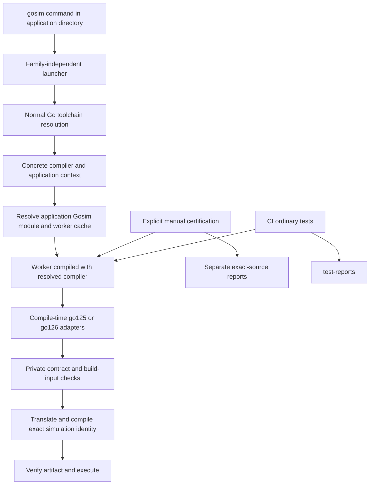

# Go family compatibility: target architecture

Status: implementation specification draft for review. Session started 2026-10-19 and continued 2026-10-20. Variant A and separation of certification are confirmed. No implementation or test execution is part of this document's creation.

## 1. Request and confirmed decisions

Support Go `1.25.*` and `1.26.*`, including callers from 1.25.1 through 1.26.9, without registering or certifying each patch. Make a new minor family substantially easier to add. Review generation provenance in both families' `origin.json` and `routes_{amd64,arm64}.json`. Recover the straightforward caller experience of the tree at `ffd3a613542675755e4cbf8186b5edaf404ed95c` without restoring its incomplete toolchain/cache model.

| Question | Selected behavior | Authority |
| --- | --- | --- |
| Who chooses the compiler? | Normal Go tooling in the caller's directory, using its module/workspace/environment rules. | User clarification and selection of Variant A. |
| Does Gosim substitute a baseline patch? | No. Use the concrete compiler Go resolved. | Variant A. |
| Does the caller rebuild workers manually? | No. Gosim locates/builds/caches matching workers automatically. | Selected variant. |
| Does an ordinary command require certification? | No. Missing/stale certification does not block use. Compatibility/artifact checks remain. | Explicit answer. |
| Is certification in CI? | No. Certification is manual and optional; CI executes tests only. | User correction supersedes earlier “CI evidence” wording. |
| AMD64/race certification | Remains disabled. Ordinary support and explicitly requested race testing are separate. | Prior user instruction. |
| Exact patch identities | Retained for actual compiler, artifacts, and replay. They are not an admission allowlist. | Required implementation consequence of retaining artifact checks. |

Draft defaults, not separate user confirmations: stable releases in each registered family include patch zero and later patches, without a rolling upper bound; prereleases/devel/non-gc/GOEXPERIMENT variants remain unsupported; no new host or simulation platforms are added. The existing module minimum `go 1.25.0` remains. An actual private-ABI incompatibility may require an explicit patch exception with an actionable reason; exceptions are not an allowlist of every supported patch.

## 2. Caller behavior

An application depends on Gosim through normal Go module dependencies. Public `gosim`, `fs`, `net`, and `rt` operations keep their signatures. The caller runs:

```sh
gosim test -features rt ./...
```

No Gosim compiler setting is required. If Go resolves go1.25.8 in that directory, the worker and simulation are compiled with go1.25.8 and use go125 adapters. Go1.26.1 uses go126 adapters. A patch upgrade can create a cache miss but must not require editing library metadata, generating adapters, certifying a tuple, or installing a different Gosim release.

Normal `go build` or `go test` already resolves the compiler for imported library code. It does not itself turn native tests into translated simulations. Metatests continue to execute generated worker binaries, with automatic CLI-worker preparation and existing application-worker preparation semantics.

The `go` directive is a minimum, not a request to force its exact version. Honor `go.work`, `toolchain` directives, `GOTOOLCHAIN`, and normal Go configuration during discovery. Under `GOTOOLCHAIN=local`, propagate Go's too-old-compiler error; do not override the user's no-switch policy. Do not implement a second “choose newest release” algorithm.

Optional maintainer `-go go1.X.Y` remains an explicit override delegated to Go's resolver, accepting any stable supported-family patch. It is unnecessary for normal callers. Legacy schema-1 config's exact `toolchain` is interpreted as an explicit override with a migration diagnostic; schema 2 omits the field. Never silently ignore an old explicit setting.

## 3. Architecture and ownership



- `cmd/gosim`: small launcher. No imports of translated runtime, host ABI implementations, simulation providers, or the translation engine. It may execute help/version without bootstrapping.
- `cmd/gosim-worker`: direct worker entry compiled with the resolved compiler. It never recursively launches another worker. Family-bound code is only loaded here.
- `internal/gosimcli`: current command implementation moved out of the executable package. Owns parsing, build operations, verify and manual certify commands. Ordinary commands have no certification admission check.
- `internal/buildcfg`: Go discovery, immutable resolution context, source/toolchain fingerprints and ordinary identity construction.
- `internal/workerboot`: resolve effective Gosim module, build/cache worker, validate worker handshake, forward exit status and signals.
- `internal/buildspec`: dependency-light version/family support registry, serializable identities/configuration/context. No concrete adapters.
- `internal/compat/spec`: family contract metadata and checks. `internal/compat/catalog` exposes metadata for generators; executable adapter selection stays compile-time.
- Existing public controls, deterministic engine, kernel, providers and translation semantics remain structurally unchanged.

Do not create a runtime object switch that mixes different Go-family implementations in a worker. Build tags select implementations when the worker and generated executable are compiled.

## 4. Data structures and persisted schemas

No SQL database, ORM, tables, migrations, indexes or database TTLs are involved. Existing SQLite-backed translation caching remains structurally unchanged; its inputs change through the versioned identity digest. No new database tables are introduced.

### 4.1 Family policy, configuration and resolved context

`internal/buildspec/family.go` CREATED:

```go
type GoVersion struct {
    Major int `json:"major"`
    Minor int `json:"minor"`
    Patch int `json:"patch"`
}

type PatchExclusion struct {
    First int `json:"first"` // inclusive
    Last int `json:"last"`   // inclusive
    Reason string `json:"reason"`
}

type FamilySupport struct {
    Family string `json:"family"` // "1.25"
    Profile string `json:"profile"` // "go125"
    MinimumPatch int `json:"minimum_patch"`
    Exclusions []PatchExclusion `json:"exclusions,omitempty"`
}
```

One registry contains go125 and go126 support records; no patch certification records or hardcoded maximum patch numbers. Parse with strict stable-release syntax and Go's version-comparison semantics; parsing a version is separate from checking family support. Registering a family does not substitute for implementing its adapters.

`internal/buildspec/types.go` UPDATED:

```go
type Config struct {
    Schema int `json:"schema"` // 2
    Features []string `json:"features"`
    SimulationOS string `json:"simulation_os"` // linux
}

// Process-local, not an executable identity. Paths locate checked content.
type Toolchain struct {
    Executable, Version, GOROOT, HostOS, HostArch string
}

type ModuleContext struct {
    Directory string `json:"directory"`
    GoMod string `json:"go_mod"`
    GoWork string `json:"go_work"` // absolute path or "off"
    GraphDigest string `json:"graph_digest"`
}

type Fingerprints struct {
    ToolchainDigest string `json:"toolchain_digest"`
    StdlibDigest string `json:"stdlib_digest"`
}

type Resolution struct {
    Schema int `json:"schema"` // 1
    Toolchain Toolchain `json:"toolchain"`
    Context ModuleContext `json:"context"`
}
```

Example schema-2 `gosim.json`:

```json
{"schema":2,"features":["rt","fs","net"],"simulation_os":"linux"}
```

When no config exists, use schema 2, all three features, Linux simulation. CLI feature overrides preserve existing whole-set replacement semantics. `buildcfg.Load` returns config plus a separate legacy explicit toolchain request; legacy toolchain input must not contaminate the new persisted config schema.

### 4.2 Executable identity and evidence separation

Identity schema 2 retains exact source/build data and removes certification fields:

```go
type Identity struct {
    Schema int `json:"schema"` // 2
    Toolchain string `json:"toolchain"` // concrete Go-resolved patch
    ToolchainDigest string `json:"toolchain_digest"`
    StdlibDigest string `json:"stdlib_digest"`
    Profile string `json:"profile"`
    AdapterRevision string `json:"adapter_revision"`
    ContractDigest string `json:"contract_digest"`
    RuntimeRevision string `json:"runtime_revision"`
    ProviderRevisions []Revision `json:"provider_revisions"`
    HostOS string `json:"host_os"`
    HostArch string `json:"host_arch"`
    SimulationOS string `json:"simulation_os"`
    SimulationArch string `json:"simulation_arch"`
    Features []string `json:"features"`
    Race bool `json:"race"`
    Experiments string `json:"experiments"`
    Tags []string `json:"tags"`
    ModuleGraphDigest string `json:"module_graph_digest"`
    TranslatorDigest string `json:"translator_digest"`
    DebugPolicyDigest string `json:"debug_policy_digest"`
}
```

`ToolchainDigest` identifies installed executable/tool inputs, not a downloaded archive checksum. Hash selected `bin/`, `pkg/tool/`, compiler-support `lib/`, `VERSION` and `go.env` content in sorted path order; `StdlibDigest` hashes selected GOROOT source content. Resolve paths explicitly and reject unreadable or changing inputs. Exclude absolute installation paths from content digests. This is content identification, not a claim to authenticate the distribution against a separately downloaded archive. Trust toolchain installation through the same user/Go mechanisms as ordinary Go tooling; remove Gosim's embedded archive allowlist and archive download/comparison path.

Compute each content inventory once per invocation and pass the resulting values through identity construction; do not repeatedly download, unpack, hash or audit a distribution per feature/test command. Do not replace content identity with an mtime-only key. Versionless discovery must not turn into whole-suite certification or compilation probes on every command.

`Manifest.Schema` becomes 2 because its embedded identity changes. Old manifests are invalidated with an actionable rebuild message; do not add legacy cache decoding or reinterpret old identities. Native artifact sidecars and metatest handshakes must likewise reject old identity schemas. Increment the metatest protocol and replay revision when the identity contract changes.

Evidence uses a separate exact record:

```go
type CertificationTuple struct {
    Toolchain string `json:"toolchain"`
    HostOS string `json:"host_os"`
    HostArch string `json:"host_arch"`
    SimulationOS string `json:"simulation_os"`
    SimulationArch string `json:"simulation_arch"`
    Features []string `json:"features"`
    Race bool `json:"race"`
    Experiments string `json:"experiments"`
}

type CertificationReport struct {
    Schema int `json:"schema"` // 2
    Tuple CertificationTuple `json:"tuple"`
    Identity Identity `json:"identity"`
    FrameworkDigest string `json:"framework_digest"`
    ExecutionMode string `json:"execution_mode"`
    WorkerArch string `json:"worker_arch"`
    ContainerImageDigest string `json:"container_image_digest,omitempty"`
    Suites []SuiteResult `json:"suites"`
    ResultDigest string `json:"result_digest"`
}
```

There is no pending/certified status in a support tuple and no support tuple allowlist. A validated report attests only its exact tested source/toolchain/tuple. `SourceDigest` remains the canonical framework identity with application graph replaced by a fixed schema-2 marker; it never generalizes one patch's execution result to a family. Missing/stale reports do not affect normal command return codes or artifact identity. Adding a report must not change translation, execution, replay or cache keys.

Existing schema-1 evidence is historical; it cannot attest schema-2 builds. Remove evidence/tuple embedding from active profiles, retaining the old JSON files as historical records initially. Manual reports live in explicit output directories and are not written back into the package to enable usage. No automatic promotion step remains.

Keep `rt.RunInfo.Certified` for source compatibility, mark it deprecated, and return false for new builds. Certification is a property of an external exact-build report, not a boolean compiled into runtime behavior. Preserve the rest of `rt.Info` including actual compiler and build digest. Remove internal branches that change behavior based on embedded certification; update corresponding contracts/driver initialization while retaining the public struct field.

### 4.3 Generation provenance and private contracts

Update `spec.Origin` to make its role explicit:

```go
type Origin struct {
    Schema int `json:"schema"` // 2
    Family string `json:"family"`
    BaselineToolchain string `json:"baseline_toolchain"`
    Files []SourceFile `json:"files"`
}
```

`origin.json` retains exact source hashes for the compiler used to generate/review that family, not all accepted caller compilers. `VerifyBaselineOrigin` is used only when checking/reproducing baseline generation. It may require exact baseline bytes. Ordinary compatibility checking must not call it.

`routegen.GenerationRecord` retains all existing transport/adapter/route/origin/module/stage fields; changes `schema` to 2, replaces `toolchain` with `generated_with`, and adds `family`. Architecture and profile remain explicit. Example:

```json
{
  "schema": 2,
  "family": "1.26",
  "profile": "go126",
  "architecture": "arm64",
  "generated_with": "go1.26.9",
  "stage": "typed-adapters",
  "adapter_digest": "<sha256>",
  "transport_digest": "<sha256>",
  "route_digest": "<sha256>",
  "origin_digest": "<sha256>",
  "modules": []
}
```

Place reviewed ABI contracts in family-owned `contracts_{amd64,arm64}.json`, separately from provenance. Schema:

```go
type FieldContract struct {
    Name string `json:"name"`
    Type string `json:"type"` // normalized qualified type expression
    Offset int64 `json:"offset"`
}
type LayoutContract struct {
    Package string `json:"package"`
    Type string `json:"type"`
    Size int64 `json:"size"`
    Align int64 `json:"align"`
    Fields []FieldContract `json:"fields"`
}
type ConstantContract struct {
    Package string `json:"package"`
    Symbol string `json:"symbol"`
    Value string `json:"value"` // exact go/constant value
}
type ContractManifest struct {
    Schema int `json:"schema"` // 1
    Family string `json:"family"`
    Architecture string `json:"architecture"`
    Hooks []Hook `json:"hooks"`
    Layouts []LayoutContract `json:"layouts"`
    Constants []ConstantContract `json:"constants"`
}
```

The implementation adds `Hook.Context` (omitted for translated Linux declarations, `host` or `host-race` for native declarations) so source selection is explicit in the inventory. `RefreshOrigin` accepts a resolved compiler and reviewed manifests, verifies them, and inventories current selected files; moved files from a baseline do not block a supported patch. It never rewrites contract expectations.

Inventories cover private types/constants actually accessed or mirrored by adapters, host ABI, shims and generated syscall records. They must not freeze whole upstream packages. Reuse the existing hook reader and routegen source/layout machinery, moving general inspection into `compat/spec` to avoid a generator/spec import cycle. Inspect host runtime declarations under the actual host/race context and translated standard-library declarations under Linux/application-cgo-disabled context. Do not accidentally inspect non-race files for a race build.

The profile descriptor becomes:

```go
type Profile struct {
    ID, Revision string
    Support buildspec.FamilySupport
    Hooks []Hook
    Packages []PackagePolicy
    RuntimePackages []string
    ContractsByArch map[string]ContractManifest
}
```

Descriptors return independently owned slices/maps, preserving existing metadata ownership guarantees. `Contracts(arch)` returns an owned manifest or an explicit unsupported-architecture error. Active `Tuples` are removed; source provenance is exposed separately by the family metadata package.

`go/types` source inspection uses the actual selected compiler's file selection and architecture sizes. Checking layout, symbol and signature compatibility does not prove identical behavior. Behavioral patch regressions remain a testing/support concern; never advertise structural checks as certification. Add specific adapters/exclusions only for observed incompatibilities, not routine source-byte changes.

### 4.4 Worker and compatibility caches

Cache root: existing Gosim user cache override, otherwise `<os.UserCacheDir()>/gosim`. No network cache service or database is introduced.

Worker key:

```text
SHA256(canonical({schema:1, protocol:1, concrete toolchain,
  toolchain_digest, stdlib_digest, host_os, host_arch,
  Gosim source digest, effective worker dependency-graph digest,
  build flags and approved experiment settings}))
```

Path: `workers/v1/<key>/worker` plus `manifest.json`. The worker bootstrap is non-race; simulation/native race tests are independently selected. A normal `-race` simulation request does not force unnecessary bootstrap-worker race instrumentation.

```go
type WorkerManifest struct {
    Schema int `json:"schema"` // 1
    Protocol int `json:"protocol"` // 1
    Key string `json:"key"`
    Toolchain string `json:"toolchain"`
    ToolchainDigest string `json:"toolchain_digest"`
    StdlibDigest string `json:"stdlib_digest"`
    HostOS string `json:"host_os"`
    HostArch string `json:"host_arch"`
    SourceDigest string `json:"source_digest"`
    GraphDigest string `json:"graph_digest"`
    BinaryDigest string `json:"binary_digest"`
}
```

No time-based expiry: immutable keys invalidate by content. Verify manifest, key and binary digest on reuse. An invalid generated cache entry is rebuilt; do not execute it. No unbounded in-memory index. Keep existing user cache cleanup conventions; automatic eviction is outside this change.

Compatibility cache key includes family, contract digest, checker/adapter source revision, exact toolchain/stdlib digests, architecture, host OS, race/experiments and ABI-relevant module content digests. Including the checker revision prevents reuse after verification logic changes. Value contains schema 1, key, those input digests and a successful observed contract digest. Cache only successful checks; no TTL and no negative cache. Store as an atomically replaced JSON file under `compat/v1/<key>.json`; schema/key mismatch is a miss.

Concurrency: use a cross-process per-key lock that the OS releases on process exit on supported Unix hosts. Wait cancellably, recheck after acquiring, build in a unique same-filesystem temporary directory, validate complete output, then rename atomically. A losing publisher verifies the winner. Never truncate an executable already being run, and never delete another invocation's temporary directory. Interrupted builds do not publish partial manifests. Use existing atomic artifact utilities where they satisfy this contract; keep workerboot independent from family-bound packages.

## 5. Toolchain resolution and worker bootstrap flows

### 5.1 Startup and resolution

1. Launcher captures cwd, CLI arguments, environment and explicit optional `-go` override. Handle help/version before worker startup.
2. Locate the caller's `go` executable using PATH; query `go env -json GOVERSION GOROOT GOHOSTOS GOHOSTARCH GOMOD GOWORK` in caller cwd. Preserve normal Go toolchain selection environment. Explicit `-go` changes only that discovery invocation's GOTOOLCHAIN request.
3. Validate returned concrete stable version against family registry and existing platform rules. Canonicalize selected GOROOT and `bin/go`; inspect its own version to detect an inconsistent resolution.
4. Freeze exact compiler for the operation: use absolute selected `bin/go`, selected GOROOT and `GOTOOLCHAIN=local` for subsequent worker/build commands. Preserve application module/workspace context where application packages/modules are inspected.
5. Resolve `github.com/neria-cloud/gosim` from the application's effective module graph. Honor replacements, workspace main modules and local edits. Do not fetch `@latest` or silently use the install-time CLI version when the application's module selects another version.
6. If Gosim is absent from the application graph, report that it must be added as a dependency. Ordinary use does not need a configuration file, but normal module dependency declaration is still required. The repository itself resolves as the main Gosim module.
7. Fingerprint selected compiler, sources and worker dependency graph. Check configured environment restrictions after discovery; do not mistake valid `GOTOOLCHAIN=auto` during discovery for forbidden mid-build switching.

### 5.2 Worker cache hit

1. Find content-keyed worker and verify manifest/binary.
2. Request `--worker-info` using a bounded handshake, without initializing simulation or running tests.
3. Worker returns protocol, actual `runtime.Version()`, host architecture and Go build info needed to validate module/compiler correspondence. Cross-check manifest and bootstrap resolution.
4. Run worker with a private resolution-file argument. The file records locations/context; it is not an authority to bypass compiler/identity checks. Worker validates it against its actual compiler and current source inputs.
5. Forward stdin/stdout/stderr, cancellation and exit code. The worker executes the original command once. No rebootstrap loop is allowed.

### 5.3 Worker cache miss

1. Acquire per-key lock, then recheck the cache.
2. Invoke selected `bin/go build -ldflags=-checklinkname=0 -tags=linkname -trimpath -o <stage>/worker github.com/neria-cloud/gosim/cmd/gosim-worker` in application module context. Use `-mod=readonly` in module mode; in workspace mode use Go's workspace module handling without forcing an invalid `-mod` setting. Do not rewrite caller module files as a hidden setup action.
3. If dependencies/checksums are missing under read-only module operation, surface Go's diagnostic and required normal module setup; no substitute compiler or dependency version is chosen.
4. Validate build info and handshake, hash binary, write manifest, and confirm source/context did not change during build. On mutation, discard staging and return a retryable changed-input diagnostic rather than looping indefinitely.
5. Publish atomically, release lock, run as for a hit.

Cold bootstrap may involve normal Go module/toolchain downloads permitted by user configuration; warm execution performs no Gosim archive downloads or certification. Offline operation succeeds with existing Go/tool/module/worker caches and otherwise returns the concrete missing dependency/toolchain error.

### 5.4 Worker execution and application graph

1. Parse resolved config/features and immutable compiler/context. Verify worker version/GOROOT/platform; mismatches now diagnose a bootstrap defect or invalid override instead of telling ordinary callers to rebuild manually.
2. Select compiled family descriptor, validate family support and approved settings, load/verify private contracts through compatibility cache.
3. Build exact schema-2 identity with no evidence lookup.
4. Load the application under its actual module/workspace graph. Existing `GoCommand` currently forces GOWORK off globally; split application-context commands from generated-output commands.
5. Generate a self-contained output module representing the resolved graph. Materialize effective requires/replacements and workspace-main-module locations from Go's resolved graph, not by reading only the nearest go.mod. For local workspace/replaced modules, include source content in graph/artifact identities. Remove dependence on the original workspace during output compilation (`GOWORK=off`).
6. Validate the generated output dependency graph against resolved input versions/replacements, feature applicability and selected family. Do not permit generated compilation to upgrade toolchain or select different dependencies.
7. Reuse a matching verified artifact or translate/build/publish it using existing atomic artifact semantics. Execute only after manifest/content/host identity checks succeed.
8. On exit, preserve reports/artifacts and remove invocation-owned temporary resolution files. Signal cancellation propagates to compilation and tests; release all locks and reap children.

### 5.5 Metatesting and public imports

Public imports retain compile-time family selection; users do not select runtime adapters through a public API. `ResolveTestIdentity` uses the native test process's actual compiler/GOROOT as the fixed toolchain, since Go already selected it. Resolve the application graph without allowing a newer PATH compiler to silently replace the running test compiler. If the on-disk module/workspace now requires a newer compiler, return “re-run go test” with the mismatch reason.

Route metatest CLI invocations through the same worker cache. An explicit `GOSIMTOOL` override is validated against the worker protocol and exact compiler; never trust its name alone. Keep generated application worker preparation and uncached-test rebuild behavior. Cache and handshake validation remain exact; changing Go patch invalidates prebuilt workers. All native and generated artifacts use schema-2 identities.

## 6. Compatibility generation and family onboarding

`cmd/gosim-gen` uses normal Go resolution by default. An explicit source compiler override is still available for reproducible maintenance. Select requested family through registry/catalog and require a matching source family, not an exact hardcoded patch.

Two distinct operations:

- Baseline reproduction: compare outputs with existing provenance using the recorded exact generation compiler, explicitly selected by maintainer/Go configuration. A mismatch says which baseline generated the files; it does not restrict application use.
- Intentional refresh: generate/update origin, route records and contract manifests from the explicitly chosen actual compiler in the same family. Writes affect only selected family/architectures plus neutral generated transport where applicable. Regenerate family source revision after validated outputs. Ordinary commands never run this operation automatically.

Keep existing explicit output/architecture flags and generation check mode. Introduce `-refresh-origin` for intentional provenance refresh; refuse silently rewriting origin/contract expectations in ordinary `-check` mode. Contract changes require an adapter review, not blindly accepting whatever the installed compiler exposes.

New minor onboarding:

1. Add one support registry record and matching family metadata/catalog entry.
2. Implement/audit family hooks, host ABI, shims and policies against a chosen development compiler.
3. Add bounded compile-time selectors for selected/profile/host ABI; update the unsupported-family guard. Existing older-family constraints remain bounded so an unimplemented family cannot select them.
4. Generate provenance/contracts/adapters for implemented architectures; update revision metadata.
5. Add representative ordinary CI jobs for the family and focused ABI/translation tests. No certification requirement, patch checksum ledger or per-patch tuple entries. Generation baselines may be exact for reproducibility, but they are never caller version requirements.

Replace scattered two-family assumptions in `spec.Profile.Validate`, `checkPackage`, `SourceRevision`, shim path validation, genprofile iteration, buildrun inactive-family checking and CLI/toolchain parsing with the common registry/catalog. Preserve the boundary that registry contains metadata only; executable family source is never selected through a runtime string switch.

## 7. Tests, CI and manual certification

CI `.github/workflows/main.yml` removes its `certify` job and every invocation of certification matrix/worker commands. It runs ordinary local tests and report tooling checks on native ARM64 Linux/Darwin workers with representative Go versions. `actions/setup-go` version selection is test configuration, not a library admission rule. Use family selectors such as `1.25.x`/`1.26.x` for routine jobs and targeted earliest-patch fixtures during implementation/maintenance; do not multiply every test internally across all versions/features.

No CI step invokes `certify`, `run-matrix.sh`, large-suite certification, evidence promotion or review. CI reports test results under `test-reports`, with resolved concrete compiler recorded. Race and large tests remain opt-in under the repository's explicit-instruction rule; ordinary CI does not add them automatically.

`make test` continues to run ordinary local tests in an isolated snapshot with the current report layout. Remove its default go1.26.9 override. Resolve Go before copying source, freeze that resolution for the snapshot, preserve or materialize module/workspace context deliberately, and reject snapshot changes. Repository test runners must not use a hidden exact-patch allowlist. Native race and large targets remain separate and use the same default Go resolution.

Split `.ci/crossarch-tests/verify.py` from certification: invoke worker `verify -ordinary` or `verify -race` explicitly, not `certify` with a validation-only flag. `verify` never falls through to both race modes when no mode is specified; default is ordinary. Large suites retain their separate reporter path. Extract source snapshot utilities to a neutral `.ci/test_support.py` (or equivalent sibling module) so ordinary verification does not import certification scheduling constants. Snapshot copying no longer resets tuples to pending or deletes evidence.

Manual certification keeps its explicit command/matrix runner, independent from CI. It accepts explicit stable supported-family versions, requires actual full selected-tuple coverage and emits schema-2 exact reports. No internal feature/toolchain sweep duplicates the outer matrix. Keep ARM64/non-race guards at scheduler, worker and Go command boundaries. A selected manual matrix can retain representative default versions as scheduling defaults, never as a support allowlist. Reports remain immutable outputs; there is no step that changes a library tuple from pending to usable.

Existing tests named Candidate/SelectedTranslation may retain names initially, but their assertions must test family acceptance, compatibility failures, worker selection and cache isolation rather than the retired pending/certified admission distinction. Existing expensive suites remain behind `make test-large`.

## 8. File/API change inventory

All signatures below are target internal APIs. Public control API signatures remain unchanged. Existing pure helper functions moved with the CLI retain signatures unless listed here; no duplicate command implementations are retained.

| File/package | Operation | Required change |
| --- | --- | --- |
| `cmd/gosim/main.go` | UPDATED | Replace embedded worker implementation with launcher call; retain launcher help/version dispatch. |
| `cmd/gosim-worker/main.go` | CREATED | Call `gosimcli.Run`; respond to worker-info before command execution. |
| `internal/gosimcli/{main,config,certify,doc,...}.go` | CREATED by moving current command files | Preserve command functionality; remove certification admission; split verify from certify. Move command tests with code. |
| `internal/workerboot/{source,cache,run,protocol}.go` | CREATED | Family-independent bootstrap, cache, handshake, child process lifecycle. |
| `internal/buildspec/{family,types,canonical,command,certification}.go` | CREATED/UPDATED | Registry, schema-2 identity, context-aware commands, evidence separated from support. |
| `internal/buildcfg/{config,toolchain,distribution,identity,certification}.go` | UPDATED | Default discovery, content fingerprinting, no embedded-distribution admission, no CertifiedIdentity requirement. Remove unused archive helpers/records. |
| `internal/compat/catalog/catalog.go` | CREATED | Explicit metadata descriptor lookup/iteration for generators. |
| `internal/compat/spec/{profile,validate,origin,hooks,revision,shims,contracts}.go` | UPDATED/CREATED | Family support selection; baseline provenance separated from local structural checks; registry-based family handling. |
| `internal/compat/go{125,126}/profile/*` | UPDATED | Family support/contracts and provenance schema; stop embedding active tuples/evidence. |
| `internal/compat/selected/*`, `internal/hostabi/*` | UPDATED where metadata APIs change | Keep bounded compile-time selection; remove evidence accessors from ordinary path. |
| `internal/routegen/{generate,check,layouts,source}.go`, `cmd/gosim-gen/main.go`, `internal/compat/genprofile/main.go` | UPDATED | Family-aware generator and explicit baseline refresh; share contract inspection; registry iteration. |
| `internal/gosimtool/{gosimtool,config,manifest,native_artifact,prebuilt}.go` | UPDATED | Automatic metatest CLI worker, schema-2 manifests/sidecars and exact-match checks. |
| `internal/translate/*`, `internal/buildrun/build.go` | UPDATED where context/identity flows | Resolved workspace/module graph, generated-output isolation, registry-based inactive-family checks. |
| `internal/compose/generate.go`, `rt/runtime` handshake/identity code | UPDATED | Identity schema, protocol/replay revision; no evidence-driven generated behavior. |
| `rt/info.go`, related contracts/kernel info fields | UPDATED | Deprecate embedded Certified indicator, preserve public field as false. |
| `Makefile`, `test.sh`, `Taskfile.yml`, `scripts/test_report.py`, `.ci/*`, `.github/workflows/main.yml` | UPDATED | Default Go discovery; separate tests from certification; preserve reports/concurrency and disabled certification routes. |
| `README.md`, `AGENTS.md`, `docs/design.md` | UPDATED during implementation | Family policy, automatic workers, report paths, no CI/ordinary certification requirement. Preserve unrelated staged README changes. |

New/updated public-to-internal entry signatures:

```go
// internal/buildspec/family.go
func ParseGoVersion(raw string) (GoVersion, error)
func (v GoVersion) Family() string
func LookupFamily(version GoVersion) (FamilySupport, error)
func SupportedFamilies() []FamilySupport
func ValidateVersion(raw string) error // syntax plus supported-family policy

// internal/buildcfg/config.go; ConfigRequest separates old explicit version input.
type ConfigRequest struct { Config buildspec.Config; ExplicitToolchain string }
type Overrides struct { Toolchain *string; Features *[]string; SimulationOS *string }
func Load(path string, overrides Overrides) (ConfigRequest, error)
func Normalize(cfg buildspec.Config) (buildspec.Config, error)

// internal/buildcfg/toolchain.go and identity.go
// Fingerprints is declared in internal/buildspec/types.go to avoid a spec/buildcfg cycle.
func Discover(ctx context.Context, directory, explicitVersion string) (buildspec.Resolution, error)
func Resolve(exact string) (buildspec.Toolchain, error) // maintenance compatibility API; no patch allowlist
func ResolveRunningProcess(ctx context.Context, directory string) (buildspec.Resolution, error)
func ValidateWorker(tc buildspec.Toolchain) error
func Fingerprint(tc buildspec.Toolchain) (buildspec.Fingerprints, error)
func Identity(cfg buildspec.Config, resolution buildspec.Resolution, profile spec.Profile,
    opts buildspec.BuildOptions, inputs buildspec.Fingerprints, contractDigest string) (buildspec.Identity, error)

// internal/buildspec/command.go; helpers expose application versus generated context explicitly.
func ApplicationCommand(ctx context.Context, r Resolution, args ...string) *exec.Cmd
func OutputCommand(ctx context.Context, tc Toolchain, directory string, args ...string) *exec.Cmd
func CheckEnvironment(tc Toolchain) error // invoked after discovery; child toolchain fixed local

// internal/workerboot
type Source struct { Directory, ModuleVersion, SourceDigest, GraphDigest string }
type Worker struct { Path string; Manifest WorkerManifest }
type Streams struct { In io.Reader; Out, Err io.Writer }
func ResolveSource(ctx context.Context, r buildspec.Resolution) (Source, error)
func Ensure(ctx context.Context, r buildspec.Resolution, source Source,
    inputs buildspec.Fingerprints, cacheRoot string) (Worker, error)
func Verify(ctx context.Context, worker Worker, r buildspec.Resolution) error
func Run(ctx context.Context, worker Worker, r buildspec.Resolution,
    args []string, streams Streams) (int, error)
func Main(ctx context.Context, args []string, streams Streams) int

// internal/gosimcli
type ResolvedBuild struct {
    Config buildspec.Config
    Resolution buildspec.Resolution
    Identity buildspec.Identity
    Selection buildspec.Selection
}
func Run(ctx context.Context, args []string, streams workerboot.Streams) int
// Avoid a package cycle: workerboot never imports gosimcli.
func resolveBuild(ctx context.Context, request buildcfg.ConfigRequest,
    resolution buildspec.Resolution, options buildspec.BuildOptions) (ResolvedBuild, error)
func verifyStep(ctx context.Context, resolved ResolvedBuild, output string, suite suiteOptions) error
func certify(ctx context.Context, resolved ResolvedBuild,
    options buildspec.MatrixOptions, suite suiteOptions) (buildspec.CertificationReport, error)

// internal/compat/catalog and spec
func Descriptor(family, arch string) (spec.Profile, error) // catalog; metadata only
func (p Profile) Contracts(arch string) (ContractManifest, error)
func (p Profile) Validate() error
func (p Profile) Select(id buildspec.Identity) (buildspec.Selection, error)
func VerifyBaselineOrigin(tc buildspec.Toolchain, origin Origin) error
func VerifyHooks(tc buildspec.Toolchain, hooks []Hook) error // retained primitive, context generalized internally
func CheckContracts(ctx context.Context, r buildspec.Resolution, p Profile,
    opts buildspec.BuildOptions, inputs buildspec.Fingerprints, cacheRoot string) (string, error)
```

`Fingerprints` is a value type in `buildspec`; fingerprint computation lives in `buildcfg`. The contract checker imports `buildspec`, never `buildcfg`. This preserves the existing dependency direction.

```go
// internal/routegen and generator command
type GenerateOptions struct { RefreshOrigin bool }
func GenerateProfile(tc buildspec.Toolchain, profileID string, arches []string,
    output string, options GenerateOptions) error
func CheckProfile(tc buildspec.Toolchain, profileID string, arches []string, output string) error

// internal/buildspec/certification.go; ordinary build code does not call these.
func TupleFor(id Identity) CertificationTuple
func SameTuple(a, b CertificationTuple) bool
func SourceDigest(id Identity) (string, error)
func ReportDigest(report CertificationReport) (string, error)
func ValidateReport(report CertificationReport) error

// internal/gosimtool public package helpers retain caller-facing signatures.
func ResolveTestIdentity(t *testing.T, configPath string) buildspec.Identity
func GetPathForPrecompiledTestBinary(t *testing.T, pkg string, id buildspec.Identity) string
func NewBuildConfig(selection buildspec.Selection, tc buildspec.Toolchain) (BuildConfig, error)
```

Remove `CertifiedIdentity` and active `ValidateTuple` admission calls. Use a `Profile.Support` family policy and existing platform/features validation in `Profile.Select`. No family tuple certificate constructor replaces them. Replace generator/profile Evidence accessors with explicit historical/manual report reading only where needed, not in worker startup.

## 9. Failure handling

| Condition | Required behavior |
| --- | --- |
| Go unavailable | Explain that normal Go tooling is required; no bundled substitute compiler. |
| Module requires newer compiler with switching disabled | Preserve Go diagnostic; respect user configuration. |
| Resolved family unsupported | Fail before worker build with family and supported-family list. |
| Compatible patch absent from old tuple/archive files | Ignore obsolete admission metadata; proceed through normal checks. |
| New stable patch in supported family | Accept by policy; check actual private contracts. |
| Missing or changed private symbol/layout | Fail with family, actual patch, offending contract, expected/observed details. No native fallback. |
| Missing/stale certification | Ordinary operation proceeds unchanged. Explicit manual report inspection must not label it current. |
| Missing worker cache | Build matching worker automatically. |
| Corrupt/stale cached worker | Rebuild under key lock; do not execute invalid bytes. |
| Application selects different Gosim version than launcher | Build the application-selected worker, require compatible bootstrap protocol; fail clearly on unsupported protocol instead of silently changing source version. |
| Incompatible dependency/compiler minimum | Return actual Go build error; do not auto-substitute a baseline patch after resolution. |
| Source/workspace changes mid-build | Discard unpublished result; return changed-input error. |
| Offline and dependencies missing | Surface normal Go failure; do not attempt independent archive downloads. |
| Child failure/cancellation | Propagate exit/cancellation, reap children, release locks, preserve useful logs. |
| AMD64/race manual certification request | Reject before scheduling/building suites. |
| Old artifact schema/handshake | Explain rebuild requirement; never silently reuse. |

## 10. Validation requirements for implementation

This section specifies future checks; none are run by the brainstorm. Race/large suites still require a direct instruction to run and check them.

- Unit-test discovery with a controlled Go executable: preserve caller cwd/environment, honor workspace results, freeze the returned compiler, and never run a separately chosen baseline. Use mocked resolver responses where no real compiler execution is necessary.
- Exercise actual early and later patches during focused ordinary compatibility validation, including go1.25.1 and go1.26.1 plus representative later patches. Do not claim family support based only on the two current baseline compilers. Audit dependency Go minimums and patch-added standard APIs used by copied shims; adapt to the family baseline or introduce a narrowly justified contract-driven implementation when needed.
- Check stable-version parsing/family registration with hypothetical future patch numbers without downloading them; unsupported minors remain rejected.
- Prove warm worker reuse, different-patch isolation, local replacement changes, correct Gosim module source, single-builder concurrency and interruption-safe publication.
- Prove same-family compatible source-byte differences do not require provenance refresh; actual private signature/layout drift is rejected. Keep behavioral tests for coroutine, reflect, maps, sync, testing shims, scheduler and model boundaries.
- Prove missing/stale/changed certification evidence has no effect on ordinary command success, artifact digest or replay identity.
- Inspect CI and ordinary test command construction to ensure they never invoke certification or reset tuple/evidence metadata. Preserve normal reporting paths and expected expensive-test skips.
- Prove old artifact/handshake schemas are rejected and actual source/patch/feature/race differences invalidate artifacts.
- Validate workspace discovery and generated graph parity with two workspace modules and a local Gosim replacement; module/workspace files are not rewritten by bootstrap.
- Confirm native public library import/build works under early supported patches and public controls retain existing non-simulation behavior.
- Measure cold bootstrap, warm startup and compatibility-check cache hits separately; report timings. Do not add another full runtime suite to each invocation as a “compatibility check.”

## 11. NOT CONSIDERED & TODO

- [postponed] Draft defaults for patch zero/future patches, deprecated `rt.Info().Certified` behavior and legacy explicit config migration require review of this target, not separate implementation assumptions.
- [postponed] Exact observed layout contract inventory must be extracted from existing family host/shim/adapter accesses during implementation. The schema and coverage rule above are fixed; do not invent successful stubs for missing contracts.
- [too-complex] Proving behavioral equivalence for every future compiler patch is impossible from structure alone. Support is conditional on actual private contracts and regression fixes; exact-version replay boundaries remain.
- [postponed] Development, prerelease, alternate-compiler and experiment-enabled Go distributions remain unsupported with explicit errors. This design does not expand host/platform support.
- [potential-improvement] Automatically generate repetitive new-family selector files after this design is implemented. Initial registry/catalog consolidation already removes scattered patch gates; a new code-generation framework is unnecessary for this change.
- [potential-improvement] Cache eviction and incremental toolchain content inventory optimization can be added separately after measurement; no mtime-only identity shortcut is authorized here.
- [porting:deffered] Historical ffd3a61 cache/version handling is not ported. Its simple command experience is retained, with exact modern artifact/replay identities.

## 12. Key method pseudocode

### Discover

```go
func Discover(ctx, dir, explicit) (Resolution, error) {
    env := callerEnvironment()
    if explicit != "" {
        parseStableVersion(explicit) or return error
        env.Set("GOTOOLCHAIN", explicit)
    }
    result := runCallerGoEnv(ctx, dir, env) or return GoDiagnostic
    version := ParseGoVersion(result.GOVERSION) or return error
    LookupFamily(version) or return UnsupportedFamily
    tc := canonicalToolchain(result) or return error
    validateSelectedExecutable(tc) or return error
    context := resolveModuleWorkspaceContext(ctx, tc, dir, result.GOMOD, result.GOWORK)
    return Resolution{1, tc, context}, nil
}
```

### ResolveSource

```go
func ResolveSource(ctx, resolution) (Source, error) {
    graph := applicationGoListModules(ctx, resolution) or return error
    gosim := graph.EffectiveModule(gosimModulePath)
    if gosim == nil { return error("add Gosim to the application module") }
    root := effectiveDirectoryIncludingReplaceOrWorkspace(gosim)
    ensureWorkerCommandExists(root) or return UnsupportedWorkerProtocol
    sources := hashExecutableGosimSources(root) or return error
    dependencies := hashEffectiveWorkerDependencyGraph(graph, root) or return error
    return Source{root, gosim.Version, sources, dependencies}, nil
}
```

### Ensure

```go
func Ensure(ctx, resolution, source, inputs, cacheRoot) (Worker, error) {
    key := workerKey(resolution.Toolchain, source, inputs, protocol, buildFlags)
    if validCachedWorker(key) { return checkedWorker(key), nil }
    lock := lockKeyCancellably(ctx, key) or return error
    defer lock.Release()
    if validCachedWorker(key) { return checkedWorker(key), nil }
    stage := newSameFilesystemStage(key) or return error
    defer removeOwnedStage(stage)
    buildWithResolvedGo(ctx, resolution, stage, source) or return error
    verifyBuildInfoAndWorkerHandshake(stage, resolution, source) or return error
    verifySourceAndResolutionUnchanged(source, resolution) or return ChangedInputs
    writeManifest(stage, key, hashBinary(stage)) or return error
    publishAtomically(stage, key) or return error
    return checkedWorker(key), nil
}
```

### Run

```go
func Run(ctx, worker, resolution, args, streams) (int, error) {
    Verify(ctx, worker, resolution) or return startupError
    input := writePrivateResolutionFile(resolution) or return startupError
    defer remove(input)
    child := startWorkerDirectly(worker, input, args, streams)
    // Child has no launcher re-entry; signals/cancellation propagate.
    return waitAndReapWithExitStatus(ctx, child)
}
```

### CheckContracts

```go
func CheckContracts(ctx, resolution, profile, options, inputs, cacheRoot) (string, error) {
    validateFamilyPlatformAndOptions(profile, resolution, options) or return error
    manifest := profile.Contracts(resolution.Toolchain.HostArch) or return error
    key := compatibilityKey(manifest, inputs, resolution, options, abiModuleInputs())
    if validSuccessRecord(key) { return manifest.Digest(), nil }
    host := inspectSelectedHostSources(ctx, resolution, options.Race) or return error
    linux := inspectSelectedLinuxSources(ctx, resolution, options.Race) or return error
    compareRequiredHooksLayoutsConstants(manifest, host, linux) or return ContractMismatch
    persistSuccessAtomically(key, manifest.Digest()) or return error
    return manifest.Digest(), nil
}
```

### resolveBuild

```go
func resolveBuild(ctx, request, resolution, options) (ResolvedBuild, error) {
    cfg := Normalize(request.Config) or return error
    ValidateWorker(resolution.Toolchain) or return error
    profile := selected.Profile() // selected by compilation, never runtime loading
    inputs := Fingerprint(resolution.Toolchain) or return error
    contracts := CheckContracts(ctx, resolution, profile, options, inputs, cacheRoot) or return error
    id := Identity(cfg, resolution, profile, options, inputs, contracts) or return error
    selection := profile.Select(id) or return error
    // No evidence reads, tuple lookup, promotion, or pending-only admission.
    return ResolvedBuild{cfg, resolution, id, selection}, nil
}
```

### Profile.Select

```go
func (profile Profile) Select(id Identity) (Selection, error) {
    profile.Validate() or return error
    NormalizeIdentity(id) or return error
    family := LookupFamily(ParseGoVersion(id.Toolchain)) or return error
    if family.Profile != profile.ID || id.AdapterRevision != profile.Revision {
        return ProfileMismatch
    }
    validatePlatformFeaturesAndContracts(id, profile) or return error
    return immutableCanonicalSelection(id, profile), nil
}
```

### GenerateProfile

```go
func GenerateProfile(tc, profileID, arches, output, options) error {
    family := LookupFamily(ParseGoVersion(tc.Version)) or return error
    if family.Profile != profileID { return FamilyMismatch }
    profile := catalog.Descriptor(family.Family, tc.HostArch) or return error
    if !options.RefreshOrigin {
        VerifyBaselineOrigin(tc, profile.Origin()) or return error
    }
    validateSelectedArchitecturesAndReviewedContracts(tc, profile, arches) or return error
    generated := renderAllOutputs(tc, profile, arches) or return error
    if options.RefreshOrigin { generated.IncludeActualOrigin(tc) }
    // No certification metadata updates; no implicit acceptance of ABI drift.
    return writeValidatedOutputs(output, generated)
}
```

### verifyStep

```go
func verifyStep(ctx, resolved, output, suite) error {
    // Mode is explicitly ordinary or race; default ordinary. No certify call.
    suites := runRequestedTestMode(ctx, resolved, suite) or return error
    return writeOrdinaryVerificationAndReporterOutputs(output, suites)
}
```

### certify

```go
func certify(ctx, resolved, options, suite) (CertificationReport, error) {
    if resolved.Identity.HostArch != "arm64" || resolved.Identity.Race {
        return error("AMD64 and race certification are disabled")
    }
    requireExplicitFullCoverageMode(suite) or return error
    before := SourceDigest(resolved.Identity)
    suites, err := runSelectedFullCoverage(ctx, resolved, suite)
    report := exactReport(resolved, before, options, suites)
    persistReportIncludingFailure(options.OutputDir, report, err) or return error
    if err != nil { return report, err }
    verifyInputsUnchanged(before) or return ChangedInputs
    ValidateReport(report) or return error
    // Never invoked by CI/ordinary tests; never edits support eligibility.
    return report, nil
}
```
