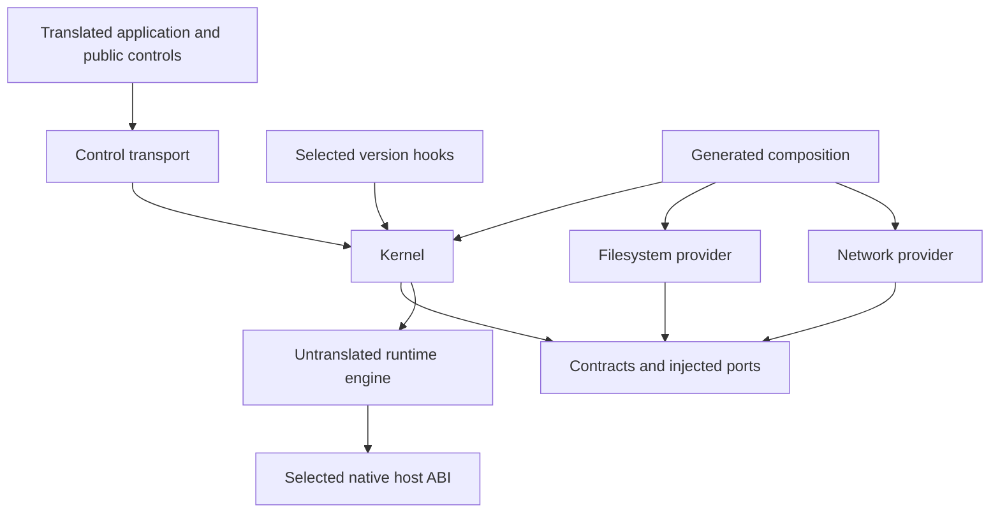

# Gosim architecture

Gosim translates application Go code into a deterministic simulation. A binary explicitly selects `rt`, `rt,fs`, `rt,net`, or `rt,fs,net`. Filesystem and network providers require the runtime. The selection is immutable before application initialization and shared by all machines in that binary.

The root API owns machine lifecycle. `fs`, `net`, and `rt` own their public controls. Their simulation implementations use typed control transport; native implementations return `ErrNotSim`, or the documented zero-value diagnostic result. There are no root network/timeout forwarding APIs or retained monolithic simulation package.

## Package ownership

| Package | Responsibility |
| --- | --- |
| `gosim`, `fs`, `net`, `rt` | Translated public machine and feature controls |
| `rt/runtime` | Untranslated scheduler, machine globals, deterministic primitives and engine |
| `rt/runtime/abi` | Untranslated primitive handles, bounded memory views and run records |
| `internal/contracts` | Translated identities, lifecycle, descriptors, typed services and injected ports |
| `internal/control` | Translated run binding and control-call transport |
| `internal/kernel` | Translated lifecycle coordinator, dispatcher, descriptor table, polling and process services |
| `internal/fs`, `internal/fs/model` | Filesystem provider, persistent state, snapshots and storage algorithms |
| `internal/net`, `internal/net/model` | Network provider, addressing, topology, sockets and packet/fault algorithms |
| `internal/compose` | Generates the selected provider/hook composition before package loading |
| `internal/translate` | AST transformations, selected policies and translation cache |
| `internal/buildspec`, `internal/buildcfg`, `internal/buildrun`, `internal/gosimtool` | Host configuration, identities, toolchain validation, builds and artifact handling |
| `internal/compat/{go125,go126}` | Family-owned hooks, shims, host ABI and reviewed profile metadata |
| `internal/compat/selected`, `internal/hostabi` | Compile-time profile selection and native ABI facade |



The kernel stores typed interfaces, not concrete filesystems or network stacks. Providers cannot import each other. Contracts import the ABI, not kernel/provider/public control packages. Public feature controls cannot import their concrete providers. Composition supplies exactly one provider per enabled optional feature, in FS/Net order, and none for disabled features.

The root API, controls, kernel, providers and selected standard-library hooks inhabit the translated type universe. The engine and ABI remain original Go packages, so translated modules can import the public runtime path. Private `internal/hostabi` stays inside the original Gosim module. Crossing this boundary uses primitive handles, bounded views, opaque native type pointers or explicit ABI records—not translated contexts, connections, times or reflect/container identities.

## Translation and composition

The host CLI resolves configuration and validates its exact compiler before calling `packages.Load`. Composition is generated first, with concrete imports and constructors only for selected providers. A new external module therefore cannot accidentally acquire both providers through a fixed runtime package list.

Translation rewrites goroutine creation, channels/selects, maps, synchronization and global accesses to deterministic runtime primitives. The imported package is `github.com/neria-cloud/gosim/rt/runtime`; its Go identifier remains `gosimruntime`. Existing translator filename/build-constraint rewriting preserves Linux source selection while compiling a native executable.

Each machine has isolated globals. The generated driver binds the translated control transport before application initialization. All fallible startup preparation happens before publication; only a committed runtime machine can execute package init and its boot callback.

The generated `Driver` creates one engine for the seed, enters its supervisor, opens the kernel/provider sessions, creates the controller machine and runs the test. Shutdown closes the kernel inside the active engine and closes the engine afterward. There is no nested scheduler or alternate monolithic runtime entry point.

## Runtime and replay

The engine uses cooperative coroutine scheduling, deterministic channels/maps, a seeded scheduler and simulated time. When no goroutine is runnable, simulated time can advance to the next scheduled event. Machine termination cancels its goroutines without executing their pending defers.

Machine IDs and epochs increase monotonically; failed starts consume their reserved epoch. Run IDs prevent stale handles from a previous simulation from being accepted. Run IDs are excluded from seed derivation and deterministic trace checksums. Overflow is a run failure, not ID reuse.

Scheduler, application, filesystem and network randomness use named, owned streams. Adding a draw in one provider does not advance another provider's stream. Reproduction requires the same complete build identity, replay revision and seed; it is not promised across toolchain, feature, source, host architecture or race-mode changes. The engine retains the single-active-run guard.

The host ABI facade selects version-owned native coroutine and race implementations using ordinary release bounds: Go 1.25 files exclude 1.26, and Go 1.26 files exclude 1.27. Other families fail explicitly. There is no blocking-channel coroutine fallback. The shared upcall wrapper contains ordinary Go state and selected facade calls, and is verified on both pinned families. Race object annotations carry one opaque native type pointer and preserve object-size/range behavior.

## Lifecycle transactions

`NewMachine` creates identity and configuration in `New`, without running init. Call optional configuration controls before `Start`. States progress through `Starting`, `Running`, `Stopping` and `Stopped`/`Crashed`; internal `Destroyed` invalidates the handle. `Restart` requires a completed epoch, while `SetMain` accepts unstarted or stopped/crashed machines.

Startup proceeds as follows:

1. Reserve a fresh epoch and descriptor table, then allocate a stopped runtime machine.
2. Ask enabled sessions to `Prepare`, in deterministic FS/Net order. Preparation cannot publish packets, flush retained disks, run application init or yield.
3. Validate stable bindings and service ownership.
4. Commit under the supervisor's transition barrier. Install bindings, publish instances, mark the epoch running and then admit application execution.

A failed prepare releases its own allocations. Successful preparations become transaction-owned and are either published once or aborted. Abort unwinds in reverse order, leaves retained state unchanged and releases addresses, descriptors and runtime staging. Repeated/aborted commit returns the transaction-state error. A publication panic or yield is an invariant failure that aborts the run.

Stop/crash closes admission, cancels dispatcher work and borrowed views, quiesces providers, disposes machine execution, settles provider state once, releases descriptors with the appropriate close reason, and detaches ephemeral state. Cleanup continues after errors and joins them. The controller is finalized last; session close order reverses opening order.

Graceful filesystem settlement flushes modeled writes. Crash settlement freezes the pre-crash state and selects the configured retained outcome. Network crash emits no final close notification; graceful descriptor release can enqueue an immutable final packet for a live destination. Provider callbacks and packets carry epoch/generation guards.

`Wait` captures the active epoch and returns its retained exit even if restart follows. Stop/crash on terminal states is idempotent; on `New` it returns `ErrNotStarted`. Returning self-targeted stop/crash/wait is rejected; explicit self-exit routes do not return. Destroy accepts unstarted or terminal machines, disposes provider state and invalidates the control handle. Controller/test-root termination is harness-owned.

## Dispatcher, descriptors and memory

Application calls enter a serialized supervisor dispatcher through generated stable route IDs and typed payload decoders. An invocation's fixed scalar/argument envelope stays inside the translated type universe. Application code cannot supply an arbitrary trampoline or provider pointer.

Submission validates run, epoch and admission. Completion is exactly once. Duplicate live completion fails; completion for a known canceled epoch is discarded with a diagnostic. Completion and cancellation clear borrowed views and result/argument references before reuse. Borrowed memory cannot survive an invocation; future asynchronous calls must copy input or own a checked lease.

The shared descriptor table dispatches read/write/close by resource capabilities and ownership. Domain methods use `FileOps` or `SocketOps`. Integer fcntl routes through the descriptor owner; pointer lock arguments use the distinct typed lock path. Generated wrappers marshal exact Go/Linux layouts to contracts and `rt/runtime/abi` views.

Polling belongs to the kernel. Registrations and deadlines carry generations in addition to machine epochs. Close/cancellation removes subscriptions, timers and borrowed calls; stale notifications cannot wake a new descriptor or restarted machine. Blocking socket operations retain EAGAIN plus poll behavior.

`getrandom`, `getpid`, and `uname` are runtime/kernel services and do not require fs/net. Their capability records remain accurate: deterministic application randomness, historical fixed PID 42, and limited uname fields. Standard descriptors/logging and named initialization probes have explicit ownership. Unknown syscalls/private symbols fail, rather than invoking host system calls.

## Filesystem provider

A session owns per-machine configuration, persistent disk state, retained snapshots and iterator handles. Prepare stages filesystem creation or restart state without changing the retained disk. Publish transfers ownership to the running instance; abort releases staged state.

Model algorithms live in `internal/fs/model`. Mutable state is supervisor-owned; provider randomness and clocks come through injected ports. Descriptor and mapping lifetimes follow the shared kernel cleanup protocol.

`FreezeCrash` retains an immutable crash image. Cloning uses the fs-owned random stream; enumeration uses a deterministic explicit depth-first stack, not a parked iterator goroutine. Closing an iterator releases its state but not snapshots already returned. Snapshots own retained references until close/session teardown and survive destruction of their source machine. Restore validates simulation ownership and target state. A positive public enumeration budget is enforced with lookahead and `ErrEnumerationLimit`.

This preserves existing storage semantics. It does not implement real flock/OFD contention, complete chmod/permission behavior, larger mapping support or other unmodeled syscall options. Stub/limited operations remain classified in the version manifests and cannot stand in for correctness evidence for applications that need those semantics.

## Network provider

A session owns topology, complete validated latency/loss policy groups, deterministic address reservations and per-machine configuration. Prepare stages a stack/address; abort releases the reservation without sending packets. Restart retains the assigned address and creates a new endpoint epoch.

Global defaults and per-link overrides are distinct. Link direction selects one ordered edge or both. A submitted non-nil group is copied atomically; nil leaves that override unchanged, while reset restores defaults. Explicit partitions are separate from sampled connection-loss state. Fault transitions consume traffic and the network-owned random stream; no background fault goroutine perturbs scheduling.

Packets include destination epochs and connection generations. Queue order and delivery remain deterministic. Quiesce cancels application callbacks; stale packets cannot reach restarted endpoints or reused connections. The model currently supports IPv4/TCP, with UDP/IPv6 and hostname-resolution gaps explicitly retained.

## Go compatibility and capabilities

The exact initial targets are Go 1.25.14/go125 and Go 1.26.9/go126 on linux/amd64, linux/arm64 and darwin/arm64, with four feature sets and race off/on. Family source selection is a compile-time boundary, not permission to run every patch in that family. `go.mod` declares the minimum language version, not the compatibility allowlist.

Each family owns hooks split by rt/kernel/fs/net, replacement shims, native ABI, source origins, private layouts, module pins and capability/policy manifests. Generation reads the pinned compiler and x/sys declarations for both Linux architectures; it rejects missing or changed required symbols and verifies generated output. The old hook/shared-shim trees and retired generation path are absent.

Package policies distinguish translated code, reviewed native-pure helpers, explicit bridges and rejected packages. Host compiler/runner networking is separate from simulated application imports. Disabled-feature wrappers remain linkable but enter the fatal feature gate and import no disabled model. Application recovery cannot convert that abort into success.

Unmodified HTTP/gRPC/crypto stacks with known translation gaps remain explicitly unsupported. Named initialization probes are implemented, limited/stubbed or rejected individually; there is no blanket successful NotImplemented response. The immutable declaration and route ledgers account for replaced legacy entry points.

## Build, cache and artifact identities

All commands share strict `gosim.json` loading and `-config`/`GOSIM_CONFIG`, `-go`, `-features`, and `-race` semantics. Features are a complete replacement override. Unknown fields, unapproved build environment/flags, unsupported workers and mismatched exact patches fail. Commands use the validated executable directly; normal CLI execution does not bootstrap another toolchain worker.

Identity includes exact toolchain/distribution/stdlib fingerprints, selected profile and adapter revision, runtime/provider revisions, translated input sources, module graph, host and simulated platform, features, race/tags and approved debug policy. Every framework source/test/script input participates in the executable-source fingerprint; documentation, `.git`, `.gosim`, and the designated status/evidence files are excluded. Promotion does not change the executable source it certifies. Application module-graph differences still separate artifacts without requiring framework re-certification for each application.

The existing STRICT SQLite cache table remains `cache(key TEXT PRIMARY KEY NOT NULL, timestamp INT, contents BLOB)`. There are no added application tables or indexes. Namespaced length-delimited content hashing and `CacheEntryV2` separate old/new data. Corrupt data is an observable miss with safe deletion/replacement; I/O failures propagate. Retention remains seven days with hourly-coarsened last-use timestamps.

Generated composition input is identity-scoped. Published artifacts are also **package-content-scoped**:

```text
.gosim/v2/<identity-digest>/input/
.gosim/v2/<identity-digest>/packages/<package-digest>/manifest.json
```

The manifest records identity, package digests, binary hash and generated-file hashes. Paths are normalized and checked against traversal/symlinks; materialization is exclusive into private staging. OS build locks and atomic publication prevent concurrent partial reuse. Batch/single-package lookup shares the same canonical dependency digest. Lookup never falls back to stale content or another feature/race tuple.

This per-package path resolves the planning clarification that one identity directory cannot contain one shared manifest for unrelated package builds. The source specification's abbreviated sidecar path has been reconciled accordingly.

## Metatesting and certification

Native metatests use identity/package-specific prebuilt workers. The versioned handshake validates content and patch before execution; children and forwarded stderr are owned and reaped. Rebuild diagnostics name the matching configuration. Candidate outputs and certified outputs occupy distinct identities and cannot substitute for each other.

Profiles declare tuples pending until reviewed execution evidence is recorded. Candidate certification can run only declared pending tuples. Its reports bind the exact source/tuple, actual worker architecture, execution mode, image digest where applicable, mandatory suites and log hashes. Normal commands require certified metadata and matching reviewed evidence. Source changes invalidate certification.

Developer gates and matrix jobs use isolated copies with identical executable inputs. Only the copy's existing tuple status/evidence metadata is reset to pending; the allowlist and original checkout are untouched. This permits testing edits to a promoted checkout without changing the pending-only selector or implying renewed certification. Copy metadata is recorded alongside evidence. Complete native ordinary/race checks share the same runner as certification; incremental `--ordinary` gates omit the full race pass until final verification.

The matrix enumerates exactly 48 tuples. Native CI executes on its actual Linux AMD64/Linux ARM64/Darwin ARM64 runner. Colima is used from Darwin ARM64 for Linux routes, recording native ARM64 or emulated AMD64 execution. The local existing VM uses Rosetta after QEMU failed a compiler smoke test. Missing emulation, wrong architecture, incomplete/skipped suites, failed tests or stale source fail the job. Docker reports/artifacts are copied through the API, avoiding assumptions about VM-shared host paths. Image digests and memory-bounded concurrency are explicit; no VM is recreated by the runner.

The suite applicability registry separates runtime, fs, net and full integration/nemesis/examples. Reduced-feature jobs execute their positive tests, native runtime/ABI/contracts and enabled model units, plus disabled-operation/replay/import boundaries. Full jobs execute the complete native suite, including real translated lifecycle fault fixtures and race-oracle checks when race is enabled. Compilation alone is never a passing tuple. Promotion is a separate reviewed metadata change after all required final-source executions.

Ordinary local reports carry `validation_only` and cannot be promoted. Authorized matrix workers request `certify -large`, which invokes the same `make test-large` reporter against the prepared tuple. Candidate boundary/replay tests select only that tuple and reuse the matrix's positive-suite coverage; translation-cache tests run on `rt`, and CLI script fixtures on `rt,fs,net`. The report runner requires terminal passes for the selected worker and feature subtest, so a skipped worker or empty selection cannot produce successful large-suite evidence. The certification report includes the hashed large-suite log alongside the other required suites; detailed logs, timelines, JSON and JUnit files are preserved beside it.

## Scope and supporting records

The design does not include mutable/per-machine feature sets, concurrent independent engines, native scheduling with virtual fs/net, external provider plugins, extra host platforms, non-Linux simulation, automatic worker bootstrap, or repairs to the documented HTTP/gRPC and syscall-model gaps.

The [usage guide](../README.md) describes current APIs and commands. The [historical syscall audit](reports/syscall-support-for-gquorum.md) records application requirements that remain outside this refactor. Family [go125](../internal/compat/go125/profile/capabilities.json) and [go126](../internal/compat/go126/profile/capabilities.json) capability manifests retain the distinction between modeled, limited, stub and rejected behavior. Passing a simulator test does not establish correctness for an application that relies on a known missing semantic.
