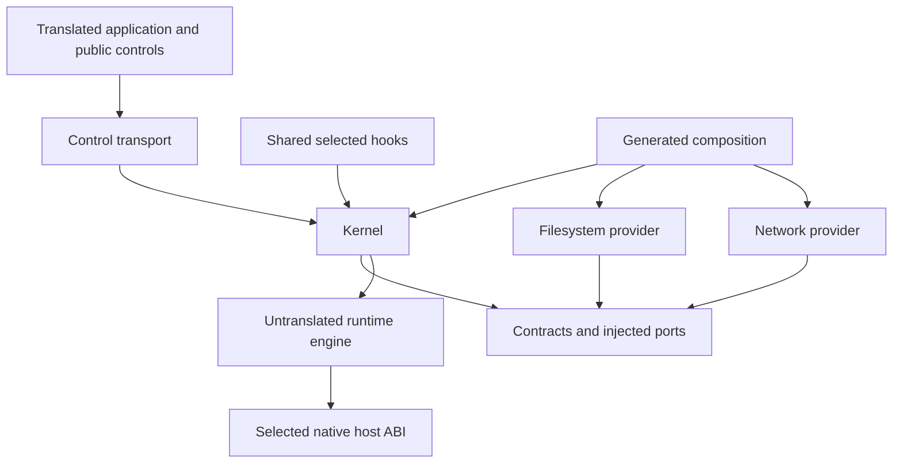

# Gosim architecture

[Architecture diagram](diagrams/architecture.svg) shows translation,
bridges, and native execution. [Animated test workflows](diagrams/test-workflows.svg)
show network and filesystem scenarios and their assertions.

Gosim translates application Go code into a deterministic simulation. A binary explicitly selects `rt`, `rt,fs`, `rt,net`, or `rt,fs,net`. Filesystem and network providers require the runtime. The selection is immutable before application initialization and shared by all machines in that binary.

The root API owns machine lifecycle. `fs`, `net`, and `rt` own their public controls. Their simulation implementations use typed control transport; native implementations return `ErrNotSim`, or the documented zero-value diagnostic result. There are no root network/timeout forwarding APIs or retained monolithic simulation package.

## Package ownership

| Package | Responsibility |
| --- | --- |
| `gosim`, `fs`, `net`, `rt` | Translated public machine and feature controls |
| `rt/runtime` | Untranslated scheduler, machine globals, deterministic primitives and engine |
| `rt/runtime/abi` | Untranslated primitive handles, bounded memory views and run records |
| `internal/contracts` | Translated identities, lifecycle, descriptors, typed services and injected ports |
| `internal/control` | Translated run binding and control-call transport |
| `internal/kernel` | Translated lifecycle coordinator, dispatcher, descriptor table, polling and process services |
| `internal/fs`, `internal/fs/model` | Filesystem provider, persistent state, snapshots and storage algorithms |
| `internal/net`, `internal/net/model` | Network provider, addressing, topology, sockets and packet/fault algorithms |
| `cmd/gosim`, `internal/workerboot` | Independent launcher, caller source/compiler discovery and automatic cached worker bootstrap |
| `cmd/gosim-worker`, `internal/gosimcli` | Direct native worker, protocol validation and commands |
| `internal/compose` | Generates the selected provider/hook composition before package loading |
| `internal/translate` | AST transformations, selected policies and translation cache |
| `internal/buildspec`, `internal/buildcfg`, `internal/buildrun`, `internal/gosimtool` | Host configuration, identities, toolchain validation, builds and artifact handling |
| `internal/compat/{hooks,shims,host}` | Shared translated hooks/shims and native ABI implementation |
| `internal/compat/{profiles,spec,audit}` | Cumulative definitions, metadata contracts and explicit source-inspection tooling |
| `internal/compat/selected`, `internal/hostabi` | Compile-time profile selection and native ABI facade |



The kernel stores typed interfaces, not concrete filesystems or network stacks. Providers cannot import each other. Contracts import the ABI, not kernel/provider/public control packages. Public feature controls cannot import their concrete providers. Composition supplies exactly one provider per enabled optional feature, in FS/Net order, and none for disabled features.

The root API, controls, kernel, providers and selected standard-library hooks inhabit the translated type universe. The engine and ABI remain original Go packages, so translated modules can import the public runtime path. Private `internal/hostabi` stays inside the original Gosim module. Crossing this boundary uses primitive handles, bounded views, opaque native type pointers or explicit ABI records—not translated contexts, connections, times or reflect/container identities.

## Translation and composition

The host CLI resolves configuration and validates its exact compiler before calling `packages.Load`. Composition is generated first, with concrete imports and constructors only for selected providers. A new external module therefore cannot accidentally acquire both providers through a fixed runtime package list.

Translation rewrites goroutine creation, channels/selects, maps, synchronization and global accesses to deterministic runtime primitives. The imported package is `github.com/neria-cloud/gosim/rt/runtime`; its Go identifier remains `gosimruntime`. Existing translator filename/build-constraint rewriting preserves Linux source selection while compiling a native executable.

Each machine has isolated globals. The generated driver binds the translated control transport before application initialization. All fallible startup preparation happens before publication; only a committed runtime machine can execute package init and its boot callback.

The generated `Driver` creates one engine for the seed, enters its supervisor, opens the kernel/provider sessions, creates the controller machine and runs the test. Shutdown closes the kernel inside the active engine and closes the engine afterward. There is no nested scheduler or alternate monolithic runtime entry point.

## Runtime and replay

The engine uses cooperative coroutine scheduling, deterministic channels/maps, a seeded scheduler and simulated time. Translated atomic operations, including uncontended mutex fast paths, provide scheduling points so synchronized polling loops permit peer progress. These implicit scheduling points respect nested procPin sections and non-yielding supervisor transactions; explicit yields and waits remain prohibited inside transactions. When no goroutine is runnable, simulated time can advance to the next scheduled event. Machine termination cancels its goroutines without executing their pending defers.

The selected family replaces `sync.Map` with deterministic map storage. Each operation schedules before a non-yielding critical section; its private native mutex supplies host race synchronization. `Range` copies a snapshot in deterministic iteration order and invokes callbacks after unlocking, permitting reentrant mutation. This models the public concurrent-map contract without exposing Go's host-address-dependent hash-trie shape to atomic scheduling. Other `sync` primitives remain translated.

Machine IDs and epochs increase monotonically; failed starts consume their reserved epoch. Run IDs prevent stale handles from a previous simulation from being accepted. Run IDs are excluded from seed derivation and deterministic trace checksums. Overflow is a run failure, not ID reuse.

Scheduler, application, filesystem and network randomness use named, owned streams. Adding a draw in one provider does not advance another provider's stream. Reproduction requires the same complete build identity, replay revision and seed; it is not promised across toolchain, feature, source, host architecture or race-mode changes. The engine retains the single-active-run guard.

The host ABI facade uses shared native coroutine and race implementations selected by ordinary Go source constraints. Generated family guards reject unsupported families. A changed implementation closes the prior variant's release interval and starts a new variant inherited by later minors; there are no runtime family switches or manual release tags. There is no blocking-channel coroutine fallback. The shared upcall wrapper contains ordinary Go state and selected facade calls, and is verified on both recorded families. Race object annotations carry one opaque native type pointer and preserve object-size/range behavior.

## Lifecycle transactions

`NewMachine` creates identity and configuration in `New`, without running init. Call optional configuration controls before `Start`. States progress through `Starting`, `Running`, `Stopping` and `Stopped`/`Crashed`; internal `Destroyed` invalidates the handle. `Restart` requires a completed epoch, while `SetMain` accepts unstarted or stopped/crashed machines.

Startup proceeds as follows:

1. Reserve a fresh epoch and descriptor table, then allocate a stopped runtime machine.
2. Ask enabled sessions to `Prepare`, in deterministic FS/Net order. Preparation cannot publish packets, flush retained disks, run application init or yield.
3. Validate stable bindings and service ownership.
4. Commit under the supervisor's transition barrier. Install bindings, publish instances, mark the epoch running and then admit application execution.

A failed prepare releases its own allocations. Successful preparations become transaction-owned and are either published once or aborted. Abort unwinds in reverse order, leaves retained state unchanged and releases addresses, descriptors and runtime staging. Repeated/aborted commit returns the transaction-state error. A publication panic or yield is an invariant failure that aborts the run.

Stop/crash closes admission, cancels dispatcher work and borrowed views, quiesces providers, disposes machine execution, settles provider state once, releases descriptors with the appropriate close reason, and detaches ephemeral state. Cleanup continues after errors and joins them. The controller is finalized last; session close order reverses opening order.

Graceful filesystem settlement flushes modeled writes. Crash settlement freezes the pre-crash state and selects the configured retained outcome. Network crash emits no final close notification; graceful descriptor release can enqueue an immutable final packet for a live destination. Provider callbacks and packets carry epoch/generation guards.

`Wait` captures the active epoch and returns its retained exit even if restart follows. Stop/crash on terminal states is idempotent; on `New` it returns `ErrNotStarted`. Returning self-targeted stop/crash/wait is rejected; explicit self-exit routes do not return. Destroy accepts unstarted or terminal machines, disposes provider state and invalidates the control handle. Controller/test-root termination is harness-owned.

## Dispatcher, descriptors and memory

Application calls enter a serialized supervisor dispatcher through generated stable route IDs and typed payload decoders. An invocation's fixed scalar/argument envelope stays inside the translated type universe. Application code cannot supply an arbitrary trampoline or provider pointer.

Submission validates run, epoch and admission. Completion is exactly once. Duplicate live completion fails; completion for a known canceled epoch is discarded with a diagnostic. Completion and cancellation clear borrowed views and result/argument references before reuse. Borrowed memory cannot survive an invocation; future asynchronous calls must copy input or own a checked lease.

The shared descriptor table dispatches read/write/close by resource capabilities and ownership. Domain methods use `FileOps` or `SocketOps`. Integer fcntl routes through the descriptor owner; pointer lock arguments use the distinct typed lock path. Generated wrappers marshal exact Go/Linux layouts to contracts and `rt/runtime/abi` views.

Polling belongs to the kernel. Registrations and deadlines carry generations in addition to machine epochs. Close/cancellation removes subscriptions, timers and borrowed calls; stale notifications cannot wake a new descriptor or restarted machine. Blocking socket operations retain EAGAIN plus poll behavior.

`getrandom`, `getpid`, and `uname` are runtime/kernel services and do not require fs/net. Their capability records remain accurate: deterministic application randomness, historical fixed PID 42, and limited uname fields. Standard descriptors/logging and named initialization probes have explicit ownership. Unknown syscalls/private symbols fail, rather than invoking host system calls.

## Filesystem provider

A session owns per-machine configuration, persistent disk state, retained snapshots and iterator handles. Prepare stages filesystem creation or restart state without changing the retained disk. Publish transfers ownership to the running instance; abort releases staged state.

Model algorithms live in `internal/fs/model`. Mutable state is supervisor-owned; provider randomness and clocks come through injected ports. Descriptor and mapping lifetimes follow the shared kernel cleanup protocol.

The inode tree stores files, directories and symlinks under `/`, while `/app` remains the default process working directory. File content uses copy-on-write 1 KiB chunks. Capacity defaults to 128 MiB; live quota counts allocated chunks of linked or open files, not sparse holes or retained snapshot copies. Writes and fallocate reservations admit all needed blocks before applying operations and fail atomically with `ENOSPC`. Truncation and final unlink/close release the charge. `fs.Stats`, `statfs` and `fstatfs` report the live volume; a recovered image over the configured limit reports zero free and remains readable. Live resizing is out of scope.

Files and directories retain mode, UID and GID through allocation, metadata pending operations, flush and crash selection. A fixed `0022` umask applies on creation; owner/group/other access uses the machine's primary UID/GID, with root bypass. Directory execute gates traversal and write plus execute gates mutations. Chmod requires owner or root; chown requires root. Read-only is a per-machine policy retained across epochs and restore, immediately rejecting mutations through existing descriptors until toggled off. Configured fixed latency delays scalar completion of filesystem data I/O and mutations after synchronous provider effects; dispatcher epoch events hold no borrowed memory and are canceled with the epoch. Stat and statfs queries are immediate.

`FreezeCrash` retains an immutable crash image. Cloning uses the fs-owned random stream; enumeration uses a deterministic explicit depth-first stack, not a parked iterator goroutine. Closing an iterator releases its state but not snapshots already returned. Snapshots own retained references until close/session teardown and survive destruction of their source machine. Restore validates simulation ownership and target state. A positive public enumeration budget is enforced with lookahead and `ErrEnumerationLimit`.

The provider still omits hard links, distinct mounts/Statx, dup/OFD sharing, special files, supplemental groups, ACLs, sticky bits, real flock/OFD contention and larger mapping support. Integer fcntl returns ENOSYS; NONBLOCK, append, O_PATH, O_TMPFILE and openat2 are unsupported. Timestamps remain zero, directory link counts are incomplete, and there is no procfs fallback. Stub/limited operations remain classified in the version manifests and cannot stand in for correctness evidence for applications that need those semantics.

See [directory handles and os.Root](file-system.md) for the user-facing design,
capabilities and limitations.

## Network provider

A session owns topology, complete validated latency/loss policy groups, deterministic address reservations and per-machine configuration. Prepare stages a stack/address; abort releases the reservation without sending packets. Restart retains the assigned address and creates a new endpoint epoch.

Global defaults and per-link overrides are distinct. Link direction selects one ordered edge or both. A submitted non-nil group is copied atomically; nil leaves that override unchanged, while reset restores defaults. Explicit partitions are separate from sampled connection-loss state. Fault transitions consume traffic and the network-owned random stream; no background fault goroutine perturbs scheduling.

Packets include destination epochs and connection generations. Queue order and delivery remain deterministic. Quiesce cancels application callbacks; stale packets cannot reach restarted endpoints or reused connections. The model currently supports IPv4/TCP, with UDP/IPv6 and hostname-resolution gaps explicitly retained. The configured TCP buffer size is captured per direction at connection creation; zero selects the historical 1 KiB window, and reconfiguration never resizes live or pending streams.

## Go compatibility and capabilities

The support registry accepts stable Go 1.25.* / go125 and Go 1.26.* / go126 releases on linux/amd64, linux/arm64 and darwin/arm64, with four feature sets and independently selected race instrumentation. Go tooling resolves the compiler in the caller's context. Family source selection remains a compile-time boundary; exact compiler and source fingerprints distinguish artifacts.

Go 1.25 is the complete authored metadata baseline. Each later `profiles/go1NN.json` declares an immediate parent, support status and typed add/replace/remove operations. Resolution folds every intermediate delta in order: 1.27 would inherit 1.25 + 1.26 + 1.27. Missing ancestry, overlapping declarations and invalid operations fail. Both architecture contracts are resolved in memory; expanded profile JSON is not stored. Shared hooks remain split by rt/kernel/fs/net. Common code has one implementation; only changed functions or interfaces need bounded source variants. Retiring support does not remove retained ancestry.

`gosim-gen profiles` derives support tables, selectors, guards and conservative adapter revisions directly from definitions. It can repair generated metadata without first loading it and can bootstrap before origin creation. Check mode requires complete independent origins. Generation uses each family's recorded exact compiler and x/sys declarations for both Linux source architectures. Shared adapter outputs have version-neutral headers; conflicting generated bytes require an explicit source variant. Origins are on disk, not embedded in the runtime; immutable historical evidence is consolidated separately. Ordinary builds still verify actual hooks/layouts/constants, with successful checks cached by compiler/source content.

The metadata-only `gosim-gen` dependency closure excludes selected/native ABI and executable hooks/shims/runtime. Explicit `observe` and `compare` use restricted source-query commands with the actual running stable compiler; normal worker/build admission is unchanged. A shared inventory derives context-specific contracts/packages and the finite exported API surface from declarations and bridges. Successful standard-library listing distinguishes an absent package from a loader failure. Missing required packages become findings; parse/type/load errors make affected contexts incomplete. Compare requires the immediate next minor and never silently launches an older compiler.

A parent snapshot binds its exact baseline compiler, parent definition/origin, inspector source, selected external module inputs and requested host/architecture/source contexts. Target definitions/support outputs alone do not stale it. With a snapshot, reports compare actual exported APIs and package/source inventories; without one, API coverage is explicitly skipped. Identity/module/source rechecks precede completeness. Output paths are checked early and exclusively published, with the closed JSON manifest linked last. Markdown groups equal findings across contexts and prioritizes incompatibilities. Draft operations require review and cannot be loaded as definitions. Audit results do not certify support. See the [onboarding commands](../README.md#reviewing-a-new-go-family).

Adapter revisions bind canonical ancestry and conservative compatibility/hostabi/buildspec inputs, excluding origins, exact history, tests and generated revision constants. Whole-framework TranslatorDigest includes origins, tests and scripts, while excluding documentation and designated evidence. InspectorDigest instead binds non-test inspection implementation and request construction independently of the building compiler, excluding target data/generated support. External module graphs, module/workspace files and relevant replacement source are bound separately. Audit artifacts are explicit outputs, never a persistent cache.

Package policies distinguish translated code, reviewed native-pure helpers, explicit bridges and rejected packages. Host compiler/runner networking is separate from simulated application imports. Disabled-feature wrappers remain linkable but enter the fatal feature gate and import no disabled model. Application recovery cannot convert that abort into success.

Existing application and dependency code is translated automatically when it needs simulated scheduling, globals, timers or I/O. Reviewed computation can stay native without traversing or copying its implementation dependencies. Symbol-level bridges admit Ed25519 and CRC32 operations directly, without translated adapters. CRC32 standard tables are shared and must remain read-only under the Go API contract. Ed25519 `GenerateKey` uses its supplied reader; passing the translated `crypto/rand.Reader` preserves deterministic replay. As an explicit exception, `GenerateKey(nil)` uses native host randomness and is not replay-deterministic. Native hash/cipher state belongs to its caller and contains no simulated descriptors or scheduler objects. Native imports inside owned adapters bypass symbol rewrites only after the profile authorizes that exact import; application directives cannot bypass a symbol allowlist.

Native boundary nodes depend on their selected symbol adapters, so those adapters participate in initialization, content hashing and global isolation. Legacy `runtime.fastrand`, `fastrandn` and `fastrand64` linknames require exact primitive signatures and resolve to deterministic adapters for any caller, without application-specific profiles.

Optional TLS/X509/OCSP, ECDSA/RSA and curve interfaces have guarded declaration facades; their certificate, signing and key-generation algorithms are not implemented in Gosim. Active runtime tracing, host subprocess, signal and profiling operations abort. The exact pinned reflect2 replacement supplies public type metadata for jsoniter initialization; raw-pointer and value operations remain guarded. Diagnostic profiling labels are simulated goroutine state. Translated plaintext HTTP request/response, connection reuse, streaming, cancellation and graceful shutdown are tested over simulated TCP, as is the real three-node embedded etcd 3.5.17 cluster with partition recovery and snapshot/WAL round trips. This does not establish full HTTP/HTTPS compatibility or stronger storage-lock guarantees. Plaintext gRPC stays entirely translated; the independent `examples/network/grpc` module exercises authenticated unary and bidirectional binary streams. Protobuf sees no executable image (`os.Executable` returns ENOENT), and x/sys sees no ELF auxiliary vector. Optional runtime collectors can register against an empty metric catalogue, but actual heap, thread and goroutine measurements abort. The separate `examples/network/nats` module owns its NATS dependencies and exercises plain TCP Core messaging. Kernel-owned scatter/gather writes submit one ordered write and preserve partial-write results for the upstream polling loop.

 Named initialization probes are implemented, limited/stubbed or rejected individually; there is no blanket successful NotImplemented response. The immutable declaration and route ledgers account for replaced legacy entry points.

## Build, cache and artifact identities

The optional schema-2 `gosim.json` contains features and simulation_os only; its absence selects rt/fs/net and Linux. All commands share `-config`/`GOSIM_CONFIG`, optional explicit `-go`, `-features`, and `-race` semantics. Schema-1 compiler selections remain deprecated explicit overrides. Features are a complete replacement override. Unknown fields, unapproved build flags, unsupported families and incompatible contracts fail.

The family-independent launcher asks Go tooling to resolve the caller module/workspace compiler and Gosim dependency, including replacements. It freezes the selected executable and constructs a content-keyed native worker cache under `workers/v1`. The key binds exact compiler/stdlib, source, worker dependency graph, platform and build protocol. Per-key cancellable locks, rechecks, private staging and atomic publication permit concurrent reuse. Binary hashes, build metadata and a bounded handshake validate cache hits. A private invocation file conveys the resolved context; the worker revalidates it before command execution. Cancellation signals and reaps owned process groups. There is no install-time Gosim-source fallback. Discovery preserves Go’s resolved GOMODCACHE location in child environments even though GOENV is disabled for builds; cache paths are transient context, while selected source contents remain bound by digests.

Application loading retains the original module/workspace context. Generated composition, contract inspection and translated output use private modules with GOWORK off, preserving the original graph roots and selected replacements. Graph comparison rejects upgrades, missing dependencies and extra dependencies before compilation. This respects Go's pruned graph without promoting every transitive dependency to a direct root. Caller go.mod/go.sum/go.work files are not rewritten by these private builds.

Identity includes exact toolchain/stdlib fingerprints, selected profile and adapter revision, runtime/provider revisions, translated input sources, module graph, host and simulated platform, features, race/tags and approved debug policy. Every framework source/test/script input participates in the executable-source fingerprint; documentation, `.git`, `.gosim`, and the designated status/evidence files are excluded. Certification metadata is independent of executable identity and cannot gate ordinary use. Application module-graph differences still separate artifacts.

The existing STRICT SQLite cache table remains `cache(key TEXT PRIMARY KEY NOT NULL, timestamp INT, contents BLOB)`. There are no added application tables or indexes. Namespaced length-delimited content hashing and `CacheEntryV2` separate old/new data. Corrupt data is an observable miss with safe deletion/replacement; I/O failures propagate. Retention remains seven days with hourly-coarsened last-use timestamps.

Generated composition input is identity-scoped. Published artifacts are also **package-content-scoped**:

```text
.gosim/v2/<identity-digest>/input/
.gosim/v2/<identity-digest>/packages/<package-digest>/manifest.json
```

Go's indirect test-dependency variants retain their package IDs and selected
imports in the graph and cache keys. They translate their full production
source; only the package directly augmented by its own tests filters production
files from its test-addition pass. A cache miss for an indirect variant reloads
syntax/types through its owning test root, including dependencies, so test-only
exports remain available without fabricating a standalone base package.

The manifest records identity, package digests, binary hash and generated-file hashes. Paths are normalized and checked against traversal/symlinks; materialization is exclusive into private staging. OS build locks and atomic publication prevent concurrent partial reuse. Batch/single-package lookup shares the same canonical dependency digest. Lookup never falls back to stale content or another feature/race tuple.

This per-package path resolves the planning clarification that one identity directory cannot contain one shared manifest for unrelated package builds. The source specification's abbreviated sidecar path has been reconciled accordingly.

## Metatesting and certification

Native metatests freeze their running test process’s compiler and automatically obtain a matching CLI worker from the caller-selected Gosim source. They use identity/package-specific prebuilt simulation executables; uncached runs can prepare them. Explicit GOSIMTOOL overrides require a matching cached worker manifest. The versioned handshake validates content and the concrete compiler before execution; children and forwarded stderr are owned and reaped. Rebuild diagnostics name the matching configuration. Certification status does not enter artifact identity.

Certification is an optional manual operation, absent from CI and ordinary-command admission. Manual reports bind the exact source/build, actual worker architecture, execution mode, image digest where applicable, mandatory suites and log hashes. Missing or stale reports do not prevent ordinary use. Historical profile tuple/evidence files are no longer support allowlists and are not rewritten by test snapshots.

`make test` resolves the compiler through Go tooling and runs ordinary tests in an isolated copy with identical executable inputs. `make test-race` and `make test-large` select their separate suites only when explicitly requested. The lower-level `verify` command runs one mode: ordinary by default or race with `-race`. It writes suite logs without producing a certification report. Snapshot metadata and source checks remain under `.gosim/verification`; user-facing reports, timelines, JSON and JUnit results remain under `test-reports/<suite>/`.

CI runs `make test` and report-tool checks on native ARM64 Linux workers with Go family selectors `1.25.x` and `1.26.x`. CI uploads test reports and never invokes the certification matrix, evidence promotion, race suites or large suites automatically.

The explicit manual certification matrix defaults to 16 tuples: two representative patches, Linux ARM64 and Darwin ARM64, four feature sets, without race instrumentation. AMD64 and race certification remain disabled in matrix selection, the worker, and direct `certify -large` execution. Colima is an explicit manual route from Darwin ARM64 to Linux ARM64. Wrong architecture, incomplete/skipped suites, failed tests or stale source fail a manual report. Docker reports/artifacts are copied through the API; image digests and bounded concurrency remain recorded.

The suite applicability registry separates runtime, fs, net and full integration/nemesis packages. Reduced-feature jobs execute their applicable positive tests and native model units; full jobs execute all applicable native tests. Manual certification requires explicit large-suite coverage. Its reporter runs the already-prepared tuple rather than repeating an internal feature/toolchain sweep, and requires terminal passes for the selected tests. Ordinary reports never claim certification.

## Compatibility storage accounting

Measured against starting revision `550d5e3`, using file contents (not filesystem
allocation or Git object storage). The original two family trees contained **195
files / 1,785,064 bytes**, including their tests and metadata. The new shared
`hooks`, `shims` and `host` trees contain **96 files / 310,136 bytes**, including
tests. That narrow comparison excludes metadata and tooling; the complete scope
below includes those costs.

| Production and data scope | Before files / bytes | After files / bytes |
| --- | ---: | ---: |
| `internal/compat` (including audit/spec/profiles) | 177 / 1,725,538 | 103 / 1,021,584 |
| `internal/hostabi` | 12 / 9,728 | 8 / 5,056 |
| `internal/buildspec` (including support registry) | 9 / 30,322 | 10 / 33,624 |
| `internal/buildcfg` (including inspection discovery) | 5 / 21,307 | 6 / 25,075 |
| `internal/routegen` | 12 / 73,782 | 13 / 78,980 |
| `cmd/gosim-gen` | 1 / 2,567 | 2 / 8,834 |
| **Total production and data** | **216 / 1,863,244** | **142 / 1,173,153** |

Production/data decreases by **74 files and 690,091 bytes (37.0%)**. Independent
origins and consolidated history remain **3 files / 238,626 bytes**, included in
the totals. The entire audit directory, including its tests, costs **9 files /
80,676 bytes**. The baseline definition is 367,659 bytes; its 1.26 delta is 8,894
bytes. Adding an unchanged future family copies zero implementation files;
selectors, support guards and revisions are generated from its small definition.

Tests/fixtures in the same scope, plus the shared test helper, increase from
**78 files / 558,144 bytes** to **95 files / 634,190 bytes**. The existing scoped
document remains 1 file / 2,346 bytes. Thus the whole scoped tree decreases from
**295 files / 2,423,734 bytes** to **238 files / 1,809,689 bytes**, including tests.
README, agent guidance, this design, diagram and tracked plan/progress documentation
are reported separately in the execution record; they are excluded from the
production figures. Untracked peer discussions and ignored brainstorms are not
committed implementation.

Ignored generated provenance/check records and explicit audit outputs are separate
local costs, not needed to store support for another family. A six-context parent
snapshot can occupy tens of megabytes; audit reports may also be large. The
execution record lists the measured artifact directories and bytes. No expanded
resolved profiles or audit snapshots are committed.

## Scope and supporting records

The design does not include mutable/per-machine feature sets, concurrent independent engines, native scheduling with virtual fs/net, external provider plugins, extra host platforms, non-Linux simulation, or complete HTTP/HTTPS and syscall-model semantics beyond the documented supported scope.

The [usage guide](../README.md) describes current APIs and commands. The [historical syscall audit](reports/syscall-support-for-gquorum.md) records application requirements at its original baseline. Current descriptor/Root semantics are described in the [filesystem guide](file-system.md#osroot-and-directory-descriptors); the historical audit is not rewritten as new execution evidence. Family [go125](../internal/compat/profiles/go125.json) and [go126](../internal/compat/profiles/go126.json) capability manifests retain the distinction between modeled, limited, stub and rejected behavior. Passing a simulator test does not establish correctness for an application that relies on a known missing semantic.
