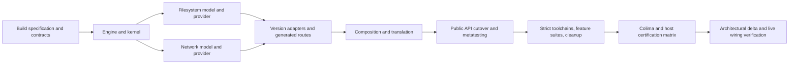

# Implementation plan: modular Gosim features and versioned Go compatibility

**Plan:** `./docs/plans/20261019-modular-features-and-go-compatibility.md`  
**Date:** 2026-10-19  
**Project source:** `./` (from this document: `../../`)  
**Source baseline / branch:** `e6122b1` / `main`  
**Target architecture:** [docs/brainstorms/20261018-modular-features-and-go-compatibility-target.md](../brainstorms/20261018-modular-features-and-go-compatibility-target.md)  
**Target SHA-256 at planning:** `113f9e343554b42f101c0e6b20168e3f5ddc1af38c5a93e355e2203ff223a31e`  
**Full brainstorm log:** [docs/brainstorms/20261018-modular-features-and-go-compatibility.md](../brainstorms/20261018-modular-features-and-go-compatibility.md)  
**Declaration inventory:** [110 files / 1,604 declarations](../brainstorms/20261018-modular-features-and-go-compatibility-inventory.md)  
**Related evidence:** [gquorum syscall audit](../reports/syscall-support-for-gquorum.md)  
**Status:** in progress; Tasks 1–28 (including their recorded children) implemented and verified under the amended validation cadence; Tasks 29–33 remain unchecked. Full race suites are deferred to final verification.

## Important notices

- The target is the design authority. References such as **T§5 / StartTxn** identify its numbered section and exact declaration/subheading; **I: path** identifies the source-file section in the declaration inventory. Apply target overrides before mechanically preserving inventoried declarations.
- User authorization raises the skill's usual 550-line task limit to **5,000 changed lines per commit**. Estimates below include implementation, tests, fixtures, generated additions/deletions, and documentation. Measure additions plus deletions with rename detection; an unchanged file move is a rename, not a reason to omit its review. Do not exclude generated code from the budget. If actual work exceeds the cap, split at a buildable boundary, record numbered child tasks before execution, and retain their checks. Never commit a broken intermediate state to meet the cap.
- Each task normally produces one commit. Suggested sizes are review budgets, not padding targets. Record commit, actual size, toolchain, commands, and results in the execution log. No implementation, new certification, or performance claim is made by creating this plan.
- No public backward-compatibility promise, aliases, forwarding wrappers, or deprecation period. The public API changes in Task 22 with all callers. Earlier construction of unused new internals is an implementation sequence, not an additional supported execution mode.
- Every task must build and pass its Verification block and the common commit gate below. Investigate and fix failing tests, including failures outside the immediate subsystem; never waive them merely as unrelated. Do not silently drop tests to obtain a green suite. Unsupported application integrations become explicit rejection tests as described below.
- The source uses module path `github.com/neria-cloud/gosim`; some existing guidance still says glycerine. Use the actual module path. `project.txt`, `architecture/`, and a separate documentation Git repository do not exist here; current architecture evidence is `docs/design.md`, README, and source. This plan belongs to the existing project repository.
- `docs/brainstorms/` is ignored by this repository; `docs/plans/` was also added to the staged ignore rules during this planning session. Keep these local documents available when executing this plan; it references the target/log/inventory rather than copying a second architecture specification. No separate documentation repository exists, and this plan is not force-added over that ignore rule. The syscall report now resides in `docs/reports/`, despite the historical `repots` link in the brainstorm log.

## Scope and implementation approach

Implement the target's four immutable feature sets (`rt`, `rt,fs`, `rt,net`, `rt,fs,net`), immediate public API replacement, provider isolation, explicit disabled-feature failures, and separate compile-time go125/go126 source. Initial certification targets remain **go1.25.14** and **go1.26.9** on **linux/amd64, linux/arm64, darwin/arm64**, with simulated Linux ABI and race off/on: **48 execution combinations**. These are pending targets. The historical Go 1.26.0 pass is development evidence only.

Proceed from contracts and orchestration down to provider/model implementation, then connect the complete path and certify it. The native engine move precedes translated contracts because generated modules must be able to import `rt/runtime/abi`. Family-specific hooks follow stable kernel/service signatures so generation is not repeatedly redesigned. Existing execution remains available on the development branch until the new path is wired; its code is then removed in bounded commits.



Reuse T§3's dependency graph: kernel/public APIs import contracts, never concrete providers; only generated composition imports providers. Keep `rt/runtime` and ABI native, domain controls/kernel/providers translated, and Go private-ABI code within selected version folders. No database migration: the existing SQLite table stays unchanged (T§9 / Persistence and schemas); cache envelopes and identities change instead.

Expected performance effects are architectural: provider interfaces add a small dispatch cost; disabled providers remove model initialization; cache identities increase cache separation; immutable recovery snapshots retain data explicitly. Do not add benchmarks or optimize allocations by weakening ownership. The target requires correctness/replay tests, not a performance campaign or extended chaos campaign.

## Planning clarifications and migration constraints

These clarify execution of the target; they do not add optional product features. Reconcile the named target passages when implementation updates architecture documentation in Task 31. If implementation evidence requires a different architectural decision, record it before changing scope.

| Issue found in source/target | Implementation resolution | Owner |
| --- | --- | --- |
| Target artifact root uses only build identity, but multiple test packages can share it | Treat `.gosim/v2/<identity>/` as a namespace. Store each binary and the unchanged manifest schema under `packages/<package-build-digest>/`; key locks/staging by both identity and package build digest. Batch commands return a list of package artifacts. No last-package-wins manifest | 20, 21, 23; clarify T§9 artifact location |
| Pending certification cannot be tested through commands that accept only certified tuples | Build/run pending tuples only through the internal candidate driver; stamp candidate identity from its first use. Normal command enforcement is activated once the driver is wired. No fake certified entry and no public unsupported bypass | 21, 24, 32 |
| Toolchain/race changes affect generated hooks, metatests and normal tests together | Keep one explicitly recorded development toolchain per intermediate commit; prepare the corresponding test artifacts before host metatests. Add exact target families as their adapters land; final acceptance requires both families and all tuples | Every Verification block |
| Current one-way network controls return EOPNOTSUPP, but target Direction.Forward selects one edge | Implement real directed connectivity/policy state and directional queue invalidation to satisfy T§4; keep Both symmetric. Do not carry the old successful-no-change or unsupported behavior into the target API | 10, 11, 22 |
| Native net/http/gRPC skip policies and existing HTTP race/nemesis examples conflict with explicit unsupported boundaries | Audit every import use. Preserve supported behavior as raw-TCP tests where the test's purpose is I/O/race/lifecycle; retain explicit rejection coverage for unsupported HTTP/gRPC examples. Native compiler/test-driver infrastructure is separate from simulated application imports. Never reclassify host networking as native-pure | 13, 17, 25, 31 |
| Minimal-feature tuples cannot compile/run all files of the current full-feature behavior package | Separate runtime, fs, net, and integration test packages, with explicit tuple applicability. Test disabled APIs in isolated negative fixtures. Run full integration on full-feature tuples and relevant positive/negative suites on reduced tuples | 25, 30 |
| Superseded generated wrappers and shims exceed one deletion budget | After the atomic cutover, temporarily exclude still-unremoved legacy files from normal builds with an internal retirement-only build constraint. No callers, no command enabling it, and no generated import may remain. Delete all such files/tags in Tasks 26–29 | 22, 26–29 |
| ABI pseudocode uses local helpers and abbreviated types | Resolve helpers inside their owning package without widening public contracts. Preserve copied `RunConfig`/`RunResult` native ABI types; never pass translated reflect/container identities through them. Kernel.Run runs inside Engine.Run's supervisor; it must not create a second scheduler | 3, 5, 21, 23 |

Intermediate gates are not release support statements. Temporary wiring/stubs must carry `// TODO(migration): remove in Task N` and fail explicitly if reached before their implementation; no success stub, host-I/O fallback, or application-visible compatibility layer is allowed. Retirement-only tags are rejected by the final user build-flag policy.

## Common commit gate

1. Format, build the CLI and all buildable packages, run affected package tests, and run the repository's complete ordinary test suite on the active development patch/host/full-feature setup. Per the user's execution instruction after Task 27.1, defer full race suites on both exact patches to final verification after implementation is complete (Tasks 32–33); this overrides intermediate task wording requiring race runs. Existing race-oracle fixtures intentionally exercise races; their outer harness must pass, rather than requiring each intentionally racing binary to exit successfully.
2. Before Task 24, use the original full-suite harness plus new contract/candidate tests as they become runnable. Task 21 adds a candidate path for isolated new-path probes; Task 22 switches the full integration harness to it. After Task 24 use the internal candidate driver for an unpromoted source revision; normal user commands must reject it. `test.sh`/Taskfile must select that development harness explicitly, not weaken normal CLI validation.
3. Run newly reachable feature/profile combinations relevant to the task. Run both exact-patch ordinary host suites after Task 24, concurrently in isolated source-matched roots when available. Run the full race suites only during final verification. Reserve the complete 48-job matrix for Task 32 and any subsequent changes that invalidate its evidence; do not rerun it after every documentation-only edit.
4. No unchecked new error, import cycle, ignored failed suite, leaked metatest process, or stale generated output. A new gate cannot silently skip because prebuilt artifacts are missing. Record unresolved infrastructure blockers as gaps and do not mark dependent work done.
5. Review `git diff --check` and rename-aware changed-line count; commit only the task's files. Keep this plan's checkboxes and execution log current. Final source must contain no temporary migration/retirement mechanism.

## Task list

### Task 1: Establish build specification, profile metadata and configuration contracts

**Files:** CREATE `internal/buildspec/types.go`, `internal/buildcfg/{config,identity,toolchain}.go`, `internal/compat/spec/{profile,validate}.go` and focused tests.  
**References:** T§1–3; T§8 / Profile; T§9 / persisted and transient build schemas; T§12 / resolveBuild.  
**Budget:** 1,500–2,500 changed lines. **Dependency:** none.

- [x] Implement the exact T§9 `Config`, `Identity`, `Revision`, `Tuple`, `Selection`, `Toolchain`, `BuildOptions`, `Overrides`, and `Distribution` records, including explicit JSON tags, debug-policy/evidence digests, and candidate/certified status. Keep shared value types in buildspec to avoid the spec/buildcfg import cycle.
- [x] Implement `Load`, `Normalize`, `Resolve`, `ValidateWorker`, `Fingerprint`, `Command`, `Identity`, `Canonical`, `Digest`, plus `Profile.Validate`, `Profile.Select`, `ValidateTuple`, and `VerifyHooks` signatures. Initially validate profiles provided by tests; do not select unimplemented executable adapters or fabricate evidence.
- [x] Make toolchain resolution/fingerprinting and subprocess environment selection real: exact executable/version, official distribution/source identity, host tuple, bounded environment/flags, no `+auto`, no modified GOROOT acceptance. Use pinned download metadata as input; test without requiring network for every unit test. Hash deterministic ordered inputs.
- [x] Keep the current CLI path operational until selection/composition cutover; these new libraries do not yet imply compatibility. Add a declaration/route ownership ledger to this plan's execution log covering I plus new T§4–9 methods; assign every entry to a later task.
- [x] Record baseline current-patch/full-suite results and exact toolchain environment. If the baseline fails, repair it before treating this as a completed green commit; do not turn the historical 1.26.0 result into certification.

**Target contract:** `Config{Schema,Toolchain,Features,SimulationOS}`, `Identity{Schema,Toolchain,DistributionDigest,StdlibDigest,Profile,AdapterRevision,RuntimeRevision,ProviderRevisions,HostOS,HostArch,SimulationOS,SimulationArch,Features,Race,Experiments,Tags,ModuleGraphDigest,TranslatorDigest,DebugPolicyDigest,Certification,EvidenceDigest}` and `Selection{Identity,HookManifestDigest,RuntimePackages,ProviderImports}` exactly as tagged in T§9.

#### Verification

- [x] Config replacement/unknown fields, missing/duplicate/invalid features, fs/net without rt, canonical ordering, worker mismatch, changed fingerprint, unapproved environment, and pending/certified tuple selection tests pass; child commands use the pinned executable/environment.
- [x] Run common commit gate; all existing suites still pass without claiming a new supported tuple.

### Task 2: Move the native runtime import path and extract the memory ABI

**Files:** MOVE `gosimruntime/` to `rt/runtime/`; CREATE `rt/runtime/abi/{views,identity}.go`; UPDATE translator constants/fixtures and every source import of the old path, including shims, models, test harnesses and examples.  
**References:** T§3 diagram and translated/native boundary; T§8 / runtime and ABI; I: `gosimruntime/*`, `internal/simulation/syscallabi/*`.  
**Budget:** 1,500–3,000 changed lines with rename detection; review the approximately 4,182-line moved runtime as well. **Dependency:** 1.

- [x] Move existing runtime production/tests as renames, preserving current computational behavior. Remove the old package path immediately, without aliases. Update generated golden imports and native exclusion policies in the same commit.
- [x] Extract `SliceView[T]`, `ValueView[T]`, Bool helpers, and the `ByteView` specialization to the externally importable untranslated ABI. Preserve bounded operations, `//go:norace` behavior and race annotations; update every consumer rather than aliasing syscallabi views.
- [x] Add primitive `HostIdentity`/`Diagnostic` and ID boundary records from T§8. Keep ABI independent of contracts/kernel/providers. Do not move the engine to a private internal package.
- [x] Add a tiny external-module translation fixture proving generated code can import the engine/ABI legally. Ensure compiler-path changes invalidate the old cache naturally until the explicit v2 format lands.

**Target signatures:** preserve I's runtime primitives and ABI view methods; exported ABI additions are T§8's exact records. Engine lifecycle replacement is Task 3, not a duplicate old-path facade.

#### Verification

- [x] External-module fixture, translation goldens, runtime/channel/map/global behavior and race annotations pass; search finds no live `gosimruntime` import path.
- [x] Run common commit gate using the moved runtime.

### Task 3: Implement the engine lifecycle and independent deterministic random streams

**Files:** CREATE/UPDATE `rt/runtime/{engine,runtime,rand,time,testmain}.go`, ABI records and tests.  
**References:** T§5 / RuntimePrepared and identity; T§8 / Engine, random streams; T§9 / Driver; T§12 / NewDomainRandom.  
**Budget:** 2,000–3,500 changed lines. **Dependency:** 2.

- [x] Implement `EngineConfig{Seed,TimeoutNS,ReplayRevision}`, `MachineToken{ID,Epoch}`, `NewEngine`, and Engine `PrepareMachine`, `PublishMachine`, `AbortMachine`, `CancelMachine`, `DisposeMachine`, `Schedule`, `CancelEvent`, `Abort`, `Run`, `Close` exactly as T§8. Preserve the process-wide single-active-run guard.
- [x] Separate allocation, publication, cancellation and disposal. Prepared machines cannot run globals/init; cancellation removes goroutines/timers/selects without executing defers or stopping the supervisor; disposal follows borrowed-memory release. Make Close/abort cleanup deterministic and safe on partial initialization.
- [x] Implement non-recoverable simulation abort through engine state, not an application panic. Preserve diagnostics and test failure even when application code recovers or ignores returned errors.
- [x] Implement `Random`, `NewDomainRandom`, `Uint64`, `Uint64N`, `Float64`, `ExpFloat64` with T§8/12's SHA-256 domain derivation, fastrander update, unbiased rejection sampling and fixed stream ownership. Do not use run ID in seeds/checksums; do not rewind streams on restart.
- [x] Introduce the T§9 `Driver` and exported ABI run records for new composition tests. Keep the old integration entry path only until Task 22, with no nested engine; identify its removal in the migration ledger.

#### Verification

- [x] Exercise failed prepare, no init before publish, cancellation during blocked operations, event/epoch rejection, independent streams, repeated seed, zero bound rejection, run-ID exclusion and single-active-run rejection.
- [x] Existing scheduler/race tests and the common commit gate pass; replay goldens change only with an explicitly recorded replay revision.

### Task 4: Declare translated provider, descriptor and control contracts

**Files:** CREATE `internal/contracts/{identity,errors,ports,lifecycle,descriptors,fileops,socketops,control_fs,control_net}.go` and contract validation tests.  
**References:** T§3; T§5 / all contracts; T§7 / typed service/control signatures; I for moved ABI consumers.  
**Budget:** 1,000–2,000 changed lines. **Dependency:** 2–3.

- [x] Implement exact feature/identity/epoch/call records, stop/close reasons, readiness/event/wait types and diagnostics. Implement canonical `ParseFeatures`, `Has`, `Names` for the four valid sets.
- [x] Declare Clock, Random (including Uint64N), Events, ReadinessSink, Trace and Ports. Preserve the native/translated value boundary; contracts import ABI only, never provider/kernel/public packages.
- [x] Declare Provider, ProviderSession, PreparedMachine, MachineInstance, Bindings and ControlBindings with Controls at session scope. Declare Resource/Readable/Writable/Pollable/DescriptorTable and all FileOps/SocketOps/FSControl/NetControl methods verbatim from T§5/7.
- [x] Add validation of provider ownership, duplicate bindings and invalid value records. Provide test-only fake ports/providers that record ordering and injected failures without becoming runtime fallbacks.

**Target lifecycle signatures:** `Provider.Open(Ports)(ProviderSession,error)`; session `Controls() ControlBindings`, `Prepare(StartSpec,DescriptorTable)(PreparedMachine,error)`, `Destroy(MachineRef)`, `Close()`; staged `Bindings() Bindings`, `Publish() MachineInstance`, `Abort()`; instance `Quiesce()`, `Settle(StopKind) error`, `Detach()`.

#### Verification

- [x] Dependency/import checks, value copying, ownership and duplicate-binding tests pass; all target interfaces type-check against test fakes.
- [x] Run common commit gate; no product entry point treats an unfinished provider as supported.

### Task 5: Implement kernel machine registry and lifecycle transactions

**Files:** CREATE `internal/kernel/{kernel,machine,transaction,services}.go`, minimal internal runtime port adapters and lifecycle tests.  
**References:** T§5 / Kernel, Machine, Run, StartTxn, RuntimePrepared, ExitRecord; T§6 all flows; T§12 / New, BeginStart, Commit, Abort, Stop, Restart, Require.  
**Budget:** 2,500–4,000 changed lines. **Dependency:** 3–4.

- [x] Implement the exact T§5 registry/transaction structures and Kernel/Create/Lookup/Start/Restart/Stop/Destroy/SetMain/Wait/Accepts methods. Distinguish New, Starting, Running, Stopping, Stopped, Crashed and Destroyed; reserve non-reused machine/run/epoch IDs and fail on overflow.
- [x] Open providers in FS,Net order; install session controls; unwind reverse order on failures. Implement transaction preparation/publication/abort with a non-yielding supervisor barrier, validation before Publish and no init before commit. Use a minimal descriptor implementation only if needed for this task; replace it fully in Task 6.
- [x] Finalize staged descriptors before aborting providers; preserve prior disk/config/terminal state on startup failure. Implement irreversible stop/crash ordering, joined cleanup diagnostics, once-only Settle, root-last teardown and runner-owned Engine.Close.
- [x] Implement epoch-capturing Wait, self-transition errors, trusted non-returning self-exit routes, root protection, and retained terminal exit records. Returning from machine Main gracefully terminates its epoch.
- [x] Supply owned clock/events/trace/random ports; gate callbacks by epoch. Kernel.Require aborts disabled operations even if caught by application recovery. Driver/runtime test composition can exercise this kernel without making normal CLI selection switch yet.

#### Verification

- [x] Failure at every prepare/commit boundary, reverse abort, consumed failed epoch, double Commit, idempotent terminal stop, root/self handling, stale handles, Wait across restart and cleanup failure tests pass using recording providers.
- [x] Run common commit gate and a real-engine lifecycle fixture, not only fake-engine unit tests.

### Task 6: Implement syscall dispatch, descriptor ownership, polling and process services

**Files:** CREATE `internal/kernel/{dispatcher,fdtable,poll,process}.go`; UPDATE kernel lifecycle adapters; retain old syscallabi until consumers migrate.  
**References:** T§5 / Invocation, Result, Dispatcher, descriptors; T§7 routing table/process; T§12 / Read, Complete; I: syscallabi/poll.  
**Budget:** 2,500–4,500 changed lines. **Dependency:** 5.

- [x] Implement `Invocation{Context,Route,Scalars[6],Args[5],Result,Sema}`, RouteID, Result and Submit/DispatchOne/Complete/CancelEpoch/Drain. Generated decoders will restrict payload types in Task 14; kernel transport does not accept arbitrary trampolines or provider pointers.
- [x] Implement FDTable Allocate/Lookup/Remove/Finalize, monotonically assigned epoch-local fds, sorted remove-before-release teardown, capability-based Read/Write/CloseFD and ownership-based fcntl dispatch. Retain deterministic stdin EOF and log-backed stdout/stderr for rt-only.
- [x] Implement PollOpen/Close/Wait/Reset/Deadline/Unblock/Notify with epoch and poll-registration generation. Remove borrowed-memory leases before disposal; duplicate live completion fails, canceled-epoch completion is discarded and traced.
- [x] Implement Getrandom/Getpid/Uname with explicit process capability metadata; translate only modeled OS errors to errno. Do not turn an unsupported syscall into success or a host call.
- [x] Complete lifecycle descriptor cancellation and port readiness adapters from Task 5. Keep cancellation metadata only until possible owner callbacks have drained; IDs do not wrap or reuse.

#### Verification

- [x] Shared fs/socket descriptors, EBADF, diagnostics without fs, sorted teardown, partial close errors, poll fd reuse, stale timeout/packet completions, canceled invocation memory access and double completion tests pass.
- [x] Run common commit gate, including race-aware view/poll tests through the real engine.

### Task 7: Move filesystem algorithms and implement owned crash snapshots

**Files:** MOVE `internal/simulation/fs/` to `internal/fs/model/`; UPDATE temporary current-simulation callers; UPDATE `filesystem.go`, `pendingops.go`, `chunkedfile.go` and tests.  
**References:** T§7 / FS model overrides; T§8 / Random; T§12 / crashPlanIterator.next; I: all filesystem model declarations.  
**Budget:** 2,000–3,500 changed lines with rename detection. **Dependency:** 4, 6.

- [x] Move the model and tests; change view imports to ABI. Preserve established inode/chunk/mapping/durability behavior and its known capability limitations.
- [x] Implement `Filesystem.FreezeCrash() *CrashImage`, CrashImage `Clone(bool,contracts.Random) *Filesystem`, `IterCrashes() *CrashIterator`, `Release()`, and iterator `Next()(*Filesystem,bool)`/`Close()`. Replace the old CrashClone/closure iterator API and update its current callers in the same commit.
- [x] Implement the exact T§7 plannedOp/crashPlan/crashFrame/crashPlanIterator structures and T§12 iterative DFS: valid include branch before exclude, copied dependency metadata, restored unavailable counts, checked overflow, empty plan produces one image. No goroutine/channel iterator remains.
- [x] Inject the fs stream into random crash selection; retain two-thirds dependency-valid selection via Uint64N(3). Make image/block/pending-data retention explicit and Release real rather than a no-op.
- [x] Remove model locks/pools that violate supervisor ownership; replace cross-run pools with session-owned allocation state. Temporary current-simulation adapters may supply the same ports while the new provider is assembled; mark their Task 22 removal.

#### Verification

- [x] Compare enumerated recovery states/order to existing pending-op examples; exercise deep dependencies, empty plan, early Close, immutable retained data, repeated release and independent fault randomness.
- [x] Filesystem/model/race tests and common commit gate pass; no parked crash-iterator goroutine remains.

### Task 8: Implement filesystem session lifecycle and recovery controls

**Files:** CREATE `internal/fs/{provider,session,lifecycle,control}.go` and provider tests.  
**References:** T§4 fs behavior; T§5 lifecycle; T§6 recovery; T§7 FSControl/provider inventory; T§12 NextSnapshot.  
**Budget:** 2,000–3,500 changed lines. **Dependency:** 5–7.

- [x] Implement FS provider/session/Prepared/Instance lifecycle signatures from Task 4. Stage initial disk/cwd state without publishing or flushing; retain persistent state in Session, not kernel. Separate stable session Controls from per-epoch FileOps bindings.
- [x] Implement FSConfig/FSFaultConfig/InodeInfo and all FSControl methods: ConfigureMachine, SetCrashMode, SetSyncFault, InspectInode, Enumerate, NextSnapshot, CloseIterator, Restore, CloseSnapshot. Validate state in kernel and domain values in provider; inputs either replace atomically or leave old values unchanged.
- [x] Use `/app` and the existing Linux fixture. Graceful Settle flushes; crash Settle freezes the pre-crash image and selects retained state with fs randomness. Settle is once-only; Quiesce/Detach/Destroy/Close are idempotent.
- [x] Implement owned snapshot/iterator IDs, positive MaxStates, one-item lookahead, ErrEnumerationLimit, independent returned snapshot retention, target Restore references, stale/cross-run errors and deterministic final cleanup.
- [x] Test session controls before first machine Start and after crash. Do not expose filesystem controls through per-epoch bindings or a concrete kernel field.

#### Verification

- [x] Prepare abort causes no flush; invalid config is atomic; graceful/crash images differ correctly; snapshot survival across iterator close/destroy and budget exhaustion are covered.
- [x] Provider contract tests and common commit gate pass; all retained resources return to zero after session Close.

### Task 9: Move filesystem syscalls behind FileOps and descriptor capabilities

**Files:** CREATE `internal/fs/{ops,file}.go`; UPDATE kernel owner dispatch and source ownership ledger.  
**References:** T§5 descriptors; T§7 / FileOps, Stat, Lock and routing; gquorum report storage inventory; I and existing `os_linux.go`.  
**Budget:** 2,000–3,500 changed lines. **Dependency:** 6–8.

- [x] Implement every FileOps method listed in T§7: path/open/rename/dir entries, allocate/seek/read-at/write-at, sync/data-sync, stat, unlink/truncate/chdir/getcwd/mkdir, flock/fcntl, map/unmap/advise. Move existing semantics; do not silently upgrade lock, permission, or mapping capability claims.
- [x] Implement File Owner/Release/Read/Write against the shared descriptor table. Use ABI memory views and invocation lifetime; do not retain caller buffers. Release distinguishes explicit/graceful/crash/abort and transfers ownership once.
- [x] Use the version-neutral Stat/Lock transport records; defer architecture-specific struct marshalling to generated adapters. Unknown operations fail according to the target policy; inherited no-ops remain explicitly classified as stubs.
- [x] Connect provider bindings to these real implementations; complete any deliberate Task 8 unfinished method. Cross-check every storage syscall in the report against its route/capability entry.

#### Verification

- [x] Existing storage semantics plus descriptor-owner mistakes, failed open cleanup, mmap lifetime, crash during sync and memory-view/race cases pass through provider+kernel integration.
- [x] Run common commit gate; no provider imports the network model or kernel implementation.

### Task 10: Move the network model and isolate events, randomness and directed links

**Files:** MOVE `internal/simulation/network/` to `internal/net/model/`; UPDATE `{net,stack,faults,trace,config,delayqueue}.go`, packet types and tests; adapt current-simulation callers temporarily.  
**References:** T§4 net policy; T§5 ports; T§6 stale packet and final-close behavior; T§7 network model inventory; I: network files.  
**Budget:** 2,500–4,500 changed lines with rename detection. **Dependency:** 4, 6.

- [x] Implement `NewNetwork(Clock,Events,Random,Trace)`, ReserveAddress/AbortReservation/Attach/Detach and `NewStack(EpochRef,Ports)`, ProcessIncoming and Shutdown signatures. Remove direct package randomness/runtime trace dependencies.
- [x] Stage deterministic IPv4 reservations; abort frees them, restart preserves assigned address while allocating new stack/connection generations. Add destination epoch and connection generation to packets; reject packets for an old incarnation even if addresses/ports match.
- [x] Preserve traffic-triggered fail/repair probability and packet ordering; implement independent directed link state for Forward and symmetric Both. Partition invalidates only the selected directional queues, without affecting reverse traffic for Forward. Global/group override updates copy inputs atomically.
- [x] Quiesce cancels application events. Graceful final close uses immutable packet data scheduled against a live destination, never a canceled source stack; crash emits no close notification.
- [x] Remove model scheduling/pooling patterns that violate serialized supervisor ownership. Temporary current-simulation port adapters are removed in Task 22.

#### Verification

- [x] Existing fault/queue tests, independent streams, directed and symmetric partition behavior, address rollback, stale packets after port reuse and graceful-vs-crash peer behavior pass.
- [x] Run common commit gate; network imports no fs/provider kernel implementation.

### Task 11: Implement network provider, socket capabilities and controls

**Files:** CREATE `internal/net/{provider,session,lifecycle,ops,socket,control}.go` and provider/kernel integration tests.  
**References:** T§4 net APIs; T§5 lifecycle/descriptors; T§7 SocketOps/NetControl and provider table.  
**Budget:** 2,500–4,500 changed lines. **Dependency:** 5–6, 10.

- [x] Implement Provider/Session/Prepared/Instance with staged address/stack publication and session Controls. Bind SocketOps only for active epochs. Keep topology/configuration in Session and kernel unaware of Stack.
- [x] Implement SocketOps Socket/Bind/Listen/Accept/Connect/LocalAddress/PeerAddress/SetOption/GetOption/FcntlInt and socket Resource/Readable/Writable/Pollable methods. Preserve nonblocking EAGAIN plus poll behavior.
- [x] Implement exact NetConfig/NetLink/NetLinkPolicy and NetControl Configure/ConfigureMachine/Address/SetLinkPolicy/ResetLinkPolicy/SetConnectivity. Validate IPv4, durations, finite probabilities and initial-state restrictions; nil public policy groups leave existing overrides unchanged.
- [x] Wire readiness to kernel with epoch/connection/poll generations. Reject unsupported address families/options with documented capability outcomes, not truncation or silent native forwarding.
- [x] Exercise full FS-then-Net preparation so a Net failure aborts staged FS work without flushing disk, leaking descriptors or consuming the fs/scheduler random streams.

#### Verification

- [x] Socket ownership/poll/readiness/deadline, connection recycling, second-provider failure, before-start controls and copied-policy tests pass using real kernel/engine integration.
- [x] Run common commit gate; provider close leaves no addresses, packets, callbacks, descriptors or surviving goroutines.

### Task 12: Isolate native host ABI and Go 1.25 runtime hooks

**Files:** CREATE `internal/hostabi/*`, `internal/compat/selected/*`, `internal/compat/go125/{profile,host,hooks/rt}/*`, minimal Go 1.26 host ABI counterparts; UPDATE engine native ABI imports.  
**References:** T§2 exact selection; T§8 / facade and family files; I: coro, race, legacy hooks; T§9 Profile/Hook/PackagePolicy.  
**Budget:** 2,500–4,500 changed lines. **Dependency:** 1–6.

- [x] Implement Coro Start/Next/Yield/Finish, all needed Race* operations and Identity through the stable facade. Inspect actual pinned toolchain private symbols/layouts for both families; do not use runtime.Version branching to select executable ABI code.
- [x] Add bounded `go1.25 && !go1.26` / `go1.26 && !go1.27` selectors, race/norace variants and explicit unsupported-family compile failure. Ensure `go list ./...` on either supported family skips inactive executable packages cleanly; metadata can remain inspectable independently.
- [x] Add go125 Descriptor/Profile data, pending tuple records and hook ownership manifests. Implement synchronization, timers, runtime maps/random hooks against stable engine/kernel contracts using signatures extracted from go1.25.14. Keep native facade and translated stdlib race hooks distinct.
- [x] Include executable-source/policy fingerprints and verification origin. Do not certify go1.25.14 because hooks compile; keep the former translator selection until the new shims/routes are complete.
- [x] Point the engine at the facade and test both pinned native ABI families. The Go 1.26 translated hook inventory is completed in Task 16; Task 12's native 1.26 implementation must itself be real and validated.

**Target declarations:** T§8 Coro/Race/HostIdentity, `Descriptor() spec.Profile`, `selected.Profile() spec.Profile`; hook ABI signatures come from the pinned toolchain, with manifest drift rejected by VerifyHooks.

#### Verification

- [x] Native coroutine and race/norace tests run under both exact patches on the available host; unsupported release, wrong family/private symbol and modified source fixtures fail explicitly.
- [x] Run common commit gate and import checks showing no executable cross-family import.

### Task 13: Implement Go 1.25 shims and audited package policies

**Files:** CREATE `internal/compat/go125/shims/{reflect,testing,synctest,maps,cryptorand}/` as required; UPDATE go125 profile/policy manifest; ADD boundary and initialization fixtures.  
**References:** T§3 type universes; T§8 shims/PackagePolicy; T§10/11 initialization and unsupported integrations; I: reflect/testing/synctest/maps_shim/cryptorand.  
**Budget:** 3,000–4,800 changed lines. **Dependency:** 12.

- [x] Implement/version the entire required reflect/testing surface and helper shims, using I as the migration checklist and actual go1.25.14 sources as ABI authority. Do not import executable go126 shims or retain a hidden go123 fallback.
- [x] Replace the hardcoded skip-map assumptions with reviewed `translate`, `native-pure`, `bridge`, `reject` records. Audit native values crossing context/time/net/reflect/container boundaries and cryptographic randomness. A package doing host I/O or entropy is not native-pure.
- [x] Classify standard-library init probes by named operation: modeled rt/kernel response, guarded fs/net route, or explicit rejection. Include minimal program/os/net/testing imports so disabled-feature behavior remains practical without silently enabling models.
- [x] Mark unsupported application HTTP/gRPC/TLS-related paths explicitly; distinguish compiler/runner host infrastructure from simulated application import policy. Replace permissive skip comments with accurate capability diagnostics and TODO(not planned) notes.
- [x] Pin external module inputs affecting x/sys and private linknames. Upgrade dependency versions only when needed for the required toolchains, documenting why and preserving compatibility with both families; do not combine unrelated updates.

#### Verification

- [x] Go 1.25 reflect/testing/map/random boundary fixtures and named init-probe policy checks pass; unsafe native network/entropy paths fail deliberately.
- [x] Run common commit gate; existing supported semantics remain covered while rejected integrations have explicit expected-failure fixtures.

### Task 13.1: Version and verify Go 1.25 shim surfaces

**Parent:** Task 13; original requirements above remain in force. **Dependency:** 12. **Budget:** 3,500–4,800 changed lines.
**References:** T§3 native/translated boundaries; T§8 family shims; I: reflect/testing/synctest/maps_shim/cryptorand.

The existing shim sources total 2,855 lines. Adding exact-source signature/capability evidence, boundary tests, package policies and initialization audits would exceed the 5,000-line commit cap. Split before implementation at this buildable boundary; neither child activates incomplete translator selection.

- [x] Copy/version all required shim declarations under bounded go125 tags, using pinned go1.25.14 sources to correct signature drift and provide explicit unsupported outcomes. No executable imports from another family or legacy shim paths.
- [x] Verify reflection/container wrapping, deterministic randomness and testing/synctest boundaries; record exact-source provenance and capability limitations. Keep original translator selection until Task 21.
- [x] Run exact go1.25.14 shim ordinary/race checks and the common commit gate; update source fingerprints, record results and commit.

### Task 13.2: Audit Go 1.25 package and initialization policies

**Parent:** Task 13; satisfies remaining parent requirements and verification. **Dependency:** 13.1. **Budget:** 1,500–3,000 changed lines.
**References:** T§3 type universes; T§8 PackagePolicy; T§10/11 init probes and unsupported integrations.

- [x] Replace skip-map assumptions in the new profile with reviewed translate/native-pure/bridge/reject records, including context/time/net/reflect/container boundaries and explicit HTTP/gRPC/TLS/entropy rejection. Preserve the legacy selection only for intermediate gates.
- [x] Classify named minimal program/os/net/testing initialization probes as modeled runtime/kernel responses, guarded domain routes or explicit rejection; test policy enforcement and disabled-feature applicability.
- [x] Pin and verify x/sys/private-linkname module inputs; update dependencies only if required by concrete toolchain evidence.
- [x] Run boundary/rejection/policy tests and the common commit gate; complete parent Task 13 checks, log and commit before Task 14.

### Task 14: Build the route generator and Go 1.25 amd64 adapters

**Files:** MOVE/REWORK `internal/simulation/gensyscall/main.go` into `cmd/gosim-gen/`; CREATE shared route manifest/schema and `internal/compat/go125/hooks/{kernel,fs,net}/*amd64*`; ADD generated control transport/decoder sources.  
**References:** T§5 Invocation/Result; T§7 full routing table and neutral Stat/Lock/Address; T§8 hooks.json; T§9 GenerateProfile.  
**Budget:** 3,000–4,900 changed lines including generated output. **Dependency:** 4, 6, 9, 11–13.

- [x] Implement `GenerateProfile(Toolchain, profileID string, arches []string, output string) error` with explicit input patch, module graph and output family. Generation updates only its requested family/architecture and is reproducible.
- [x] Inventory every current generated/manual route, including x/sys, shared read/write/close/fcntl/poll, process calls and all public control operations. Assign stable versioned RouteIDs and generated payload types/decoders; reject unsupported/unknown routes and ABI signature drift.
- [x] Generate go125 amd64 wrappers that marshal real Go/Linux layouts to contracts.Stat/Lock/Address/ABI views and typed kernel services. Preserve pointer-vs-integer fcntl distinction and race annotations. Disabled domain wrappers call Require without importing providers.
- [x] Implement the shared `internal/control` transport signatures CurrentRef/Submit/Bind and generated route codecs, with per-run binding and checked payload types. Only the generated harness may bind a kernel; production wrappers cannot supply arbitrary trampolines.
- [x] Add capability records for implemented/limited/stub/rejected operations. Keep original generated wrappers only for the still-active old integration path; Task 26 removes them after cutover.

#### Verification

- [x] Regeneration is byte-identical; missing symbols, wrong pointer layouts, forged payloads and unknown RouteIDs fail. amd64 wrappers build on an amd64 worker/container, with executed route probes when available; compile-only evidence is labeled.
- [x] Run common commit gate; new wrappers import contracts/kernel but no concrete fs/net models.

### Task 14.1: Establish versioned route inventory and reproducible generation

**Parent:** Task 14; all parent requirements remain in force. **Dependency:** 13. **Budget:** 2,000–3,500 changed lines.
**References:** T§5 Invocation/Result; T§7 complete route ownership; T§8/9 source verification and GenerateProfile.

The original generator is 892 lines, existing temporary decoders are approximately 400 lines, and the target adds all lifecycle/fs/net/runtime controls plus version/architecture adapters, source manifests and negative tests. Generated output counts toward the cap. Split before implementation at buildable boundaries; each child runs the common gate and commits separately.

- [x] Establish the complete stable versioned route inventory, typed input/result schemas, ownership/capability and legacy-route dispositions. Generate route IDs and typed payload codecs reproducibly from that inventory.
- [x] Add cmd/gosim-gen with explicit exact toolchain/family/architecture/output inputs, verified source/module dependencies and scoped deterministic output. Retain the original generator solely for the still-active legacy path until Task 26; this avoids changing existing generated ABI during the staged cutover.
- [x] Verify inventory coverage, wrong family/patch/architecture rejection, malformed/duplicate routes and deterministic generation; run the common gate and commit. New payload wiring is completed by child 14.2; selected Linux adapter output by child 14.3.

### Task 14.2: Wire generated dispatch and control transport

**Parent:** Task 14. **Dependency:** 14.1. **Budget:** 3,000–4,800 changed lines.
**References:** T§5 dispatcher/lifecycle; T§7 services and internal/control transport.

- [x] Replace temporary handwritten route decoders with generated checked payload decoding and implement all target lifecycle/fs/net/runtime control routes.
- [x] Implement CurrentRef/Submit/Bind with per-run binding, supervisor-only harness installation, checked epoch/admission and no application trampoline. Preserve blocking wait/poll, cancellation and borrowed-view cleanup.
- [x] Verify real transported calls, forged/wrong/stale payloads, unknown routes, feature gates and cleanup; run the common gate and commit.

### Task 14.3: Generate Go 1.25 amd64 adapters and initialization responses

**Parent:** Task 14; completes remaining parent requirements and verification. **Dependency:** 14.2. **Budget:** 3,000–4,900 changed lines.
**References:** T§7 Stat/Lock/Address/routing; T§8/9 exact source ABI generation; Task 13.2 named initialization audit.

- [x] Generate complete go125 amd64 kernel/fs/net wrappers from exact Go/x/sys sources, with real Linux layouts, pointer/integer fcntl separation, memory/race annotations, explicit capabilities and no concrete provider imports.
- [x] Implement source-audited runtime/kernel initialization responses, environment/debug behavior and the IPv4 TCP capability probe identified by Task 13.2, without blanket success or host fallback.
- [x] Verify byte-identical regeneration, missing/signature/layout drift failures, amd64 build/executed probes as available, and common gate; finish parent Task 14 checks, log and commit before Task 15.

### Task 14.3.1: Kernel initialization and adapter transport foundation

**Parent:** Task 14.3. **Dependency:** 14.2. **Budget:** 1,000–2,500 changed lines.
**References:** T§7 routing; T§8 version hooks; Task 13.2 named initialization audit.

- [x] Implement version-owned process/environment/debug/poll hooks, a typed pre-marshalling feature gate, standard-descriptor F_GETFL and the TCP protocol-6 probe.
- [x] Verify exact source declarations, initialization and transport behavior, disabled-feature rejection and ordinary/race suites; run common gate, log and commit.

### Task 14.3.2: Complete generated Go 1.25 amd64 syscall adapters

**Parent:** Task 14.3; completes its remaining requirements. **Dependency:** 14.3.1. **Budget:** 3,000–4,900 changed lines.
**References:** T§7 Stat/Lock/Address; T§8/9 exact source ABI generation.

- [x] Generate complete amd64 syscall wrappers and layouts with source/signature/layout verification, explicit capabilities and pointer/integer separation.
- [x] Verify byte-identical scoped regeneration, ABI drift failures, executed amd64 probes when available and common gate; finish parent checks, log and commit.

### Task 15: Generate and verify Go 1.25 arm64 adapters

**Files:** CREATE go125 arm64 kernel/fs/net hook outputs; UPDATE arch layout assertions and generation fixtures.  
**References:** T§2 linux/arm64 and darwin/arm64 distinction; T§7 routing/transport schemas; T§8/9 generation.  
**Budget:** 2,500–4,000 changed lines. **Dependency:** 14.

- [x] Generate the complete arm64 route set from go1.25.14/x/sys source rather than copying amd64 layouts. Verify syscall numbers, flock/stat/dirent/sockaddr field widths, alignment and pointer-slot encoding.
- [x] Verify the same logical route/capability set on both architectures; differences must be an explicit architecture policy, never an accidentally omitted wrapper.
- [x] Check simulated Linux source selection followed by native darwin/arm64 compilation; retain filename/build-constraint rewriting without compiling Linux executables for the Mac runner.

#### Verification

- [x] Generation clean-check, layout tests and arm64 executed adapter probes pass; architecture-specific error-path tests are included.
- [x] Run common commit gate and go125 complete hook/shim compile tests with required linkname flags.

### Task 16: Implement Go 1.26 runtime hooks and profile policies

**Files:** CREATE/UPDATE `internal/compat/go126/{profile,host,hooks/rt}/*` and Go 1.26 ABI tests.  
**References:** T§2; T§8 family ownership/Profile/Hook; I: both legacy hook trees.  
**Budget:** 2,000–3,500 changed lines. **Dependency:** 12, 14–15.

- [x] Obtain runtime/private stdlib signatures and layout assumptions from go1.26.9. Complete synchronization/timer/map/random/race hooks and native host verification for that patch; no cross-family executable imports.
- [x] Populate go126 pending tuples, ownership/signature/source manifests and package policy records. Record deltas from go125 rather than assuming source-identical packages have identical ABI.
- [x] Check the Go 1.26 runtime's pushed linkname/race behavior explicitly. Route every supported symbol to the selected facade/engine; unknown required symbols fail generation/translation.

#### Verification

- [x] Native/race/hook tests on go1.26.9 pass, including signature mutation rejection and bounded-family selection checks.
- [x] Run common commit gate and verify go125 remains buildable with no source contamination.

### Task 17: Implement Go 1.26 shims and initialization policies

**Files:** CREATE `internal/compat/go126/shims/*`; UPDATE go126 package policies and boundary/init fixtures.  
**References:** T§3 native/translated boundary; T§8 shims; T§10/11 required probe classification; I's shim declarations.  
**Budget:** 3,000–4,800 changed lines. **Dependency:** 13, 16.

- [x] Implement complete reflect/testing and required maps/synctest/crypto helper surfaces against go1.26.9. Preserve deterministic time/random/global behavior; explicitly reject unsupported boundaries.
- [x] Repeat the package and stdlib-init audit for this family, including any new runtime/crypto package structure. Do not inherit a permissive broad-prefix skip simply because it existed in go125 or the old translator.
- [x] Share only demonstrably stable pure helpers outside executable adapters; family directories remain independently testable. Bound all executable version-specific files correctly.

#### Verification

- [x] Both families' reflection/testing/random/map fixtures pass; unsupported application network/native entropy and invalid ABI fixtures fail with useful diagnostics.
- [x] Run common commit gate and regenerate family policy manifests without changes to the other family.

#### Task 17.1: Go 1.26 shim implementations and exact-source surface checks

**Budget:** 3,600–4,700 changed lines. Split recorded before implementation to leave policy/init audit room below the 5,000-line commit cap.

- [x] Implement bounded Go 1.26 reflect/testing/maps/synctest/cryptorand shims, including source-derived API/semantic deltas, source records and independent family-owned tests.
- [x] Verify exact go1.26.9 and go1.25.14 shim behavior, source signatures/interfaces, invalid native/container boundaries and deterministic random behavior; run the common commit gate.

#### Task 17.2: Go 1.26 package and initialization policy audit

**Budget:** 800–2,000 changed lines. Depends on 17.1; completes parent 17.

- [x] Audit exact-patch package/init/crypto structure and populate bounded policies, native imports, probes, capabilities and module records without executable cross-family imports.
- [x] Verify both-family fixtures and explicit unsupported application network/native entropy/ABI diagnostics, reproducible metadata and unchanged Go 1.25 source; run the common commit gate.

### Task 18: Generate Go 1.26 amd64 syscall and control adapters

**Files:** CREATE go126 amd64 kernel/fs/net hook outputs and layout fixtures.  
**References:** T§5/7 routes and payloads; T§8/9 generation; T§2 exact amd64 tuple.  
**Budget:** 2,500–4,000 changed lines. **Dependency:** 14, 16–17.

- [x] Implement the Go 1.26-specific `syscall.runtimeClearenv(map[string]int)` process hook found by Task 17.2; keep its map translated and clear machine/debug state without native environment access.
- [x] Generate all amd64 routes using go1.26.9 and the pinned external module graph; reuse the logical manifest, not older ABI declarations. Cover shared descriptor, fs, net, process and control ownership completely.
- [x] Verify disabled wrappers require features before domain calls and import no domain models. Preserve deterministic errno/capability classification, pointer marshalling and race annotations.
- [x] Check generated outputs contain no old simulation, go123, go125-executable or old engine import.

#### Verification

- [x] amd64 layout/generation/signature and executed adapter probes pass with recorded worker/emulation mode.
- [x] Run common commit gate and both-family generation clean-checks.

### Task 19: Generate Go 1.26 arm64 adapters and close ABI inventory gaps

**Files:** CREATE go126 arm64 kernel/fs/net hook outputs; UPDATE cross-family/architecture route inventory checks.  
**References:** T§2; T§7 full route table; T§8 inventory and shims; T§9 generation.  
**Budget:** 2,500–4,000 changed lines. **Dependency:** 15, 18.

- [x] Generate and validate arm64 syscall layouts, pointer forms and all control codecs under go1.26.9. Exercise both Linux arm64 and Linux-source-to-Darwin output selection paths.
- [x] Account for every I hook/shim method and every T§7 route across both selected families and both architectures. Record intentional rejects/stubs explicitly; no unexplained unimplemented declaration is accepted.
- [x] Confirm family selection never imports the other family's executable source and that unsupported family compilation fails before a simulation runs.

#### Verification

- [x] arm64 layout/execution and family/architecture coverage checks pass; all four family/architecture output generations are reproducible.
- [x] Run common commit gate. Do not promote compatibility status yet.

#### Task 19.1: Go 1.26 arm64 adapters and host execution

**Budget:** 1,200–2,000 changed lines. Split recorded before implementation; inventory closure remains a separate buildable commit under the 5,000-line cap.

- [x] Generate Go 1.26 arm64 layouts/wrappers and extend native Linux/Darwin ABI probes and complete four-output reproducibility checks.
- [x] Execute exact-patch Linux arm64 ordinary/race probes and both-family Darwin/source checks; verify family isolation and run the common commit gate.

#### Task 19.2: Close both-family hook and shim inventory gaps

**Budget:** 2,000–4,800 changed lines. Depends on 19.1; completes parent 19.

- [x] Account for all inventoried hook/shim declarations and target routes, implement remaining family-owned gaps, and record reviewed replacements, rejections and stubs with no unexplained omissions.
- [x] Verify family/architecture coverage, bounded selection, unsupported-family rejection, all generated outputs and the common commit gate without compatibility promotion.

##### Task 19.2.1: Complete source-selected helper and rejection adapters

**Budget:** 2,500–4,500 changed lines. Split recorded before implementation: the audit found missing computational hooks and architecture-specific private declarations; the durable declaration ledger is independently reviewable in 19.2.2.

- [x] Implement family-owned byte/string, ChaCha8 and net-random hooks; explicit unsupported ABI/CPU/process hooks; select architecture-specific manifests without widening the target Hook schema.
- [x] Verify exact pinned source signatures, helper behavior against native reference results, fatal rejection, architecture selection and all four reproducible outputs; run common commit gate.

##### Task 19.2.2: Verify complete declaration and route ownership

**Budget:** 1,500–3,000 changed lines. Depends on 19.2.1; completes 19.2 and parent 19.

- [x] Check in a durable baseline inventory and reviewed dispositions for every hook/shim declaration and target route, including obsolete declarations and named stubs/rejects.
- [x] Verify both families/architectures, replacements, bounded/unsupported-family selection and complete route ownership; run common commit gate.

### Task 20: Implement v2 cache envelopes and package-specific build artifacts

**Files:** UPDATE `internal/translate/cache.go`, `internal/translate/cache/cache.go`; CREATE host artifact/manifest helpers in `internal/gosimtool/`; ADD cache/materialization tests.  
**References:** T§9 / complete SQLite DDL, key/value/TTL schemas, manifest and build flow; T§12 cacheGet; planning clarification on per-package paths.  
**Budget:** 2,000–3,500 changed lines. **Dependency:** 1, 19.

- [x] Implement T§9 CacheEntryV2 and TranslatePackageResult/PackageGlobalInfo serialization exactly; introduce the `gosim-translation-v2` namespace. Retain the sole STRICT cache table and primary key, with no migration/ORM/new table.
- [x] Implement encode/decode/cacheGet/cachePut, DB.Delete and locked Cache.Delete. Hash ordered compiled source/non-Go/dependency/module/build inputs using length-delimited SHA-256; preserve hourly last-used touch and seven-day retention. Corrupt entries become observable misses; SQLite I/O errors remain build failures.
- [x] Implement canonical manifest records and content verification. Use `.gosim/v2/<identity>/packages/<package-build-digest>/manifest.json` for each binary so independent package builds do not overwrite one another; keep T§9's manifest value schema.
- [x] Materialize through process-unique staging under a per-artifact host lock and atomic publication. Reject path traversal, verify binary/generated-file/package hashes, and do not overwrite a complete artifact on failure. Candidate and certified artifacts have distinct identities/namespaces.
- [x] Wire helpers into host-level tests now; switch the translator and BuildConfig/Deps types to them in Task 21, avoiding a half-migrated public cache format.

**Unchanged DDL:** `CREATE TABLE IF NOT EXISTS cache (key TEXT PRIMARY KEY NOT NULL, timestamp INT, contents BLOB) STRICT;`. **Envelope:** `CacheEntryV2{Format uint32, IdentityDigest string, PackageDigest string, Result TranslatePackageResult}`. Existing old-format entries are never decoded.

#### Verification

- [x] Cache hit/miss/corrupt/old-format/TTL, every identity dimension, source-content-with-unchanged-mtime, path traversal, concurrent same-artifact builds and different-package same-identity builds pass.
- [x] Run common commit gate; no new persistent schema appears.

### Task 21: Generate optional composition and connect profile-driven translation

**Files:** CREATE `internal/compose/*`, `internal/translate/profile.go`; UPDATE `internal/translate/{main,translate,cache}.go`, `internal/gosimtool/gosimtool.go`, command configuration plumbing and candidate test driver.  
**References:** T§3 composition diagram; T§8 profile policy; T§9 BuildConfig/TranslateInput/TranslateOutput/Driver and build flow; T§12 Generate/resolveBuild.  
**Budget:** 3,000–4,900 changed lines. **Dependency:** 5–6, 9, 11, 19–20.

- [x] Implement Generate/ValidateImports with only enabled concrete provider constructors, selected family hooks/shims, and disabled-feature rejection wrappers. Generate before packages.Load. Public controls and kernel must never gain concrete provider imports.
- [x] Change BuildConfig to `{Identity,Selection,Toolchain,Digest}`, TranslateInput to `{Packages,Cfg}`, and TranslateOutput to `{RootOutputDir,Packages,Deps map[string]map[string]string,Identity}`. Thread immutable selection through translatePackages/translatePackage/renameFile; return errors instead of exiting through log.Fatal.
- [x] Implement Policies/ValidateBoundary and selected RuntimePackages/hook maps; load simulated Linux sources with app cgo off, then compile native-host output with the pinned toolchain and required linkname flags. Source hashes use the actually compiled files.
- [x] Connect v2 cache and package artifacts. Generate the Driver that enters one Engine, opens kernel/provider sessions, binds control before init, runs the root machine and performs ordered cleanup. Use exact native RunConfig/RunResult ABI records.
- [x] Add an internal candidate execution path for a tuple already in pending data. Initially run small isolated source fixtures that use the new composition without the old public root API; retain old full-suite entry wiring only until Task 22. All new artifacts are stamped candidate, never certified.
- [x] Validate all four generated import graphs and a new-path rt-only translated program. Record/remediate any profile-boundary gap before public cutover; no blanket skip or host fallback is allowed.

#### Verification

- [x] Real translated rt-only and provider fixtures execute via generated Driver, with cache hit and miss paths; disabled imports are absent transitively in both original and translated graphs.
- [x] Current full-suite harness still passes, along with both-family new-path probes and common commit gate. Candidate artifacts cannot be mistaken for existing/certified prebuilts.

### Task 21.1: Resolve immutable profile policies and reject unsafe source boundaries

**Files:** CREATE `internal/translate/profile.go` and focused tests; UPDATE `internal/compat/selected/*` metadata helpers.
**References:** T§3 native/translated graph; T§8 Profile and package modes; T§9 Policies/ValidateBoundary.
**Budget:** 1,000–2,500 changed lines. **Dependency:** 20.

- [x] Validate the complete immutable selection against the compile-time selected family's architecture-specific descriptor and declared tuple; resolve hooks, replacements, native islands and shared globals from owned metadata.
- [x] Implement Policies/ValidateBoundary. Reject unsupported packages/symbols, unauthorized native imports, cgo, unreviewed private linknames and bodyless assembly entries; retain explicitly hooked rejection adapters without allowing native fallback.
- [x] Verify forged/stale/cross-family selection and typed source boundaries under both exact patches; run common commit gate. The legacy entry remains active until 21.3/22.

### Task 21.2: Generate feature-specific composition and its native Driver boundary

**Files:** CREATE `internal/compose/*`; UPDATE narrowly required native Driver support.
**References:** T§3 composition graph; T§9 Driver and GeneratedComposition; T§12 Generate.
**Budget:** 1,500–3,500 changed lines. **Dependency:** 21.1.

- [x] Implement Generate/ValidateImports before package loading, selected hooks/shims and enabled provider constructors only. Generate one Engine/kernel/control/root/cleanup flow implementing Driver.
- [x] Verify all feature combinations, family-specific imports, invalid selection/output paths, initialization ordering and failed-run cleanup through generated source probes; run common commit gate. Actual translated execution remains required in 21.4.

### Task 21.3: Connect immutable translation inputs and the v2 cache

**Files:** UPDATE `internal/translate/*`, `internal/gosimtool/*`, and existing command/harness configuration consumers.
**References:** T§9 exact BuildConfig/TranslateInput/TranslateOutput and cache flow; T§12 resolveBuild.
**Budget:** 2,500–4,900 changed lines. **Dependency:** 21.2.

- [x] Adopt the exact target records and content-based dependency metadata; thread selection through AST transforms, shared globals, selected hooks and filename rewriting. Return errors instead of terminating the host.
- [x] Load Linux application sources with the selected executable/cgo disabled, generate composition before loading, and use v2 hashes/envelopes. Retain explicitly isolated legacy integration wiring only until Task 22.
- [x] Verify translation/cache miss/hit equivalence, errors and exact toolchain selection under both families; run common commit gate.

### Task 21.4: Execute and verify new-path candidate artifacts

**Files:** UPDATE internal candidate driver, compiler/artifact plumbing and isolated fixtures.
**References:** T§3 transitive graph; T§9 build/artifact/Driver flow; parent Task 21 verification.
**Budget:** 2,000–4,900 changed lines. **Dependency:** 21.3.

- [x] Build pending-tuple-only candidate fixtures using the pinned native-host compiler and package manifests. Execute the generated Driver with exact RunConfig/RunResult records.
- [x] Run real rt-only and provider translated programs under both families, with cache hits/misses and all four original/translated transitive import graphs. Fix discovered boundary gaps before cutover, with no blanket skip/native fallback.
- [x] Verify candidate isolation and complete all parent Task 21 checks; run common commit gate with old full-suite entry retained until Task 22.

### Task 22: Perform the public API and live runtime cutover

**Files:** UPDATE root `machine.go`/IsSim entry files; CREATE `errors.go`, public `fs/`, `net/`, `rt/` control/config/recovery files and sim/native variants; UPDATE all callers, nemesis, examples, root network removal, translator entry and harness wiring.  
**References:** T§4 complete public catalog and native/sim split; T§5 control transport; T§6 flows; T§9 Driver.  
**Budget:** 3,000–4,900 changed lines. **Dependency:** 8–11, 21.

- [x] Replace root Machine/MachineConfig/API with the target signatures: `Machine{runID,machineID uint64}`, `MachineConfig{Label string; Main func()}`, error-returning NewMachine/Start/Stop/Crash/Restart/SetMain/Wait/Destroy, ExitSelf/CrashSelf, State/Label/ID/RunID. NewMachine is unstarted; callers configure features then explicitly Start.
- [x] Implement every public fs/net/rt method and value type from T§4, including Snapshot/CrashIterator/ErrEnumerationLimit, copied link policy groups and Info metadata. Native variants return ErrNotSim/zero info as specified; value/default helpers remain usable.
- [x] Delete root fs/network/runtime controls and deprecated constructors/methods, without forwarding aliases. Update all repository API users and fixtures atomically: MainFunc to Main; check errors; move Addr/configuration into simnet; use fs crash controls/snapshots; update nemesis to configure crash policy before crash.
- [x] Convert existing HTTP-based race/nemesis fixtures whose purpose is generic I/O/lifecycle into supported raw-TCP equivalents before switching the full suite. Preserve explicit expected-rejection tests for unsupported HTTP/gRPC behavior; Task 25 adds the complete feature applicability matrix. The cutover commit itself must be green.
- [x] Switch normal translated execution and the repository integration harness to generated composition/kernel/Driver. Remove temporary legacy provider-port adapters and old translator selection branches. Kernel.Run executes inside the Driver's active Engine; never nest schedulers.
- [x] Detach all old simulation/hook/shim imports from reachable production entry points. For superseded files awaiting bounded deletion, add the retirement-only build constraint described above, including their tests; no execution path can enable it. List exact files for Tasks 26–29.
- [x] Keep regular command results candidate during this development cutover; source is not yet promoted. Task 24 activates final rejection of normal commands for pending tuples; do not label development artifacts certified.

#### Verification

- [x] All updated public API examples, pre-start configuration, native ErrNotSim behavior, root/self exits, post-crash controls and failure diagnostics pass via real translated entry points.
- [x] Full ordinary/race suites run on the new kernel via candidate harness; common commit gate passes. Search finds no root forwarding wrappers, old active engine path or live old simulation import.

#### Execution split recorded before Task 22 implementation

The public API, caller migration, and live execution switch remain one atomic change. Prepare reusable artifact discovery first so the combined implementation, regression tests, retirement inventory, and documentation fit the 5,000-line commit cap. Parent checks remain mandatory; this does not change the target architecture. The content-based prebuilt foundation is pulled forward from Task 23 because the new integration harness cannot use legacy timestamp artifacts.

### Task 22.1: Prepare package-specific content-checked artifact discovery

**Files:** UPDATE `internal/translate/{main,dependencies,selected_test}.go`, `internal/gosimtool/*`, `internal/candidate/build*`.
**References:** T§9 selected source/package digests, manifests and prebuilt discovery.
**Budget:** 700–1,800 changed lines. **Dependency:** 21.4.

- [x] Add dependency inspection using the same pinned loader, composition, selected graph and content hashing as translation, without translating or compiling. Compute each package's own application/test closure plus selected composition, independent of batch membership.
- [x] Share canonical package-input digest construction between candidate builds and exact artifact lookup. Resolve only the requested identity/package/content directory; verify every manifest/binary/generated file and never fall back to another feature set, race mode or stale package build.
- [x] Exercise discovery against real candidate output. Keep legacy public APIs and the full integration harness operational until the atomic Task 22.2 cutover.

#### Verification

- [x] Batch/single-package digest parity, added/removed/edited sources (including unchanged mtime), embed content, package separation, wrong identity, corrupted artifacts and missing builds are covered. Run both exact-family focused ordinary/race checks and the common commit gate.

### Task 22.2: Replace public APIs and switch live execution atomically

**Files/references:** Parent Task 22, T§4–6 and T§9. **Dependency:** 22.1.
**Budget:** 3,000–4,900 changed lines; if actual size exceeds the cap, record a further buildable split before executing it.

- [x] Complete every remaining parent Task 22 implementation checkbox, including all callers, raw-TCP fixtures, generated Driver CLI/harness wiring and exact retirement inventory.
- [x] Run every parent Task 22 verification and the common gate; only then mark the parent complete. Record the exact development-toolchain transition required by the selected worker.

#### Further execution split recorded during integration discovery

The expanded integration graph exposed missing deterministic hash/x/sys hooks, Linux copy-optimization fallbacks, arm64 directory flags, per-machine logging, and final-event scheduling during cleanup. These prerequisites can be verified while the legacy public API/harness remains operational. Extract them in an isolated checkout before committing the atomic public/caller/live-path switch; this preserves a buildable boundary and reserves the 5,000-line budget for retirement and harness updates. No public API compatibility layer or target change is introduced.

### Task 22.2.1: Complete candidate integration prerequisites

**Files/references:** New-path composition/logging, runtime diagnostics, kernel event admission, fs flags, both compatibility profiles/adapters/generator, and focused regression probes. T§5–6, T§8–9. **Dependency:** 22.1.

- [x] Restore per-machine logging and copied syscall diagnostics on the candidate Driver path; format mixed test/log output correctly.
- [x] Correct arm64 directory flags, running SetMain error classification, and bounded final-event admission during ordered teardown. Preserve public/caller/legacy harness source at the pre-cutover revision in this commit.
- [x] Add reviewed deterministic hash/x/sys randomness hooks and explicit splice/sendfile optimization fallbacks; regenerate both profiles and verify through real translated probes.
- [x] Run both exact-family affected ordinary/race suites and the complete pre-cutover common gate in the isolated checkout. Commit only this buildable prerequisite.

### Task 22.2.2: Complete the atomic public API and live harness switch

**Files/references:** All remaining parent 22/22.2 files and checks. **Dependency:** 22.2.1.

- [x] Finish public APIs/callers, TCP fixtures, CLI/config/artifact discovery, Driver entry, and retirement inventory as one buildable cutover.
- [x] Complete every parent verification through the new exact-go1.26.9 candidate harness, then mark parent 22/22.2 complete. Keep Task 23 protocol/ownership checks distinct.

### Task 23: Replace metatesting and prebuilt discovery with identity-checked ownership

**Files:** UPDATE `metatesting/metatest.go`, runtime testmain protocol, `internal/gosimtool/*`, `cmd/gosim/selftest.go`, all metatest/script/race harness callers.  
**References:** T§9 metatesting/Driver/manifests; I: metatesting; T§10 stale cache/replay checks.  
**Budget:** 1,500–3,000 changed lines. **Dependency:** 20–22.

- [x] Implement `Options{ConfigPath string}`, `ForPackage(t,opts)`, `ForOtherPackage(t,pkg,opts)`, `newRunner(path,expected Manifest)` and idempotent MetaT.Close. Replace the current ForCurrentPackage/ForOtherPackage callers; no old constructor aliases remain.
- [x] Remove package-only global runner caching. Each constructor owns one child, serializes requests and registers cleanup that closes pipes and waits/reaps the child, including failed startup/handshake.
- [x] Exchange protocol 2 `{identity_digest,toolchain}` before test requests. Add BuildDigest/ReplayRevision result metadata and verify the binary's actual runtime identity. Keep existing ListTests/RunAllTests/Run behaviors where signatures are retained.
- [x] Replace timestamp-only prebuilt info with identity/package/content manifests; implement the target GetPathForPrecompiledTestBinary signature and package-specific artifact selection. Update selftest copied modules and txtar tests to carry explicit config and exact toolchain selection.

#### Verification

- [x] Wrong patch/identity/protocol, source changes preserving mtime, same package under different features, race/nonrace artifacts, concurrent runner requests, child crash and early cleanup tests pass without leaked processes.
- [x] Run common commit gate with prebuilt simulation and race-oracle binaries prepared through the same candidate identity.

### Task 24: Enforce exact toolchains and expose the internal certification workflow

**Files:** UPDATE `cmd/gosim/{config,main,selftest}.go`, CREATE `cmd/gosim/certify.go` and `.ci/verify-step.sh`, UPDATE Taskfile/test.sh, buildcfg and profile evidence handling.  
**References:** T§2 exact certification and environment; T§9 BuildFlags/ResolvedBuild/MatrixOptions/CertificationReport; T§12 resolveBuild.  
**Budget:** 2,000–3,500 changed lines. **Dependency:** 1, 12–23.

- [x] Make all building commands resolve the same config/overrides/identity. Require an explicit toolchain/features setting through flags or config; replace feature lists rather than merge; reject unknown fields/flags, unsupported architecture/OS, experiments, release-tag overrides and unexpected debug policy.
- [x] Route every Go subprocess, packages.Load, generator and selftest build through the pinned Command helper. Recheck actual worker/compiler/test-binary identity; no GOTOOLCHAIN auto-upgrade and no bare PATH-selected go subprocess remains.
- [x] Implement `certify(BuildFlags,MatrixOptions)(CertificationReport,error)` as an internal CI command accepting only declared pending tuples. Record exact source, package outputs, suite status, worker/container architecture, execution mode and image digest. Never auto-promote, count skips as passes or reuse certified cache entries.
- [x] Normal translate/test/build-tests/debug/prepare-selftest accept certified matching source evidence only. Candidate building remains available to repository CI/development explicitly; no public force-unsupported switch. Re-certification invalidation excludes only evidence/status metadata from source fingerprints to avoid circularity.
- [x] Provide `.ci/verify-step.sh` and the repository validation entry points specified under Validation Commands, explicit config selection and candidate full-suite setup. Share the suite runner with certify without recursively invoking the outer verify script. Remove any temporary command acceptance introduced during cutover. Preserve required linkname flags and host SQLite/race cgo tooling while application cgo remains disabled.

#### Verification

- [x] Command parity, config precedence, rejected pending normal runs, allowed listed candidate runs, false certification, wrong executable, tampered evidence/GOROOT, dependency toolchain escalation and stale binary tests pass.
- [x] Run full candidate ordinary/race suites for both exact patches on the current host plus common commit gate; status remains pending until the matrix completes.

### Task 25: Organize feature suites and verify isolation, failures and replay

**Files:** MOVE/UPDATE `internal/tests/behavior/*` into feature-scoped test packages where appropriate; CREATE `internal/tests/{rt,fs,net,integration,features}/` fixtures and import-boundary checks; UPDATE race/script harness package lists.  
**References:** T§3 import diagram; T§4 disabled/native APIs; T§6 failure table; T§10 required tests; T§11 exclusions.  
**Budget:** 2,500–4,500 changed lines with rename detection. **Dependency:** 22–24.

- [x] Partition positive simulation tests into rt-only, rt+fs, rt+net and full integration applicability; move existing tests with their metatests/helpers and preserve their assertions. Record the complete suite-to-feature mapping used by certification; test name filters alone are insufficient because imports/init still run.
- [x] Add isolated negative fixtures that invoke disabled fs/net during init and normal execution, including ignored errors and recovered panics. Verify run-level diagnostic feature/operation/caller/machine/epoch and failure status; no host resource is created or contacted.
- [x] Add import checks on generated transitive graphs: rt-only excludes both models; rt+fs excludes net; rt+net excludes fs; contracts/public APIs/kernel do not import providers; fs/net cannot import one another; inactive family executable packages never appear.
- [x] Add real translated fault-injection coverage for prepare failure, canceled blocked calls, poll deadlines, stale packets, epoch/fd/ID overflow, iterator/snapshot ownership, root/self transitions, ignored/recovered abort and all cleanup failure paths in T§6.
- [x] Verify same complete identity/seed replays with equal traces and isolated domain streams. Changes to toolchain/features/profile/source/race/debug policy invalidate artifact reuse; run ID does not change replay output.
- [x] Complete unsupported-boundary fixtures and capabilities. Preserve I/O/race intent of old HTTP tests with raw TCP; keep explicit HTTP/gRPC rejection tests, and do not count excluded functionality as successful simulated coverage.

#### Verification

- [x] Every feature set executes its applicable positive suites and both disabled-feature negative cases under both exact patches on the current host; import assertions inspect real generated output.
- [x] Run common commit gate. Reconcile the suite inventory so no previously supported test disappears without replacement or an explicit target exclusion.

### Task 26: Remove superseded generated syscall wrappers

**Files:** DELETE retired `internal/simulation/linux_gen_amd64.go`, `linux_gen_arm64.go`; remove any remaining generator pointer to these outputs.  
**References:** T§7 routing coverage; T§8 family source ownership; T§9 profile-specific generation.  
**Budget:** approximately 4,680 deleted generated lines, at most 5,000 total. **Dependency:** 22, 25.

- [x] Confirm the active generated route inventory covers every old supported wrapper and records all limited/stub/rejected ones. Remove the retired files, not the selected family outputs.
- [x] Verify no imports/build scripts/generate directives or fixture expectations name the old output locations. Keep this commit limited to the generated-wrapper deletion budget.

#### Verification

- [x] All four selected-family/architecture outputs regenerate cleanly and active import graphs use them; old generated wrappers are absent.
- [x] Run common commit gate on both target patches; ordinary and race suites remain green.

### Task 27: Remove the two superseded hook trees

**Files:** DELETE retired `internal/hooks/go123/`, `internal/hooks/go125/`; update only residual references tied to that removal.  
**References:** T§8 complete hook inventory, bounded selection and no fallback; I: both legacy trees.  
**Budget:** approximately 3,628 production deleted lines plus bounded residual references, below 5,000. **Dependency:** 26.

- [x] Match every old hook declaration to its selected go125/go126 counterpart, reviewed stable helper, or explicit rejected capability in the ownership ledger.
- [x] Remove both old trees and any retired hardcoded hooksGo123 package constants/manifests. The new go125 adapter remains under `internal/compat/go125/`.
- [x] Ensure standard Go build constraints, not runtime switches or manual release tags, select executable family sources.

#### Verification

- [x] No old hook import survives in production, generated output or goldens. Both selected families' hook signature checks pass.
- [x] Run common commit gate on both target patches.

#### Execution split recorded before Task 27 implementation

The two retired hook trees contain 3,708 lines; their old translator selection/cache/tables add 1,434 lines before generator cleanup, audits and documentation. Deleting the complete obsolete path in one commit would exceed 5,000 changed lines. Remove the already excluded translator path first, then the hook trees. Both children run the common gate on both exact patches; parent requirements remain mandatory. No target or supported execution behavior changes.

### Task 27.1: Remove the retired translator hook-selection path

**Files:** DELETE `internal/translate/{legacy_main,cache_legacy,hooks_go123,hooks_go123_amd64_gen,hooks_go123_arm64_gen}.go`; UPDATE residual generation/dependency references in `internal/simulation/gensyscall/main.go` and `imports.go`.
**References:** Parent Task 27; T§8 compile-time family selection, T§9 removal of fixed hook/runtime package selection. **Dependency:** 26.
**Budget:** 1,500–1,900 changed lines.

- [x] Remove the excluded translator/cache path and hardcoded go123 hook tables/constants, along with their obsolete generator and dependency pointers. Retain the selected profile-driven translator and tool dependency declarations.
- [x] Verify the remaining old hook trees are excluded and have no supported entry point; preserve their source-based completeness audit for Task 27.2.

#### Verification

- [x] Selected-family hook/declaration/translation checks pass; no retired translator entry or hook-table generator remains.
- [x] Run common commit gate on both exact patches and commit the buildable removal before Task 27.2.

### Task 27.2: Remove old hook trees and preserve their independent audit

**Files:** DELETE `internal/hooks/go123/`, `internal/hooks/go125/`; UPDATE `internal/routegen/adapters_test.go` and its immutable baseline fixture.
**References:** Parent Task 27; T§8 complete hook inventory and bounded selection. **Dependency:** 27.1.
**Budget:** 3,800–4,200 changed lines.

- [x] Freeze the source-based legacy wrapper audit before deleting both old trees; retain the complete declaration ledger and selected-family signature checks.
- [x] Complete every remaining parent Task 27 implementation and verification item, including import/constraint checks and both exact-patch common gates; only then mark the parent complete.

### Task 28: Remove the monolithic simulation coordinator and old syscall ABI

**Files:** DELETE remaining retired `internal/simulation/{simulation,gosim,gosim_gen,userspace,os_linux,os_other,linux_syscall,generate}.go`, old syscallabi dispatcher/poll files and obsolete gensyscall entry; retain no old model directories.  
**References:** T§3 final package graph; T§5 kernel/dispatcher; T§7 services; T§9 generator; I: syscallabi.  
**Budget:** 3,000–4,900 changed lines; split if the actual remaining file count exceeds the cap. **Dependency:** 26–27.

- [x] Verify each lifecycle/syscall/control/ABI responsibility has moved to its target owner, then delete its retired source and no-longer-used helpers. Delete duplicate memory-view declarations; ABI is the sole native memory boundary.
- [x] Remove retired concrete fs/net coordinator fields, unconditional provider setup, old syscall trampolines and old Runtime.Setup/run entry. No hidden full-feature composition remains.
- [x] Update generation commands and CI to target `cmd/gosim-gen` only. Verify old simulation package does not survive as a stub facade.

#### Verification

- [x] Source/import/route ledger audit shows no lost responsibility, remaining old package or old generation path.
- [x] Run common commit gate, including full ordinary lifecycle tests under both target patches; defer full race suites to final verification per the amended cadence.

### Task 29: Remove obsolete shared shims and native ABI helpers

**Files:** DELETE retired `internal/{reflect,testing,synctest,maps_shim,cryptorand,coro,race}/` implementations once all consumers use target paths; remove remaining retirement constraints.  
**References:** T§3 boundary; T§8 family shims/native facade; I: all listed packages.  
**Budget:** 3,000–4,900 changed lines; use rename-aware accounting and split by complete package if needed. **Dependency:** 27–28.

- [ ] Verify selected-family shims and hostabi cover every retained declaration and stdlib/private dependency. Update remaining host-tool consumers to appropriate native facade/pure helpers before deletion; do not import translated kernel into host tooling.
- [ ] Delete unused shared compatibility implementations and the blocking-channel coroutine fallback. Remove all migration/retirement-only build tags, flags and TODO(migration) notes from source and tools.
- [ ] Check all Go-sensitive implementation code is either version-owned or documented as verified stable. Reconcile the final old-to-new declaration ledger with the complete baseline inventory.

#### Verification

- [ ] Searches find no retired paths/tags or temporary adapters; both families' ordinary native/translated tests pass through actual selected implementations; full race validation follows at the end.
- [ ] Run common commit gate; the normal package list contains only final architecture packages.

### Task 30: Automate the certification matrix with Colima and host runners

**Files:** UPDATE `.ci/crossarch-tests/{Dockerfile.test,docker-compose.yml,test-amd64.sh,test-arm64.sh}`, CREATE `run-matrix.sh`; UPDATE `.github/workflows/main.yml`, Taskfile and evidence collection helpers.  
**References:** T§2 48 combinations/Colima evidence; T§9 CI files/report schemas; T§10 compatibility gates.  
**Budget:** 1,500–3,000 changed lines. **Dependency:** 24–29.

Colima should be used only for MacOS arm64. Linux amd64 shouldn't run tests for arm64 architecture.

- [ ] Parameterize Docker by exact patch and resolved image digest. Correct the arm64 service's current erroneous amd64 platform. Retain build-essential/SQLite/race dependencies for host tooling and prevent copying stale `.gosim` artifacts into an image.
- [ ] Implement the Validation Commands matrix CLI with explicit context/platform/toolchain/output arguments. Use existing `colima` context for both Linux architectures, amd64 emulation where necessary, and direct host execution for darwin/arm64. Do not recreate the user's Colima VM or assume performance equivalence under emulation.
- [ ] Expand exactly 2 patches × 3 host tuples × 4 feature sets × 2 race modes. Determine actual worker/container/daemon architectures and record observed execution mode; an image build or cross-compile never counts as executed tests. Missing emulation or failing race startup makes the job fail.
- [ ] Use Task 25's suite applicability table. Full-feature jobs run complete integration/metatesting plus ordinary/race host suites; reduced-feature jobs execute relevant model/runtime/native-unit suites and negative fixtures without importing excluded domains through an all-tests package. Mandatory suite coverage is explicit in each report.
- [ ] Separate artifacts/cache identities per tuple and per package, bound job concurrency to available memory, propagate all exit statuses and persist complete logs/reports. An omitted/skipped job cannot be represented as a passing tuple.
- [ ] Wire native GitHub runners where available and the same local matrix command for Colima. CI runner availability is an execution prerequisite, not permission to claim an unrun platform.

#### Verification

- [ ] Matrix enumeration dry-run produces 48 unique tuples and correct platforms; validate shell/YAML and failure propagation. Execute one real candidate smoke tuple on each available worker route before the full matrix.
- [ ] Run common commit gate; Docker architecture/readiness evidence is accurate and does not mutate unrelated Colima settings.

### Task 31: Update usage, architecture, examples and final dependency/configuration metadata

**Files:** UPDATE `README.md`, `docs/design.md`, root package docs, `AGENTS.md`/linked guidance where stale, examples/nemesis docs/config, `go.mod`/`go.sum` only as required, repository `gosim.json` or explicit test configs; reconcile the target's artifact-path wording.  
**References:** T§1–4 public behavior; T§8/9 configuration and version ownership; T§11 exclusions; planning clarifications table.  
**Budget:** 1,000–2,500 changed lines. **Dependency:** 25–30.

- [ ] Document the actual package graph, native/translated boundary, exact four feature sets, unstarted machine workflow, fs snapshot ownership, network controls, explicit disabled-feature abort and native ErrNotSim behavior. Remove old API examples rather than showing deprecated wrappers.
- [ ] Document exact patch selection, pending vs certified status, rebuild command on worker mismatch, generated family selection, replay scope, candidate developer workflow and public normal CLI behavior.
- [ ] Align T§9's artifact path with per-package manifests and record the planning clarifications in architecture documentation. Repair historical report links to `docs/reports/`; do not rewrite syscall capability claims as newly implemented features.
- [ ] Set the module's minimum Go language version consistently with supporting 1.25 and 1.26, without confusing a go.mod directive with an exact compatibility allowlist or forcing newer automatic selection. Retain only necessary dependency updates supported by both families.
- [ ] Compile/run supported examples with explicit configs; preserve clearly labeled unsupported HTTP/gRPC examples as rejection demonstrations or documentation, not silent successful native execution. Document scope exclusions with accurate capability tables.

#### Verification

- [ ] Documentation links and example commands match real flags/APIs; supported examples execute and invalid configurations fail as described.
- [ ] Run common commit gate. Do all source/config changes before final certification so its fingerprints cover the final implementation.

### Task 32: Execute all target tuples and promote verified compatibility evidence

**Files:** UPDATE family `profile/tuples.json` and reviewed compact evidence records; store full logs/artifacts under `.gosim/certification/` or CI artifacts, not unchecked pass constants.  
**References:** T§2 pending/certified matrix and fingerprint rules; T§9 CertificationReport; T§10 release acceptance.  
**Budget:** 500–2,000 changed tracked lines; fixes belong to bounded commits and require reruns. **Dependency:** 30–31.

- [ ] Run the full 48-combination matrix against the exact final executable source/profile/dependency fingerprints, preserving worker/architecture/emulation/image/suite evidence. Both Go families are required; partial family/platform success is not completion.
- [ ] Verify every report has all required applicable suites, normal/race modes, generated import checks and repeated-seed/negative evidence. Compile-only, skipped, stale-source or incomplete reports cannot promote a tuple.
- [ ] Fix failures at their owning subsystem, update this plan's gap log, and rerun affected tuples; runtime/shared ABI/core changes invalidate all dependent tuples. Do not silently downgrade the target platform list.
- [ ] Promote only verified tuples in reviewed source data with result/source fingerprints. Exclude status/evidence metadata from executable source digests as designed; independently bind evidence to the certified identity so publication is not circular.
- [ ] Build fresh certified artifacts and exercise normal test/translate/build-tests/debug/prepare-selftest entry points; candidate artifacts must not be reused. Reject altered source, wrong patch, wrong flags and mismatched metatest binary after promotion.

#### Verification

- [ ] All 48 required executions have matching successful reports and truthful execution-mode labels; both exact families are certified for their listed tuples.
- [ ] Common commit gate and certified user-path smoke checks pass. A promotion-only metadata commit must not invalidate its own source fingerprint.

### Task 33: Architectural delta verification and closure of every implementation gap

**Files:** Inspect all touched source/generated/test/config/doc files; update this plan's evidence/gap logs and make bounded fixes where required.  
**References:** target **ALL sections T§1–12**, full declaration inventory, brainstorm D1–D7, and every planning clarification.  
**Budget:** 500–3,000 changed lines for verification fixes; split larger fixes before completion. **Dependency:** every preceding task.

- [ ] Verify public API delta: every T§4 value type, method signature, native/sim implementation, error contract and removed old API matches; examples/nemesis and external-module tests use only the new API.
- [ ] Verify runtime/ABI delta: every retained I primitive and T§8 Engine/Random/view/facade method exists; selected host ABI, deterministic streams, machine isolation, memory borrowing, abort and single-active-run behavior match.
- [ ] Verify contracts/kernel delta: all T§5 records, interface methods, service ownership, dispatcher/completion, descriptors/polling/process routes and T§6 lifecycle/failure flows match the implementation and T§12 algorithms.
- [ ] Verify filesystem delta: all T§7 FileOps/FSControl methods, staged ownership, immutable crash images, synchronous iterator, state budget, restore/reference lifetime and known capability classifications match; no promised lock/permission support is fabricated.
- [ ] Verify network delta: all SocketOps/NetControl methods, staged addresses, directed policy, traffic-driven faults, epochs/connection generations, graceful final packets and crash cleanup match T§4/6/7.
- [ ] Verify Go compatibility delta: each I hook/shim has an accounted-for destination; both families select at compile time, exact ABI/layout/module policy checks exist, unsupported imports/probes fail correctly, and no shared/old fallback remains.
- [ ] Verify build/translation delta: every T§9 Config/Identity/Tuple/Selection/BuildConfig/Driver structure and method exists; providers are generated before package loading; host vs simulated platform and native vs translated boundaries remain separate; all commands use the pinned executable.
- [ ] Verify database/cache/artifact delta: the sole unchanged STRICT SQLite table/index and seven-day/hourly-touch policy match; CacheEntryV2, hash inputs, corrupt-entry handling, package manifests, locks/atomic publication, protocol and replay identities match T§9 and the artifact-path clarification. No unplanned ORM/table/store exists.
- [ ] Verify metatesting/testing/CI delta: child ownership/reaping, handshake/content checks, suite applicability, 48 exact certified tuples, actual architecture/emulation labels and mandatory negative/import/race coverage are real and current.
- [ ] Verify documentation/scope delta: no compatibility wrapper, migration/retirement tag, fake success stub, host fallback, unclassified probe, unaccounted declaration or silently deferred requirement survives. Every T§11 exclusion has its specified rejection/capability behavior and `TODO(not planned)` note where relevant.
- [ ] Review **every entry in NOT IMPLEMENTED GAPS**. Fix it according to target/plan or document an explicit user-approved deferral. Mark an unresolved too-complex item `[_]` with reason/evidence; do not declare this task or the overall implementation complete while a required gap remains. Re-run invalidated certification after source fixes.
- [ ] Verify **all methods/components are wired for actual use**: CLI/config → selected profile → composition/translation → pinned compile → Driver/Engine → kernel/provider sessions → public controls and typed syscalls → cleanup/replay/metatest results. Run supported public entry-point examples for every feature set and both families; trace constructor/route reachability, including negative disabled routes. No required component may exist only in tests or unreachable code.

#### Verification

- [ ] The final common commit gate passes, architecture/route/declaration ledgers have no unexplained omissions, and every required gap is fixed or explicitly approved as deferred.
- [ ] Certification evidence matches final executable fingerprints; rerun affected jobs if this task changed them. Record final commits and validation evidence before checking this task complete.

## Validation Commands

Commands below run from the project root. The **baseline commands exist now**; later commands are implementation deliverables of the named tasks, not claims that today's CLI accepts them. Use exact patch values from the target; do not substitute the machine's default Go.

### Baseline and intermediate commits

Record the baseline using the previously exercised development toolchain (not a compatibility certification):

```sh
GOTOOLCHAIN=go1.26.0 ./test.sh --concurrency 1
git diff --check
```

Then record the active development patch in the execution log and run the same full gate after each early task. Focused tests supplement it, for example after their packages exist:

```sh
GOTOOLCHAIN=go1.26.0 go test -ldflags=-checklinkname=0 -tags=linkname ./internal/buildcfg/... ./internal/contracts/... ./internal/kernel/...
GOTOOLCHAIN=go1.26.0 go test -ldflags=-checklinkname=0 -tags=linkname ./internal/fs/... ./internal/net/... ./rt/runtime/...
```

If native ABI selection makes a newer target patch the development baseline earlier, record that transition and use the new exact patch for all commands. Do not keep an old-patch bypass in final code.

### Complete local candidate checks after Task 24

Task 24 adds `.ci/verify-step.sh`: it builds the worker with the selected patch, formats/checks source, prepares candidate artifacts, and runs the complete ordinary and race suite through the shared runner. It fails on any missing prerequisite or failing suite; it does not certify unrun tuples. Implement its environment contract as shown:

```sh
GOTOOLCHAIN=go1.25.14 GOSIM_TOOLCHAIN=go1.25.14 ./.ci/verify-step.sh
GOTOOLCHAIN=go1.26.9 GOSIM_TOOLCHAIN=go1.26.9 ./.ci/verify-step.sh
git diff --check
```

Execution cadence amended at the user's request during Task 27.2: the combined `verify-step.sh` commands above are final-verification commands from this point onward. For intermediate commits, run formatting and task-specific checks, build the CLI with each exact patch, then invoke its `internal-candidate certify -go PATCH -features rt,fs,net -output DIR` command without `-race`. This invokes the same complete ordinary suite runner and validates its report. Use separate source-matched roots for parallel patch jobs so selftest artifacts cannot collide. Reports remain candidate evidence and do not promote compatibility. Full race suites and race matrix jobs remain required during the final verification phase (Tasks 32–33), after implementation; interrupted race runs are recorded as canceled, never passed. Earlier completed race evidence is retained unchanged.

Host test invocations retain `-ldflags=-checklinkname=0 -tags=linkname` and additionally `-race` for the race pass. Simulation invocations receive the same patch, explicit feature set and race mode. Prepare-selftest/build-tests and the intentionally racing fixtures run under matching manifests; running bare `go test ./...` with stale prebuilts is not an equivalent gate.

### Generation and import boundaries after Task 19

The generator uses explicit `-toolchain`, `-profile`, `-arches`, and repository-root `-output` flags. Task 19 adds the planned `-check` mode, which compares temporary generated output without overwriting tracked files:

```sh
GOTOOLCHAIN=go1.25.14 go run ./cmd/gosim-gen -toolchain=go1.25.14 -profile=go125 -arches=amd64,arm64 -output=. -check
GOTOOLCHAIN=go1.26.9 go run ./cmd/gosim-gen -toolchain=go1.26.9 -profile=go126 -arches=amd64,arm64 -output=. -check
```

Task 25's import/declaration checks run from the candidate suite against each actual generated graph, not a hand-maintained allowlist alone. Include normal and race variants and inspect transitive package paths.

### Colima and native-host matrix after Task 30

Readiness checks are read-only:

```sh
colima status
docker --context colima info
docker --context colima compose -f .ci/crossarch-tests/docker-compose.yml config
```

The matrix script must implement these entry points and preserve the requested image/execution metadata:

```sh
./.ci/crossarch-tests/run-matrix.sh --context colima --platform linux/amd64 --toolchains go1.25.14,go1.26.9 --output .gosim/certification/linux-amd64
./.ci/crossarch-tests/run-matrix.sh --context colima --platform linux/arm64 --toolchains go1.25.14,go1.26.9 --output .gosim/certification/linux-arm64
./.ci/crossarch-tests/run-matrix.sh --native --platform darwin/arm64 --toolchains go1.25.14,go1.26.9 --output .gosim/certification/darwin-arm64
```

Each platform command expands to 16 tuples. The Darwin command must execute on a Darwin ARM64 worker; use CI/native hardware if the executing environment differs. Linux amd64 under the current ARM64 Colima VM is emulated and must be labeled accordingly. The runner builds each patch's CLI with that patch and invokes the internal certify command; no automatic tuple promotion occurs.

### Certified user-path acceptance after Task 32

Use fresh certified output, never a candidate binary masquerading as certified:

```sh
GOTOOLCHAIN=go1.25.14 go run ./cmd/gosim test -go=go1.25.14 -features=rt ./internal/tests/rt
GOTOOLCHAIN=go1.26.9 go run ./cmd/gosim test -go=go1.26.9 -features=rt,fs ./internal/tests/fs
GOTOOLCHAIN=go1.26.9 go run ./cmd/gosim test -go=go1.26.9 -features=rt,net ./internal/tests/net
GOTOOLCHAIN=go1.26.9 go run ./cmd/gosim test -go=go1.26.9 -features=rt,fs,net ./internal/tests/integration ./nemesis
```

The matrix already covers the complementary patch/feature/race combinations. Add script tests for translate/build-tests/prepare-selftest/debug parity. Debug must validate identity without requiring a GUI in CI. No new performance benchmark or prolonged chaos campaign is required; retain the existing nemesis tests and bounded replay checks specified by the target.

### Commit size and final source checks

```sh
git diff --check
git diff --cached --numstat --find-renames
git status --short
```

Sum added and deleted counts, including generated/test/docs changes; investigate binary changes separately. Verify absence of retired package imports, `TODO(migration)`, retirement-only tags and unconditional concrete provider imports. Unsupported-scope comments use `TODO(not planned)` and must not suppress required behavior.

## Target coverage map

| Target area | Implementation tasks | Final proof |
| --- | --- | --- |
| T§1 decisions / T§3 dependency graph | 1–6, 21–22, 25–29 | Four real generated graphs and no old wrappers/imports |
| T§2 patch/platform/environment/certification | 1, 12–19, 24, 30, 32 | 48 matching reports; exact-source normal command acceptance |
| T§4 public API and native behavior | 8, 11, 22–23, 31 | Public fixture/example execution and ErrNotSim/disabled tests |
| T§5 provider/session/lifecycle/dispatch/fd/poll contracts | 3–6, 8–11, 14, 21 | Contract faults plus actual translated lifecycle |
| T§6 startup/shutdown/recovery/failure flows | 5–11, 22, 25 | Fault at every lifecycle stage, epoch/callback tests |
| T§7 filesystem + crash model | 7–9 | Storage semantics, owned snapshots, bounded enumeration |
| T§7 network + controls | 10–11 | Directed links, readiness, generations, final close behavior |
| T§7 route ownership / process / transport | 6, 14–15, 18–19 | Complete route ledger and checked payload/ABI tests |
| T§8 engine/native ABI/random | 2–3, 12, 16, 29 | Native and translated tests, stream/replay isolation |
| T§8 every version hook/shim declaration | 12–19, 27, 29 | I-to-target ledger, source signature/layout checks |
| T§9 config/selection/translation/composition | 1, 20–24 | Same pinned executable/identity through all entry points |
| T§9 SQLite/cache/manifests/TTL | 20–21, 23 | Unchanged DDL; cache isolation/corruption/content tests |
| T§9 Driver/metatesting/CI | 21–24, 30, 32 | Real generated Driver, protocol/cleanup, execution evidence |
| T§10 required verification | 25, 30, 32–33 | Behavioral failures/import boundaries/full matrix |
| T§11 exclusions | 13, 17, 25, 31, 33 | Named errors/capabilities/TODO(not planned), no silent fallback |
| T§12 each algorithm | 1, 3, 5–8, 20–21 | Decision/error/ownership tests against actual entry points |

## NOT CONSIDERED & TODOs

These exclusions were already accepted in the target; they are not open implementation tasks. Do not request the same scope approval again. Put a `// TODO(not planned): ...` comment at the relevant boundary and use the specified error/capability outcome. A warning alone is insufficient where the target requires failure.

| Classification | Excluded work | Required behavior and owner |
| --- | --- | --- |
| postponed | fs/net on native scheduling without rt | Config error; Tasks 1/24 |
| postponed | Runtime/per-machine feature mutation and dynamic plugins | Immutable build set; invalid config/control cannot add providers; Tasks 4/21/22 |
| postponed | Other Go patches, families, custom/devel toolchains | Compile-time family failure or exact compatibility error; Tasks 12/24 |
| postponed | Darwin amd64, Windows, other simulated OSes, application cgo/nondefault experiments | Not certified; reject requested tuple/settings; Tasks 1/24/30 |
| potential-improvement | Automatic cross-toolchain worker bootstrap | Exact mismatch plus actionable rebuild command; Task 24 |
| too-complex | Concurrent independent runs in one process | Preserve single-active-run guard; Task 3 |
| postponed | Full gRPC/HTTP/TLS/crypto translation repair and complete gquorum integration | Explicit unsupported boundary/capability evidence; Tasks 13/17/25/31 |
| postponed | Correct flock/OFD lock semantics, chmod, larger mappings, UDP/IPv6 | Preserve accurately documented limited/stub/rejected semantics; do not claim implementation; Tasks 9/11/25 |
| postponed | Full Linux processes/signals/procfs | Classify required init probes individually; unknown operations fail; Tasks 6/13/17 |
| potential-improvement | Native amd64 performance certification and independent plugin modules | No performance claim from Colima emulation; remain one Go module; Tasks 30/31 |

Required stdlib init classification, one-way Forward behavior, reliable iterator Close and stale-packet generation protection are **in scope**, despite requiring more than directory moves. They must not be moved into this exclusion table to shorten implementation.

## NOT IMPLEMENTED GAPS

Implementation has started. Unchecked tasks above are planned work, not discovered gaps. During execution add each mismatch with target section, owning task/file, evidence, proposed fix and validation. Use `[_]` only for a discovered required gap that remains unfixed because it is too complex; such a marker prevents an unqualified completion claim.

| State | Target / task | Gap and evidence | Resolution / validation |
| --- | --- | --- | --- |
| — | — | None recorded during planning | Architectural clarifications are listed separately above |

## NOT PLANNED CHANGES

### Task 25 — Default machine label prevents an accidental filesystem dependency

`internal/kernel/machine.go`: reduced-feature execution found that unnamed child machines returned an empty uname nodename, making Go's os.Hostname init fall back to `/proc/sys/kernel/hostname` and abort rt-only runs. Create now assigns the deterministic `machine-<id>` default label, as the former simulator did. The moved runtime machine/init tests exercise this through real translation. Diff: the default-label branch immediately after allocating MachineRef.

### Task 24 — Separate framework certification from application graph identity

`internal/buildspec/canonical.go`: SourceDigest previously reused the entire artifact identity, which tied compatibility evidence to each consuming application’s module graph. Keep ModuleGraphDigest in the full artifact/cache identity, but exclude it from the framework/tuple certification fingerprint. The regression test in `internal/buildcfg/certification_test.go` proves both properties. This corrects implementation of target T§2 source evidence without changing the target architecture.

- Task 22.1: canonicalized temporary project roots in `internal/{candidate/build_test,translate/selected_test}.go` using `filepath.EvalSymlinks` before constructing paths. Running outside the repository's dedicated TMPDIR exposed macOS `/var` versus `/private/var` aliases in source/artifact comparisons; the fixture now uses the loader's canonical path. Diff: the two four-line fixture-root normalization additions in this task's commit. Production identity and artifact validation are unchanged by this fixture correction.

- Task 21.4: real translated programs exposed boundaries that native composition probes could not exercise. Added family-owned translated runtime/race leaf bridges to break a stdlib import cycle; private hook-source module inspection; canonical vendored paths and selected pushed definitions; explicit-only global sharing, constant array len/cap and per-machine embedded data initialization. Added composition initialization for every machine boot and isolated supervisor package initialization using the existing native transition/race discipline. Comparable domain sentinels preserve errors.Is across globals, stat adapters preserve errno without os initialization, net backlog probes use the existing bounded queue, and unset local time defaults to UTC so ordinary logging works without fs. Diff: this task's `internal/{candidate,compat,compose,contracts,fs,kernel,net,translate,routegen}` and `rt/runtime` changes; the progress record explains each observed failure and correction. Native-only composition fixtures synchronize their shared process setup; generated production/candidate code retains actual machine isolation. Regenerated four route origin records and profile revisions; handwritten capability probes have explicit first-gate checks alongside generated syscall wrappers. Target architecture remains unchanged.

- Task 21.3: connecting the selected source graph exposed adapter boundaries not exercised by native adapter tests. Removed reflect shim dependencies on bytes/strings to break the errors/reflection cycle; explicitly admitted slog/internal and its buffer subpackage as translated state; selected math/big's existing pure Go arithmetic through an owned source-selection tag. Added empty simulated GOROOT (no installed simulated toolchain) and translated fatal cleanup adapters while retaining rejection of application AddCleanup. Added focused regression tests and regenerated revisions. Diff: this task's `internal/compat/go{125,126}/{hooks/rt/runtime*,shims/reflect/*,profile/*}` and `internal/translate/{graph,load,profile}.go` changes. Target architecture remains unchanged.

- Task 21.2: the generated filesystem probe exposed an existing `internal/fs/model/filesystem.go` OpenFile bug: resolved trailing-slash directories (including `/`) were looked up as empty entries. Normalize the resolved final component to `.` for nonempty paths and reject empty paths with ENOENT; retain ENOTDIR for a regular file with trailing slash. Added model regression tests and retained `/` in the generated Driver probe. Diff: the Task 21.2 commit's `internal/fs/model/{filesystem.go,open_directory_test.go}` changes.

Task 1 uses small additional files inside the declared packages for shared canonicalization/command policy, archive verification, and hook-source inspection. This avoids the spec/buildcfg import cycle and keeps archive verification independently testable. Pinned distribution metadata is stored in `internal/buildcfg/distributions.json`; these hashes are trust anchors, not certification evidence. The plan is tracked in the actual checkout, despite the planning notice describing it as ignored. No behavioral changes outside Task 1 were needed. See its implementation commit and progress record for validation and size.

Task 9 also fixes two model errors required by the strict syscall boundary and mapping-lifetime tests in `internal/fs/model/filesystem.go`: duplicate mkdir/exclusive-open return `syscall.EEXIST` instead of generic Go errors; mappings retain an inode reference until unmap so closing an unlinked descriptor cannot invalidate them. These do not add permissions, locking, or larger/writable mapping support. The corresponding diff is:

```diff
- return errors.New("help already exists")
+ return syscall.EEXIST
- return 0, errors.New("file already existed")
+ return 0, syscall.EEXIST
  file.mmaps = append(file.mmaps, m)
+ fs.openCountByInode[inode]++
  file.mmaps = slices.Delete(file.mmaps, idx, idx+1)
+ if err := fs.CloseFile(m.Inode); err != nil { panic(err) }
```

Task 10 updates `internal/tests/behavior/log_meta_test.go` because removing the network runner removes one goroutine before application startup. Exact log assertions remain; only the corresponding goroutine IDs decrease by one (`"goroutine":4` → `"goroutine":3`, `main/4` → `main/3`, and equivalent initialization/child IDs). `network_trace_test.go` now checks the prescribed copied string-field trace representation (`latency.lambda`, `loss.failProbability`, `loss.repairProbability`) while retaining fractional-value, payload-exclusion and replay checks. Network lifecycle cleanup also fixes the existing partially drained listener backlog:

```diff
- for i := 0; i < l.incomingCount; i++ {
+ for l.incomingCount > 0 {
```

These are required effects/fixes of Task 10 ownership changes, not a target architecture revision. Real Forward behavior replaces the old EOPNOTSUPP assertions as explicitly planned.

Task 11 includes kernel network service/control boundaries and a temporary typed syscall decoder (generated replacement remains Task 14), matching Task 9's filesystem integration. `internal/net/model/stack.go` adds reason-aware listener finalization after quiescence and reuses it for ordinary listener close. The provider reports actual bound listener addresses instead of the former dummy port; unsupported IPv6/UDP/unknown options are explicit errors, known option success stubs remain labeled, and SO_ERROR bytes use Linux numeric values on every host.

The full gate exposed an intermittent pre-existing stderr-forwarding failure in `TestScript/metatestlogs`: the intentional race was detected but its warning could be lost when the parent test exited without waiting for the worker. `metatesting/metatest.go` now tracks test owners, serializes protocol access and reaps the worker after its last owner, joining stderr copying. `rt/runtime/testmain.go` treats EOF as normal worker shutdown. The relevant diff is:

```diff
+ t.Cleanup(func() { /* drop test owner; last owner closes stdin and waits */ })
+ r.mu.Lock(); defer r.mu.Unlock() // Run/ListTests protocol serialization
+ closeErr := r.stdin.Close()
+ timer := time.AfterFunc(5*time.Second, func() { _ = r.cmd.Process.Kill() })
+ waitErr := r.cmd.Wait() // joins stderr copier; expected race exit 66 is classified
+ timer.Stop()
+ if err == io.EOF { return } // worker request loop
```

`metatesting/ownership_test.go` verifies shared parent/child ownership, duplicate acquisition and actual process reaping. The existing stderr script passed three consecutive reruns. Owner keys use `any` so the legacy translator's testing type rewrite does not break its existing simulated-use rejection fixture. Task 23 still owns identity-keyed metatesting replacement; its migration marker remains. No target architecture change was made.

## Execution log

| Task / commit | Actual changed lines | Toolchain / host / features | Validation and evidence | Notes |
| --- | --- | --- | --- | --- |
| Planning only | Documentation | Source baseline e6122b1 | Repository/source/target review; no new compatibility tests executed | Initial plan |
| Task 1 / 5757fc9 | See progress record | go1.26.0 / darwin-arm64 / existing full feature suite | Baseline and final `./test.sh --concurrency 1` passed, including race; focused rejection/identity/hook tests; real distribution verification for both target patches | No tuple certified |
| Task 2 / 3d1bf1d | See progress record | go1.26.0 / darwin-arm64 / existing full suite | Full ordinary/race gate; external native ABI fixture; generator output; import audit | Runtime moved without behavior changes |
| Task 3 (commit containing this entry) | See progress record | go1.26.0 / darwin-arm64 / existing full suite | Native engine lifecycle and RNG tests under race; complete ordinary/race gate passed | New engine replay revision is gosim-replay-v2; legacy wiring removed in Task 22 |

## Planning verification

- The plan references every numbered target section and maps every provider/runtime/tooling boundary to an owner. Exact schemas and signatures remain sourced from the target; task contract summaries identify their final shapes.
- Generated outputs are split by Go family and architecture; large obsolete files are deleted in separate commits. Source/race/feature behavior stays tested throughout, with explicit temporary migration ownership and mandatory removal.
- The final task checks each subsystem and resolves recorded gaps; its last implementation subtask verifies live composition and entry-point reachability.
- Only this plan is produced by this planning session. Implementation, source compatibility certification and target-document reconciliations are scheduled work, not already completed changes.
- Structural verification passed: 33 consecutively numbered tasks, 220 unchecked implementation/verification items, per-task files/references/budgets/dependencies, balanced fenced blocks, existing local reference targets, complete numbered-target coverage, and a final live-wiring subtask. No new library tests were run for this documentation-only task.

Task 12 also updates `cmd/gosim/selftest.go` to copy `packages.Package.EmbedFiles` and check copy errors: the extracted external-module fixture omitted the new embedded profile manifests. `internal/tests/script/testdata/{testbuilding,metatestlogs}.txtar` now uses the repository-required `-ldflags=-checklinkname=0 -tags=linkname` for native metatest builds; those fixtures had relied on the retired channel coroutine fallback. The final full gate passes with the intended native implementation. The relevant diff is:

```diff
- Mode: packages.NeedImports | packages.NeedFiles | packages.NeedDeps | packages.NeedName,
+ Mode: packages.NeedImports | packages.NeedFiles | packages.NeedDeps | packages.NeedName | packages.NeedEmbedFiles,
+ files = append(files, pkg.EmbedFiles...)
- copyFileIfChanged(file, newP, 0o644)
+ if err := copyFileIfChanged(file, newP, 0o644); err != nil { log.Fatal(err) }
- exec go test ...
+ exec go test -ldflags=-checklinkname=0 -tags=linkname ...
```

Task 12 extracts exact runtime-hook declarations from Go 1.25.14 instead of carrying four obsolete `sync` symbols (`runtime_SemacquireMutex`, `runtime_nanotime`, `runtime_canSpin`, `runtime_doSpin`); their actual `internal/sync` hooks remain. New non-race atomic AND/OR implementations return the prior value, matching Go's contract, and notify-list initialization checks the translated layout. Existing translator selection remains unchanged until Task 21. `internal/compat/genprofile` and spec provenance/fingerprint helpers support the task's source-identity requirement; they do not generate certification evidence.

Task 13.1 extends `rt/runtime/map.go` so a reflected invalid value deletes a map entry, which is required for `reflect.Value.SetMapIndex` and map Clear. It adds `rt/runtime/dispatch.go:Abort(abi.Diagnostic)` to carry fatal version-adapter errors through the native boundary using primitive fields. Go 1.25 `crypto/rand.Read` now aborts irrecoverably on a supplied reader error, matching pinned-source behavior; Go 1.25 sync throw/fatal hooks use that same bridge instead of recoverable panics. This surfaced while auditing shim semantics. The relevant core diff is:

```diff
 func (m *mapImpl[K, V]) SetIndex(key, value reflect.Value) {
+ if !value.IsValid() { m.outer().Delete(key.Interface().(K)); return }
  m.outer().Set(key.Interface().(K), value.Interface().(V))
 }
+ func Abort(diagnostic abi.Diagnostic) {
+   g := getg()
+   g.upcall(func() { if gs.get().abortErr == nil { gs.get().abortErr = &AbortError{Diagnostic: diagnostic} } })
+   g.park(false)
+ }
- panic(str) // four Go 1.25 sync throw/fatal hooks
+ gosimruntime.Abort(abi.Diagnostic{Kind: "RuntimeFatal", Feature: "rt", Operation: <hook>, Message: str})
```

The Task 13 split records the existing 2,855 shim lines before adding verification, fixes and policy work. Both children are required; Task 13.1 does not claim the pending policy/init audit or new-path composition is complete. Native unit tests of testing filesystem helpers verify delegation/cleanup only; translated filesystem gating is covered by subsequent adapters/composition and feature suites.


Task 15's workspace-cache rebuild exposed a pre-existing cold-cache translator failure: synthetic `package.test` binaries were passed back to go/packages as real import paths. `internal/translate/main.go` now uses its existing package classifier's base path when requesting an uncached reload. The complete gate rebuilds the affected synthetic packages and verifies translation/race/script behavior. This incidental fix was required by the common gate:

```diff
- uncachedPackages[strings.TrimSuffix(pkg.PkgPath, "_test")] = struct{}{}
+ _, reloadPath := classifyPackage(pkg)
+ uncachedPackages[reloadPath] = struct{}{}
```


Task 16 corrects the object-race ABI in both family-owned adapters, native facades and `rt/runtime/race_bridge.go`: the first argument is one opaque native type pointer, not a two-word interface, and the native runtime applies the composite object's full size. Native type layouts are not copied into translated code. Both pinned runtimes already push these `internal/race` symbols; this is not unique to Go 1.26. The relevant diff is:

```diff
- func RaceReadObjectPC(t any, addr unsafe.Pointer, callerpc, pc uintptr) { runtime.RaceRead(addr) }
+ func RaceReadObjectPC(t unsafe.Pointer, addr unsafe.Pointer, callerpc, pc uintptr) { runtimeRaceReadObjectPC(t, addr, callerpc, pc) }
+ //go:linkname runtimeRaceReadObjectPC internal/race.ReadObjectPC
+ func runtimeRaceReadObjectPC(t unsafe.Pointer, addr unsafe.Pointer, callerpc, pc uintptr)
```

The corresponding WriteObjectPC path receives the same correction. Last-field read/write race-oracle tests pass on both pinned patches. Task 16 also adds the missing explicit `maps` translate policy to Go 1.25 after reviewing byte-identical maps sources across the two pinned patches; this closes a policy omission exposed by the Go 1.26 audit. Origin/revision/generated-origin digests were refreshed. No target changes or certification promotion.


Task 19.1 fixes the existing translation golden test's cross-toolchain fixture dependency in `internal/translate/translate_test.go`. The shared prepare-selftest extraction contained only Go 1.26 native host dependencies; running the Go 1.25 translator test against it produced an ill-typed SSA package and nil dereference. The test now builds a private worker with its exact compiler, pins loader subprocess PATH/GOTOOLCHAIN, and uses the complete source module. It preserves all golden assertions and does not mutate shared prebuilts. The relevant diff is:

```diff
- MakeGoModForTest(extractedModDir, workDir, ...)
+ MakeGoModForTest(curModDir, workDir, ...)
- binPath := <shared .gosim/scripttest/bin/gosim>
+ binPath := filepath.Join(t.TempDir(), "gosim")
+ exec.Command(filepath.Join(runtime.GOROOT(), "bin", "go"), "build", "-o", binPath, "./cmd/gosim")
+ GOTOOLCHAIN=local; PATH=<runtime.GOROOT()/bin>:<existing PATH>
```


Task 19.2.2 adds the planned generator check mode after the validation-command audit found it missing, and corrects the examples to the implemented explicit flag names and repository-root output. `routegen.CheckProfile` renders in a temporary tree and compares bytes without rewriting tracked files. The relevant CLI diff is `+ check := flag.Bool("check", false, ...)` and `+ if *check { err = routegen.CheckProfile(...) } else { err = GenerateProfile(...) }`. The target architecture is unchanged.

Task 19.2.2 also fixes executable publication in `cmd/gosim/main.go` after the common gate exposed macOS killing valid-on-disk Mach-O workers. The original cached inode exited with SIGKILL, while a byte-identical fresh copy executed. Copying now uses a completed temporary file and atomic rename; an open old inode and the previous artifact survive replacement/failure. Regression coverage is `cmd/gosim/copy_test.go`. Three already-poisoned task-owned generated fixtures were refreshed with identical bytes; no tests or signature checks were disabled. The relevant diff is:

```diff
- dst, err := os.OpenFile(to, os.O_CREATE|os.O_TRUNC|os.O_WRONLY, perm)
+ dst, err := os.CreateTemp(filepath.Dir(to), ".gosim-copy-*")
+ defer os.Remove(dst.Name())
+ if err := dst.Chmod(perm); err != nil { return err }
  if _, err := io.Copy(dst, src); err != nil { return err }
- return nil
+ if err := dst.Close(); err != nil { return err }
+ return os.Rename(dst.Name(), to)
```


Task 20 mechanically exports the existing `packageSelector` record as target `PackageSelector`, updating translator references and the still-live legacy generator template/output. No alias or new public user API is added. It moves v1 hashing/cache helpers into `internal/translate/cache_legacy.go` with explicit Task 21 removal ownership, so the intermediate full-suite path does not consume a partially wired v2 identity. The current cache wrapper captured its timestamp at construction; it now computes the same hourly-coarsened last-used time per Get/Put/Clean, preserving seven-day retention for a long-lived build. These are implementation details required by the target cache schema/lifetime; no architecture change.
