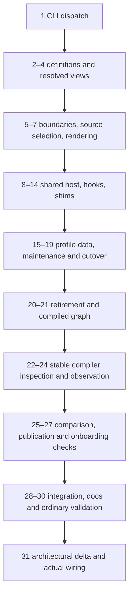

# Implementation Plan: Compact Go version support

**Plan:** `docs/plans/20261021-compact-go-versions.md`

**Date:** 2026-10-21

**Project source:** `.` (relative to repository root; `../..` from this plan)

**Branch / starting revision:** `feat/compact-go-versions` / `550d5e3`

**Target Architecture:** [revision 3](../brainstorms/20261021-compact-go-versions-target.md)

**Brainstorm session:** [complete log](../brainstorms/20261021-compact-go-versions.md)

**Design review:** [thread 1](../review/feat_compact-go-versions.md)

**Plan review:** thread 2 in the same review file; pending Claude review.

**Status:** plan only; no implementation task has started.

## Scope and execution rules

Implement the reviewed shared-package design, Go 1.25 baseline plus cumulative metadata/source changes, stable `1.X.*` admission, and comparison/report/draft tooling. Go 1.27 is a hypothetical fixture, not a newly supported release in this plan. Keep the four existing immutable feature sets and all runtime/determinism/native-boundary invariants.

The source of design decisions is target revision 3. Existing README, AGENTS.md and docs/design.md describe today's family-owned trees and will be updated after migration; their current build/test restrictions continue to apply throughout. There is no `project.txt`, `architecture/` or `docs/architecture/` in this checkout. `docs/brainstorms` is an ignored ordinary directory, not a symlink or nested repository. The plan is tracked in the existing branch; do not create another repository or force-add ignored brainstorm files.

- Execute tasks in order. Each task ends with build and focused verification; fix any failures encountered, including unrelated failures in commands actually run, before reporting that gate green. Record unexpected changes and evidence in the sections below.
- Each task budgets **at most 550 lines of authored Go implementation and test edits**. Pure file renames, verified deletion of an identical second copy, generated JSON/Go and fixture relocation are separately reported mechanical changes, not hidden inside the authored-code estimate. Preserve moved bodies; do not rewrite large files. If the authored portion exceeds its bound, split it into consecutively numbered, buildable subtasks before execution and update references.
- Migration tasks may temporarily retain existing old metadata/admission until their consumers move. This is an ordered checkout transition, not a new compatibility feature. Add no forwarding packages, runtime family switches, manual release tags, legacy cache decoder or successful runtime stub. Final retirement removes every transition rule.
- Task 1 may expose explicit command-not-yet-implemented errors while later tasks supply handlers. They must never claim success, affect ordinary Gosim commands or remain after Task 26. Deferred features use a concise `// TODO(not planned): ...` at the relevant maintenance boundary where useful; do not add warnings or runtime stubs for hypothetical features.
- Regenerate affected revision outputs at the end of every source-changing task. Through Task 17 use the existing genprofile command for active old descriptors; Task 18 switches to `gosim-gen profiles`. Both hashing paths must include shared inputs during the transition. Do not leave normal test fixtures reading stale revision constants.
- No new third-party dependency or database migration is needed. SQLite DDL, CacheEntryV2 and contract-cache schemas/retention remain exactly as target §5; fingerprint changes invalidate artifacts without new cache formats.
- Race, large, cross-architecture execution, Docker/Colima and certification are **not** part of this plan's validation. Do not enable their environment gates, call their fixtures directly, or substitute tags-only race compilation. Source selection/contract inspection for another architecture or race context is reported as inspection only. Lint remains scoped to cmd/examples.
- This planning session writes the plan and the authorized peer request only. Implementation, generators, builds and tests are for later execution.

## Architecture and task ordering

The high-level CLI/metadata contracts come first. Then prepare boundary/source-selection/generator code for safe moves; consolidate native host, hooks and shims while existing profiles continue serving callers; convert metadata and switch selection; remove transition code; finish comparison and end-to-end validation.



Intermediate generated/shared code must work under both currently supported families. A path move updates its imports, selected profile target strings, policy permissions, generation destinations and fixture expectations together. Do not move only one side of a type-universe boundary and leave an unbuildable task.

### Contract index reused by tasks

The following are the target structures/signatures, not alternate schemas. Tasks must implement exact JSON tags/validation in target §§3, 4, 6 and 7; do not duplicate expanded derived metadata in committed files.

```go
// target §3: all RecordDelta.Remove keys are tuples, even scalar keys.
type FamilyDefinition struct {
    Schema int `json:"schema"`
    Family string `json:"family"`
    Parent string `json:"parent,omitempty"`
    Supported bool `json:"supported"`
    Delta ProfileDelta `json:"delta"`
}
type RecordDelta[T any] struct {
    Add []T `json:"add,omitempty"`
    Replace []T `json:"replace,omitempty"`
    Remove [][]string `json:"remove,omitempty"`
}
type Declaration struct {
    Hook Hook `json:"hook"`
    Arches []string `json:"arches,omitempty"`
}
// ProfileDelta contains declarations, packages, bridges, native_imports,
// shared_globals, probes, modules, capabilities, runtime_packages and
// architecture-keyed layout/constant deltas, exactly as target §3.
// ResolvedFamily has Family, ProfileID, Supported, Chain, DefinitionDigest
// and materialized record slices/maps; no origin or delta operations.
// Profile gains Chain and DefinitionDigest and always holds BOTH
// architecture contract manifests; callable hooks select one architecture.
```

Origin remains schema 2 `{schema,family,baseline_toolchain,files:[{path,digest,hooks?}]}` in independently generated on-disk files. No runtime origin embed. AdapterRevision excludes origins; complete-source TranslatorDigest includes them. InspectorDigest excludes data/generated support artifacts and binds implementation independently of parent DefinitionDigest/OriginDigest/module inputs.

New CLI routes are `profiles`, `observe`, `compare` plus existing flag-only generation. Compare output uses target §6 ComparisonReport, DraftDelta, Finding, DeltaProposal, ContextResult and observation schemas exactly. `api_diff` is `inspected`, `skipped-no-parent` or `incomplete`. Exit 0 is completed comparison, never compatibility approval; exit 1 is incomplete/operational error; exit 2 is bad CLI input.

## Validation Commands

Commands below are execution gates, not commands run while writing this plan. Use the repository-selected compiler for ordinary focused tests; repeat family-sensitive checks under each recorded baseline where specified. Always retain the linkname flags.

### V-BUILD: intermediate native build

```sh
go build -ldflags=-checklinkname=0 -tags=linkname ./cmd/gosim ./cmd/gosim-worker ./cmd/gosim-gen
```

For a family-sensitive task run the same command separately with `GOTOOLCHAIN=go1.25.14` and `GOTOOLCHAIN=go1.26.9`. Do not build inactive version packages with a mismatched compiler. This builds host commands, not simulation validation.

### V-FOCUS: relevant ordinary package tests

```sh
go test -ldflags=-checklinkname=0 -tags=linkname ./internal/compat/spec
```

Replace the package argument with the explicit task package list below, after checking those tests do not require prepared simulation workers. New focused fixture tests should select their own package/test names; do not trigger the large suite or all metatesting from a direct wildcard. For source/runtime changes that need translated execution, use V-ORDINARY with source-matched preparation, not bare `go test ./...`. Existing large-gated tests remain skipped; record that rather than weakening their gates.

### V-REVISIONS: active maintenance entry

Before Task 18, refresh active legacy profile revisions with:

```sh
go run -ldflags=-checklinkname=0 -tags=linkname ./internal/compat/genprofile
```

Task 5 broadens its hash coverage to shared inputs. From Task 18 onward use only:

```sh
go run -ldflags=-checklinkname=0 -tags=linkname ./cmd/gosim-gen profiles -root=.
go run -ldflags=-checklinkname=0 -tags=linkname ./cmd/gosim-gen profiles -root=. -check
```

Write-mode metadata generation may precede first origin creation; check mode requires complete origin metadata. Re-run write mode after executable generated bytes change, not merely for provenance refresh.

### V-GENERATION: separate exact-compiler checks

```sh
GOTOOLCHAIN=go1.25.14 go run -ldflags=-checklinkname=0 -tags=linkname ./cmd/gosim-gen -toolchain=go1.25.14 -profile=go125 -arches=amd64,arm64 -output=. -check
GOTOOLCHAIN=go1.26.9 go run -ldflags=-checklinkname=0 -tags=linkname ./cmd/gosim-gen -toolchain=go1.26.9 -profile=go126 -arches=amd64,arm64 -output=. -check
```

Each process checks its own compiler/source only. No in-process cross-family parsing. Both compare full shared bytes with version-neutral headers; ignored records are not prerequisites. If intentional regeneration is needed, use the same command without `-check`, then re-run both checks. `-refresh-origin` is only for an intentional reviewed origin update/bootstrap. These commands inspect architecture/race-selected source contracts; they do not execute crossarch/race suites.

### V-ORDINARY: source-matched native and simulation validation

```sh
GOSIM_TOOLCHAIN=go1.25.14 TEST_REPORTS_DIR="$PWD/.gosim/compact-go-validation/go125" make test
GOSIM_TOOLCHAIN=go1.26.9 TEST_REPORTS_DIR="$PWD/.gosim/compact-go-validation/go126" make test
```

Use separate report roots so the second run cannot overwrite the first. Read each `unit/latest/report.md`, timeline and failing logs; record exit status, pass/fail/error/skip totals, exact compiler and tested source. `make test` creates/prepares the isolated snapshot. Do not claim execution coverage for skipped platforms, race or large tests. Fix observed failures before acceptance; broadening into restricted suites still needs an explicit user instruction.

### V-AUDIT: real known-family comparison

After Tasks 22–26, use a new output directory for each invocation:

```sh
GOTOOLCHAIN=go1.25.14 go run -ldflags=-checklinkname=0 -tags=linkname ./cmd/gosim-gen observe -profile=go125 -output=.gosim/compact-go-audit/go125-observation.json
GOTOOLCHAIN=go1.26.9 go run -ldflags=-checklinkname=0 -tags=linkname ./cmd/gosim-gen compare -parent=go125 -parent-observation=.gosim/compact-go-audit/go125-observation.json -output=.gosim/compact-go-audit/go126
GOTOOLCHAIN=go1.26.9 go run -ldflags=-checklinkname=0 -tags=linkname ./cmd/gosim-gen compare -parent=go125 -output=.gosim/compact-go-audit/go126-declarations
```

Create the parent output directory first. Never remove a previous report merely to reuse these example names; choose a fresh suffix. Verify known iterator/ArtifactDir/API and StoreReluintptr/clearenv/source findings as applicable. Declaration-only mode must say `skipped-no-parent`. Use fixtures for a hypothetical unregistered future family rather than claiming its compiler is available or enabling support.

### V-DOCS and final hygiene

Check Markdown links/fences and referenced command names. Format only changed Go files with gofmt; use repository formatting checks where applicable. Run `make lint` only for changed cmd/examples scope; no internal/all-project linter. Record actual production/test/doc/generated file counts and byte totals with paths, including new audit/tooling files. Review git diff and remove transition code/stubs, not historical evidence.

## Task List

### Task 1: Establish the generator command dispatch contract

**Files:** cmd/gosim-gen/main.go, commands.go, focused command tests.

**References:** target §6 command table/exits; §7 cmd interfaces; §8 command flows.

**Budget:** ≤300 authored Go lines. **Dependencies:** none.

- [ ] Refactor process-global flag handling into `runCLI(ctx context.Context, args []string, stdout, stderr io.Writer) int`, preserving existing flag-only generation and `-check`/`-refresh-origin` exclusion.
- [ ] Add `runProfiles`, `runCompare`, `runObserve` with the same handler signature. Initially return an explicit nonzero unavailable error for new subcommands; route existing generation unchanged. Do not expose a successful placeholder.
- [ ] Define help/argument contracts from target §6, including required destinations and stable-family terminology. Keep normal gosim application CLI unchanged.
- [ ] Test dispatch, invalid arguments, errors reaching stderr and legacy generation argument preservation with injected command-level fakes; no generator execution is needed for argument tests.

#### Verification

- [ ] V-BUILD and V-FOCUS for cmd/gosim-gen pass; existing behavior remains reachable and placeholders fail explicitly.

### Task 2: Add strict family-definition types and decoding

**Files:** internal/compat/spec/definition.go and focused tests.

**References:** target §3 full schema, keys/normalization; §7 DecodeDefinition/LoadDefinitions; §11 DecodeDefinition.

**Budget:** ≤500 authored Go lines. **Dependencies:** 1.

- [ ] Implement FamilyDefinition, RecordDelta, Declaration, PackageRef, ArchitectureDelta and ProfileDelta exactly as target §3 and the contract index, using existing spec records.
- [ ] Implement `DecodeDefinition([]byte) (FamilyDefinition,error)` with recursive duplicate-key detection, unknown-field rejection, one-value EOF check, explicit required-field presence and canonical family/path validation.
- [ ] Implement `LoadDefinitions(fs.FS) (map[string]FamilyDefinition,error)` with strict goNNN.json filename matching; ignore origin/evidence files intentionally and reject definition filename/family mismatch.
- [ ] Normalize omitted/both architecture sets to common scope, reject duplicates/unsupported architectures, preserve layout/ordered payload order and canonicalize only sets.
- [ ] Cover malformed nested JSON, absent false-valued supported, draft rejection, trailing bytes, invalid remove tuples and unsafe paths with focused table tests.

#### Verification

- [ ] V-BUILD and V-FOCUS for internal/compat/spec pass; no current profile consumer changes yet.

### Task 3: Resolve cumulative deltas and immutable ancestry

**Files:** internal/compat/spec/resolve.go and focused tests.

**References:** target §3 operations/ancestry; §7 ResolvedFamily; §11 ResolveDefinitions/applyRecords.

**Budget:** ≤500 authored Go lines. **Dependencies:** 2.

- [ ] Implement `ResolveDefinitions(map[string]FamilyDefinition,string) (ResolvedFamily,error)` and generic `applyRecords[T](base []T, delta RecordDelta[T], key func(T) []string) ([]T,error)`.
- [ ] Require 1.25 root, immediate predecessor links, no cycles/missing parents, no duplicate family keys, and retained unsupported ancestors. Pure resolution must not require generated support admission.
- [ ] Enforce absent Add, present Replace/Remove, no cross-operation duplicate key, whole-record replacement, redundant replacement error, and persistent removal until explicit re-add.
- [ ] Add Clone and Canonical methods; deep-copy nested maps/slices, including layout fields and probe arguments. Compute chain DefinitionDigest deterministically.
- [ ] Test three-layer inheritance, empty intermediate delta, retirement, split common declaration into disjoint arch records, collision after architecture expansion, and mutation isolation.

#### Verification

- [ ] V-BUILD and spec tests pass; resolved results are independent of map iteration and current compiler family.

### Task 4: Materialize profile, policy and contract views

**Files:** spec/resolve.go, profile.go, contracts.go and focused tests.

**References:** target §3 derived views/nine-contract correction; §5 identity; §7 resolved methods; §11 Descriptor.

**Budget:** ≤500 authored Go lines. **Dependencies:** 3.

- [ ] Add Profile.Chain and DefinitionDigest; implement `ResolvedFamily.Descriptor(arch,revision string) (Profile,error)`, PolicyManifest(), ShimManifest(arch), using existing record semantics.
- [ ] Derive declaration category from Hook.Context and target category. Build BOTH amd64/arm64 ContractsByArch maps every time; only callable hooks select the requested architecture.
- [ ] Keep metadata structural validation separable from supported-family admission so retained ancestors and unregistered pure fixtures resolve, while production Profile.Validate/selection remains strict.
- [ ] Test derived policies/hooks/shims/contracts using fixtures, including all nine previously omitted shim contracts and unknown target/context rejection. Record their intentional coverage expansion, not false legacy equivalence.
- [ ] Preserve ContractDigest and identity schemas; new fields must be deterministically populated wherever selection comparisons depend on them.

#### Verification

- [ ] V-BUILD and spec tests pass for both baseline compilers. Existing runtime descriptors remain active.

### Task 5: Prepare path admission and fingerprints for incremental moves

**Files:** spec/paths.go, profile.go, policy.go, revision.go; translate/profile.go; compose validation; related tests.

**References:** target §§2, 5 package boundaries/fingerprints; §7 classifier/consumers; §8 ordinary flow.

**Budget:** ≤500 authored Go lines. **Dependencies:** 4.

- [ ] Add `CompatPackageKind` and `ClassifyCompatPackage(path string)` for original/shared and relocated spellings; separate category recognition from exact import authorization.
- [ ] Allow shared targets through the same reviewed metadata permissions while still recognizing the existing selected family's paths during migration. Do not admit another family's executable target or unknown compat metadata into translated code.
- [ ] Adapt composition/translation path validation to support incremental package moves without adding forwarding packages or runtime family selection. Retain existing native islands, feature and provider rules.
- [ ] Broaden the active SourceRevision input inventory to include shared compatibility paths as they appear, while old profiles remain active. Exclude all generated revision constants to avoid self-reference. Final origin-independent chain hash replaces this transitional inventory in Task 17.
- [ ] Capture old normalized profile/source inventory and measured baseline counts in ignored migration evidence for later equivalence checks. No committed copy of expanded profiles.

#### Verification

- [ ] V-REVISIONS, V-BUILD and focused spec/translate/compose boundary tests pass. Test inactive-family rejection and shared paths requiring exact permissions.

### Task 6: Select only active shim source bindings

**Files:** spec/shims.go, source-selection helpers and focused tests.

**References:** target §3 binding defect; §7 VerifyShimBindings; §11 binding/destination selection.

**Budget:** ≤450 authored Go lines. **Dependencies:** 5.

- [ ] Implement a private explicit go/build.Context selector with family release tags, OS/arch/filename tags and approved source predicates. Do not inherit the maintenance process's release tags.
- [ ] Use selected files in existing shim checks; update callers atomically. Final public signature is `VerifyShimBindings(root string, r ResolvedFamily, source SourceContext) error`; while old descriptors remain active, share the private selection implementation rather than inventing a public compatibility facade.
- [ ] Preserve duplicate rejection in readHookDeclarations; inactive files must neither satisfy required bindings nor trigger false duplicates.
- [ ] Test selected/inactive variants, methods, filename predicates and hypothetical next-minor inheritance. Translated checks are cgo-off; preserve native race source context separately.

#### Verification

- [ ] V-REVISIONS, V-BUILD and focused spec binding/source tests pass under both families. No race build or execution.

### Task 7: Separate generation rendering from publication and checking

**Files:** routegen/generate.go, check.go, adapters.go, layouts.go, current_test.go and focused tests.

**References:** target §4 neutral provenance; §7 routegen; §8 generation; §11 GenerateProfile/CheckProfile.

**Budget:** ≤500 authored Go lines. **Dependencies:** 6.

- [ ] Factor rendering into a pure output map stage that receives current profile inputs; CheckProfile compares only committed selected outputs without requiring ignored records or writing final outputs.
- [ ] Enforce running compiler equals inspected compiler before parsing. Keep each test/process on its selected compiler; update tests that previously implied cross-family parsing.
- [ ] Replace exact-version generated source comments with version-neutral text. Keep exact version/fingerprints in origin/generation records. Remove test normalization that would hide source-header discrepancies.
- [ ] Add `selectedGeneratedPath(root,packagePath,stem string,source SourceContext,family string) (string,error)` using Task 6's selection semantics and one selected destination requirement. Rendering preserves authored constraints instead of recomputing a family ceiling.
- [ ] Until moves complete, support selected existing destinations through explicit current profile targets; no guessed shared path or automatic copied tree. Update generator expectations and regenerate affected comments for both families.

#### Verification

- [ ] V-REVISIONS, V-BUILD, routegen focused tests and V-GENERATION pass. Check mode leaves mtimes/bytes unchanged and works with ignored generation records absent.

### Task 8: Consolidate native host ABI and its facades

**Files:** compat/{go125,go126}/host → compat/host; hostabi facades/guards/tests; current profile target records.

**References:** target §2 source inheritance/guards; §4 provenance; §7 hostabi; final design-review Q1.

**Budget:** ≤350 authored Go lines plus verified moves/deletions. **Dependencies:** 7.

- [ ] Move the identical host implementations once, delete the verified duplicate, preserve unsafe/linkname/race semantics and update hostabi imports and profile native target paths together.
- [ ] Add direct compat/host unsupported guard using the current supported intervals; keep hostabi/selected rejection. Task 18 takes over guard generation.
- [ ] Remove union support ceilings from the six shared hostabi facade/test files named in target §2; preserve fixed floor and race predicates. Collapse identical family facade files into shared implementations without forwarding packages.
- [ ] Update linkname/closure tests and confirm maps/synctest leaf packages do not need native metadata imports to reject unsupported simulations.

#### Verification

- [ ] V-REVISIONS, V-BUILD under both families, focused hostabi/spec checks and V-GENERATION pass. Record source-only guard checks separately from execution.

### Task 9: Consolidate runtime hooks with the StoreReluintptr variant

**Files:** compat/{go125,go126}/hooks/rt → compat/hooks/rt; old profile targets/permissions; related tests.

**References:** target §2 variants; §3 declarations; §5 permissions; §9 behavior preservation.

**Budget:** ≤400 authored Go lines plus verified moves/deletions. **Dependencies:** 8.

- [ ] Move common runtime hook bodies once and normalize imports, retaining approved non-release constraints and full union of tests.
- [ ] Extract StoreReluintptr into the two small signature variants: bounded baseline and cumulative go1.26 replacement. Do not unify incompatible return signatures with runtime branching.
- [ ] Update both active family metadata sets, runtime bridge references and exact sync/atomic/native permissions in the same task; preserve simulator scheduling/atomic semantics.
- [ ] Test family-specific signature/source selection and inherited 1.26 selection for a hypothetical 1.27 context, without declaring support for it.

#### Verification

- [ ] V-REVISIONS, both-family V-BUILD and relevant native hook/spec checks pass. Use V-ORDINARY if changed translated behavior requires execution; do not run sim-only tests as native coverage.

### Task 10: Consolidate kernel, filesystem and network hooks

**Files:** both families' hooks/{kernel,fs,net} → shared hooks; compose imports; routegen destinations; profile records/tests.

**References:** target §2 clearenv/shared layouts; §§5, 7 composition/generation; §9 retained tests.

**Budget:** ≤500 authored Go lines plus verified generated moves/deletions. **Dependencies:** 9.

- [ ] Move the coupled hook packages together to preserve their kernel layout imports. Keep generated architecture-specific syscall/layout files shared and selected by existing architecture predicates.
- [ ] Extract clearenv as a go1.26 addition; keep common process/transport code and the union of statfs/GID assertions.
- [ ] Update composition, selected target metadata, generator expected paths and canonical imports atomically. Preserve exact route IDs, provider isolation and disabled-feature fatal behavior.
- [ ] Use Task 7 destination selection for shared generated files; neutral headers and authored constraints must byte-match under independent family checks.

#### Verification

- [ ] V-REVISIONS, both-family V-BUILD, routegen/spec focused checks and V-GENERATION pass; run V-ORDINARY for the hook/composition transition and record report totals.

### Task 11: Consolidate reflect while preserving each method surface

**Files:** both families' shims/reflect → shared shims/reflect; active profile shim/bridge records; boundary tests.

**References:** target §2 reflect variant gate; §3 contracts; §9 embedded-interface validation.

**Budget:** ≤450 authored Go lines plus verified moves/deletions. **Dependencies:** 10.

- [ ] Preserve shared reflect bodies/type identity and isolate 1.26 Type/Value iterator additions under cumulative constraints.
- [ ] Try the target's small extension-interface composition only with a meaningful translated-interface fixture. If unsupported, use the allowed small whole-interface variants and record that outcome; do not alter translator semantics solely to avoid a short duplicate declaration.
- [ ] Update active bridge replacements, shim targets and native reflect/sync/iter permissions together; reject native object/type-universe escapes.
- [ ] Preserve shared implementation assertions and add focused tests for exact selected interfaces and iterator behavior where ordinary simulation supports them.

#### Verification

- [ ] V-REVISIONS, both-family V-BUILD, spec/boundary checks and ordinary prepared translated fixture validation pass. Record whether embedding or short interface variants were selected.

### Task 12: Consolidate testing with small API and temporary-root variants

**Files:** both families' shims/testing → shared shims/testing; compose references; active metadata/tests.

**References:** target §2 testing state decision; §§3, 7 methods; §9 behavioral validation.

**Budget:** ≤450 authored Go lines plus verified moves/deletions. **Dependencies:** 11.

- [ ] Keep the common struct and both Gosim-owned artifact fields shared. Do not add a familyTestState embedding or duplicate the entire testing implementation.
- [ ] Select the TB method surface, ArtifactDir method and GOTMPDIR behavior with small authored constraints; retain 1.25 semantics and inherited 1.26 behavior.
- [ ] Update composition and both family metadata/binding expectations together. Apply the same verified interface strategy as Task 11.
- [ ] Preserve tests from both copies and add focused artifact/temp-root regressions through ordinary prepared simulation.

#### Verification

- [ ] V-REVISIONS, both-family V-BUILD and relevant ordinary prepared tests pass; disabled feature behavior remains unchanged.

### Task 13: Consolidate crypto/rand's version-sensitive reader choice

**Files:** both shims/cryptorand packages → shared package; active policies/contracts/tests.

**References:** target §1 measured difference; §2 crypto variant; §6 behavioral source review.

**Budget:** ≤350 authored Go lines plus verified moves/deletions. **Dependencies:** 12.

- [ ] Share the existing prime algorithm and common rand/text code; isolate only the version-sensitive reader choice as specified by existing behavior.
- [ ] Preserve 1.25 reader semantics and 1.26 custom-reader/GODEBUG behavior exactly; do not introduce host randomness fallbacks.
- [ ] Update replacement/contract paths and preserve deterministic-reader tests and known feature behavior.

#### Verification

- [ ] V-REVISIONS, both-family V-BUILD and relevant native/ordinary simulation tests pass. Do not use lint-driven crypto algorithm changes.

### Task 14: Consolidate remaining unchanged shims and test guards

**Files:** remaining shims including debug, exec, httppprof, maps, metrics, ocsp, pprof, runtimebridge, signal, syncmap, synctest, tls, user, x509; shared guard tests.

**References:** target §2 layout; §3 derived categories; §5 boundaries; §9 union-of-tests requirement.

**Budget:** ≤450 authored Go lines; process mechanical moves in package-sized batches. **Dependencies:** 13.

- [ ] Move each normalized-identical package once, verify and delete its second implementation, and update imports/profile targets as a coherent package batch. Keep genuine differing declarations bounded rather than erasing them.
- [ ] Preserve complete package replacements, guarded aborts and exact native permissions. Sparse contract ledgers must not change bridge classification.
- [ ] Consolidate shared guard/runtimebridge/synctest tests without dropping assertions or compiling sim-only tests as native proofs.
- [ ] Confirm there are no executable hooks/shims/host left in old family directories; old metadata remains temporarily until cutover.

#### Verification

- [ ] Each mechanical batch compiles with relevant focused checks; task completion requires V-REVISIONS, both-family V-BUILD, V-GENERATION and ordinary validation of the fully shared executable tree.

### Task 15: Convert existing metadata to baseline and cumulative delta

**Files:** new profiles/go125.json, go126.json; spec conversion/equivalence tests; ignored migration inventory.

**References:** target §3 complete schema/key rules; §4 origin separation; §9 migration/accounting.

**Budget:** ≤450 authored Go/test lines; JSON is generated/reviewed data. **Dependencies:** 14.

- [ ] Convert current reviewed metadata into one full baseline and only actual 1.26 replacements/additions/removals. Normalize already-shared paths; derive architecture applicability and remove redundant contracts/hooks/shims duplication.
- [ ] Use a bounded one-time conversion script or test helper under ignored migration output, not a permanent second profile-generation tool. Review every delta against the original inventories.
- [ ] Materialize both families and compare canonical semantic records to the captured originals after path normalization. Explicitly account for nine added shim contracts, source corrections and any genuinely changed metadata; no blanket golden update.
- [ ] Assert empty future delta inherits all intermediate changes in fixtures. Keep future-family fixture support isolated from the actual registry.

#### Verification

- [ ] V-REVISIONS, V-BUILD and spec conversion/resolution tests pass. Existing callers still use old metadata until the facade is ready.

### Task 16: Add the profiles facade and independent on-disk provenance

**Files:** profiles/profiles.go, initial revisions_gen.go; spec origin loader; profiles/*.origin.json, evidence.json; Go/Python exclusions and tests.

**References:** target §4 origin/evidence; §5 hashes/cache; §7 profiles/LoadOrigin; §8 metadata flows.

**Budget:** ≤500 authored Go/test lines plus lossless data moves. **Dependencies:** 15.

- [ ] Implement Definitions, Resolve, Descriptor, Policy, Shims and Revision signatures from target §7; embed only `go*[0-9].json`, use lazy immutable metadata and return independent values.
- [ ] Implement `LoadOrigin(fs.FS,profileID string) (Origin,error)` for checkout readers. Move complete original origin payloads to independent files without inheriting/relabeling source hashes.
- [ ] Preserve the complete old evidence/tuple JSON values in the consolidated schema-1 history envelope. During coexistence exclude both old evidence paths and the new exact path from executable identities; never exclude origins from whole-source hashes.
- [ ] Seed the new revisions output from current valid values only as an unused transition artifact; Task 17 replaces it using the final algorithm before production selection switches. New facade tests use explicit fixture revisions where appropriate and cannot claim cutover readiness yet.
- [ ] Test no origin/evidence runtime embed, cloned records, origin filename/family validation and lossless historical payload migration; update Python exclusion unit coverage without invoking certification.

#### Verification

- [ ] V-REVISIONS, V-BUILD and focused profiles/spec/buildcfg plus Python metadata utility checks pass. Ordinary active descriptors still work.

### Task 17: Implement final source revisions and support rendering

**Files:** profiles/generate.go, revisions_gen.go; spec/revision.go; buildspec generated table renderer and tests.

**References:** target §5 fingerprint scopes; §7 GenerateMetadata/renderSupport/renderRevisions; §11 maintenance/revision pseudocode.

**Budget:** ≤500 authored Go/test lines. **Dependencies:** 16.

- [ ] Implement origin-independent SourceRevision with target domain, canonical chain/resolved data and conservative source inventory; exclude origins, evidence, tests/testdata and every generated revision output. Keep whole-source TranslatorDigest origin-sensitive.
- [ ] Implement renderSupport and renderRevisions with on-disk definitions and no eager production lookup. Render exact supported intervals including gaps, selectedProfile constants and host/hostabi/selected guards. Validate retained ancestors separately from support.
- [ ] Implement GenerateMetadata write/check ordering: support outputs first, then revisions; check mode additionally validates complete structural origin metadata without loading every compiler.
- [ ] Exercise rendering/publication in temporary fixture repositories at this step. Do not overwrite the active old selected functions before Task 18 replaces them with shared methods. The new revision table may be produced independently; refresh active old revision constants as needed for intermediate tests.
- [ ] Test origin-only edit leaves AdapterRevision unchanged but changes whole-source identity, evidence-only edits leave both executable hashes unchanged, ancestor/shared-source edits invalidate, and missing first origin permits write-mode revisions but fails final check.

#### Verification

- [ ] V-BUILD and focused profiles/spec/buildcfg tests pass. Fixture support rendering is deterministic, idempotent and independent of stale compiled registry entries.

### Task 18: Switch production selection and remove duplicate metadata entry points

**Files:** selected/selection.go and selectors; buildspec/family.go/families_gen.go; cmd/gosim-gen profiles handler; catalog callers/tests; old profile/genprofile removal.

**References:** target §§3, 5 admission, §7 selected/profiles/buildspec, §8 bootstrap; all associated method signatures.

**Budget:** ≤500 authored Go lines plus generated data/deletion. **Dependencies:** 17.

- [ ] Move Profile/descriptorForArch/policyManifest into shared selection.go and use generated selectedProfile constants. Make policy errors explicit and preserve complete canonical selection comparisons.
- [ ] Move FamilySupport to `{Family,Profile string}`, remove unused patch minimum/exclusions, and source the support table from definitions. Update affected constructors/tests atomically.
- [ ] Wire `runProfiles` to GenerateMetadata. Now generate final support files/revisions in the real tree and verify agreement. The generator dependency closure must remain metadata-only.
- [ ] Replace catalog and version-profile imports in production and compile-required fixtures with profiles functions and LoadOrigin from the checkout. Update currentGeneration/test helpers and origin reads together; no callback/forwarding package survives.
- [ ] Remove catalog, genprofile and the old family profile source/data once all references are migrated. Retain the consolidated history and independent origins. Remove old revision files so the final source fingerprint cannot include stale generated outputs, then regenerate final revisions.
- [ ] Remove legacy evidence exclusions only after their files are gone; keep the exact consolidated evidence exclusion and all origin inputs in TranslatorDigest/Python identities.

#### Verification

- [ ] V-REVISIONS using only the new entry, both-family V-BUILD, profiles/spec/buildcfg/routegen focused tests and V-GENERATION pass. No code reference to the retired packages or active old descriptor remains.

### Task 19: Finish shared generation and first-origin bootstrap

**Files:** routegen/generate.go, check.go, adapters.go, layouts.go; cmd legacy generation wiring; generation tests.

**References:** target §7 routegen final signatures; §8 generation/bootstrap; §11 GenerateProfile/CheckProfile.

**Budget:** ≤500 authored Go/test lines. **Dependencies:** 18.

- [ ] Finalize `renderProfileOutputs(tc,r,origin,arches,root)` using ResolvedFamily and selected authored destination files. Retain strict module/contracts/bindings checks and independent process identity.
- [ ] Explicit RefreshOrigin may seed only a missing new-family origin with schema/family/current exact baseline, then replace it after successful checks. Normal generation/check requires a complete existing origin.
- [ ] Use the same SourceRevision as profiles; delete any provisional generation-only revision algorithm. Rebuilt gosim-gen sees newly generated support tables before normal contract validation.
- [ ] Write only selected shared outputs, this family's origin and ignored provenance records; refresh of one origin must not modify another. Shared writes are accepted only after every supported selecting family's check succeeds.
- [ ] Test a fixture with a new unchanged definition: profiles writes support/revisions before origin; explicit generation produces first origin; final -check passes. Use controlled metadata/compiler fixtures for unavailable releases and the real compiler for actual source checks.

#### Verification

- [ ] V-REVISIONS, both-family V-BUILD, routegen tests and V-GENERATION pass. Check mode needs no ignored artifact and performs no publication.

### Task 20: Remove migration admission and complete consumer-path cleanup

**Files:** spec/paths.go/profile.go/policy.go; translate/compose checks; remaining path/string fixtures and maintenance messages.

**References:** target §5 strict final boundaries; §7 consumer inventory; §9 retirement.

**Budget:** ≤400 authored Go/test lines. **Dependencies:** 19.

- [ ] Remove transitional old-family path acceptance and old fingerprint branches. Only final shared categories and exact reviewed permissions remain.
- [ ] Search all source/scripts/fixtures for old executable paths, catalog/genprofile, old profile filenames and physical-family selection assumptions. Historical review/evidence text is not executable migration debt and must not be rewritten as new evidence.
- [ ] Complete call-site error handling for final VerifyShimBindings/Descriptor/Policy signatures; remove temporary private adapters only needed for old descriptors.
- [ ] Assert no forwarding packages, expanded metadata copies, stale ceilings, old revision generators or unconsumed active definitions remain.

#### Verification

- [ ] V-REVISIONS, both-family V-BUILD and focused spec/translate/compose tests pass. Final-path negative fixtures reject retired/unknown metadata imports.

### Task 21: Enforce the compiled graph's native-island boundary

**Files:** internal/buildrun/build.go and new focused graph tests; related translation fixture.

**References:** target §5 node/edge rules; §7 buildrun; §8 failure table; final peer review Q2.

**Budget:** ≤450 authored Go/test lines. **Dependencies:** 20.

- [ ] Classify original and relocated compat node spellings explicitly. Allow native host/selected/profiles/spec only as native infrastructure; never infer translated admission from their native presence.
- [ ] Allow relocated-to-original Gosim imports only to rt/runtime and rt/runtime/abi, preserve standard-library/external exact native permissions separately, and reject every original compat/hooks or compat/shims node.
- [ ] Preserve existing provider/feature graph checks. Test forbidden hostabi/buildspec imports outside the compat subtree as well as forbidden metadata paths.
- [ ] Add a focused ordinary translated-output fixture that exercises real generator output and legitimate native runtime dependencies, plus synthetic negative graph fixtures. Do not repurpose the large selected-translation suite or unset its guard.

#### Verification

- [ ] V-REVISIONS, V-BUILD and buildrun focused tests pass; run the new fixture through ordinary prepared validation. A real valid graph must pass before accepting the positive allowlist.

### Task 22: Add narrow stable compiler inspection

**Files:** buildspec/command.go; buildcfg/inspection.go, discovery/fingerprint helpers and tests.

**References:** target §6 inspection boundary; §7 inspection signatures; §11 DiscoverInspection.

**Budget:** ≤500 authored Go/test lines. **Dependencies:** 21.

- [ ] Implement SourceInspectionCommand restricted to required env/version/list queries with canonical stable versions, installation/environment controls and local exact toolchain execution. Reject build/run/test and arbitrary flags in this entry.
- [ ] Implement InspectionCompiler state plus DiscoverInspection, Toolchain, Fingerprints and Recheck. Require running compiler equals inspected exact version and verified installation; an explicit override is an equality assertion.
- [ ] Factor private discovery/fingerprint helpers without weakening normal Discover/Fingerprint/OutputCommand/ApplicationCommand family checks. Unknown stable inspection succeeds only on the inspection path; prerelease/devel/custom still fail.
- [ ] Test mismatched executable/runtime identity, changed installation, unsupported family ordinary rejection and inspection-only acceptance using controlled fixtures. Do not simulate support by editing the real registry.

#### Verification

- [ ] V-REVISIONS, V-BUILD and focused buildspec/buildcfg tests pass; normal caller admission behavior remains unchanged.

### Task 23: Collect bounded source observations with the matching compiler

**Files:** spec/source.go and observation types/collector; origin inspection reuse; focused source tests.

**References:** target §§6–7 ObservationRequest/ObservationSet/CollectSourceObservations; §11 collector.

**Budget:** ≤500 authored Go/test lines. **Dependencies:** 22.

- [ ] Add the exact observation/context schemas from target §6 in spec; no duplicate audit wire structs. Add ObservationRequest with resolved parent, origin, contexts, IncludeAPIs and IncludeStdlibInventory.
- [ ] Refactor the source loader with private command selection. Export `CollectSourceObservations(ctx,tc,dir,req) (ObservationSet,error)` using fixed SourceInspectionCommand, independently enforcing stable/running identity and installation/environment rules.
- [ ] Collect declared symbols, layouts/constants, package inventory and tracked/selected source hashes for explicit contexts; preserve private source-matched module handling, cleanup and no caller module rewrite.
- [ ] Record context errors and missingness correctly: failed package loading is incomplete, never a missing-symbol record. Preserve native race cgo-on versus translated cgo-off selection without building those race contexts.
- [ ] Test signature/layout/constant absence/change and source hash drift, errors/cancellation and deterministic records. Ordinary VerifyContracts continues using strict OutputCommand.

#### Verification

- [ ] V-REVISIONS, V-BUILD and focused spec/buildcfg tests pass under each running family compiler; no in-process other-family parsing.

### Task 24: Capture parent API inventories and validate snapshots

**Files:** spec API observation helpers; audit/compare.go snapshot types/Observe; inspector digest helper/tests.

**References:** target §6 API scope/ParentObservation/InspectorDigest; §7 Observe; §11 Observe.

**Budget:** ≤500 authored Go/test lines. **Dependencies:** 23.

- [ ] Implement the finite API package inventory derived from parent declarations and reviewed bridges, including complete replacements and symbol bridges; exclude Gosim implementation packages and wildcard-wide unrelated inventories.
- [ ] Enumerate exported declarations/method sets in both parent/candidate contexts through Task 23, recording APIPackages. Do not classify sparse shim manifests as partial bridges.
- [ ] Implement `Observe(ctx,ObserveRequest) (ParentObservation,error)` at the parent's exact recorded compiler. Require complete requested observations and unchanged compiler/source/module identities before returning a usable snapshot.
- [ ] Implement InspectorDigest over non-test implementation Go source, excluding data/generated support/revision artifacts; bind parent definition/origin and relevant module/replacement inputs separately.
- [ ] Validate snapshot schema, family, exact baseline, digests and requested inventories; test target-definition/support-only edits preserve usability while parent or inspector implementation edits invalidate.

#### Verification

- [ ] V-REVISIONS, V-BUILD and spec/audit snapshot tests pass. Observe remains data-only and does not enable support.

### Task 25: Compute actionable comparison findings and draft operations

**Files:** audit/compare.go and focused diff/proposal tests.

**References:** target §6 report/draft schema and coverage; §7 Compare/CompareObservations; §11 comparison algorithms.

**Budget:** ≤500 authored Go/test lines. **Dependencies:** 24.

- [ ] Implement CompareRequest, ComparisonReport, Finding, DeltaProposal and DraftDelta exactly as target §6; use spec observation records without mirrors.
- [ ] Implement Compare and CompareObservations, enforcing stable immediate next minor, complete parent resolution and optional validated parent snapshot; no hidden parent compiler download.
- [ ] With a snapshot, report actual upstream API changes. Without one, inspect declared contracts/source and report APIDiff skipped-no-parent without an old-API finding flood. Record incomplete requested API scans distinctly.
- [ ] Propose only unambiguous typed add/replace/remove operations. Mark missing implementations and source-only behavior review unresolved; no automatically approved origin, support declaration or executable patch.
- [ ] Sort deterministic findings/proposals, keep completed differences separate from operational errors, and recheck compiler/module/source identities before assigning Complete.

#### Verification

- [ ] V-REVISIONS, V-BUILD and audit tests pass for empty delta, inherited parent changes, incompatibilities, skipped API coverage, incomplete contexts, stale snapshots and non-installable draft decoding.

### Task 26: Publish audit artifacts and wire all generator handlers

**Files:** audit/output.go; cmd/gosim-gen/commands.go; focused publication/CLI tests.

**References:** target §6 publication/exits; §7 CLI/output signatures; §11 WriteComparison.

**Budget:** ≤500 authored Go/test lines. **Dependencies:** 25.

- [ ] Implement RenderReport, WriteComparison and WriteObservation. Exclusively create destinations; report.md and delta.draft.json close before final report.json publication. An absent report.json means interrupted publication; incomplete scans may publish Complete=false.
- [ ] Refuse existing files/directories, handle cancellation/write/close errors, and clean only invocation-owned outputs. No locks/report-digest/finding-ID protocol or overwrite mode.
- [ ] Wire runObserve and runCompare to real inspection, validation, publication and target exit semantics. Print completeness/API coverage/finding counts. Remove every Task 1 placeholder.
- [ ] Test complete differences exit 0, incomplete scan exit 1, invalid CLI exit 2, partial publication, preexisting destinations and observe refusing incomplete snapshots.

#### Verification

- [ ] V-REVISIONS, V-BUILD, cmd/audit tests and V-AUDIT pass. Verify no profile/support/source mutation from either audit command.

### Task 27: Verify real version changes and no-change onboarding

**Files:** audit/profiles/routegen focused integration fixtures and tests; ignored audit artifacts.

**References:** target §§1, 8 onboarding, 9 acceptance; §11 end-to-end algorithms.

**Budget:** ≤450 authored Go/test lines. **Dependencies:** 26.

- [ ] Exercise the known 1.25→1.26 comparison in separate compiler processes, expecting selected signature/API changes and crypto source review, while unchanged layouts/constants stay unchanged.
- [ ] Test hypothetical unchanged next-family metadata with empty delta through support/gate/revision rendering and explicit origin bootstrap fixtures; assert zero copied implementation files and cumulative inherited variants.
- [ ] Test unchanged family authoring does not stale a captured parent snapshot merely through new data/support artifacts; actual source edits do invalidate it.
- [ ] Verify adding/retiring support does not allow runtime switching or gaps in ancestry, and normal unregistered compiler admission stays rejected. Do not add real 1.27 support or claim execution with unavailable compiler fixtures.

#### Verification

- [ ] V-REVISIONS, V-BUILD and focused onboarding tests pass; archive V-AUDIT results and state actual versus fixture-based coverage separately.

### Task 28: Migrate worker, artifact and metatesting fixtures

**Files:** internal/{workerboot,gosimtool,candidate,buildcfg,translate} fixtures/tests; metatesting/protocol_test.go; .ci metadata utilities where affected.

**References:** target §5 complete identities/caches; §7 consumer inventory; §8 ordinary cache/worker flows.

**Budget:** ≤450 authored Go/test lines; split fixture-only batches if needed. **Dependencies:** 27.

- [ ] Finish fixture substitutions for shared paths, generated registry/revisions and exact compiler/worker identities. Preserve patch/features/race manifest matching and launcher-selected worker behavior.
- [ ] Add/retain meaningful regressions for cache invalidation from ancestor/shared source, origin-only TranslatorDigest changes, evidence-only stability and corrupt/stale cache rejection with unchanged schemas.
- [ ] Preserve SQLite table/index/value formats, seven-day retention/hourly touches and content-addressed contract cache behavior. Do not introduce old-format decode or a new persistent audit cache.
- [ ] Update candidate/CLI fixtures without executing large-gated cases; record such migrated fixtures as unexecuted. Run worker-dependent ordinary tests only through prepared source-matched workflow.

#### Verification

- [ ] V-REVISIONS, V-BUILD and focused non-worker tests pass; V-ORDINARY covers applicable worker/protocol tests. Record restricted skips without promoting them to passes.

### Task 29: Document the supported workflow and measure compaction

**Files:** README.md, AGENTS.md/CLAUDE.md where present, docs/design.md, relevant existing diagrams/command guidance; this plan's accounting.

**References:** target §§1–2, 6 commands, 9 file/storage accounting, 10 exclusions.

**Budget:** ≤100 authored Go lines (normally zero); documentation only. **Dependencies:** 28.

- [ ] Update package ownership, cumulative constraints/deltas, independent origins, sole profiles maintenance entry and ordinary stable-family admission; remove retired catalog/genprofile and old capabilities-file links.
- [ ] Document recommended observe→compare→reviewed definition/code→profiles→matching compiler origin generation→checks workflow, skipped API semantics and partial-output interpretation.
- [ ] Preserve all existing race/large/certification/lint restrictions. Add comments for intentionally unsupported automatic rebase/apply/semantic-proof behavior at the relevant tool boundary only; no runtime warning or stub.
- [ ] Measure production file/byte totals across compat, hostabi, support registry, generator and audit; report test/doc and ignored report/generated bytes separately. Compare against 195 files/1,785,064 bytes in the original family trees without hiding the new subsystem costs.
- [ ] Update existing architecture documentation to implemented facts and resolve stale shared-shim retirement wording; do not create a separate proposal document.

#### Verification

- [ ] V-DOCS passes; V-BUILD remains green if any command documentation required code adjustment. All advertised command names/paths exist.

### Task 30: Run final ordinary and generation validation

**Files:** only fixes justified by failed gates; plan progress/evidence.

**References:** target §9 acceptance and limitations; §5 identities; §8 success/failure flows.

**Budget:** ≤400 authored Go/test lines for fixes; split any larger correction. **Dependencies:** 29.

- [ ] Run V-REVISIONS check, V-GENERATION for both exact baselines and V-BUILD under both families on the completed source.
- [ ] Run V-ORDINARY separately for both families with distinct report roots, read reports/timelines/logs and record exact tested source, exits, totals and skips. Run V-AUDIT if not already verified against the final inspector source; stale earlier reports are not final evidence.
- [ ] Fix every observed failure before completion; log unrelated fixes in NOT PLANNED CHANGES. Repeat only the gates needed to cover the correction and any source snapshot invalidation.
- [ ] Verify no ordinary workflow triggers certification, race/large suites, crossarch execution or Docker. Keep unavailable/excluded coverage explicit; do not obtain green status by weakening guards or expectations.

#### Verification

- [ ] All selected gates pass on the final source. Applicable ordinary tests pass; excluded suites remain explicitly unexecuted. Record report locations and checksum/source identity evidence.

### Task 31: Architectural delta verification and actual-use audit

**Files:** completed implementation and this plan's gap/evidence records.

**References:** target revision 3 — **ALL sections**, including full schemas and every method inventory/pseudocode.

**Budget:** ≤400 authored Go/test lines for small corrections; split larger fixes before completing. **Dependencies:** 30.

#### Verification requirement

Compare implemented code, data and real entry-point flows with the target, not just test outcomes. Any correction repeats its relevant focused/build/identity checks and final ordinary coverage when affected. Put every discrepancy in NOT IMPLEMENTED GAPS, fix it, and link the fix/evidence; `[_]` means unresolved and prevents claiming full completion. Explicit user-approved deferrals must be recorded as such. The final checkbox below is the wiring audit and must be completed last.

- [ ] Verify shared hooks/shims/native host, authored cumulative constraints, signature/interface variants, test union and direct/support guards match target §2; no full per-family source copies, forwarding packages or runtime family dispatch remain.
- [ ] Verify schema/strict decoding/natural-key operations/ancestry/deep copies/derived both-architecture contracts match §3 and all associated §7/§11 methods; account explicitly for nine added contracts.
- [ ] Verify independent on-disk origins, lossless historical envelope, absence of runtime origin/evidence embeds and provenance refresh isolation match §4.
- [ ] Verify path classifier, original/relocated nodes, positive native-island edges, unconditional native-hook/shim rejection and provider/feature boundaries match §5 with a real output-graph fixture.
- [ ] Verify Identity schema, AdapterRevision/TranslatorDigest/InspectorDigest scopes, SQLite DDL/CacheEntryV2/contract-cache schemas, TTL/locking/publication and exact compiler separation match §5; no database/ORM/cache schema change was introduced.
- [ ] Verify stable inspection, snapshot schemas/scope, actual API inventory diffs, report/draft completeness and publication, exit codes and command flags match §6; source-only inspections are not reported as execution validation.
- [ ] Verify every created/updated §7 signature/component has an implementation and every retired entry/consumer has migrated; no exported command injection or incomplete command placeholder remains.
- [ ] Verify normal startup/cache hit/miss, generation/check, bootstrap, observe/compare/adoption, cancellation/cleanup and failure paths match §8/§11, including clean-checkout generation without ignored records.
- [ ] Verify §9 validation evidence and storage accounting cover the actual final source; documentation matches implemented behavior and §10 exclusions remain intentional without successful stubs.
- [ ] Reconcile every NOT IMPLEMENTED GAPS item now: fix it to the target, document an equivalent working approach, or record an explicit user-approved deferral. Mark unresolved hard items `[_]`; do not silently remove or check them off.
- [ ] **Verify all methods/components are wired for actual use:** cmd/gosim-gen routes invoke real profiles/observe/compare/generation handlers; selected/hostabi/runtime use generated support and shared code; compose/translate/buildrun consume resolved permissions; launcher/worker/cache identities include intended inputs; origin/audit writers are reachable from real tools. Verify this through real entry-point flows and call/dependency inspection, not only isolated tests. No target component is merely defined or test-only.

## NOT IMPLEMENTED GAPS

None discovered during planning that changes the accepted architecture. All tasks above are pending implementation, not completed gaps. Add discrepancies found during execution here with task/target reference, evidence, fix and verification; use `[_]` for an unresolved item.

## NOT PLANNED CHANGES

None. Record any necessary execution-time departure or unrelated failure fix with paths, reason, bounded diff and verification. Do not silently expand runtime behavior or the approved test scope.

## NOT CONSIDERED & TODO

- [postponed] Automatic baseline rebase/removal of retained ancestors. Keep ancestry; add a maintenance-boundary TODO comment if helpful, not a runtime fallback.
- [too-complex] Whole-standard-library semantic equivalence proof. Reports state declared/API/source coverage and require review for behavioral source changes.
- [potential-improvement] Interactive draft installation, automatic implementation generation and persistent audit cache. Drafts remain non-installable data and existing destinations cannot be overwritten.
- [postponed] Actual support for a new real Go family, beta/RC/custom compilers, or extra host platforms. This plan preserves 1.25/1.26 and tests future metadata only with fixtures; prereleases remain rejected.
- [postponed] Race/large suites and certification/crossarch execution require explicit separate instructions. Their exclusion is not a code defect and must not be replaced by a successful stub or bypass.
- User selection of this target for go-plan authorizes planning from revision 3; previous brainstorm confirmation bookkeeping is not an implementation feature. Plan review remains pending; no implementation is started here.

## Progress and verification log

| Date | Task | Change / evidence | Result |
| --- | --- | --- | --- |
| 2026-10-21 | Planning | Read target revision 3, current source/README/design/repository guidance; created bounded ordered tasks and peer request | No implementation/build/test/generation performed |

## Plan consistency checklist

- Every task has target references, dependencies, a bounded authored-code budget and a verification block or final verification requirement.
- New interfaces/schemas are the target's contracts; staging helpers are private and removed when their old consumers disappear.
- Top-level CLI contracts precede implementation; shared-source moves keep metadata/import/generator changes coherent; production cutover waits for data, facade and maintenance support.
- Three distinct hashes preserve intended invalidation: adapter implementation, full build source including origin, inspector implementation excluding onboarding data.
- Final task audits every subsystem and ends with actual-use wiring. Gap tracking never equates unresolved work or skipped tests with completion.
