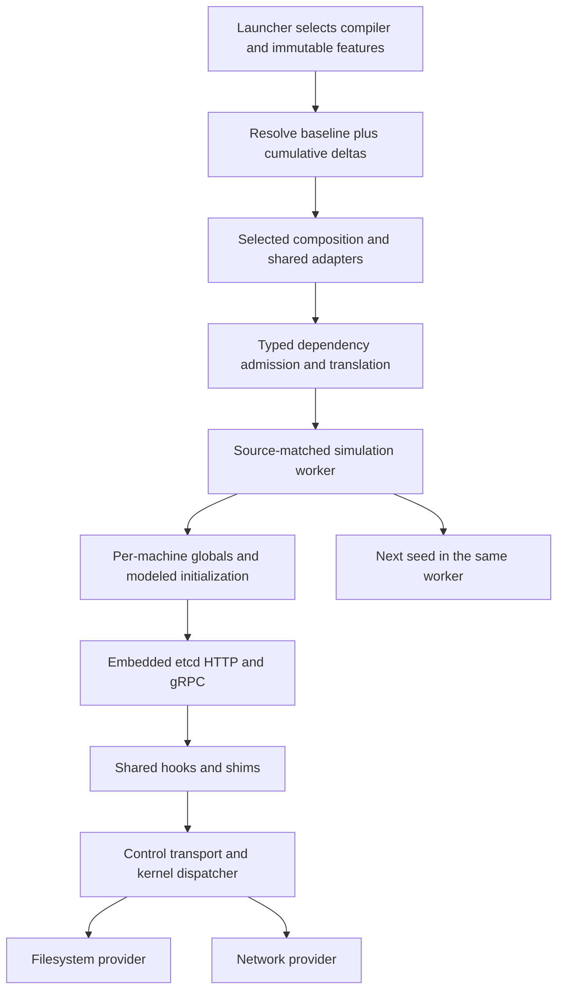

# Implementation plan: restore deterministic etcd simulation

**Plan:** `docs/plans/20261021-restore-etcd.md`

**Date:** 2026-10-21

**Project source:** `.` from the repository root; `../..` from this file.

**Branch:** `feat/compact-go-versions`; planning checkout `bac4e1c`.

**Input / investigation:** [historical study](../reports/20261021-restore-etcd-historical-study.md). This report supersedes the earlier location under `docs/brainstorms`.

**Target architecture:** [implemented runtime-maintenance architecture](../design.md#go-compatibility-and-capabilities), [package ownership](../design.md#package-ownership), [maintainer guide](../MAINTAINER_GUIDE.md). Restoration-specific structures, interfaces and flows are specified in A1–A9 below. The input is an investigation, not a method-level target specification; there is no separate restoration target file. This plan is the only new document produced by this planning session.

**Status:** Implemented and ordinarily verified on Go 1.25.14 and Go 1.26.9. Manual certification, race, large, and other-platform suites remain outside this plan's execution scope.

## Objective and execution rules

Restore the existing etcd 3.5.17 plaintext three-node cluster, network partition/recovery, snapshot and WAL examples on both supported Go families. Put common compatibility work in the Go 1.25 baseline and shared implementations. Go 1.26 inherits it; only demonstrated differences belong in its delta. Support remains `1.25.*` and `1.26.*`, with exact compiler/source identity for artifacts.

- Preserve pinned application dependencies: etcd 3.5.17, bbolt 1.3.11, gRPC 1.62.1, protobuf 1.33.0. Do not upgrade dependencies to hide a translation failure.
- Execute tasks in order. Batch two tasks per commit, following the user's existing instruction: 1–2, 3–4, 5–6, 7–8, 9–10, 11–12. Each pair must build and pass its applicable gates before commit. Task size estimates cover authored Go code/tests; generated metadata and declaration inventories are reported separately. Split a task before exceeding 1,500 authored lines.
- Build after each task. Run focused tests for the affected code; run the complete ordinary suites at Task 11. Fix every failure encountered in an invoked gate, including unrelated failures, before claiming that gate passed. Do not rerun unrelated suites after every small edit.
- Record unexpected work in `NOT PLANNED CHANGES`, remaining discrepancies in `NOT IMPLEMENTED GAPS`, and executed commands/results in the progress table. A compile-only shim check does not establish application support.
- Preserve `-ldflags=-checklinkname=0 -tags=linkname` on host builds/tests. Use the independent launcher for simulation. Do not run bare native `go test ./...` against stale prebuilt workers.
- Race, large suites, certification, Docker/Colima, and other-platform execution are outside this plan's execution gates. They require explicit authorization under [AGENTS.md](../../AGENTS.md); the prior completed certification does not certify changed source. The historical partition scenario is explicitly in scope; a general chaos or performance sweep is not.
- Lint changed Go files only under `cmd` and `examples`, using repository targets. Do not change generated/runtime semantics to satisfy whole-tree linting.
- Keep user-owned staged changes and documentation reorganization separate. Do not recreate deleted old plans/brainstorms or create a nested repository.

## Target architecture

### A1. Observable acceptance and scope

Positive support means executing the existing application stack, with translated HTTP/gRPC and simulated TCP/storage. No host network or filesystem fallback is permitted.

| Scenario | Required observation |
| --- | --- |
| Cluster startup | Three independently configured machines start embedded etcd and reach readiness within a simulated deadline |
| Before partition | Successful put/get round trips with exact value equality |
| Partition | Apply the existing seeded `nemesis.PartitionMachines` scenario; errors during the fault window are handled as expected application outcomes |
| After repair | Successful put/get round trips resume within a bounded recovery window; the test cannot pass solely on pre-partition successes |
| Snapshot | Missing snapshot is reported, saved metadata/data are loaded exactly |
| WAL | Create, close, reopen, save state/entries, reopen and recover exact values |
| Normal shutdown | Client closed, each embedded server closed through the simulation, every machine's exit observed |
| Repeated runs | Seeds 1, 2, 3 in one worker all pass; repeating seed 1 in that worker agrees with a fresh worker's seed 1 under the same identity |
| Feature applicability | Cluster package included only for `rt,fs,net`; focused HTTP tests require `rt,net` |

Retain `TestEtcd`, `TestSnapshotter`, and `TestWal`. Improve assertions and cleanup without replacing the real cluster with a fake. The historical cluster only required one successful operation; this plan strengthens progress checks before and after the partition. Do not require identical success counts across Go families or revisions.

Full TLS, certificate generation, JWT algorithms, etcd v2 discovery/JSON operations, unsafe reflect2 execution, host metrics, process signals, and stronger lock/crash guarantees remain excluded. A required operation on the positive scenario's actual path cannot be deferred merely by labeling it optional; implement its proper behavior or record a blocking gap.

### A2. Cumulative metadata and file ownership

Use existing `spec.FamilyDefinition`, `ProfileDelta`, `Declaration`, `PackagePolicy`, `Bridge`, `Capability`, `InitProbe`, `ModulePin`, and `ResolvedFamily` unchanged. No schema version change or new selection mechanism is needed.

| Location | Planned ownership |
| --- | --- |
| `internal/compat/profiles/go125.json` | Common package replacements, declaration contracts, capabilities, init probes and runtime-package membership |
| `internal/compat/profiles/go126.json` | Only actual signature/API differences required by these adapters; retain all existing deltas |
| `internal/compat/shims/elliptic/elliptic.go` | NEW: optional curve API declaration facade |
| `internal/compat/shims/ecdsa/ecdsa.go` | NEW: optional ECDSA declaration facade |
| `internal/compat/shims/rsa/rsa.go` | NEW: optional RSA declaration facade |
| `internal/compat/shims/reflect2/reflect2.go` | NEW: upstream API declarations, supported type metadata and guarded unsupported operations |
| `internal/compat/shims/trace/trace.go` | NEW: disabled runtime-trace query and guarded execution facade |
| Existing `shims/{tls,x509,pprof,metrics,runtimebridge,reflect}` | Extend only demonstrated declaration/initialization needs; preserve existing guarded behavior |
| `internal/translate`, `rt/runtime` | Fix demonstrated protobuf/global lifetime or translation defects at their owning layer |
| `internal/kernel`, `internal/net`, `internal/fs`, `internal/routegen` | Correct demonstrated HTTP/storage route or provider defects; preserve ownership and transport |
| `examples/etcd` | Embedded lifecycle and real application acceptance scenarios |
| `internal/tests/{net,integration,features}` | HTTP regression, repeated-worker checks, positive applicability |

One package is needed for each distinct upstream replacement/type universe; do not create per-family copies or a parallel etcd compatibility tree. Common files use `//go:build go1.25`. Use bounded files only for a demonstrated incompatible definition, for example `go1.25 && !go1.26` and `go1.26`. Never switch executable behavior on `runtime.Version()` or custom release tags.

For every new replacement, add an exact `packages` rule and `bridges` replacement, declare required callable contracts, and include it in `runtime_packages` where selected composition requires an explicit root. Its imports must use the selected shared type universe. Keep the existing wildcard rejections for all unreviewed packages. Exact positive rules override only the reviewed package.

New records in the baseline use `delta.<collection>.add`; changing a record already authored in the baseline edits that record. A descendant changes an inherited key with `replace` or `remove`; it must not duplicate it with `add`. Declaration keys remain `(context, package, symbol, architecture-scope)`. Replace complete records, not individual fields. Check both resolved families after every metadata change.

Use `capabilities.status = limited` for a declaration facade whose values may compile but whose operations abort. `rejected` is a static symbol rejection in `ResolveSymbol` and would prevent dormant call sites from compiling. Preserve an exact execution guard and an appropriate rejected-operation probe; never relabel an unimplemented algorithm as `implemented`.

### A3. Optional crypto and tracing declarations

The plaintext scenario does not generate certificates or use JWT authentication. Its dependencies still declare these paths. Follow the existing TLS/X509 facade pattern: preserve required types and signatures, allow harmless declarations/constants, and abort unsupported execution with `abi.Diagnostic` through `rt/runtime.Abort`.

Do not use native ECDSA/RSA key aliases or forward entropy-taking methods to native crypto. Go 1.26 can ignore the supplied random reader; Go 1.25 also does not guarantee deterministic key generation from that reader. Guarding excluded operations avoids claiming unimplemented replay guarantees.

Core shared type shapes (imports below mean selected translated interfaces or reviewed computation types):

```go
// shims/elliptic — complete upstream method set required by the pinned callers.
type Curve interface {
    Params() *CurveParams
    IsOnCurve(x, y *big.Int) bool
    Add(x1, y1, x2, y2 *big.Int) (*big.Int, *big.Int)
    Double(x1, y1 *big.Int) (*big.Int, *big.Int)
    ScalarMult(x, y *big.Int, k []byte) (*big.Int, *big.Int)
    ScalarBaseMult(k []byte) (*big.Int, *big.Int)
}
type CurveParams struct {
    P, N, B, Gx, Gy *big.Int
    BitSize int
    Name string
}

// shims/ecdsa
type PublicKey struct { elliptic.Curve; X, Y *big.Int }
type PrivateKey struct { PublicKey; D *big.Int }

// shims/rsa
type PublicKey struct { N *big.Int; E int }
type PrivateKey struct {
    PublicKey
    D *big.Int
    Primes []*big.Int
    Precomputed PrecomputedValues
}
type PrecomputedValues struct { Dp, Dq, Qinv *big.Int; CRTValues []CRTValue }
type CRTValue struct { Exp, Coeff, R *big.Int }
type PSSOptions struct { SaltLength int; Hash crypto.Hash }
```

The finite callable surface must be inventoried from both installed compiler sources and the pinned application's typed imports in Task 1. At minimum the existing transport/JWT code references:

```go
// elliptic
func P224() Curve
func P256() Curve
func P384() Curve
func P521() Curve
// ecdsa
func GenerateKey(c elliptic.Curve, random io.Reader) (*PrivateKey, error)
func Sign(random io.Reader, priv *PrivateKey, digest []byte) (*big.Int, *big.Int, error)
func Verify(pub *PublicKey, digest []byte, r, s *big.Int) bool
func (priv *PrivateKey) Public() crypto.PublicKey
func (priv *PrivateKey) Sign(random io.Reader, digest []byte, opts crypto.SignerOpts) ([]byte, error)
// rsa
func SignPKCS1v15(random io.Reader, priv *PrivateKey, hash crypto.Hash, digest []byte) ([]byte, error)
func VerifyPKCS1v15(pub *PublicKey, hash crypto.Hash, digest, signature []byte) error
func SignPSS(random io.Reader, priv *PrivateKey, hash crypto.Hash, digest []byte, opts *PSSOptions) ([]byte, error)
func VerifyPSS(pub *PublicKey, hash crypto.Hash, digest, signature []byte, opts *PSSOptions) error
func (pub *PublicKey) Size() int
func (priv *PrivateKey) Public() crypto.PublicKey
func (priv *PrivateKey) Sign(random io.Reader, digest []byte, opts crypto.SignerOpts) ([]byte, error)
func (opts *PSSOptions) HashFunc() crypto.Hash
```

Copy reviewed constants such as RSA PSS salt-length values exactly. Type declarations, field access and explicitly implemented simple metadata methods may work; all algorithm/key-generation calls above remain fatal unsupported operations. Record each method's disposition explicitly rather than assuming every method is harmless. Include any additional required Equal, key-conversion, ASN.1, curve or X509 declarations found by the bounded typed inventory; public/private type consistency must hold across TLS, X509 and JWT. Do not implement all upstream exports speculatively.

The runtime-trace facade has the required upstream `Task`/`Region` types and callable signatures:

```go
type Task struct{}
type Region struct{}
func IsEnabled() bool // always false: tracing cannot be enabled in this scope
func Start(w io.Writer) error
func Stop()
func NewTask(ctx context.Context, taskType string) (context.Context, *Task)
func (t *Task) End()
func StartRegion(ctx context.Context, regionType string) *Region
func (r *Region) End()
func WithRegion(ctx context.Context, regionType string, fn func())
func Log(ctx context.Context, category, message string)
func Logf(ctx context.Context, category, format string, args ...any)
```

Only `IsEnabled` is positively supported by this facade. Active tracing and task/region/log operations abort with an explicit `runtime/trace` diagnostic. OpenTelemetry's existing `IsEnabled` branch then stays inactive. Add only additional declarations actually required by selected source.

### A4. Reflect2 type metadata without its private ABI

Replace the exact pinned `github.com/modern-go/reflect2` package with a shared translated facade. Do not admit the upstream unsafe implementation or recoverable panic-only private linknames. Its complete public interface shapes used by jsoniter must match v1.0.1: `Type`, `ListType`, `ArrayType`, `SliceType`, `StructType`, `StructField`, `MapType`, `MapIterator`, `PtrType`, `InterfaceType`, `Config`, and `API`. The pinned source is the declaration authority; record the callable inventory in Task 1 and retain the existing module checksum contract.

Proposed owned state and entry points:

```go
type Config struct { UseSafeImplementation bool }
type API interface {
    TypeOf(obj any) Type
    Type2(typ reflect.Type) Type
}
type frozenConfig struct {
    useSafeImplementation bool
    types map[reflect.Type]Type
}
type typeBase struct { cfg *frozenConfig; typ reflect.Type }
type ptrType struct { typeBase }
// Separate wrappers for each supported kind, preserving interface assertions.
var ConfigUnsafe = Config{UseSafeImplementation: false}.Froze()
var ConfigSafe = Config{UseSafeImplementation: true}.Froze()
func (cfg Config) Froze() *frozenConfig
func (cfg *frozenConfig) TypeOf(obj any) Type
func (cfg *frozenConfig) Type2(typ reflect.Type) Type
func TypeOf(obj any) Type
func TypeOfPtr(obj any) PtrType
func Type2(typ reflect.Type) Type
func PtrTo(typ Type) Type
func IsNil(obj any) bool
func IsNullable(kind reflect.Kind) bool
```

Implement actual type introspection needed during initialization: nil handling, Kind, String, Type1, Elem, type equality/canonicalization, and the applicable public metadata methods. jsoniter's `Config.Froze` calls `TypeOfPtr(...).Elem()` for string, RawMessage and interface extension registration. These are executed initialization paths and must not be replaced with success-shaped placeholders.

The pinned jsoniter **v1.1.11** source also names exported concrete `reflect2.UnsafePtrType`, `UnsafeIFaceType`, `UnsafeSliceType`, `UnsafeArrayType`, `UnsafeMapType` and `UnsafeStructType` in declarations and assertions. Preserve these distinct public type names and their required method sets in the facade so the translated package compiles. A type name containing `Unsafe` does not grant pointer operations: its metadata may be modeled, while raw-pointer operations still abort. If jsoniter actually invokes a pointer operation in the positive scenario, implement its safe translated semantics or record a required gap and leave the task incomplete.

- Intern wrapper values by the selected `reflect.Type` within each translated config. Repeated calls must yield comparable canonical keys for jsoniter's extension maps.
- Construct kind-specific wrappers. A scalar must not accidentally satisfy `MapType`, `PtrType`, or every other interface because one implementation exposes every method.
- Keep maps/configs as translated machine state. No native `sync.Map`, host-global registry, address-based cache keys or shared mutable descriptors.
- Implement legitimate metadata through the existing public reflection shim. Do not unwrap its private `typeImpl` or inspect a native runtime type address.
- All allocation, mutation, raw-pointer extraction/packing and private map operations outside this subset must abort. This includes `UnsafeNew`, `UnsafeSet`, `UnsafeMakeMap`, unsafe iteration, `PtrOf`, `RTypeOf`, `RType`, and other pointer operations. Keep required declarations so dormant bodies type-check; do not return fabricated pointers/IDs.
- Non-unsafe value operations such as `New`, `Set`, `Indirect`, codec execution and collection mutation are also excluded unless explicitly implemented and tested. A safe-sounding name is not admission.
- If the positive cluster invokes an excluded operation, determine the real required semantics and extend this section/task before completion. Do not silently switch jsoniter to native encoding/json, change its number/case semantics, or remove application dependencies.

Minimal introspection is a deliberate capability, not general reflect2/jsoniter support. Test unsupported operation execution through the simulator's fatal diagnostic path, including a caller attempting `recover`.

### A5. Embedded lifecycle and bounded cluster fixture

Remove CLI process management from the example's embed wrapper. No new public Gosim lifecycle API is needed. Replace `EtcdMain` with:

```go
// examples/etcd/etcdmain_test.go
func RunEmbedded(ctx context.Context, cfg *embed.Config, ready chan<- error) error
func MakeZapLogger() *zap.Logger // existing helper retained

// examples/etcd/etcd_test.go — test-local structures
// Ready and Done each have a buffered capacity-one channel owned by this node.
type nodeHandle struct {
    Machine gosim.Machine
    Cancel context.CancelFunc
    Ready <-chan error
    Done <-chan error
}
type phaseResult struct { Attempts, Successes int }
func startNode(t *testing.T, name, address string) nodeHandle
func waitReady(t *testing.T, node nodeHandle)
func stopNode(t *testing.T, node nodeHandle)
func exerciseKV(t *testing.T, client *clientv3.Client, phase string, duration time.Duration) phaseResult
```

`RunEmbedded` validates cfg, starts the real `embed.StartEtcd`, reports one startup outcome, waits for cancellation/server stop/error, and closes the embedded server on every exit path. Before readiness, cancellation is a startup failure; after readiness, controller cancellation is normal shutdown. Propagate unexpected errors; do not call `log.Fatal`, `os.Exit`, `osutil.HandleInterrupts`, or native signal APIs. Do not globally weaken the signal shim.

Configure machine network address and simulated filesystem before `Start`. Use relative per-node data directories inside each machine's simulated volume, bounded backend quota, explicit plaintext listeners and static cluster membership. Disable optional auto-TLS, auth, tracing export and metrics scraping in the example configuration; importing declaration dependencies remains supported. Preserve application defaults required for real consensus and persistence.

Readiness, operation and shutdown waits have simulated deadlines. The root test owns cancellation and observes both server completion and `Machine.Wait`; successful completion requires a graceful exit. Failure cleanup must not block indefinitely or leave packets/events from dead epochs. Do not use host sleeps or increase all global test timeouts to hide deadlocks.

Use the existing seeded `nemesis.PartitionMachines` semantics, with explicit phase boundaries so pre-partition and post-repair progress are separately asserted. Retain positive value equality checks for every completed put/get. The root controller's labels and logical keys are stable; do not compare wall-clock durations or pointer-bearing log fields across runs.

### A6. HTTP, persistence and protobuf lifetime

Keep HTTP/gRPC source translated. Restore `internal/tests/net/net_grpc_http_test.go` to `//go:build sim`, retaining `TestNetTcpHttp`. Extend only necessary scenarios: request/response integrity, persistent connections, stream/cancel/deadline handling and graceful server shutdown. Provider effects continue through existing hooks → control → kernel → contracts → FS/net providers.

Fix defects where they occur. A route change must update `internal/routegen` inputs and regenerate adapters/dispatch; never hand-edit generated output. A declaration/type problem belongs in the relevant shared shim and baseline contract. Do not introduce a native net/http bridge or an etcd-specific transport.

Protobuf descriptor isolation is an acceptance requirement, not a predetermined diagnosis. First reproduce the historical shape using gRPC status details/failed calls across multiple simulated runs in one worker. Trace descriptor ownership through translated globals, generated init and reflection. Fix the smallest demonstrated ownership defect. Immutable native type metadata may remain cached if proven immutable and independent of machine values; protobuf descriptors/messages, mutable registries and callbacks must not outlive their owning run/machine state. Do not clear arbitrary host caches, share application registries, or launch a fresh worker for every seed.

Snapshot/WAL tests continue using real etcd packages and simulated storage. Their comparisons cover exact bytes, terms/votes/commit indices and entries after reopen. Fix only demonstrated storage errors through existing provider interfaces. Existing limited flock/fcntl behavior is not evidence of correct lock contention; no stronger guarantee is added by these tests.

### A7. Actual flows and failure behavior



1. Ordinary invocation resolves the caller's compiler, source and feature identity. Existing worker-cache hit/miss paths remain unchanged; changed adapters/source invalidate content identities.
2. Effective metadata adds exact reviewed replacement edges. Loading traverses their selected imports and rejects unreviewed native/private boundaries. Dormant excluded APIs type-check only through guarded facades.
3. Composition initializes translated shim/config state, then application state for each machine. reflect2 registration receives real selected type metadata. Disabled tracing reports false; host metrics are never sampled implicitly.
4. Each real embedded server starts, opens simulated files/listeners, signals readiness and participates in consensus. Network partitions affect peer routes through existing public controls.
5. Cancellation closes clients/servers, wakes waiters and drains lifecycle cleanup. The next simulation run receives fresh mutable application state.
6. Generation resolves both families separately, verifies upstream and implementation contracts, updates revisions and independently checks generated outputs. Origins remain independent; historical evidence is immutable.

| Failure | Required behavior |
| --- | --- |
| Unknown package or uncovered native symbol | Explicit translation error; no wildcard admission |
| Executed crypto/TLS/private reflection operation outside scope | Fatal unsupported-operation diagnostic; recovery cannot turn it into success |
| Readiness timeout or unexpected server error | Test fails with node/phase details; cleanup still attempted |
| RPC deadline during partition | Recorded unsuccessful attempt; exact value check still required for successful round trips |
| No progress after repair | Test fails, even if earlier operations succeeded |
| Full-feature fixture selected for reduced features | Excluded before loading by applicability; direct unsupported access still hits feature guards |
| Stale descriptor/cache state on later seed | Regression fails; no per-seed process workaround |
| Missing/mismatched origin or declaration | Generation/check fails; do not fabricate evidence |

### A8. Schemas, caches, identities and performance

No new application DB, ORM, migration, config schema, feature set, service endpoint or public machine API is introduced. Existing route IDs and provider contracts remain unless a demonstrated defect requires an explicitly documented compatible extension.

The existing translation DB remains:

```sql
CREATE TABLE IF NOT EXISTS cache (
    key TEXT PRIMARY KEY NOT NULL,
    timestamp INT,
    contents BLOB
) STRICT;
```

No additional tables/indexes or old-format decoder. Keep `gosim-translation-v2`, length-delimited content keys and:

```go
type CacheEntryV2 struct {
    Format uint32
    IdentityDigest string
    PackageDigest string
    Result TranslatePackageResult
}
```

Retention remains seven days with hourly last-use timestamps. Worker cache `workers/v1`, contract cache `compat/v1`, artifact identity/package-content directories, manifest schema and locks remain unchanged. The new reflect2 type cache is in-memory translated state only, keyed by selected `reflect.Type`, valued by immutable wrapper metadata within its owning config; it has no disk serialization or TTL and dies with that machine's globals.

Run IDs remain stale-handle guards, not random or trace inputs. Preserve independent random domains. Increment `rt/runtime.ReplayRevision` only if fixing the actual scheduler/random-derivation contract requires it; source/profile changes already invalidate executable artifacts. A protobuf application-state fix alone must not automatically change that revision.

Expected cost: larger translated dependency closure on the first etcd build; existing content caches amortize it. Type wrappers add bounded per-machine metadata allocations. Positive cluster coverage adds execution time to full-feature ordinary tests. Record actual translation/ordinary timings; do not add a new persistent cache, benchmark framework, broad timeout increase, or default large-suite invocation.

### A9. Algorithms and completion gates

```text
optionalAlgorithm(...):
    Abort(UnsupportedOperation, precise package/operation)
    unreachable  // never return a successful placeholder

Type2(cfg, typ):
    if typ == nil: return nil
    if cfg.types contains typ: return existing canonical wrapper
    wrapper = kind-specific metadata wrapper using public selected reflect APIs
    cfg.types[typ] = wrapper
    return wrapper

RunEmbedded(ctx, cfg, ready):
    validate cfg; publish startup error and return on failure
    e = embed.StartEtcd(cfg); publish startup error and return on failure
    defer e.Close()
    select readiness / cancellation / server failure / early stop
    publish exactly one startup outcome
    after successful readiness, select cancellation / server failure / stop
    propagate unexpected error; return normally on requested shutdown

clusterScenario(seed):
    configure immutable features and bounded virtual time
    create/configure/start three nodes; await all readiness
    exerciseKV(before); require progress
    run existing seeded partition scenario and bounded KV attempts
    await repair; exerciseKV(after); require recovered progress
    compare every successful read with its written value
    close client; cancel nodes; observe completion and graceful exits

replayCheck:
    one prepared worker executes seed 1, 2, 3, then 1 again
    require every result successful with equal identity/replay revision
    compare checksums and deterministic semantic output for the two seed-1 runs
    compare with seed 1 in a fresh matching worker
```

The final gate is actual positive application execution on both families, not just compilation or absence of a rejection. No unresolved required-path gap may be accepted as completion.

## Task list

### Task 1: Freeze the supported scenario and finite adapter contracts

**Files:** existing `examples/etcd/*`, `internal/compat/spec` test fixtures, this plan.
**References:** A1, A2, A3–A5, A9; historical study “Current restoration gaps”; maintainer guide §§2–3.
**Estimated authored changes:** ≤350 lines; no package admission change yet.

- [x] Inventory the exact imported symbols, fields, methods and initialization calls for the pinned etcd graph under both current compilers. Prune replaced/hooked bodies using real translation rules; raw `go list` membership alone is not an executable requirement.
- [x] Include jsoniter v1.1.11's concrete exported reflect2 type assertions in that inventory; its `Unsafe*Type` names must remain available even while raw-pointer operations are guarded.
- [x] Record the finite upstream signatures and dispositions alongside the contract tests: modeled metadata, declared/guarded operation, or still statically rejected. Include bridge-transitive methods, crypto key interfaces and reflect2/jsoniter initialization.
- [x] Confirm the existing module graph/checksums; retain dependency versions and root-module examples. Do not create a forked etcd module.
- [x] Define A5's lifecycle helper and phased scenario contract in test fixtures or the plan before implementing; preserve the three original positive test names.
- [x] Establish focused fixture locations for import/initialization, recovery-resistant guards and protobuf repeated-worker behavior. Keep incomplete positive fixtures out of ordinary runnable package lists until their dependencies are implemented; do not commit failing tests into active suites.
- [x] Record any additional required API here before extending facade scope. Preserve current negative behavior until its replacement has both metadata and implementation.

#### Verification

- [x] `V-BUILD` and existing focused `V-METADATA` pass on both families. Inventory extraction is source inspection, not positive etcd execution.
- [x] Confirm no policy was broadened and no generated support family was added.

### Task 2: Add guarded crypto declaration facades to the shared baseline

**Files:** NEW shared `shims/{elliptic,ecdsa,rsa}`; existing TLS/X509 facade only as needed; `profiles/go125.json`, genuine `go126.json` deltas, contract/guard tests and generated revisions.
**References:** A2–A3, A7 failure table; maintainer guide “Describe the upstream contract” and “Review a new package's execution policy”.
**Estimated authored changes:** ≤1,200 lines; generated metadata counted separately.

- [x] Implement A3's reviewed type shapes, constants and finite required method surface. Use local shared type identities consistently across crypto, JWT, TLS and X509 declarations.
- [x] Add precise aborting algorithm boundaries. No native key generation, host entropy, successful cryptographic placeholders or broad crypto allowlist.
- [x] Add exact baseline package/bridge/declaration/capability/probe records, including selected runtime-package roots. Existing broad crypto rejection remains for unreviewed packages.
- [x] Classify callable-but-guarded methods as limited with explicit execution diagnostics; do not leave static rejected capability records that defeat the intended declaration facade.
- [x] Verify both compiler APIs; add a Go 1.26 delta/source variant only for an actual required difference. Preserve existing descendants and type/interface assertions.
- [x] Cover dormant imports and executable negative paths with representative translated tests; verify an application recover cannot continue after an unsupported algorithm.
- [x] Run `V-GENERATE` for changed contracts and sources.

#### Verification

- [x] `V-BUILD`, `V-METADATA`, new facade/guard tests, and `V-GENERATE` pass for both families.
- [x] A focused etcd transport/auth import fixture passes this boundary; record subsequent distinct blockers without claiming whole-etcd support.

### Task 3: Implement reflect2's required type metadata without private runtime access

**Files:** NEW `shims/reflect2/reflect2.go` and focused tests; baseline replacement/contracts; existing reflection shim only for a demonstrated public API defect.
**References:** A4, A7–A8; study “Where support lived in the old tree”; maintainer guide §2.
**Estimated authored changes:** ≤1,300 lines, split declaration and behavior work if necessary.

- [x] Implement pinned public interface declarations and kind-specific wrapper types with A4's exact state ownership.
- [x] Implement `Config.Froze`, `TypeOf`, `TypeOfPtr`, `Type2`, pointer/element and required metadata queries through the selected public reflection API. Intern wrappers per config using translated maps.
- [x] Exercise real jsoniter default/standard-library-compatible config initialization, including string, RawMessage and interface extension keys. Verify nil behavior and canonical comparable keys.
- [x] Preserve interface method sets: non-map/non-pointer wrappers must not satisfy unrelated interfaces. Keep unsafe and unimplemented value operations fatal, including recovery attempts.
- [x] Replace only the exact reflect2 package; keep unsupported subpackages/private ABI rejected. Preserve module checksum enforcement and update its descriptive reason to the new limited capability.
- [x] Add baseline declarations and selected pinned-module source checks; use translated positive and fatal-operation fixtures for execution probes. The existing `InitProbe` format addresses GOROOT source only, so it cannot express a reflect2 module probe. Regenerate without treating historical panic-only private linknames as proof of support or marking all reflect2 operations implemented.
- [x] Check two simulated machines initialize independent mutable configuration state; this is not a native global cache.

#### Verification

- [x] Focused translated initialization/type-identity and negative-operation tests pass on both families; host package compilation alone is insufficient.
- [x] `V-BUILD`, `V-METADATA`, `V-GENERATE` pass. Record any executed need beyond A4 before extending support.

### Task 4: Supply disabled tracing and bounded observability declarations

**Files:** NEW `shims/trace`; baseline metadata; existing metrics/pprof/runtimebridge facades only where a selected declaration is missing.
**References:** A3 tracing signatures, A7, A8; study “Observability”.
**Estimated authored changes:** ≤600 lines.

- [x] Implement `IsEnabled() == false`, required Task/Region types and callable declarations. Unsupported trace execution aborts with a precise diagnostic.
- [x] Verify the actual OpenTelemetry disabled-tracing branch without invoking host tracing or treating all trace functions as successful no-ops.
- [x] Exercise Prometheus package initialization separately from metric collection. Preserve explicit failure for host heap/thread/goroutine measurements; add only missing declarations needed to register inactive collectors.
- [x] Check focused observability initialization does not scrape metrics or start an exporter; confirm the actual etcd startup path in Task 8. If a required startup path invokes an excluded operation, resolve it explicitly rather than blanket-suppressing diagnostics.
- [x] Add exact baseline contracts and negative tests; keep compile-time family selection and generate independently for both versions.

#### Verification

- [x] Focused OpenTelemetry/Prometheus initialization and unsupported-execution fixtures pass on both compilers.
- [x] `V-BUILD`, `V-METADATA`, `V-GENERATE` pass; no native runtime metrics/trace dependency is newly authorized.

### Task 5: Convert the etcd wrapper to explicit embedded lifecycle

**Files:** `examples/etcd/etcdmain_test.go`, `etcd_test.go`; small test-local helper if required.
**References:** A1, A5, A9 `RunEmbedded`/cluster flow; design “Package ownership” and lifecycle sections.
**Estimated authored changes:** ≤600 lines.

- [x] Implement `RunEmbedded` and the test-local `nodeHandle` helpers with exact A5 signatures and buffered startup/completion channels.
- [x] Remove process-signal/exit orchestration from this embedded fixture. Keep real `embed.StartEtcd`, error reporting, readiness and close behavior.
- [x] Configure network/storage before Start; preserve machine isolation, plaintext/static membership, bounded quota and simulated deadlines.
- [x] Propagate startup errors once, close servers on cancellation, report unexpected errors, and observe graceful machine exit. Test cancellation both before and after readiness and a failing startup configuration.
- [x] Register deterministic cleanup before operations that can fail; cleanup uses bounded waits and does not rely on a crashed machine running deferred code.
- [x] Keep all existing signal guards unchanged. Do not grant os/signal support to make the example compile or run.

#### Verification

- [x] `V-BUILD` and `V-LINT` pass. Focused lifecycle helper and startup fixtures pass where their dependency closure is now available.
- [x] Any remaining full-application translation defect is recorded by path and diagnostic for Tasks 6–8; no startup success is fabricated.

### Task 6: Restore the actual HTTP transport path

**Files:** `internal/tests/net/net_grpc_http_test.go`; demonstrated shared shim/translator/net/kernel/routegen defects only; feature inventory entry for this test.
**References:** A2, A6–A7; maintainer guide §3; historical HTTP test evidence.
**Estimated authored changes:** ≤1,000 lines; split if a genuinely new modeled operation is required.

- [x] Enable the retained `TestNetTcpHttp` under `sim` and update its exact existing inventory constraint without adding/removing historical test entries.
- [x] Verify request/body identity, persistent connections, stream/cancel/deadline handling and graceful shutdown through simulated TCP.
- [x] Fix concrete typed-boundary, polling or transport defects at the owner. Translate net/http; do not route it through host net or replace the HTTP stack with an etcd-specific mock.
- [x] For any missing syscall route, specify its typed payload/signature and provider ownership here first, then change generator inputs and regenerate. Existing IDs remain stable.
- [x] Exercise the pinned root gRPC scenario as a regression; retain the newer standalone gRPC example unchanged.
- [x] Run profiles maintenance after shared executable inputs change; add a family delta only when the difference is verified.

#### Verification

- [x] `V-HTTP`, focused affected provider/translator tests, `V-BUILD`, `V-METADATA` and applicable generation checks pass on both compilers.
- [x] Tests execute real request/response/shutdown paths; compile-only output does not satisfy this task.

### Task 7: Verify and fix protobuf descriptor isolation across runs

**Files:** focused fixture under `internal/tests/integration`; demonstrated changes in `internal/translate`, shared reflection, or `rt/runtime` only as justified.
**References:** A6, A8–A9; study “Reproduction” combined-seed failure.
**Estimated authored changes:** ≤1,000 lines.

- [x] Build a focused reproduction involving real gRPC status/error details and protobuf descriptor access across two machines and multiple runs in one worker.
- [x] Locate the lifetime/ownership error if reproduced. Separate immutable type wrappers from mutable application descriptors, values, init state and caches; document the causal chain before changing ownership.
- [x] Fix the narrow owning layer. Do not special-case the example package, hard-code `google.rpc.Status.code`, share application globals natively, or restart the worker between seeds.
- [x] If current code already satisfies the isolated regression, retain the evidence and continue to the full-cluster repeated-worker gate; do not invent a production fix solely because the old tree failed.
- [x] Verify the A8 cache formats/retention and exact build identity remain unchanged. Adjust replay revision only for a demonstrated scheduling/random contract change.
- [x] Add a meaningful regression for the actual defect, including a seed replay after intervening runs.

#### Verification

- [x] Focused repeated-worker regression, affected translator/reflection/runtime tests, `V-BUILD` and revision checks pass on both compilers.
- [x] A fresh-process-only pass does not satisfy this task; descriptor mismatch remains a required gap until the matching same-worker scenario succeeds.

### Task 8: Complete positive persistence and phased cluster execution

**Files:** `examples/etcd/{etcd_test,wal_test}.go`; demonstrated FS/net/compatibility fixes only.
**References:** A1, A5–A7, A9; historical TestSnapshotter/TestWal contracts.
**Estimated authored changes:** ≤900 lines plus any separately bounded owner fix.

- [x] Run and repair the real snapshot/WAL round trips under current simulated storage. Preserve exact metadata/data assertions and close every handle on successful paths.
- [x] Implement before/fault/after phases around the existing seeded partition. Require bounded pre-partition progress and post-repair progress; every successful get must equal the written value.
- [x] Complete actual three-node readiness and consensus execution. Do not reduce the fixture to a single node, omit raft peer traffic, bypass persistence or remove the partition.
- [x] Observe client close, server completion and all machine exits. Distinguish expected RPC failures during partition from startup, persistence, data-corruption and shutdown failures.
- [x] Run all three original tests with seeds 1–3 in one invocation on both families. Resolve each remaining required-path failure; extend a precise adapter/owner contract when needed, without broad admission.
- [x] Record elapsed time and semantic phase results. Keep lock-contention/durability limitations explicit; passing historical smoke tests does not implement those models.

#### Verification

- [x] `V-ETCD` passes for both families with nine successful test/seed records per compiler and no skipped scenarios.
- [x] `V-BUILD`, `V-LINT`, focused owner tests and maintenance checks pass after any fixes.

### Task 9: Wire positive applicability and durable replay coverage

**Files:** `internal/tests/features/{suites.go,inventory_test.go,README.md}`, HTTP inventory mapping, Makefile, ordinary test preparation/verification inputs where needed, integration metatest.
**References:** A1, A7–A9; design testing flows and existing `metatesting.MetaT` protocol.
**Estimated authored changes:** ≤700 lines.

- [x] Add `./examples/etcd` as a sim-only Suite requiring `rt,fs,net`, and include it in matching build/preparation inputs. Reduced-feature package lists must exclude it before loading.
- [x] Add a native integration metatest that uses an already prepared matching worker via `metatesting.ForOtherPackage`; run TestEtcd seeds 1, 2, 3, then 1 on the same MetaT instance. Compare the repeated seed's checksum/semantic output and a fresh matching worker.
- [x] Assert `Failed == false`, empty error, matching BuildDigest/ReplayRevision and nonempty checksums. Avoid comparing pointer-bearing etcd logs as raw text or requiring equal results across different compiler identities.
- [x] Keep native metatest lists free of sim-only example packages; update preparation so ForOtherPackage cannot silently use an old full-feature artifact.
- [x] Preserve the 207-entry historical test inventory, changing only the restored HTTP constraint as appropriate. Add new checks separately rather than rewriting historical provenance.
- [x] Correct stale claims of existing `unsupported-etcd` coverage. The current `internal/candidate/build_test.go` has a plaintext-gRPC case, not that old assertion. Search before editing; remove a rejection assertion only if it actually exists. Keep restricted candidate suites gated.
- [x] Preserve targeted negative operation tests for TLS, crypto, unsafe reflection, signals and missing features after replacing whole-package rejection with limited declaration admission.

#### Verification

- [x] Focused feature-registry/native-selection checks and the correctly prepared repeated-worker metatest pass under both families.
- [x] `V-BUILD`, `V-METADATA` pass. Confirm ordinary full-feature execution now includes positive etcd; no large-suite environment gate was enabled.

### Task 10: Finalize maintenance metadata and supported-scope documentation

**Files:** effective profile definitions, independent origins as intentionally required, generated revisions; `README.md`, `examples/{README.md,etcd/README.md}`, `docs/design.md`, `docs/MAINTAINER_GUIDE.md`, feature README.
**References:** A2–A4, A7–A8; maintainer guide §§1–4.
**Estimated authored changes:** ≤350 Go lines; documentation/generated metadata separate.

- [x] Reconcile every new facade's package/bridge/declaration/capability/probe/module/runtime-root record with actual selected source on both architectures and families. Verify unused optional operations remain guarded.
- [x] Audit cumulative inheritance: new common support is in go125, go126 contains only real deltas, no duplicated implementation tree or runtime version switch exists.
- [x] Independently run both compiler generation checks. Refresh each origin only when intentionally recording changed upstream-contract provenance, after contracts validate; never copy origins or alter historical evidence.
- [x] Verify shared generated outputs satisfy both families, including new runtime-package closure and shim bindings. Preserve generated selectors/guards and unsupported-family behavior.
- [x] Update documentation to describe working plaintext cluster/snapshot/WAL scenarios, ordinary coverage, repeated-worker verification and precise exclusions. Remove obsolete blanket HTTP/gRPC rejection wording.
- [x] Document the new facades in the maintainer guide using the existing cumulative maintenance workflow. Add only relevant `TODO(not planned)` comments at actual excluded-operation boundaries, without runtime warning spam.

#### Verification

- [x] `V-BUILD`, `V-METADATA`, full `V-GENERATE`, formatting and documentation link/example checks pass on both families.
- [x] Documentation claims match executed evidence and capability dispositions; no certification is claimed for the new source.

### Task 11: Execute final ordinary and application acceptance gates

**Files:** only fixes justified by failed gates; this plan's evidence/gap sections.
**References:** A1, A7–A9; all implemented task contracts.
**Estimated authored changes:** fix-driven; split any substantial corrective work.

- [x] Run `V-ORDINARY` separately for Go 1.25.14 and Go 1.26.9 with separate report roots. Read reports, timelines, skips and failure logs; ensure actual positive etcd and replay metatest inclusion.
- [x] Run `V-ETCD` and `V-HTTP` for each family on the final source identity if the ordinary records do not already establish the same exact scenario/seed coverage.
- [x] Verify existing simple/Bolt/network examples and nested NATS/gRPC examples remain successful on both families. Run the filesystem example with its documented Go 1.25.2 requirement. Reuse unchanged-source evidence only if it actually matches the final executable inputs.
- [x] Check that unsupported-operation tests still terminate the simulation and that disabled-feature selection excludes unrelated models before loading.
- [x] Fix every observed failure, record not-planned changes, and repeat only invalidated gates needed for final evidence. Do not substitute longer deadlines, skipped assertions or fresh-worker-only execution.
- [x] Record input identities, compiler versions, executed commands, pass/fail/skip counts and elapsed times. Explicitly state that large/race/certification/other platforms were not run.

#### Verification

- [x] Both ordinary suites exit 0, applicable positive examples and multi-seed checks pass, generation checks match final source, and source manifests identify the reviewed inputs.
- [x] No source-changing required gap remains before architectural verification.

### Task 12: Architectural delta verification and actual wiring

**Files:** this plan; narrowly required fixes and evidence only.
**References:** A1–A9 in full; current design/maintainer architecture; historical study restoration scope.
**Estimated authored changes:** verification-driven; split substantive fixes before completion.

- [x] Verify A1 acceptance: real three-node plaintext cluster, partition/repair progress, snapshot/WAL exactness, bounded cleanup, both families and repeated-worker behavior exist and execute.
- [x] Verify A2 ownership and maintenance: shared implementation only, baseline inheritance, genuine deltas, both architecture contracts, independent origins, generated revisions/selectors and exact compiler artifact separation.
- [x] Verify A3 crypto/tracing types, callable signatures and dispositions against the completed finite inventory. No missing facade method may be covered by a successful placeholder or native entropy fallback.
- [x] Verify A4 reflect2 type/config structures, canonicalization, kind-specific interfaces and translated cache ownership; private ABI/value operations remain explicitly guarded and initialization is genuinely implemented.
- [x] Verify A5 lifecycle interfaces and every startup/cancel/error/stop path, with no process signal/exit fallback and observed graceful exits.
- [x] Verify A6 HTTP/storage/protobuf ownership: translated I/O, real provider calls, corrected descriptor lifetime where required, no per-seed worker workaround and no stronger locking/durability claim.
- [x] Verify A7 happy/error flows and A8 unchanged DB/cache/config schemas, identity invalidation, lifecycle cleanup, random streams and any justified replay-revision change.
- [x] Verify A9 algorithm behavior, negative-operation fixtures, ordinary applicability/preparation, documented exclusions, and executed report evidence. Compare signatures in this plan with final code; record any justified adjustment here.
- [x] Audit every entry in `NOT IMPLEMENTED GAPS`. Fix required gaps according to this architecture, or record an explicitly approved alternative. Mark any unresolved item `[_]` and leave the plan incomplete; do not silently defer a positive-path requirement.
- [x] **Last: verify actual wiring from real entry points.** Launcher selects the family; effective baseline/delta metadata selects the new shared replacements; composition includes them; typed loading uses their declarations; real etcd calls reach simulated HTTP/TCP/storage and the embedded lifecycle helper; ordinary preparation builds matching workers; the suite registry runs positive etcd and the same-worker replay test. Every planned component must be reachable through this flow, not merely declared or referenced by a unit test.

#### Verification

- [x] Build is green, all required final gates pass on the reviewed source, no required gap remains, and claims in the plan/documentation match actual execution.

## Validation Commands

Run from the repository root. Commands below are execution instructions for the plan, not evidence that they ran during planning. Restrict intermediate invocations to affected packages/scenarios. `GOBASE` is a task-local shell variable, not an environment-wide compiler policy.

### V-BUILD and V-LINT

```sh
make build GOSIM_TOOLCHAIN=go1.25.14
make build GOSIM_TOOLCHAIN=go1.26.9
make lint
./.ci/gofmt check
git diff --check
```

Lint only when changed command/example Go files exist. Preserve staged user changes; do not stage unrelated files to control lint selection.

### V-METADATA and focused units

```sh
GOTOOLCHAIN=go1.25.14 go test -ldflags=-checklinkname=0 -tags=linkname \
  ./internal/compat/spec ./internal/compat/profiles ./internal/tests/features
GOTOOLCHAIN=go1.26.9 go test -ldflags=-checklinkname=0 -tags=linkname \
  ./internal/compat/spec ./internal/compat/profiles ./internal/tests/features
```

Add the affected shim/translator/kernel/provider package and a relevant `-run` selection as needed. New native facade units do not replace translated type/initialization/guard checks. Keep new positive/negative translated regression tests in applicable ordinary test packages; do not repurpose restricted large-suite fixtures to bypass their gate.

### V-GENERATE

After source/definition changes:

```sh
GOTOOLCHAIN=go1.25.14 go run -ldflags=-checklinkname=0 -tags=linkname \
  ./cmd/gosim-gen profiles -root=.
```

When adapter output needs regeneration, run the matching generator without `-check`, then regenerate profiles again. When the reviewed contract/provenance changed, intentionally use `-refresh-origin` independently under each baseline compiler, inspect the origin diff, and regenerate profiles. Never use origin refresh as an ABI-validation bypass.

Final independent checks:

```sh
GOTOOLCHAIN=go1.25.14 go run -ldflags=-checklinkname=0 -tags=linkname \
  ./cmd/gosim-gen -toolchain=go1.25.14 -profile=go125 -arches=amd64,arm64 -output=. -check
GOTOOLCHAIN=go1.26.9 go run -ldflags=-checklinkname=0 -tags=linkname \
  ./cmd/gosim-gen -toolchain=go1.26.9 -profile=go126 -arches=amd64,arm64 -output=. -check
GOTOOLCHAIN=go1.25.14 go run -ldflags=-checklinkname=0 -tags=linkname \
  ./cmd/gosim-gen profiles -root=. -check
GOTOOLCHAIN=go1.26.9 go run -ldflags=-checklinkname=0 -tags=linkname \
  ./cmd/gosim-gen profiles -root=. -check
```

These architecture arguments inspect/generate source contracts; they do not execute cross-architecture jobs.

### V-HTTP and V-ETCD

```sh
GOTOOLCHAIN=go1.25.14 ./.gosim/gosimtool test -features rt,net -seeds 1-3 -v \
  -run '^TestNetTcp(Http|Grpc)$' ./internal/tests/net
GOTOOLCHAIN=go1.26.9 ./.gosim/gosimtool test -features rt,net -seeds 1-3 -v \
  -run '^TestNetTcp(Http|Grpc)$' ./internal/tests/net

GOTOOLCHAIN=go1.25.14 ./.gosim/gosimtool test -features rt,fs,net -seeds 1-3 -v ./examples/etcd
GOTOOLCHAIN=go1.26.9 ./.gosim/gosimtool test -features rt,fs,net -seeds 1-3 -v ./examples/etcd
```

Keep all seeds in each invocation. Task 9's prepared native metatest adds order `1,2,3,1` and fresh-worker comparison using `MetaT.Run`, which CLI seed ranges alone do not establish. Use current matching prepare-selftest/build-tests manifests before running that focused native test; the ordinary verification entry handles preparation automatically.

### V-ORDINARY

```sh
GOSIM_TOOLCHAIN=go1.25.14 TEST_REPORTS_DIR="$PWD/.gosim/etcd-validation/go125" make test
GOSIM_TOOLCHAIN=go1.26.9 TEST_REPORTS_DIR="$PWD/.gosim/etcd-validation/go126" make test
```

Read each `unit/latest/report.md`, `timeline.md`/JSON, relevant package logs and source verification records. Check the etcd scenarios and replay metatest were executed, not skipped. Other explicitly excluded suites remain reported as skips.

### Existing example regressions

Run after building the current launcher; keep logs by compiler and package:

```sh
(
set -e
for GOBASE in go1.25.14 go1.26.9; do
  GOTOOLCHAIN="$GOBASE" ./.gosim/gosimtool test -features rt -seeds 1-3 ./examples/simple
  GOTOOLCHAIN="$GOBASE" ./.gosim/gosimtool test -features rt,fs -seeds 1-3 ./examples/bolt
  GOTOOLCHAIN="$GOBASE" ./.gosim/gosimtool test -features rt,net -seeds 1-3 \
    ./examples/network/machines ./examples/network/latency
  GOTOOLCHAIN="$GOBASE" ./.gosim/gosimtool -C examples/network/nats test -features rt,fs,net -seeds 1-3 .
  GOTOOLCHAIN="$GOBASE" ./.gosim/gosimtool -C examples/network/grpc test -features rt,net -seeds 1-3 .
done
GOTOOLCHAIN=go1.25.2 ./.gosim/gosimtool -C examples/filesystem test -features rt,fs -v .
)
```

The subshell stops on the first failed command. Preserve its exit status when capturing logs; a final successful command must not mask an earlier failure.

## NOT IMPLEMENTED GAPS

Planning-time unresolved implementation facts are bounded by explicit tasks, not waived requirements:

- [x] The finite callable/field inventory is recorded in `internal/compat/spec/testdata/etcd_contract.md`; exact facade signatures, generator contracts and translated positive/guard fixtures pass on both families.
- [x] The accepted plaintext initialization and cluster execution need reflect2 type metadata only. Real jsoniter initialization, three-node runs and repeated-worker runs pass; excluded pointer/value operations remain fatal.
- [x] The restored translated HTTP test passes body, reuse, stream, cancellation, deadline and shutdown assertions on seeds 1–3 under both compilers. No HTTP provider defect required a route change or native shortcut.
- [x] The historical protobuf descriptor mismatch is not reproduced in the current implementation. Both the focused status/detail fixture and full etcd cluster pass seeds 1, 2, 3, 1 in one worker, with equal seed-1 checksums and a fresh-worker comparison. The historical root cause remains unproven, so no production cache change is claimed.
- [x] Required plaintext startup, storage, observability initialization and shutdown paths execute in the positive tests on both families. Invalid config and pre-readiness cancellation are covered; active optional operations remain guarded.

Use `[_]` for an unresolved required gap at attempted completion. The plan cannot be marked complete while such an entry remains.

## NOT PLANNED CHANGES

- Task 9's first full-cluster same-worker replay had identical phase results
  but unequal checksums. The earliest differing log line was an etcd client
  retry target of the form `etcd-endpoints://0x.../10.0.0.1:2379`; pinned
  client code formats the client pointer into that target, and Gosim includes
  log bytes in its checksum. The example now uses a no-op logger for that
  client's optional retry messages while retaining explicit phase results and
  failure assertions. Both exact compilers then passed same-worker and fresh
  worker checksum/semantic comparison. No scheduler, cache or replay revision
  behavior was weakened.
- Task 5's removal of `osutil` exposed a translated map-conversion type from
  `github.com/golang/protobuf/proto.enumsByName` while loading the pinned
  grpc-gateway. The translator now generates an alias for that private named
  map type in its translated package, using its existing alias mechanism. This
  does not expose a native protobuf registry or change package selection.
- The pinned etcd debug utility references
  `runtime.SetMutexProfileFraction` in its optional pprof handler. A precise
  baseline rewrite now returns zero for disabled queries and aborts attempts
  to enable native mutex profiling. Both behaviors have translated fixtures;
  the plaintext embedded config leaves pprof disabled.
- Task 3's module-source probe uses the pinned module contract and translated
  initialization/abort fixtures. The current `InitProbe` schema accepts only
  GOROOT `src/` paths; adding an external module path would be a false probe.
  No schema extension is needed for this restoration.
- Prometheus v1.11.1 assigns `runtime.ReadMemStats` to a
  `func(*runtime.MemStats)` field. The existing runtime bridge used `any`,
  which failed translated type checking. Its signature is now exact, with a
  reviewed native type import used only for the signature; execution still
  aborts before collecting host metrics.
- `.ci/gofmt`: ordinary validation found that its source search included generated `.gosim` caches inside nested examples, causing a false formatting failure and transient read errors. Prune every `.gosim` directory while retaining all source directories. Verified by `./.ci/gofmt check` and the passing ordinary suite. The change is limited to the find expression:

  ```diff
  -gofiles=$(find . -name "*.go" -and -not -ipath "./.gosim/*" -exec sh -c 'head -3 {} | grep -q "DO NOT EDIT." || echo {}' \;)
  +gofiles=$(find . -type d -name .gosim -prune -o -type f -name "*.go" -exec sh -c 'head -3 "$1" | grep -q "DO NOT EDIT." || echo "$1"' _ {} \;)
  ```
- A4 and Task 1 now name jsoniter v1.1.11's required exported concrete reflect2 types. Pinned source inspection proved the original interface-only wording incomplete; the safety boundary for raw-pointer operations remains unchanged.

## NOT CONSIDERED & TODO

- [postponed] [porting:deffered] Full TLS/X509, RSA/ECDSA algorithms and JWT authentication. Preserve named fatal guards for excluded execution; declaration admission is not algorithm support.
- [postponed] [porting:deffered] Full unsafe reflect2, jsoniter value codecs and etcd v2 discovery. Implement the necessary type-introspection subset; guard unsupported pointer/value paths. A real executed need in the target scenario must be resolved, not deferred under this label.
- [postponed] [porting:simplefication] Native process signals and CLI exit handling. This embedded fixture uses explicit simulated lifecycle; general signal APIs remain rejected.
- [postponed] Full runtime tracing, native metrics collection and profiling. Disabled query/initialization is modeled narrowly; actual host observations remain rejected.
- [potential-improvement] Full lock-contention and crash-durability modeling beyond the original WAL/snapshot round trips. Preserve documented limitations; do not claim successful stubs provide locks.
- [postponed] Dependency upgrades, additional Go families, extra feature sets, platform expansion, benchmarks and a broader chaos matrix.
- [postponed] Race, large suite and manual certification runs require separate explicit execution scope. They do not gate ordinary library use and are not enabled by this plan.
- [porting:improvement-over-upstream] The historical cross-run protobuf failure is **included**, not deferred. Same-worker isolation and post-partition progress are mandatory improvements over the historical weak assertions.

## Progress and verification log

| Date | Phase | Evidence | Result |
| --- | --- | --- | --- |
| 2026-10-21 | Planning | Read user-specified historical report, current shared-profile implementation, maintained architecture/guide, selected dependency initialization, and actual candidate/applicability code | Plan only; restoration not executed |
| 2026-10-21 | Tasks 1–2 | Pinned module verification on both compilers; exact baseline profile and origin generation/checks; translated crypto fixture and fatal-guard fixture on both compilers; `make test` | 1,998 pass, 20 skip, 0 fail/error in 84 reports. Etcd now advances to reflect2 rejection; positive etcd remains pending. |
| 2026-10-21 | Tasks 3–10 | Shared metadata/reflect2/tracing facades, embedded lifecycle, translated HTTP, positive etcd and repeated-worker tests, baseline inheritance and docs | Paired implementation commits `6d1eb94`, `7000dda`, `dd43385`, `67eea50`; detailed commands and results in [progress](../progress/20261021-restore-etcd.md). |
| 2026-10-21 | Tasks 11–12 | Exact-family ordinary suites, final seed 1–3 HTTP/etcd, existing examples, expected-abort guards, generation and architecture wiring audit | Go 1.25.14: 2,031 pass / 18 skip; Go 1.26.9: 2,047 pass / 16 skip; 0 fail/error in 87 reports each. See [final evidence](../progress/20261021-restore-etcd.md#tasks-1112--exact-family-acceptance-and-architecture-audit). |

## Plan consistency checklist

- [x] Task 1 completes the finite contract inventory without changing dependency versions or broad admission rules.
- [x] Each task cites A-sections and existing architecture, has a bounded change set, and includes build/focused verification.
- [x] All common work is baseline/shared; no independent Go-family copy or runtime version switch is planned.
- [x] Positive application execution and deterministic repeated-worker coverage are required on both families.
- [x] Unsupported operations remain explicit, with no successful placeholder or host fallback.
- [x] Final task audits every subsystem and ends by verifying real entry-point wiring.
