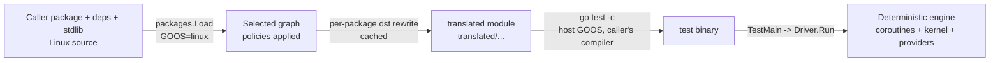
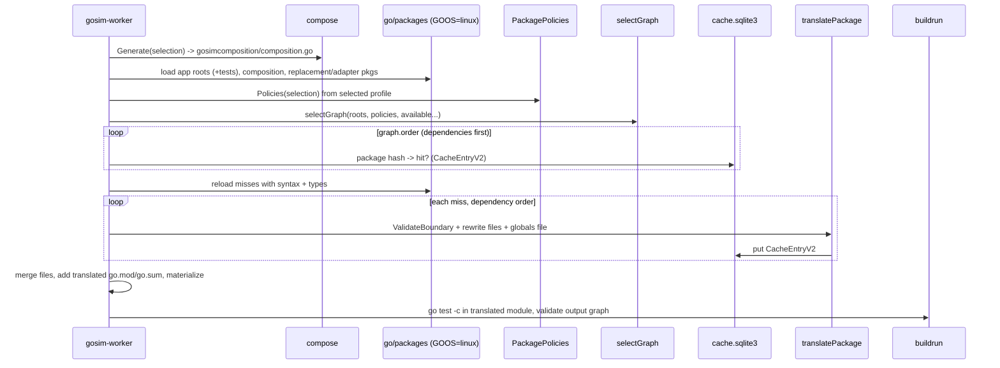

# How Gosim translates Go code

This document explains how Gosim turns ordinary Go code, including the caller's
packages, their dependencies and the standard library, into a deterministic
simulation binary. It covers:

- what the `cmd/gosim*` tools do and in which order;
- each stage of the translation pipeline, with the source location that owns it;
- every rewrite the translator applies, with real before/after output;
- how translated code reaches the simulated kernel at runtime;
- how to write hooks, shims, symbol rewrites and kernel routes;
- how to debug translation and build failures.

It is written for engineers who change Gosim itself. For using Gosim, read
[README.md](../README.md). For the overall component architecture, read
[design.md](design.md).

> **Paths in this document.** Version-specific code currently lives in
> `internal/compat/go125` and `internal/compat/go126`. Each family owns a full
> copy of its hooks, shims, host ABI and profile metadata. Examples use
> `go125`; the `go126` tree has the same structure. Line references are to
> commit `5212209`.

---

## 1. The mental model

Gosim never runs your code on the real Go runtime's scheduler, maps,
channels, timers or system calls. Instead, it:

1. **Loads** your test package and its whole dependency graph, including the
   standard library, as **Linux** source (`GOOS=linux`, `CGO_ENABLED=0`). This
   happens even on macOS.
2. **Rewrites** that source with `go/types` and `dave/dst`:
   - `go f()` becomes `gosimruntime.Go(...)`;
   - `chan`, `select` and `map` become deterministic runtime types;
   - package variables move into a per-machine global block;
   - selected standard-library functions lose their bodies and are linked to
     **hooks** that call the simulated runtime or kernel.
3. **Writes** the result into a private Go module named `translated`, where
   every package is relocated to `translated/<original path>`.
4. **Compiles** that module with `go test -c` for the *host* platform, using the
   *caller's exact compiler*.
5. **Runs** the test binary. Its `TestMain` hands control to a generated
   `Driver`, which starts the deterministic engine. Every simulated goroutine
   is a native runtime **coroutine** that the engine schedules from a seed.



### Two type universes

Correct hooks depend on this distinction more than on anything else.

| Universe | What lives there | How it is compiled |
| --- | --- | --- |
| **Translated** | Your code, its dependencies, almost the whole stdlib (`translated/time`, `translated/sync`, …), the public `gosim`/`fs`/`net`/`rt` controls, `internal/kernel`, `internal/control`, `internal/contracts`, the fs/net providers, and the family **hooks/shims** | Rewritten source under `translated/...` |
| **Native** | The engine `rt/runtime` (package name `gosimruntime`), its ABI `rt/runtime/abi`, `internal/hostabi`, the family `host` package, profile metadata, and reviewed pure-computation packages (`native-pure` policy) | Original source, untouched |

A translated package may call into the native universe only through:
- the two **native islands**, `rt/runtime` and `rt/runtime/abi`;
- explicitly reviewed bridges or `native-pure` packages.

Values that cross the boundary are primitives, handles, `abi.ByteView` and
similar records. They are never translated `context.Context`, `time.Time`,
channels or maps. A translated `time.Duration` and a native `time.Duration` are
*different types*.

---

## 2. The tools

| Binary | Source | Purpose | Who runs it |
| --- | --- | --- | --- |
| `gosim` (built as `.gosim/gosimtool`) | `cmd/gosim` → `internal/workerboot` | Version-independent **launcher**. Resolves the caller's compiler and Gosim source, then builds or reuses a matching worker. | Users, Makefile, metatests |
| `gosim-worker` | `cmd/gosim-worker` → `internal/gosimcli` | Does the real work: translate, build, run, debug. Compiled **with the caller's compiler**, so its compile-time-selected family matches. | The launcher (normally) |
| `gosim-gen` | `cmd/gosim-gen` → `internal/routegen` | Maintainer **generator**. Generates the kernel route table, typed syscall adapters and layout mirrors from routes metadata plus a pinned GOROOT and x/sys; refreshes origin provenance. | Gosim maintainers |
| `genprofile` | `internal/compat/genprofile` | Maintainer helper. Recomputes each family's `profile/revision.go` source fingerprint. | Gosim maintainers |

`make build` builds the three binaries into `.gosim/` with the required flags
(`-ldflags=-checklinkname=0 -tags=linkname`).

### 2.1 `gosim`: the launcher

`workerboot.Main` (`internal/workerboot/run.go:170`) runs these steps:

1. **Startup directory and overrides.** It parses only `-C dir` and peeks at
   `-config`/`-go`; everything else is forwarded unchanged.
2. **Configuration.** It loads `gosim.json` (`buildcfg.Load`). Schema 2 holds
   `features` and `simulation_os`; if the file is absent, the defaults are
   `rt,fs,net` and Linux.
3. **Compiler discovery** (`buildcfg.Discover`). It asks Go tooling, in the
   caller's module or workspace, which compiler to use. The result must be a
   stable `go1.X.Y` in a supported family (`buildspec/family.go`). The
   executable and GOROOT are frozen and fingerprinted (`buildcfg.Fingerprint`).
4. **Gosim source resolution** (`ResolveSource`). It finds the Gosim module
   version and replacement that the *caller's* module graph selects.
5. **Worker cache** (`Ensure`, `internal/workerboot/cache.go:144`).
   - The key covers the exact compiler/stdlib fingerprint, the Gosim source,
     the worker dependency graph, the platform and the protocol. Workers live
     at `<user cache>/gosim/workers/v1/<key>/`.
   - On a miss, it builds
     `go build -ldflags=-checklinkname=0 -tags=linkname -trimpath ./cmd/gosim-worker`
     in the caller's context under a per-key lock.
   - Before publishing atomically, it re-checks that neither the source nor the
     compiler changed during the build.
   - Every cache hit is verified with a `--worker-info` handshake (`Verify`).
   - The user cache root is `$GOSIMCACHE` if set, otherwise
     `os.UserCacheDir()/gosim` (`buildspec.CacheRoot`).
6. **Hand-off** (`Run`). It writes a private invocation file
   (`gosim-resolution-*.json`) holding the resolution and the worker manifest,
   then executes `worker --resolution <file> <original args>` in the caller's
   directory and environment. The worker re-validates the file
   (`ValidateInvocation`) before doing anything.

The launcher never translates anything itself. That is why it can be built
with any supported compiler: the worker always matches the caller.

### 2.2 `gosim-worker`: the command implementation

`gosimcli.Run` (`internal/gosimcli/main.go:154`) dispatches these commands:

| Command | What it does |
| --- | --- |
| `test [flags] [packages]` | Translate, build each test package's artifact, and run it (`-run`, `-skip`, `-seeds 1,5-10`, `-simtrace`, `-logformat`, `-jsonlogout`, `-v`) |
| `build-tests` | Translate and build artifacts only |
| `translate [packages]` | Translate only. The output is published to `<project>/.gosim/translated` (the path is printed). **This is the best tool for seeing what the translator did.** |
| `debug -package P -test T [-seed N -step K -headless]` | Build, then run the binary under `dlv` |
| `prepare-selftest`, `lookup-test`, `resolve-build` | Metatest plumbing: prepare prebuilt binaries, find an artifact by source digests, print the resolved identity |
| `viewer -log L -source DIR` | Inspect captured JSON logs against translated source |
| `internal-candidate verify/certify` | Manual verification/certification entry points (not part of ordinary use) |

All build commands share `-config`, `-go`, `-features rt[,fs][,net]` and
`-race`. Before any translation, `resolveBuildForContext`
(`internal/gosimcli/config.go:46`) does the following:

1. Reloads the config and accepts the launcher's resolution, or resolves the
   running process when the worker is invoked directly.
2. Puts the pinned compiler's `bin` first on `PATH`. `go/packages` invokes `go`
   from `PATH`, and `translate.validateLoaderWorker` later refuses any mismatch.
3. Takes `selected.Profile()`, the family profile chosen **at compile time** by
   build constraints in `internal/compat/selected/go125.go` / `go126.go`.
4. Runs `spec.CheckContracts`. It verifies every hook signature, private struct
   layout and constant the profile depends on against **this** compiler's
   GOROOT and x/sys sources. Successful results are cached by content.
5. Computes the build `Identity` (`buildcfg.Identity`). It covers the exact
   toolchain/stdlib digests, profile and adapter revision, runtime/provider
   revisions, a whole-framework source digest, the module graph, platform,
   features, race and tags. It then derives the `Selection` (`Profile.Select`).

The `Identity` digest names the working area for everything that follows:
`<project>/.gosim/v2/<identity-digest>/`.

### 2.3 `gosim-gen`: the generator

`gosim-gen` produces code that would be tedious and error-prone to write by
hand. Run it from the repository root with the **family's recorded baseline
compiler**:

```sh
GOTOOLCHAIN=go1.25.14 go run ./cmd/gosim-gen -toolchain=go1.25.14 -profile=go125 -arches=amd64,arm64 -output=.
GOTOOLCHAIN=go1.26.9  go run ./cmd/gosim-gen -toolchain=go1.26.9  -profile=go126 -arches=amd64,arm64 -output=.
# add -check to verify without writing; -refresh-origin to re-record provenance
```

`routegen.GenerateProfile` (`internal/routegen/generate.go:38`) runs these
steps:

1. **Validates** the profile and its policies. Unless `-refresh-origin` is
   given, it also checks that the compiler is the exact baseline in
   `profile/origin.json` (`spec.VerifyBaselineOrigin`) and that every reviewed
   contract holds against it (`spec.VerifyFamilyContracts`). It then checks
   the pinned x/sys module (`spec.VerifyModules`).
2. **Loads `internal/routegen/routes.json`.** This is the single source of truth
   for the kernel's typed routes: 78 routes, each with an ID, name, owner,
   kind, typed inputs/results, and the legacy symbols it replaced.
3. **Renders family-independent transport:**
   - `internal/kernel/routes_gen.go` holds the `XxxRequest`/`XxxResult` structs,
     `Invocation()` constructors, `DecodeXxxResult` functions and payload
     validation;
   - `internal/kernel/dispatch_gen.go` holds `Dispatcher.decode`, which switches
     on the route ID and calls the matching `Kernel` method.
4. **Renders family adapters** for each architecture. It parses the selected
   GOROOT and x/sys **Linux/<arch>** sources and, for every symbol in the
   adapter table (`internal/routegen/adapters.go:18`), generates a function with
   the upstream signature. That function marshals arguments into the typed
   route request and calls the kernel. The outputs are
   `hooks/{kernel,fs,net}/syscalls_<arch>.go`.
5. **Renders layout mirrors.** `hooks/kernel/layouts_<arch>.go` declares
   `Stat_t`, `Statfs_t` and similar records. They are checked against the
   upstream struct definitions in `internal/routegen/layout_<arch>.json`.
6. **Writes generation records.** These are `profile/routes_<arch>.json`, plus
   `origin.json` when refreshing. Every output is rendered and validated before
   the first write, and unchanged files keep their mtime.

`-check` renders the same outputs into a temporary tree and byte-compares them
with the repository (`internal/routegen/check.go:14`).

---

## 3. The translation pipeline, stage by stage

Entry point: `translate.Translate` (`internal/translate/main.go:26`). It is
called by `buildrun.BuildResolved` for `test`/`build-tests`/`debug`, and
directly for `translate`.



### 3.1 Composition comes first

`prepareComposition` (`main.go:284`) calls `compose.Generate`
(`internal/compose/generate.go`). It writes **one** generated package before
any application source is loaded:

```text
.gosim/v2/<identity>/input/
  go.mod, go.sum            # private module: github.com/neria-cloud/gosim/.gosim/v2/<identity>/input
  gosimcomposition/composition.go
```

The composition does three things:
- imports the selected family's runtime packages (hooks, plus the shims that
  must always be present) as blank imports;
- constructs **exactly** the providers for the enabled features
  (`fsprovider.NewProvider()`, `netprovider.NewProvider()`);
- defines a `Driver` type that implements `gosimruntime.Driver`.

`Driver.Run` checks that the native host identity matches the build, creates
the engine, installs a machine initializer, creates the kernel with the
providers, binds `control`, and runs the test. The machine initializer
configures the simulated process, runs `simrt.InitGlobals`, and sets up
logging.

Generating composition before loading means a disabled provider is never in
the import graph. Its absence is structural, not filtered after the fact.
`compose.ValidateImports` re-checks the exact import set before
materialization.

### 3.2 Loading Linux source

`loadSelectedPackages` (`internal/translate/load.go:65`) calls `packages.Load`
with this environment:

| Setting | Value | Why |
| --- | --- | --- |
| `GOOS` | `simulation_os` (Linux) | The simulated program always sees Linux syscalls and layouts |
| `GOARCH` | the host architecture | Layouts and adapters exist for amd64 and arm64 |
| `CGO_ENABLED` | `0` | Application cgo is not supported |
| `GOTOOLCHAIN` | `local` | The compiler is already pinned |
| `-tags` | `linkname,sim,math_big_pure_go,noasm` (+`race`) | Selects pure-Go fallbacks instead of assembly; `sim` selects simulation-only files |
| `-mod` | `readonly` (or the caller's flags for application roots) | The caller's `go.mod`/`go.sum` are never rewritten |

`loadSourceGraph` (`internal/translate/dependencies.go:51`) performs three
loads:
1. the **application roots**, with tests (`Tests: true`), in the caller's
   module;
2. the **composition** (`./gosimcomposition`) in the private input module;
3. the **available** packages: every shim/bridge replacement and symbol-rewrite
   target in the profile. These packages are only *available*. They join the
   graph only if something reachable actually uses them.

### 3.3 Package policies

`translate.Policies` (`internal/translate/profile.go:34`) flattens the
selected profile and its policy manifest into lookup maps:

| Map | Source metadata | Meaning |
| --- | --- | --- |
| `hooks` | `hooks.json` + `hooks_<arch>.json` (`Profile.Hooks`) | `pkg.Symbol` → hook target. The function body is removed and linked to the target |
| `packages` | `bridges.json` entries with `replacement` | The whole package is replaced by a shim (`reflect` → `shims/reflect`) |
| `replacements` | `bridges.json` `rewrites` | Symbol-level redirection (`sync.Map` → `shims/syncmap.Map`, `runtime.NumGoroutine` → `runtimebridge`) |
| `native` | `bridge` packages without replacement + `native-pure` policies | The package stays native and is not translated |
| `shared` | `shared_globals.json` | Package variables that stay real process-wide variables instead of per-machine globals |

Every package path gets a **mode** from `policies.json` (`spec.Profile.Policy`,
`internal/compat/spec/policy.go:12`):

| Mode | Effect |
| --- | --- |
| `translate` | Rewritten into the translated universe. **This is the default for unknown non-stdlib packages.** |
| `native-pure` | Kept native. Only for side-effect-free computation (hashes, ciphers, `cmp`, xxhash, …). The package is not traversed and its globals are not isolated |
| `bridge` | Kept native, but every used symbol must be listed in the bridge's `native_symbols` or `rewrites`; or the whole package is redirected to a `replacement` shim; or it is a native island (`rt/runtime`, `rt/runtime/abi`) |
| `reject` | Using the package is an error (`net/http/...`, `plugin`, `C`, quic-go, …) |

Matching rules: an exact path wins over a `/...` subtree, and the longer
subtree wins. An unknown **standard-library** package is an error
(`unreviewed standard-library package`). No missing rule ever selects native
execution.

`packagePolicy` (`profile.go:95`) also enforces structural rules:
- retired paths are rejected;
- compat packages from another family, and `host`/`profile` packages, are
  rejected;
- disabled providers are rejected (`internal/fs` when `fs` is off);
- concrete providers may be imported only by their own subtree or by the
  composition.

### 3.4 Building the selected graph

`selectGraph` (`internal/translate/graph.go:23`) walks the loaded packages and
builds the graph that will actually be translated, in dependency order:

- A **non-translate** package becomes a *native node* (`graph.native[id]`),
  and the walk does not descend into its internals. If that package has symbol
  rewrites, their **adapter packages are traversed instead**, because the
  native boundary depends on them.
- A **replaced** package (`packages[path]`) is swapped for its shim; the walk
  continues into the shim.
- For translated packages, `survivingImports` (`graph.go:189`) re-parses every
  file **with hooked function bodies deleted**. It keeps only imports still
  referenced. Dependencies used only inside a hooked body never enter the
  graph.
- An import annotated `//gosim:notranslate` stays native, but only if
  `AllowNativeImport` permits it: either the package is `native-pure` or
  `native_imports.json` lists the exact `(from, package)` pair. Application code
  cannot opt an I/O, time or container package out of translation.
- Test packages are classified by `classifyPackage`
  (`internal/translate/packages.go:28`):
  - `base`: `pkg`;
  - `fortest`: `pkg [pkg.test]`, the package compiled with its in-package
    `_test.go` files;
  - `tests`: `pkg_test`;
  - `testbinary`: `pkg.test`, the generated main.
- Cycles in the selected graph are errors.

`pushedDefinitions` (`graph.go:274`) records bodyless declarations that another
translated package legitimately **pushes** with `//go:linkname`, for example
`os` defining `net.newUnixFile`. These are not escapes to native code.

All packages reachable from the composition are marked **infrastructure**. Their
globals can be initialized lazily on the engine supervisor (see 4.4).

### 3.5 The translation cache

The translator only rewrites cache misses.
- **Tool hash.** `computeTranslateToolHash` hashes the canonical build
  `Identity` under the `gosim-translation-v2` namespace.
- **Package hash.** `computePackageHash` (`internal/translate/cache.go:63`)
  hashes the tool hash, the package ID/path/name, length-delimited digests of
  every compiled Go, other and embedded file, the module record and `go.mod`
  bytes, and the hashes of all selected dependencies.
- **Entries.** They are stored in `<project>/.gosim/cache.sqlite3` (table
  `cache(key, timestamp, contents)`). Each value is a gzip/gob `CacheEntryV2`
  holding `Format`, `IdentityDigest`, `PackageDigest` and the
  `TranslatePackageResult` (translated files plus global metadata). Entries
  expire after seven days of disuse. Corrupt entries are misses.

Only misses are reloaded with `NeedSyntax|NeedTypes|NeedTypesInfo`
(`reloadSelectedPackages`, `main.go:217`), so a warm cache avoids type-checking
the standard library.

### 3.6 Boundary validation

Before rewriting, `ValidateBoundary` (`internal/translate/profile.go:158`)
type-checks every use of a foreign object in a translated package:
- every imported package must pass `importPolicy`;
- every symbol from a native package must resolve through
  `PolicyManifest.ResolveSymbol`. That means a rewrite, a listed native symbol,
  a native island, or a replacement shim. A capability marked `rejected` blocks
  the symbol;
- `validateDeclarations` (`profile.go:283`) checks every `//go:linkname`:
  - hooked local symbols are fine;
  - links to `runtime.fastrand*` and `runtime.getAuxv` must have the exact
    primitive signature and are redirected to deterministic adapters;
  - links into other translated packages must still pass symbol policy;
  - links into native packages are rejected (`unreviewed native linkname`);
- every **bodyless function** must be hooked, linked, or a pushed definition.
  This is what catches assembly-backed functions with no Go fallback
  (`unreviewed bodyless function`).

### 3.7 Rewriting one package

`translatePackage` (`internal/translate/translate.go:132`) works as follows:

1. **Test binaries** (`testbinary`) are not rewritten. Instead it generates
   `gosim_meta_test.go` (section 4.7).
2. For `fortest` packages, only the `_test.go` files are translated. The
   normal files were already translated as `base`.
3. It decorates the `go/ast` files into `dst` files. `dst` keeps comments and
   directives attached to nodes, and its resolver uses the type-checker's
   `Uses` map, so every identifier carries its package path (`ident.Path`).
4. It collects globals and tests (`collectGlobalsAndTests`), merges
   `GlobalInfo` from dependencies (whose globals were moved and under which
   container), and collects `//go:embed` data.
5. `translateFile` (`translate.go:579`) runs two passes:
   - **post-order:** `select` statements, `range` over maps, and global
     definitions;
   - **pre-order** (`preApply`, `translate.go:515`): all other rewrites, in a
     fixed order. Conversions and `nil` come first, then `make`, then types,
     then operations, then globals, init, linknames, `go`, and finally global
     reads.
6. It writes each file, then `gosim_globals.go` (`gosim_globals_for_test.go` /
   `gosim_globals_test.go` for test variants), and, where needed,
   `gosimaliashack.go`.

### 3.8 Output layout

- **Package paths.** `GetNewPackageName(p)` = `"translated/" +
  ReplaceSpecialPackages(p)`, which renames every `internal` and `vendor` path
  element with a trailing `_`. Example: `internal/poll` →
  `translated/internal_/poll`. The rename avoids Go's internal-import rule:
  `translated/os` must be able to import translated `internal/poll`.
- **File locations.** Files are written under the output root *without* the
  `translated/` prefix, because the module itself is named `translated`.
  Example: `.gosim/translated/time/sleep.go`.
- **Build constraints.** Every `//go:build` and `// +build` line is replaced by
  `//`. **File-name constraints** naming the simulation OS/arch are neutered by
  adding `_` (`renameFile`, `translate.go:93`), so `zsyscall_linux_arm64.go`
  becomes `zsyscall_linux_arm64_.go`. The selection was already made at load
  time with `GOOS=linux`, and the output must compile on darwin hosts too.
- **Module files.** `selectedModuleFiles(cfg, "translated")` writes a `go.mod`
  named `translated` that requires the exact original module graph (including
  Gosim itself, for the native packages), plus a `go.sum`.
- **Conflicts.** Two packages emitting different bytes for the same file is an
  error (`conflicting translated output`).

---

## 4. Rewrite catalogue (with real output)

All examples below come from running
`make build` followed by
`./.gosim/gosimtool -C examples/simple translate -features rt .`
and reading `.gosim/translated/`.

### 4.1 Imports and identifiers

`rewriteImport` and `rewriteIdent` (`internal/translate/rewrites.go`) replace
every reference to a package with its relocated or replaced path:
- `testing` becomes the family shim,
  `translated/github.com/neria-cloud/gosim/internal_/compat/go125/shims/testing`;
- `math/rand` becomes `translated/math/rand`;
- native packages keep their path.

Dot-imports are turned into named imports. Symbol rewrites change both name
and package: a use of `sync.Map` becomes `syncmap.Map` from the selected shim.

```go
// original: examples/simple/simple_test.go
import ("math/rand"; "testing"; "github.com/neria-cloud/gosim")
func TestGosim(t *testing.T) { t.Logf("Random: %d", rand.Int()) }

// translated
import (
	"translated/github.com/neria-cloud/gosim/internal_/compat/go125/shims/testing"
	"translated/math/rand"
	"translated/github.com/neria-cloud/gosim"
)
func ImplTestGosim(t *testing.T) { t.Logf("Random: %d", rand.Int()) }
```

### 4.2 Goroutines

`rewriteGo` (`internal/translate/go.go:13`) rewrites `go` statements:
- `go f()` with a no-argument, no-result function becomes
  `gosimruntime.Go(f)`;
- any other call is wrapped in a generated generic **bind** helper, because
  `Go` takes only `func()`. Arguments are still evaluated at the `go`
  statement, exactly as in Go.

```go
// translated shims/testing/testing.go
gosimruntime.Go(Bind2_0(tRunner)(t, f))

// generated into gosim_globals.go of that package
func Bind2_0[T1, T2 any](f func(v1 T1, v2 T2)) func(v1 T1, v2 T2) func() { ... }
```

`gosimruntime.Go` (`rt/runtime/runtime.go:763`) yields the current goroutine
(a scheduling point), creates a race token, and asks the scheduler to start a
new coroutine on the current machine.

### 4.3 Channels and select

`internal/translate/chan.go` rewrites every channel construct:

| Go | Translated |
| --- | --- |
| `chan T` (type) | `gosimruntime.Chan[T]` |
| `make(chan T, n)` | `gosimruntime.NewChan[T](n)` |
| typed `nil` channel | `gosimruntime.NilChan[T]()` |
| `ch <- v` | `ch.Send(v)` |
| `<-ch`, `v, ok := <-ch` | `ch.Recv()`, `ch.RecvOk()` |
| `close(ch)`, `len`, `cap`, `range ch` | `ch.Close()`, `ch.Len()`, `ch.Cap()`, `range ch.Range()` |
| implicit conversion to a named/directional channel type | explicit conversion |

A `select` becomes a `switch` over `gosimruntime.Select(...)`. Each case gets
a selector; the generated code returns the chosen index, the received value
and the ok flag. A select without `default` gets a synthetic
`default: panic("unreachable select")` to satisfy the compiler. A single case
plus `default` uses the cheaper `SelectRecvOrDefault`/`SelectSendOrDefault`.

```go
// translated context/context.go
gosimruntime.Go(func() {
	switch idx1, _, _ := gosimruntime.Select(parent.Done().RecvSelector(), child.Done().RecvSelector()); idx1 {
	case 0:
		child.cancel(false, parent.Err(), Cause(parent))
	case 1:
	default:
		panic("unreachable select")
	}
})
```

The engine chooses among ready cases with the seeded scheduler, so select
fairness is deterministic for a given seed.

### 4.4 Maps

`internal/translate/map.go` rewrites every map construct. Go's built-in map
iteration order is randomized per process; `gosimruntime.Map` iterates in a
deterministic order.

| Go | Translated |
| --- | --- |
| `map[K]V` | `gosimruntime.Map[K, V]` |
| `make(map[K]V)`, literal, typed `nil` | `NewMap[K,V]()`, `MapLiteral([]KV[K,V]{...})`, `NilMap[K,V]()` |
| `m[k]`, `v, ok := m[k]` | `m.Get(k)`, `m.GetOk(k)` |
| `m[k] = v`, `m[k] += v` | `m.Set(k, v)`; op-assign becomes a `Get`/`Set` pair |
| `delete`, `clear`, `len`, `range m` | `m.Delete(k)`, `m.Clear()`, `m.Len()`, `range m.Range()` |
| generic constraint `~map[K]V` | `gosimruntime.AnyMap[K, V]` (+ `ExtractMap(m)` at use sites) |

```go
// translated maps/maps.go
for k, v1 := range gosimruntime.ExtractMap(m1).Range() {
	if v2, ok := gosimruntime.ExtractMap(m2).GetOk(k); !ok || v1 != v2 {
```

Exception: `internal/sync` and `hash/maphash` keep their map *types*, because
they use `abi.TypeOf(m).MapType()` for type introspection only.

### 4.5 Package variables become per-machine globals

Each simulated **machine** has its own copy of every package variable.
Restarting a machine re-runs package initialization, and machines never share
mutable state by accident. The translator implements this as follows
(`internal/translate/globals.go`):

1. The `var` declarations are removed from the file (`rewriteGlobalDef`).
2. Each variable becomes a field of a per-package `Globals` struct in the
   generated `gosim_globals.go`.
3. Every read or write becomes `G().name` (`rewriteGlobalRead`), including in
   *other* packages, which learn the container through merged `GlobalInfo`.
4. Initializer expressions move, in the type checker's `InitOrder`, into an
   `initializers` function. `func init()` is renamed to `gosiminitN` and called
   at the end of that function.
5. `//go:embed` variables are initialized from embedded data inside
   `initializers`. A `[]byte` gets a fresh copy per machine boot.
6. A real `init()` only registers the package with the runtime.

```go
// generated context/gosim_globals.go
type Globals struct {
	Canceled         error
	DeadlineExceeded error
	goroutines       atomic.Int32
	cancelCtxKey     int
	closedchan       gosimruntime.Chan[struct{}]
}
var globals gosimruntime.Global[Globals]
func initializers(initializeShared bool) {
	G().Canceled = errors.New("context canceled")
	G().DeadlineExceeded = deadlineExceededError{}
	G().closedchan = gosimruntime.NewChan[struct{}](0)
	gosiminit0()
}
func G() *Globals { return globals.Get() }
func init() {
	gosimruntime.RegisterPackage("context").Globals = &gosimruntime.Globals{Globals: &globals, Initializers: initializers, Infrastructure: true}
}
```

At runtime (`rt/runtime/globals.go`):
- `prepareGlobals` uses `reflect.StructOf` to build one **merged struct type**
  from all registered packages and gives each `Global[T]` its field offset.
- Each machine allocates one instance (`allocGlobals`).
- When the scheduler steps a goroutine, it points `globalPtr` at that
  goroutine's machine block (`goroutine.step`). `G()` is therefore a pointer
  addition, and the same code sees a different machine's state depending on
  who is running.
- `InitGlobals` runs all initializers in registration (dependency) order inside
  the machine initializer.

Special cases:
- **Shared globals.** `shared_globals.json` lists variables (currently
  `internal/control.binding`) that stay ordinary package variables. Their
  initializers run only when `initializeShared` is true.
- **Infrastructure globals.** Packages reachable from the composition are
  marked `Infrastructure: true`. The supervisor initializes them lazily on
  first access; application globals are never touched on the supervisor.
- **Constant array length.** `len(globalArray)` is a constant in Go; turning
  it into `len(G().a)` would break constant expressions, so
  `rewriteConstantArrayLen` substitutes the type checker's constant value.
- **Unexported aliases.** If a generated type expression needs an unexported
  type from another package, that type must be listed in `typeAliases`
  (`internal/translate/types.go:509`). The translator then emits a
  `gosimaliashack.go` with an exported alias; otherwise it panics with
  `need public export hack`.

### 4.6 Hooks: removing a body and linking it

This rewrite connects standard-library behaviour to the simulation.
`rewriteStdlibEmptyAndLinkname` (`internal/translate/rewrites.go:157`) handles
every function listed in the profile's hooks:
- the body is dropped;
- the `//go:linkname` directive is added (or replaced) so it points at the
  **translated** hook target;
- `_ "unsafe"` is imported.

```go
// translated time/sleep.go
//go:linkname Sleep translated/github.com/neria-cloud/gosim/internal_/compat/go125/hooks/rt.Time_Sleep
func Sleep(d Duration)

// translated sync/runtime.go
//go:linkname runtime_Semacquire translated/github.com/neria-cloud/gosim/internal_/compat/go125/hooks/rt.Sync_runtime_Semacquire
func runtime_Semacquire(s *uint32)

// translated syscall/zsyscall_linux_arm64_.go (generated adapter target)
//go:linkname Fstat translated/github.com/neria-cloud/gosim/internal_/compat/go125/hooks/fs.Syscall_Fstat
func Fstat(fd int, stat *Stat_t) (err error)
```

The same pass handles the other linkname cases:

| Situation | Action |
| --- | --- |
| Existing `//go:linkname local pkg.sym` to a translated package | Retargeted to `translated/<pkg>.sym` |
| Link to `runtime.fastrand{,n,64}` / `runtime.getAuxv` | Retargeted to the deterministic adapter named by the profile's rewrites |
| Pushed definition into a package this graph doesn't import | Retargeted to its future translated path |
| Target prefixed `gosimnotranslate/` | Prefix stripped, so the link stays native (reserved for owned code) |
| Bodyless function, not hooked, not a pushed definition | Translator panic `missing function body` (normally caught earlier by `ValidateBoundary`) |
| Any other unknown native link | Panic `unknown linkname` |
| Dangling linkname comments elsewhere | Commented out (`// gosim removed: ...`) |

Small compiler-compatibility fixes are applied in the same pass:
- `//go:uintptrkeepalive` becomes `//go:uintptrescapes` (the former is
  stdlib-only);
- `//go:noescape` is dropped from bodyless functions;
- `Mmap` in `syscall`/`x/sys/unix` gets `//go:nocheckptr`.

### 4.7 Tests

These rewrites live in `internal/translate/tests.go` and
`globals_analysis.go`:
- Each top-level `TestXxx(t *testing.T)` is renamed to `ImplTestXxx`.
- A user `TestMain` is removed.
- For the test binary, the translator generates `gosim_meta_test.go`. It
  registers all tests and hands control to the runtime driver:

```go
func init() {
	gosimruntime.SetAllTests([]gosimruntime.Test{{Name: "TestGosim", Test: ImplTestGosim}})
}
func TestMain(m *testing_original.M) {
	gosimruntime.TestMain(gosimcomposition.Driver{})
}
```

`gosimruntime.TestMain` (`rt/runtime/driver_main.go:17`) parses `-seeds`,
`-simtrace` and `-jsonlogout`, plus `-metatest` for the JSON request protocol
used by native metatests. For each seed it calls
`Driver.Run(config, func(){ … TestEntrypoint … })`. Each seed is a fresh
engine run.

### 4.8 Targeted compatibility rewrites

| Rewrite | Reason |
| --- | --- |
| `sync.notifyList` → alias of `gosimruntime.NotifyList` | `sync.Cond` waits must park simulated goroutines |
| `//go:norace` on all `sync`/`internal/sync` functions | Their own race hooks synchronize; instrumenting their state would report false races between cooperatively scheduled goroutines |
| `encoding/json.cachedTypeFields`/`typeEncoder` wrapped in `Begin/EndControlledNondeterminism` | These caches use `sync.Map`/`sync.Once` patterns whose fill order must not perturb the schedule |

---

## 5. Building and validating the output

`buildrun.BuildResolved` (`internal/buildrun/build.go:27`) handles each
translated test package:

1. Compute the package's source digest from the dependency file set that
   `translate` reported. Look up or build an **artifact** under
   `.gosim/v2/<identity>/packages/<package-digest>/` (`manifest.json` +
   `testbin`), using exclusive staging and atomic publication.
2. Materialize the translated module into the staging `source/` directory.
3. **`validateOutputGraph`** (`build.go:101`) first matches the translated
   module graph against the input graph (no upgrades or extra modules). It then
   runs `go list -deps -test` on the real compiled graph and rejects:
   - another family's compat packages;
   - a native copy of an fs/net provider (`native provider escaped translation`);
   - disabled providers;
   - forbidden cross-provider or kernel→provider edges;
   - a missing enabled provider.
4. Compile:
   `go test -c -trimpath -mod=readonly -ldflags=-checklinkname=0 -tags=linkname,sim [-race]`,
   with `CGO_ENABLED=1` (needed for race on the host) and **host** `GOOS`.
   Because build constraints were neutered, the Linux-selected source compiles
   on darwin as well.

The `test` command then executes the binary with
`-test.run`/`-test.skip`/`-seeds`/`-simtrace`/`-logformat`. It sets an empty
`GODEBUG` and merges stdout and stderr into one test-output stream.

---

## 6. What happens at runtime

### 6.1 Scheduling

Each simulated goroutine is a **native coroutine**. The family `host` package
(`internal/compat/go125/host/coro.go`) uses `//go:linkname` to reach Go's
private `runtime.newcoro`, `runtime.coroswitch` and `runtime.coroexit`, the
same machinery that powers `iter.Pull`. `internal/hostabi` exposes it as
`Coro{Start,Next,Yield,Finish}`.

The engine (`rt/runtime`) runs one coroutine at a time and picks the next one
with the seeded scheduler. Blocking operations (channel ops, semaphores,
`Sleep`, kernel calls) park the coroutine. When nothing is runnable, simulated
time jumps to the next timer. Translated atomics call `AtomicYield`, which is
an implicit scheduling point.

### 6.2 From a stdlib call to a provider

Here is the full path of `os.File.Stat()` → `syscall.Fstat` inside the
simulation:

```mermaid
sequenceDiagram
  participant App as translated app / os
  participant Sys as translated syscall.Fstat (bodyless)
  participant Hook as hooks/fs.Syscall_Fstat (generated)
  participant Ctl as internal/control.submit
  participant Disp as kernel.Dispatcher (supervisor)
  participant K as kernel.Kernel
  participant FS as fs provider
  App->>Sys: Fstat(fd, &st)
  Sys->>Hook: (go:linkname)
  Hook->>Hook: kh.Require(contracts.FS) — abort if fs disabled
  Hook->>Ctl: kh.Call(k.FstatRequest{FD}, k.DecodeFstatResult)
  Ctl->>Disp: stamp run/epoch/PC, Dispatcher.Submit(inv)
  Disp->>Disp: SyscallEnter; incoming.Send; Semacquire (park)
  Disp->>K: dispatch_gen decode -> k.Fstat(ctx, fd)
  K->>FS: descriptor owner FileOps
  FS-->>Disp: Result (exactly once)
  Disp-->>Hook: wake; TakeResult
  Hook-->>App: writeStat(unsafe.Pointer(&st), out.Stat)
```

Key properties:
- **Transport.** `control.Submit` (`internal/control/dispatch.go:59`) sets the
  call context itself (run ID, machine, epoch, caller PC). Application code
  cannot forge it, and outside a simulation it returns `ErrNotSim`.
- **Serialization.** The dispatcher runs on the supervisor, so kernel/provider
  state is changed by one actor at a time and cannot race with simulated
  goroutines.
- **Borrowed memory.** Buffers cross as `abi.ByteView`; they are valid only
  for that invocation and cleared on completion or cancel. Adapters annotate
  writes into user memory for the race detector
  (`simrt.RaceWriteRange(...)`).
- **Unsupported operations.** `Reject(op)` aborts the run with an
  `UnsupportedOperation` diagnostic (`hooks/kernel/transport.go`). Raw
  `Syscall`/`Syscall6`/`RawSyscall*` are always rejected; there is no host
  syscall fallback.
- **Layout mirrors.** A generated adapter takes `*kh.Stat_t` where the
  upstream signature has `*syscall.Stat_t`. The linkname joins two declarations
  of **identical memory layout**. Layout equality, including GC pointer maps, is
  what `gosim-gen` and `CheckContracts` verify.

---

## 7. Writing hooks and other compatibility code

### 7.1 Pick the right mechanism

| You need to… | Use | Where |
| --- | --- | --- |
| Replace one stdlib (or x/sys) **function** with simulated behaviour | **Hook** | `hooks.json` + `hooks/<owner>/*.go` |
| Model a **system call** with real kernel/provider state | **Kernel route** + generated adapter | `internal/routegen/routes.json`, `adapters.go`, `internal/kernel` |
| Replace a **whole package** (API surface + types) | **Shim** (bridge with `replacement`) | `shims/<name>/`, `bridges.json`, `policies.json`, `shims.json` |
| Redirect specific **symbols** of a package, keep the rest translated | **Bridge rewrite** | `bridges.json` `rewrites` |
| Let pure computation run **native** | `native-pure` policy, or `bridge` with `native_symbols` | `policies.json`, `bridges.json` |
| Let an *owned* adapter import a native package | `//gosim:notranslate` + permission | `native_imports.json` |
| Forbid a package or symbol | `reject` policy / capability `rejected` | `policies.json`, `capabilities.json` |
| Document the behaviour of an init-time operation | Probe record | `probes.json` |

Every family owns a complete copy of these files, so a change usually has to be
made in **both** `go125` and `go126`, adjusted for any API difference.

### 7.2 Anatomy of a hook

A hook record in `internal/compat/<family>/profile/hooks.json`:

```json
{"package":"time","symbol":"Sleep","signature":"func(Duration)",
 "target":"github.com/neria-cloud/gosim/internal/compat/go125/hooks/rt.Time_Sleep","owner":"rt"}
```

| Field | Rule |
| --- | --- |
| `package` | Upstream import path of the declaration being replaced |
| `symbol` | Function name. Methods are `Recv.Method`, with `*` for pointer receivers (e.g. `*rtype.Fields`) |
| `signature` | The upstream function type as printed by `go/printer`, **parameter names removed** and grouped parameters expanded (`func(a, b int)` → `func(int, int)`). Types are spelled as upstream spells them inside that package (`Duration`, not `time.Duration`) |
| `target` | Fully qualified *original* path of the implementation. The translator relocates it to `translated/...` |
| `owner` | `rt`, `kernel`, `fs` or `net`. It must match the hooks package that holds the target |
| `context` | Empty for translated hooks. `host`/`host-race` only appear in contracts for native host ABI declarations |

Architecture-specific hooks go in `hooks_<arch>.json`.

**Naming convention.** Targets are named with `translate.RewriteSelector`: the
package path is split on `/` and `.`, each part is capitalized and joined, then
`_` and the symbol are appended. Examples: `time.Sleep` → `Time_Sleep`;
`internal/bytealg.Equal` → `InternalBytealg_Equal`;
`golang.org/x/sys/unix.Getpid` → `GolangOrgXSysUnix_Getpid`. The pipeline does
not enforce this convention, but reviewers and generators expect it.

The implementation (`internal/compat/go125/hooks/rt/time.go`):

```go
//go:build go1.25 && !go1.26

package rt

import (
	"time"
	"github.com/neria-cloud/gosim/rt/runtime"
)

func Time_Sleep(duration time.Duration) {
	gosimruntime.Sleep(int64(duration))
}
```

How this works:
- The hooks package is **translated like any other package**. Its `import
  "time"` becomes `translated/time`, so `time.Duration` here is the same type
  that the translated `time.Sleep` declares. The linkname is ABI-compatible.
- Only primitive values cross into `gosimruntime`.
- The hook must keep the family's release build constraint
  (`go1.25 && !go1.26`).

### 7.3 Adding a function hook, step by step

1. **Confirm the upstream declaration** with the family's baseline compiler:
   `go doc -src <pkg>.<Symbol>`, or read `$(go env GOROOT)/src/...`. Write the
   signature in the normalized form described above.
2. **Choose the owner.**
   - `rt`: scheduling, time, random, synchronization or process-local state.
   - `kernel`: process/descriptor services available without fs or net.
   - `fs` / `net`: operations that need those providers. Their first statement
     must be `kh.Require(contracts.FS|Net, "<pkg>.<Symbol>")`, so disabled
     features abort even if the application ignores errors.
3. **Implement the target** in
   `internal/compat/<family>/hooks/<owner>/<topic>.go`, exactly matching the
   upstream parameter and result types (see 7.4 for rules).
4. **Register the hook.** Add the record to `profile/hooks.json` (or
   `hooks_<arch>.json`) **and** the identical record to the `hooks` array of
   **both** `profile/contracts_amd64.json` and `contracts_arm64.json`.
   `Profile.Select` refuses a hook that differs from its contract
   (`selected hook … differs from reviewed … contracts`).
5. **Do it for every family** that has the symbol. Check whether its signature
   or semantics changed in the newer release.
6. **Refresh fingerprints:** `go run ./internal/compat/genprofile`. If you
   changed generated adapters, also run `gosim-gen -check` for each family (2.3).
7. **Test it.** Write a `//go:build sim` test in the matching
   `internal/tests/{rt,fs,net,integration}` package, plus a native
   `//go:build !sim` metatest if you need to assert behaviour across seeds.
   Run it focused:

   ```sh
   make build
   ./.gosim/gosimtool test -features rt,fs,net -seeds 1-20 -run TestYourCase ./internal/tests/integration
   ```

   Then run `make test`.
8. **Inspect the output** if anything is surprising:
   `./.gosim/gosimtool translate ./your/pkg`, then read
   `.gosim/translated/<pkg>/…`. The hooked function should appear bodyless with
   a `//go:linkname` to your target.

Ordinary builds then verify your signature against each caller's real
compiler. A mismatch fails the build with
`hook ABI drift for <key> in goX.Y.Z` or
`required hook … is missing` (`internal/compat/spec/source.go`).

### 7.4 Rules for hook bodies

Hook bodies run inside the simulation, on a simulated goroutine.

- **No host I/O, time or randomness.** Use `gosimruntime` (`Nanotime`, `Sleep`,
  `Semacquire`, `Fastrand64`/`Fastrandn`, timers…) or a kernel route. Never call the real
  `os`, `net` or `syscall`: inside the translated universe those are simulated
  anyway, so the call recurses into your own hook or the kernel.
- **Block only through runtime primitives** (semaphores, channels, kernel
  `Call`), which park the coroutine. A native blocking call stalls the whole
  simulation.
- **Make scheduling explicit.** A hook that models an atomic or polled
  operation should call `gosimruntime.AtomicYield()` *before* the effect, as
  `Sync_runtime_LoadAcquintptr` does. Concurrent pollers then make progress
  deterministically.
- **Don't run application code under the supervisor.** Callbacks into
  application code happen on application goroutines, never inside a dispatcher
  transaction.
- **Mark race-detector exceptions explicitly.** Functions that touch scheduler
  metadata or pretend to be atomic use `//go:norace`. When a hook writes into
  application memory on another actor's behalf, annotate it with
  `simrt.RaceWriteRange` / `RaceReadRange` (see the generated adapters).
- **Fail closed.** For an unsupported mode, call `Reject("<operation>")` (kernel
  hooks) or abort with a diagnostic. Never return a fake success
  (AGENTS.md: "no host-I/O fallbacks or generic successful stubs").
- **Use only allowed dependencies.**
  - `hooks/fs` and `hooks/net` may import the kernel hooks package (`kh`),
    `internal/kernel`, `internal/contracts`, `rt/runtime`, `rt/runtime/abi`, and
    translated stdlib.
  - They must **not** import concrete providers (`internal/fs`,
    `internal/net`); only the composition constructs those.
  - The profile validator rejects provider imports from profiles
    (`spec.Profile.checkPackage`).

### 7.5 Adding a kernel route (a new system call)

Use a kernel route when the behaviour needs kernel or provider state:
descriptors, files, sockets, polling.

1. **Declare the route** in `internal/routegen/routes.json`: a new unique `id`,
   a `name`, the `owner`, `kind`, typed `inputs` and `results`, and `legacy`
   symbols if it replaces something. Buffers use `abi.ByteView`.
2. **Map the upstream symbols** to it in `adapterOperations` /
   `adapterSymbols` (`internal/routegen/adapters.go`). If needed, assign the
   owner in `adapterOwner` and add marshalling rules in `adapter_body.go`.
3. **Implement the kernel method** that `dispatch_gen.go` will call (e.g.
   `func (k *Kernel) Fstat(ctx contracts.CallContext, fd int) (...)`) in
   `internal/kernel`. Delegate to providers through `contracts` interfaces
   (`FileOps`, `SocketOps`, …), never through concrete types.
4. **Run `gosim-gen`** for each family with its baseline compiler. This
   regenerates `routes_gen.go`, `dispatch_gen.go`, the family adapters and the
   generation records. The new adapter hooks also need records in `hooks.json`
   and the contracts, matching what `adapterHooks` derives.
5. **Run `genprofile`**, then both `gosim-gen -check` commands, then tests.

### 7.6 Writing a shim (whole-package replacement)

Use a shim when a package's *types* must change. Examples: `reflect` must
understand translated maps and channels, and `testing` must run tests as
simulated goroutines.

1. **Create** `internal/compat/<family>/shims/<name>/`. Give it the same package
   name and the exported API that translated callers use (types, functions,
   methods, variables, constants). Unexported internals are yours.
2. **Add a bridge** in `bridges.json`:
   `{"package":"<upstream>","replacement":"github.com/neria-cloud/gosim/internal/compat/<family>/shims/<name>","reason":"..."}`.
   Then set the package's policy to `bridge` in `policies.json`. From now on,
   every import of `<upstream>` in translated code resolves to your shim
   (`selectedPackageNames`: `replaced[from] = replaced[to]`).
3. **Record the API you mirror** in `shims.json` (same record format as hooks)
   and in both contracts files, so upstream signature drift is detected.
4. **Add it to `RuntimePackages`** in `profile/profile.go` only if it must
   always be present (like `reflect`, `testing` or `maps`). Optional shims load
   only when reachable.
5. **Owned native imports.** If the shim must use a native package internally,
   import it with `//gosim:notranslate` and add a `native_imports.json` entry
   `{from: <shim path>, package: <native pkg>, reason}`. Example:
   `shims/syncmap` imports native `sync` for a private host-race mutex.

Anything translated code uses but your shim lacks shows up as a compile error
in the translated build. Treat that as the list of API you still need to
provide.

### 7.7 Symbol rewrites and native symbols

- **Rewrites** redirect individual symbols and keep the rest of the package
  translated:

  ```json
  {"package":"sync","rewrites":[{"symbol":"Map","package":"github.com/neria-cloud/gosim/internal/compat/go125/shims/syncmap","target":"Map"}]}
  ```

  The target package is loaded as "available" and joins the graph only when
  used. If the source package itself is native (a `bridge`), the rewrite
  targets are traversed as its adapters.
- **Native symbols** (`native_symbols`) keep exact symbols of a `bridge` package
  running natively. Example: `crypto/ed25519` signing, or `hash/crc32` tables.
  Every symbol a translated package uses must be listed, including methods
  (`PrivateKey.Sign`, `*Options.HashFunc`). Otherwise the build fails with
  `unreviewed native boundary`. Only list symbols whose values contain no
  scheduler-visible state (no goroutines, timers, channels, maps or
  host-global registration).

### 7.8 Checklist for any compatibility change

- [ ] Change both family trees, adjusting for API differences.
- [ ] Keep hooks, shims and contracts consistent: identical hook records in
      `hooks*.json` and both `contracts_*.json`; shim API records in
      `shims.json` and the contracts.
- [ ] Update `policies.json`, `bridges.json`, `native_imports.json` and
      `capabilities.json` (status `implemented`, `limited`, `stub` or
      `rejected`, with a reason) as applicable.
- [ ] Run `go run ./internal/compat/genprofile`, then
      `go run ./internal/compat/genprofile -check`.
- [ ] If generated adapters or routes changed: both `gosim-gen ... -check`
      commands.
- [ ] Write focused simulation tests; run them, then `make test`.
- [ ] `gosimtool translate` the relevant package and read the output once.

---

## 8. Troubleshooting

| Message | Where | What it means / what to do |
| --- | --- | --- |
| `unreviewed standard-library package X in go125` | `spec.Profile.Policy` | A stdlib package has no policy. Classify it in `policies.json` (`translate` is usual) for every family |
| `unsupported application package X` | policy `reject` | The dependency is deliberately unsupported (e.g. `net/http/...`, `plugin`) |
| `unreviewed native boundary P.S` | `ResolveSymbol` | Code uses symbol `S` of a bridge package that is not listed in `native_symbols`/`rewrites` |
| `unreviewed native import P from F` | `AllowNativeImport` | `//gosim:notranslate` was used without a `native_imports.json` permission |
| `unreviewed bodyless function P.F` | `validateDeclarations` | Assembly or linkname-only function with no Go fallback. Hook it, or confirm `noasm`/`math_big_pure_go` select a fallback |
| `unreviewed native linkname P.F -> T` | `validateDeclarations` | A `//go:linkname` into native code. Hook the target or redesign |
| `missing function body` / `unknown linkname` (translator panic) | `rewriteStdlibEmptyAndLinkname` | A bodyless or linked declaration slipped past validation. Check hooks and pushed definitions |
| `need public export hack for P.T` | `makeTypeExpr` | A generated expression needs an unexported foreign type. Add it to `typeAliases` |
| `selected hook P.S differs from reviewed <arch> contracts` | `Profile.Select` | The `hooks.json` and `contracts_*.json` records disagree |
| `hook ABI drift for P.S in goX.Y.Z` / `required hook … is missing` | `CheckContracts` | The caller's compiler has a different upstream declaration. Add a variant for that family or fix the signature |
| `layout ABI drift` / `constant ABI drift` | `CheckContracts` | A private struct layout or constant changed upstream |
| `disabled provider import X` / `concrete provider X imported outside composition` | `packagePolicy` / `importPolicy` | Feature isolation was violated |
| `native provider escaped translation` / `inactive family in compiled graph` | `validateOutputGraph` | The compiled graph contains a native provider or the wrong family |
| `package-loader worker PATH selects …` | `validateLoaderWorker` | The worker was not started through the launcher, or `PATH` was changed |
| `native runtime identity differs from generated composition` | generated `Driver.Run` | The binary was linked against a different native runtime/profile than the one it was translated for. Rebuild |
| `operation is not modeled by the Go 1.25 profile` (run abort) | `hooks/kernel.Reject` | The program reached an unmodeled operation. Check `capabilities.json` before adding a model |

General debugging tips:

- `gosimtool translate <pkg>` publishes the full translated tree to
  `<project>/.gosim/translated`. Search it with `grep -rn` to see exactly what
  the compiler sees.
- `gosimtool debug -package <pkg> -test <Test> -seed N -step K` runs the
  artifact under `dlv`. `-simtrace` enables engine traces, and
  `-jsonlogout` plus `gosimtool viewer` inspect logs against translated source.
- **Stale results.** Translation results are cached in `.gosim/cache.sqlite3`,
  keyed by identity and content, so stale results should not happen. If you
  suspect corruption, deleting `.gosim/` is safe: everything there is derived.

---

## 9. Where things live

```text
<project>/.gosim/
  cache.sqlite3                         translation cache (CacheEntryV2, 7-day retention)
  translated/                           output of `gosim translate` (module "translated")
  v2/<identity-digest>/
    input/                              private composition module
      go.mod, go.sum
      gosimcomposition/composition.go
    translation-*/                      private staging for one translation run
    packages/<package-digest>/          published artifact
      manifest.json, testbin
$GOSIMCACHE or <os.UserCacheDir()>/gosim/
  workers/v1/<key>/                     launcher's cached gosim-worker binaries
  compat/v1/<hash>.json                 cached contract-check results
```

| Concern | Code |
| --- | --- |
| Launcher, worker cache | `cmd/gosim`, `internal/workerboot` |
| Worker commands, build resolution | `cmd/gosim-worker`, `internal/gosimcli` |
| Identity, discovery, fingerprints | `internal/buildcfg`, `internal/buildspec` |
| Composition | `internal/compose` |
| Translator | `internal/translate` (`main.go`, `graph.go`, `profile.go`, `translate.go`, `go.go`, `chan.go`, `map.go`, `globals.go`, `rewrites.go`, `tests.go`, `cache.go`) |
| Compile and graph checks, artifacts | `internal/buildrun`, `internal/gosimtool` |
| Engine and runtime API used by rewrites | `rt/runtime` (`runtime.go`, `chan.go`, `map.go`, `globals.go`, `driver_main.go`) |
| Kernel transport and dispatch | `internal/control`, `internal/kernel` |
| Hooks, shims, host ABI, profile metadata | `internal/compat/{go125,go126}` |
| Compile-time family selection | `internal/compat/selected`, `internal/hostabi` |
| Metadata types and validation | `internal/compat/spec` |
| Generator | `cmd/gosim-gen`, `internal/routegen` |

## 10. Glossary

| Term | Meaning |
| --- | --- |
| **Family / profile** | A supported Go minor version (`1.25` → profile `go125`) with its own hooks, shims, host ABI and metadata, selected at compile time |
| **Translated universe** | Code rewritten under `translated/...`; all stdlib types there are distinct from native ones |
| **Native island** | `rt/runtime` and `rt/runtime/abi`: original packages that translated code may call directly |
| **Hook** | A bodyless upstream function linked to a family implementation |
| **Shim** | A whole-package replacement for an upstream package |
| **Bridge** | A policy entry that keeps a package native (with an exact symbol allowlist), rewrites its symbols, or replaces it with a shim |
| **Composition** | The generated package that fixes features, providers and the `Driver` for one build identity |
| **Machine** | A simulated process with its own globals, environment and descriptors |
| **Supervisor** | The engine's privileged context that runs the dispatcher, kernel and providers serially |
| **Identity** | The canonical description of one build; its digest keys all generated state |
| **Contract** | A reviewed expectation (hook signature, layout or constant) verified against the actual compiler |
